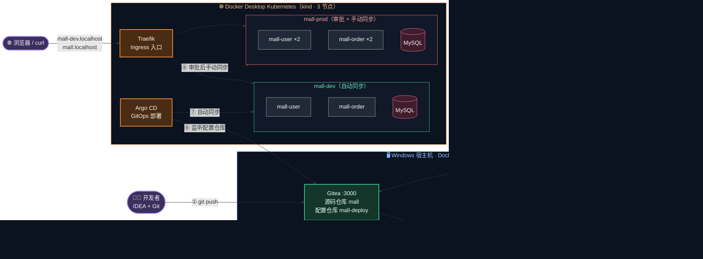

# CI/CD 实战教程：从 `git push` 到 Kubernetes 自动上线

> 面向 **Java 开发工程师** 的 CI/CD 实战课。目标不是把你培养成运维，而是让你**看懂、会用、能排错**公司里的整条交付流水线。
> 全程在 **Windows + Docker Desktop** 上完成，每一步都有命令、预期结果和原理讲解。

---

## 一、学完你能做到什么

- 说清楚 CI、CD、GitOps 分别解决什么问题，以及一次代码提交是如何"流"到生产环境的
- 独立编写 **Dockerfile**（分层构建）、**Jenkinsfile**（声明式流水线）、**K8s YAML**、**Helm Chart**
- 搭建并串联 **Gitea → Jenkins → SonarQube → 镜像仓库 → Argo CD → Kubernetes** 全链路
- 掌握多环境发布、审批、滚动更新、回滚这些日常开发中真正会遇到的场景
- 出问题时知道去哪看日志、用什么命令定位

## 二、全景架构



同一张图的文字版（在不支持 Mermaid 的环境中查看）：

```text
                         ┌──────────────────── 宿主机 Docker（docker compose）─────────────────────┐
 开发者 ──① git push──▶  │  Gitea :3000 ──② webhook──▶ Jenkins :8080 ──③ 扫描──▶ SonarQube :9000   │
                         │  ├ mall        (源码)            │ mvn 测试 → docker build              │
                         │  └ mall-deploy (部署配置) ◀─⑤改tag┘          │ ④ docker push            │
                         │                                              ▼                          │
                         │                                      Registry :5000                     │
                         └─────────────▲──────────────────────────────────────────────────────────┘
                                       │ ⑥ 拉取部署配置（GitOps）
                         ┌─────────────┴────────── Docker Desktop K8s（kind 3 节点）──────────────┐
                         │  Argo CD ──⑦ 自动同步──▶ mall-dev   (mall-user / mall-order / MySQL)   │
                         │          ──⑧ 手动同步──▶ mall-prod  (mall-user×2 / mall-order×2 / MySQL)│
                         │  Traefik ◀── 浏览器访问 http://mall-dev.localhost / http://mall.localhost│
                         └────────────────────────────────────────────────────────────────────────┘
```

## 三、章节目录

| 章 | 标题 | 你将学会 | 涉及组件 |
|---|---|---|---|
| 00 | [导学：CI/CD 全景与组件选型](docs/00-overview.md) | CI/CD/GitOps 概念、组件选型理由、学习路线 | — |
| 01 | [环境准备](docs/01-environment.md) | Docker Desktop 与 K8s 检查、Git Bash、Helm、网络加速 | Docker Desktop、kubectl、Helm |
| 02 | [练习项目 mall：调研、设计与本地运行](docs/02-project-mall.md) | 微服务项目结构、配置外部化、单元测试 | Spring Boot 4、Maven、MySQL |
| 03 | [Docker 化：分层镜像与 Compose 联调](docs/03-docker.md) | 生产级 Dockerfile、镜像分层、多容器联调 | Docker、Docker Compose |
| 04 | [一键搭建 CI 基础设施](docs/04-ci-infra.md) | 用 Compose 编排 Gitea / Registry / SonarQube / Jenkins | Docker Compose |
| 05 | [Gitea：代码托管](docs/05-gitea.md) | 组织/仓库、推送代码、访问令牌 | Gitea、Git |
| 06 | [Jenkins：第一条流水线](docs/06-jenkins-ci.md) | 凭据、多分支流水线、Jenkinsfile、Webhook 自动触发 | Jenkins |
| 07 | [SonarQube：代码扫描与质量门禁](docs/07-sonarqube.md) | 覆盖率、质量门禁、门禁失败阻断流水线 | SonarQube、JaCoCo |
| 08 | [镜像构建与推送私有仓库](docs/08-image-registry.md) | 镜像命名与 tag 策略、仓库认证 | Docker Registry |
| 09 | [Kubernetes 核心概念与手工部署](docs/09-kubernetes.md) | Pod/Deployment/Service/ConfigMap/Secret/StatefulSet/探针 | Kubernetes、kubectl |
| 10 | [Helm 与 Ingress](docs/10-helm-ingress.md) | 用 Helm 装软件、写 Chart、多环境 values、域名路由 | Helm、Traefik |
| 11 | [Argo CD：GitOps 持续部署](docs/11-argocd-gitops.md) | Application、自动同步、自愈、剪枝 | Argo CD |
| 12 | [全链路打通：从 git push 到自动上线](docs/12-end-to-end.md) | 流水线更新 GitOps 仓库，端到端演示 | 全部 |
| 13 | [生产发布：审批、晋升与回滚](docs/13-release-rollback.md) | Build Once Deploy Many、审批、滚动更新、回滚 | Jenkins、Argo CD、K8s |
| 14 | [排错手册、资源清理与进阶路线](docs/14-troubleshooting.md) | 常见故障定位、命令速查、下一步学什么 | — |

> 建议按顺序学习，每章都依赖前一章的成果。完整走一遍大约需要 **3～5 天**（每天 2～3 小时）。

## 四、仓库目录说明

```text
cicd-study/                    ← 教程资料（本目录，只读参考）
├── README.md                  ← 你正在看的总览
├── docs/                      ← 15 个章节
├── mall/                      ← 练习项目源码      → 第 5 章推送到 Gitea 的 mall/mall 仓库
├── mall-deploy/               ← GitOps 部署配置   → 第 5 章推送到 Gitea 的 mall/mall-deploy 仓库
├── infra/                     ← CI 基础设施（docker compose、Jenkins 镜像、Argo CD 安装参数）
└── k8s-basics/                ← 第 9 章手写的 K8s 清单
```

**动手实验统一在独立的工作目录 `D:\cicd-lab`（Git Bash 中为 `/d/cicd-lab`）中进行**，第 1 章会带你把上面的资料复制过去。这样既不会污染教程资料，也避免了"仓库套仓库"的 Git 问题。

## 五、全局约定（遇到不确定的地方，以这里为准）

### 5.1 访问地址与账号

| 组件 | 浏览器访问地址 | 账号 | 密码 / 获取方式 |
|---|---|---|---|
| Gitea | http://host.docker.internal:3000 | `mall-admin` | `Admin@123456` |
| Jenkins | http://host.docker.internal:8080 | `admin` | `Admin@123456` |
| SonarQube | http://localhost:9000 | `admin` | 初始 `admin`，首次登录改为 `Admin@123456` |
| Docker Registry | `localhost:5000`（无界面，用 API 查看） | `admin` | `Admin@123456` |
| Argo CD | http://argocd.localhost | `admin` | 初始密码从 Secret 读取（第 11 章） |
| 应用 · 开发环境 | http://mall-dev.localhost/api/users | — | — |
| 应用 · 生产环境 | http://mall.localhost/api/users | — | — |
| MySQL · Compose 联调 | `localhost:3307` | `mall` / `root` | `mall123` / `root123` |
| MySQL · K8s 内 | `mysql:3306`（集群内） | `mall` / `root` | `mall123` / `root123` |

> 💡 `*.localhost` 域名会被浏览器和 curl 自动解析到 `127.0.0.1`，**不需要修改 hosts 文件**。
> 💡 `host.docker.internal` 由 Docker Desktop 自动写入 Windows hosts 文件，浏览器、容器、K8s Pod 都能用它访问宿主机。

### 5.2 端口占用一览

| 端口 | 占用者 | 端口 | 占用者 |
|---|---|---|---|
| 80 / 443 | Traefik（K8s Ingress 入口） | 5000 | Docker Registry |
| 3000 | Gitea | 8080 | Jenkins |
| 3307 | Compose 中的 MySQL | 8081 / 8082 | mall-user / mall-order（本地运行时） |
| 9000 | SonarQube | | |

### 5.3 命名约定

| 类别 | 名称 | 说明 |
|---|---|---|
| Gitea 组织 | `mall` | |
| Gitea 仓库 | `mall`、`mall-deploy` | 源码仓库、GitOps 配置仓库，默认分支均为 `main` |
| 镜像名 | `localhost:5000/mall/<服务名>:<tag>` | 手工构建用 `v1`，流水线用 Git 提交短哈希（7 位） |
| K8s 命名空间 | `mall-lab` | 第 9、10 章练习用，学完删除 |
| | `traefik`、`argocd` | 基础组件 |
| | `mall-dev`、`mall-prod` | 开发环境、生产环境 |
| Jenkins 任务 | `mall` | 多分支流水线（Multibranch Pipeline） |
| | `mall-promote-prod` | 生产发布（晋升）流水线 |

### 5.4 Jenkins 凭据（Credentials）

| 凭据 ID | 类型（Kind） | 内容 | 使用者 |
|---|---|---|---|
| `gitea-token` | Gitea Personal Access Token | Gitea 访问令牌 | Gitea 服务器配置（管理 Webhook）、多分支流水线拉代码 |
| `gitea-cred` | Username with password | `mall-admin` + Gitea 访问令牌 | 流水线中推送 mall-deploy、生产发布任务拉代码 |
| `sonar-token` | Secret text | SonarQube 用户令牌 | Jenkins 连接 SonarQube |
| `registry-cred` | Username with password | `admin` + `Admin@123456` | 推送镜像到 Registry |

## 六、本机环境（编写教程时实测）

| 项目 | 版本 / 配置 |
|---|---|
| 操作系统 | Windows 11 |
| Docker Desktop | 4.86（Engine 29.7，containerd 镜像存储） |
| Kubernetes | v1.36（Docker Desktop 内置，**kind 模式，3 节点**） |
| JDK / Maven | 21 / 3.9.9 |
| Spring Boot | 4.1.1 |
| Gitea / Jenkins / SonarQube | 28.1.0 / LTS(JDK21) / 26.9 Community |
| Argo CD / Traefik | Helm Chart 最新稳定版 |

开始学习 👉 [第 0 章 导学：CI/CD 全景与组件选型](docs/00-overview.md)
