# 第 0 章 导学：CI/CD 全景与组件选型

> 动手之前，先把整张地图看明白：CI/CD 要解决什么问题，一次代码提交会经过哪些组件，以及每个组件为什么选它而不选别的。

---

## 本章目标

学完本章，你应该能够：

1. 用自己的话说清楚 **CI（持续集成）**、**持续交付**、**持续部署**、**GitOps** 四个概念的区别
2. 画出"一次代码提交从 `git push` 到线上生效"要经过的 **8 个关键步骤**
3. 说出本教程用到的每个组件（Gitea、Jenkins、SonarQube、Registry、Kubernetes、Helm、Traefik、Argo CD）**负责什么**
4. 说明每类组件的主流选择，以及本教程**为什么这么选**
5. 区分 **Push 模式**（Jenkins 直接部署）和 **Pull 模式**（Argo CD GitOps）
6. 清楚整个课程的 4 个阶段和每章的产出，知道遇到问题该去哪里找答案

本章只讲概念，不动手。预计阅读时间 **40 分钟**。

---

## 本章在全景中的位置

```mermaid
flowchart LR
    c0["第 0 章<br/>导学：全景与选型"]:::focus

    subgraph S1["阶段一 · 打基础"]
        direction TB
        c1["01 环境准备"]:::app
        c2["02 练习项目 mall"]:::app
        c3["03 Docker 化"]:::app
    end

    subgraph S2["阶段二 · 持续集成 CI"]
        direction TB
        c4["04 CI 基础设施"]:::ci
        c5["05 Gitea"]:::scm
        c6["06 Jenkins"]:::ci
        c7["07 SonarQube"]:::ci
        c8["08 镜像仓库"]:::ci
    end

    subgraph S3["阶段三 · 持续部署 CD"]
        direction TB
        c9["09 Kubernetes"]:::cd
        c10["10 Helm + Ingress"]:::cd
        c11["11 Argo CD"]:::cd
    end

    subgraph S4["阶段四 · 串联与发布"]
        direction TB
        c12["12 全链路打通"]:::focus2
        c13["13 发布与回滚"]:::focus2
        c14["14 排错与进阶"]:::focus2
    end

    c0 --> S1 --> S2 --> S3 --> S4

    classDef focus fill:#713f12,stroke:#facc15,stroke-width:3px,color:#fefce8
    classDef focus2 fill:#3b2f5c,stroke:#a78bfa,stroke-width:2px,color:#f5f3ff
    classDef scm fill:#14352a,stroke:#34d399,stroke-width:2px,color:#ecfdf5
    classDef ci fill:#1e3a5f,stroke:#60a5fa,stroke-width:2px,color:#eff6ff
    classDef cd fill:#4a2c12,stroke:#fb923c,stroke-width:2px,color:#fff7ed
    classDef app fill:#1f2937,stroke:#9ca3af,stroke-width:1px,color:#f9fafb
    style S1 fill:#0b1220,stroke:#9ca3af,color:#e5e7eb
    style S2 fill:#0b1220,stroke:#60a5fa,color:#93c5fd
    style S3 fill:#0b1220,stroke:#fb923c,color:#fdba74
    style S4 fill:#0b1220,stroke:#a78bfa,color:#c4b5fd
```

你现在站在最左边黄色的位置。接下来 14 章，我们会一个组件一个组件地搭起来，最后在第 12 章把它们全部串成一条完整的流水线。

---

## 0.1 先回忆一下：没有 CI/CD 的日子

作为 Java 开发，你一定经历过（或者听前辈讲过）这样的上线流程：

```text
周五晚上 8 点，准备上线……

 1. 在自己电脑上 git pull，然后 mvn clean package -DskipTests      ← 测试？上线要紧，先跳过
 2. 打开 WinSCP / FinalShell，把 xxx.jar 拖到服务器 /opt/app/ 下   ← 传错了版本怎么办？
 3. ssh 登录服务器，ps -ef | grep java 找到旧进程，kill -9         ← 正在处理的请求全断了
 4. nohup java -jar xxx.jar > app.log 2>&1 &                       ← 启动参数和上次一样吗？
 5. tail -f app.log，盯着日志看有没有报错                          ← 报错了，赶紧回滚……
 6. 回滚？上一个版本的 jar 呢？好像被覆盖了……                      ← 😱
 7. 测试同学："我这边测试环境是好的啊"
    开发同学："我本地也是好的啊"                                    ← 环境不一致
```

这个流程有一堆问题，我们把它们整理一下：

| 痛点 | 具体表现 | CI/CD 怎么解决 |
|---|---|---|
| **全靠手工** | 打包、上传、重启都要人操作，步骤多、容易漏 | 流水线自动执行，每一步都写在代码里（Jenkinsfile） |
| **质量没保障** | 赶时间就 `-DskipTests`，代码规范没人检查 | 单元测试 + 代码扫描 + 质量门禁，不达标直接拦截 |
| **环境不一致** | "我本地是好的"——JDK 版本、依赖、配置都可能不同 | 用 Docker 镜像把"应用 + 运行环境"打包成一个不可变的整体 |
| **版本不可追溯** | 线上跑的 jar 到底是哪次提交打出来的？说不清 | 镜像 tag = Git 提交哈希，任何一个运行中的版本都能精确追溯到源码 |
| **发布有中断** | kill 旧进程到新进程启动之间，服务不可用 | Kubernetes 滚动更新：新实例就绪后才下线旧实例 |
| **回滚靠运气** | 旧 jar 被覆盖、启动参数记不清 | 每个版本的镜像都保留在仓库里，回滚 = 切回旧的 tag |
| **谁改了什么不知道** | 有人直接登录服务器改了配置，没人知道 | GitOps：一切变更都通过 Git 提交，有记录、可审计、可回退 |

用一张图对比一下"手工发布"和"CI/CD 自动发布"：

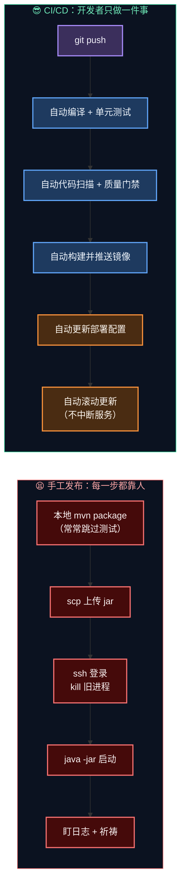

> 💡 **一句话总结**：CI/CD 的本质，是把"上线"这件事从**一项依赖个人经验的手艺**，变成**一段可以被版本管理、被反复执行、被审计的代码**。这和我们用代码代替手工 SQL 运维、用单元测试代替手工点点点，是同一个思路。

---

## 0.2 四个核心概念：CI、持续交付、持续部署、GitOps

这四个词经常被混着说，我们一次性把它们讲清楚。

### 0.2.1 用一条流水线来理解

把"代码变成线上服务"看成一条流水线，四个概念的区别在于**自动化覆盖到哪一步**：

```text
 提交代码 → 编译 → 单元测试 → 代码扫描 → 构建镜像 → 部署测试环境 → [人工审批] → 部署生产环境
 │                                    │                                         │
 └──────────── 持续集成 CI ───────────┘                                         │
 │                                                              │               │
 └────────────────────── 持续交付 Continuous Delivery ──────────┘ 生产需人点头  │
 │                                                                              │
 └──────────────────────── 持续部署 Continuous Deployment ─────────────────────┘ 全自动
```

| 概念 | 英文 | 核心问题 | 产出 | 典型触发 |
|---|---|---|---|---|
| **持续集成** | Continuous Integration（CI） | "我的代码和大家的代码合在一起，还能编译通过、测试通过吗？" | 通过测试的代码 + 测试报告 + 质量报告 | 每次 push / 每个合并请求 |
| **持续交付** | Continuous Delivery（CD） | "这个版本随时**可以**上生产吗？" | 可部署的制品（镜像），已在测试环境验证 | CI 通过后自动部署到测试环境；生产**由人决定** |
| **持续部署** | Continuous Deployment（CD） | "通过所有检查的版本，能不能**直接**上生产？" | 已上线的新版本 | 全自动，没有人工审批环节 |
| **GitOps** | GitOps | "怎么保证集群里跑的，和 Git 里写的一模一样？" | 集群状态 = Git 仓库中的声明 | 部署工具持续监听 Git 仓库 |

> 🧠 **两个 CD 的区别**：持续**交付**和持续**部署**的唯一区别，就是"上生产前有没有人工审批"。
> 金融、电商这类对稳定性要求高的公司，生产环境基本都是**持续交付**（要审批）；互联网公司的非核心服务常用**持续部署**。
> 本教程两种都会做：**开发环境 `mall-dev` 是持续部署**（push 后自动上线），**生产环境 `mall-prod` 是持续交付**（Jenkins 审批 + Argo CD 手动同步）。

### 0.2.2 GitOps 是什么

GitOps 不是一个新工具，而是一种**部署方式**：

1. 把"应用应该以什么样子运行"（镜像版本、副本数、配置……）**全部写成 YAML 放进 Git 仓库**
2. 集群里运行一个"同步器"（本教程用 Argo CD），**不停地对比 Git 中的期望状态和集群中的实际状态**
3. 一旦不一致，就把集群**拉回到 Git 中描述的样子**

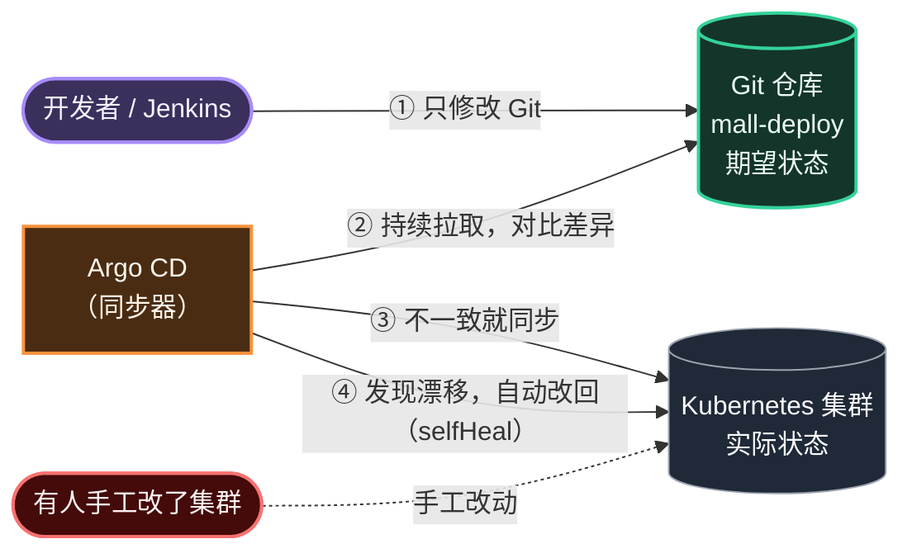

用 Java 开发熟悉的东西类比：

| GitOps 概念 | Java 世界里的类比 |
|---|---|
| Git 仓库里的 YAML | 数据库表结构的 Flyway 迁移脚本——"表应该长什么样"写在代码里 |
| Argo CD 持续对比、同步 | Spring 的 `@Scheduled` 定时任务，每 60 秒检查一次，不一致就修复 |
| 回滚 = `git revert` | 回滚代码 = `git revert`，部署也是同一套操作 |
| 禁止手工改集群 | 禁止直接连生产库手工改数据，一切走变更脚本 |

---

## 0.3 一次提交的旅程

下面这张时序图，就是你在第 12 章完成后会亲眼看到的完整过程。**建议把它打印出来，每学完一章就回来看看自己走到了哪一步。**

```mermaid
---
config:
  theme: dark
---
sequenceDiagram
    autonumber
    actor Dev as 开发者
    participant Git as Gitea<br/>mall 源码仓库
    participant CI as Jenkins
    participant SQ as SonarQube
    participant Reg as Registry<br/>镜像仓库
    participant Cfg as Gitea<br/>mall-deploy 配置仓库
    participant CD as Argo CD
    participant K8s as Kubernetes
    actor User as 用户

    Dev->>Git: git push（main 分支）
    Git->>CI: Webhook："有新提交了"
    rect rgb(30, 58, 95)
    Note over CI,Reg: 持续集成 CI（第 6~8 章）
    CI->>Git: 拉取最新代码
    CI->>CI: mvn clean verify<br/>编译 + 单元测试 + 覆盖率
    CI->>SQ: mvn sonar:sonar 上传分析结果
    SQ-->>CI: Webhook 回调：质量门禁结果
    alt 门禁未通过
        CI-->>Dev: ❌ 流水线失败，后续步骤全部跳过
    else 门禁通过
        CI->>Reg: docker build + docker push<br/>tag = Git 提交短哈希
    end
    end
    rect rgb(74, 44, 18)
    Note over CI,K8s: 持续部署 CD · GitOps（第 9~12 章）
    CI->>Cfg: 修改 envs/dev/*.yaml 中的 image.tag 并推送
    CD->>Cfg: 每 60 秒拉取一次，发现新提交
    CD->>K8s: 渲染 Helm Chart 并应用到 mall-dev
    K8s->>K8s: 滚动更新：新 Pod 就绪后再下线旧 Pod
    end
    User->>K8s: 访问 http://mall-dev.localhost/api/users
    K8s-->>User: 新版本响应 ✅
```

我们把这 13 步归纳成 8 个关键步骤，和 README 全景图里的编号一一对应：

| 编号 | 步骤 | 谁来做 | 在哪一章学 |
|---|---|---|---|
| ① | 开发者推送代码 | 开发者 + Git | 第 5 章 |
| ② | 代码仓库通知流水线 | Gitea Webhook → Jenkins | 第 6 章 |
| ③ | 编译、测试、代码扫描、质量门禁 | Jenkins + Maven + SonarQube | 第 6、7 章 |
| ④ | 构建并推送镜像 | Jenkins + Docker + Registry | 第 8 章 |
| ⑤ | 修改部署配置中的镜像版本 | Jenkins → mall-deploy 仓库 | 第 12 章 |
| ⑥ | 部署工具发现配置变化 | Argo CD 监听 mall-deploy | 第 11 章 |
| ⑦ | 自动部署到开发环境 | Argo CD → Kubernetes | 第 9~11 章 |
| ⑧ | 审批后手动发布到生产环境 | Jenkins 审批 + Argo CD 手动同步 | 第 13 章 |

> 💡 注意第 ⑤ 步：**Jenkins 并不直接操作 Kubernetes**，它只是改了一个 Git 仓库里的 YAML 文件。真正"部署"的动作由 Argo CD 完成。这个设计非常关键，我们在 [0.6 节](#06-push-模式-vs-pull-模式) 专门讲它的好处。

---

## 0.4 组件全家桶：每个组件负责什么

### 0.4.1 组件一览

| 组件 | 一句话职责 | 生活类比（把软件交付想象成"开连锁餐厅"） | 本教程版本 |
|---|---|---|---|
| **Git** | 管理源码的每一次变更 | 菜谱的修订记录 | 本机已安装 |
| **Gitea** | 托管 Git 仓库，提供网页、权限、Webhook | 总部的菜谱档案室，菜谱一改就通知厨房 | 28.1.0 |
| **Maven** | 编译、测试、打包 Java 项目 | 按菜谱备料、切配 | 3.9.x |
| **JaCoCo** | 统计单元测试覆盖率 | 记录每道工序有没有被试吃过 | 0.8.14 |
| **Jenkins** | 按 Jenkinsfile 自动执行构建步骤 | 中央厨房的**厨师长**，按流程指挥所有工序 | LTS（JDK 21） |
| **SonarQube** | 代码质量扫描 + 质量门禁 | **质检员**，不合格的菜不许出厨房 | 26.9 Community |
| **Docker** | 把应用 + 运行环境打包成镜像 | 把菜做成**标准化的预制菜**，到哪家门店味道都一样 | Docker Desktop 4.86 |
| **Docker Registry** | 存放、分发镜像 | 预制菜**冷库** | registry:2 |
| **Kubernetes** | 运行和管理容器：调度、自愈、扩缩容、滚动更新 | **连锁门店的运营系统**：哪家店开几个灶、坏了自动换 | v1.36（kind 3 节点） |
| **Helm** | Kubernetes 应用的模板与打包工具 | **标准门店装修方案**，各门店只需改面积、桌数等参数 | 3.x / 4.x 均可 |
| **Traefik** | Ingress 控制器：按域名/路径把外部请求转发给服务 | 商场**大门和导购**，按顾客要去的店把人带过去 | Helm Chart 最新稳定版 |
| **Argo CD** | GitOps 部署：让集群状态与 Git 保持一致 | **巡店督导**，拿着总部标准逐店检查，不一致立刻纠正 | Helm Chart 最新稳定版 |

### 0.4.2 组件关系图

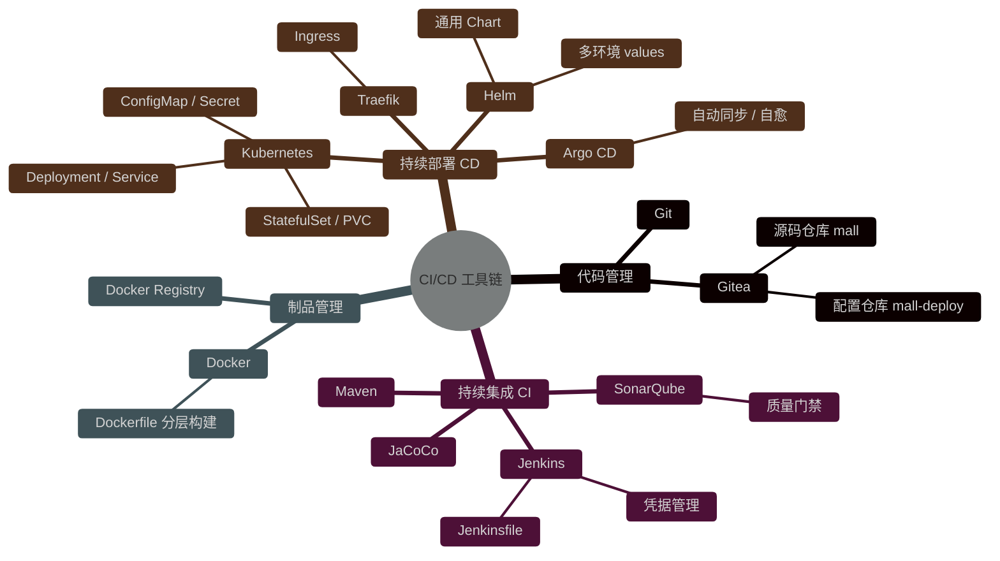

### 0.4.3 资源占用预估

全部组件同时运行时，大致的内存占用如下（实测量级，非精确值）：

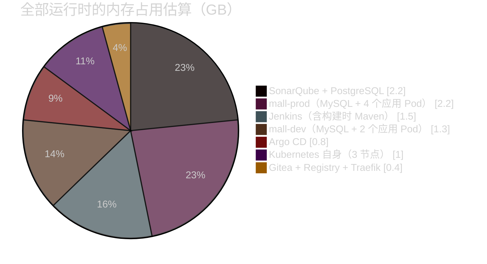

合计约 **9GB**。你本机 Docker 可用内存约 15.5GB，完全够用。如果你的机器内存较小，第 1 章会教你怎么调整，第 14 章会教你怎么按需暂停组件。

---

## 0.5 选型调研：为什么是这些组件

CI/CD 每个环节都有好几种主流选择。选型时我们考虑四个维度：

| 维度 | 说明 |
|---|---|
| **企业普及度** | 学了能直接用在工作中，优先选国内企业用得最多的 |
| **本地资源占用** | 全部跑在一台 Windows 笔记本的 Docker Desktop 里，不能太重 |
| **学习价值** | 能暴露核心概念，而不是把细节全藏起来 |
| **可迁移性** | 学会之后换成同类的其它工具，成本低 |

下面逐类分析。

### 0.5.1 代码托管

| 方案 | 特点 | 资源占用 | 企业使用情况 | 本教程 |
|---|---|---|---|---|
| **GitLab CE** | 功能最全，自带 GitLab CI、制品库 | 重：单机至少 4GB 内存，推荐 8GB | 国内企业私有化部署**最多** | ❌ 太重 |
| **GitHub** | 全球最大的代码托管平台，自带 GitHub Actions | 云服务，本地不占资源 | 开源项目、外企常用 | ❌ 本地 K8s 访问它、它回调本地 Jenkins 都需要内网穿透 |
| **Gitea** | Go 编写的轻量 Git 服务，界面和 GitHub 类似，支持 Webhook、组织、令牌、Gitea Actions | 轻：约 100~200MB | 中小团队、内网环境常用 | ✅ **选它** |

**结论**：选 **Gitea**。它提供了 CI/CD 需要的全部能力（仓库、组织、权限、访问令牌、Webhook），资源占用只有 GitLab 的零头。你在 Gitea 里学到的"创建令牌、配置 Webhook、保护分支"，在 GitLab / GitHub 中几乎一模一样。

### 0.5.2 持续集成（CI 引擎）

| 方案 | 流水线定义 | 特点 | 企业使用情况 | 本教程 |
|---|---|---|---|---|
| **Jenkins** | `Jenkinsfile`（Groovy DSL） | 老牌开源 CI，插件生态极其丰富，可对接任何代码仓库 | 国内企业**存量最大**，面试必问 | ✅ **选它** |
| **GitLab CI** | `.gitlab-ci.yml` | 与 GitLab 深度集成，开箱即用 | 用 GitLab 的公司常用 | 第 14 章对照 |
| **GitHub Actions** | `.github/workflows/*.yml` | 生态好、市场插件多 | 开源项目标配 | 第 14 章对照 |
| **Gitea Actions** | 兼容 GitHub Actions 语法 | 需要单独部署 Runner | 较新，使用面还不广 | 第 14 章对照 |
| **Tekton** | Kubernetes CRD | 云原生，每个步骤都是一个 Pod | 平台型团队使用，学习曲线陡 | ❌ 对初学者太抽象 |

**结论**：选 **Jenkins**。理由很现实——你去大多数国内公司，大概率会碰到 Jenkins。而且 Jenkins 的核心概念（流水线、阶段、步骤、凭据、制品、触发器）在所有 CI 工具中都通用，第 14 章会给出 Jenkinsfile 与 GitLab CI / GitHub Actions 的对照表。

### 0.5.3 代码质量

| 方案 | 特点 | 本教程 |
|---|---|---|
| **SonarQube** | 业界事实标准：Bug、漏洞、坏味道、重复代码、覆盖率、**质量门禁** | ✅ **选它**（Community 免费版） |
| Checkstyle / PMD / SpotBugs | Maven 插件形式的静态检查，无统一平台 | 可作为补充 |
| 阿里巴巴 Java 规约插件（P3C） | IDE 插件，侧重编码规范 | 可作为补充 |

> ⚠️ SonarQube **社区版（Community Build）只支持分析一个分支**，所以我们的流水线只在 `main` 分支上执行代码扫描；分支分析、PR 评论等能力需要商业版。这在第 7 章会详细说明。

### 0.5.4 制品库（镜像仓库）

这是本教程**唯一一个"没有选企业最常用方案"**的地方，必须给你讲清楚原因。

| 方案 | 特点 | 资源占用 | 企业使用情况 | 本教程 |
|---|---|---|---|---|
| **Harbor** | CNCF 毕业项目：项目隔离、权限、漏洞扫描、镜像复制、Web 界面 | 官方最低要求 2 核 4GB；离线安装包依赖 Linux 的 bash 脚本 | 国内企业私有镜像仓库**事实标准** | ⚠️ 第 8、14 章对照讲解 |
| **Nexus Repository** | 一个平台同时管 Maven、npm、Docker 等多种制品 | 约 2GB | Java 团队常用来做 Maven 私服 | 第 14 章提及 |
| **Docker Registry** | Docker 官方的镜像仓库最小实现（Harbor 的存储核心也是它） | 极轻：约 20MB | 小团队、测试环境 | ✅ **选它** |
| **云厂商镜像服务** | 阿里云 ACR、腾讯云 TCR、AWS ECR 等，免运维 | 云服务 | 上云企业常用 | 第 14 章提及 |

**为什么本地不用 Harbor？** 两个原因，都是在本机**实测**得出的：

1. **在 Windows 上安装麻烦且重**：Harbor 官方离线安装包需要在 Linux 环境中执行 `install.sh`；用 Helm 装进 K8s 则要起 7~8 个 Pod，占用 2GB 以上内存。
2. **装了也发挥不出作用**：Docker Desktop 的 kind 集群拉取镜像时，统一经过 Docker Desktop 内置的一个镜像代理（`registry-mirror`）。这个代理会**优先从本机 Docker 镜像库里取**，本机没有时**只会用 HTTPS 去上游仓库拉**。本地自建的仓库（无论 Harbor 还是 Registry）一般是 HTTP，集群根本不会去它那里拉镜像。

既然如此，用最轻量的 Docker Registry 就够了。**对开发工程师来说，Harbor 和 Registry 的日常操作完全一样**：

```bash
docker login <仓库地址>                                # 登录
docker tag  mall-user:local <仓库地址>/mall/mall-user:v1   # 打标签
docker push <仓库地址>/mall/mall-user:v1                 # 推送
```

唯一的区别是镜像地址：本教程是 `localhost:5000/mall/mall-user:v1`，公司里可能是 `harbor.xxx.com/mall/mall-user:v1`。第 9 章会专门讲"本地集群镜像从哪来"与"生产集群镜像从哪来"的区别。

### 0.5.5 Kubernetes 应用打包

| 方案 | 思路 | 特点 | 本教程 |
|---|---|---|---|
| **原生 YAML + kubectl** | 直接写 Deployment、Service 等资源清单 | 最直观，但多环境时大量重复 | ✅ 第 9 章先手写，打基础 |
| **Kustomize** | 基础 YAML + 各环境补丁（overlay） | kubectl 内置，无模板语法 | 第 10 章对比提及 |
| **Helm** | Go 模板 + values 参数文件，还是 K8s 的"包管理器" | 第三方软件（Traefik、Argo CD、MySQL……）基本都用 Helm 分发 | ✅ **第 10 章重点** |

**结论**：先手写原生 YAML 理解每个资源，再用 **Helm** 把它模板化。我们会写一个**通用的 Spring Boot Chart**（`springboot-app`），mall 的每个服务、每个环境都复用它，差异全部放在 values 文件里——这正是很多公司"运维提供标准 Chart，开发只改 values"的工作方式。

### 0.5.6 持续部署（CD）

| 方案 | 模式 | 特点 | 本教程 |
|---|---|---|---|
| **Jenkins 直接 kubectl / helm** | Push（推） | 简单直接，很多公司起步时这么做 | 第 0.6 节对比讲解 |
| **Argo CD** | Pull（拉）/ GitOps | CNCF 毕业项目，**Web 界面直观**，能看到每个资源的同步状态和差异 | ✅ **选它** |
| **Flux CD** | Pull（拉）/ GitOps | CNCF 毕业项目，更轻量，但没有内置 Web 界面 | 第 14 章提及 |

**结论**：选 **Argo CD**。它的可视化界面对学习帮助巨大——你能直观地看到"Git 里写的"和"集群里跑的"哪里不一样。

### 0.5.7 流量入口（Ingress 控制器）

| 方案 | 现状 | 本教程 |
|---|---|---|
| **ingress-nginx** | 过去最常用的 Ingress 控制器。Kubernetes 官方 2025 年 11 月宣布退役，**2026 年 3 月已正式退役**，不再有任何更新（包括安全补丁） | ❌ 已退役 |
| **Traefik** | 成熟的云原生网关，**同时支持 Ingress 和 Gateway API**，Helm 一条命令安装 | ✅ **选它** |
| **Gateway API 实现**（Envoy Gateway、NGINX Gateway Fabric、Istio 等） | Kubernetes 官方推荐的下一代流量 API | 第 14 章进阶 |

> 🧠 注意区分：**退役的是 ingress-nginx 这个"控制器"，不是 Ingress 这个"API"**。`kind: Ingress` 资源仍然是 Kubernetes 的标准 API，换一个控制器（Traefik）就能继续用。企业里现存的大量 Ingress 配置，你学了照样看得懂。

### 0.5.8 本地 Kubernetes

| 方案 | 特点 | 本教程 |
|---|---|---|
| **Docker Desktop 内置 K8s** | 勾选即用；新版支持 **kind 模式（多节点）** | ✅ **选它**（你已安装，3 节点） |
| minikube | 老牌本地 K8s，需单独安装 | ❌ |
| kind（独立版） | 用容器模拟节点，CI 测试常用 | ❌ Docker Desktop 已内置 |
| k3d / k3s | 轻量发行版 | ❌ |

### 0.5.9 选型总表

```mermaid
flowchart LR
    subgraph SCM["代码托管"]
        g1["GitLab CE"]:::app
        g2["GitHub"]:::app
        g3["✅ Gitea"]:::focus
    end
    subgraph CIE["CI 引擎"]
        j1["✅ Jenkins"]:::focus
        j2["GitLab CI"]:::app
        j3["GitHub / Gitea Actions"]:::app
        j4["Tekton"]:::app
    end
    subgraph ART["镜像仓库"]
        r1["Harbor（对照讲解）"]:::app
        r2["Nexus"]:::app
        r3["✅ Docker Registry"]:::focus
    end
    subgraph DEP["打包 / 部署"]
        h1["✅ Helm"]:::focus
        h2["Kustomize"]:::app
        a1["✅ Argo CD"]:::focus
        a2["Flux"]:::app
    end
    subgraph ING["流量入口"]
        i1["ingress-nginx（已退役）"]:::warn
        i2["✅ Traefik"]:::focus
        i3["Gateway API 实现"]:::app
    end

    SCM --> CIE --> ART --> DEP --> ING

    classDef focus fill:#713f12,stroke:#facc15,stroke-width:3px,color:#fefce8
    classDef app fill:#1f2937,stroke:#9ca3af,stroke-width:1px,color:#f9fafb
    classDef warn fill:#450a0a,stroke:#f87171,stroke-width:2px,color:#fef2f2
    style SCM fill:#0b1220,stroke:#34d399,color:#6ee7b7
    style CIE fill:#0b1220,stroke:#60a5fa,color:#93c5fd
    style ART fill:#0b1220,stroke:#60a5fa,color:#93c5fd
    style DEP fill:#0b1220,stroke:#fb923c,color:#fdba74
    style ING fill:#0b1220,stroke:#fb923c,color:#fdba74
```

---

## 0.6 Push 模式 vs Pull 模式

这是 CD 环节最重要的一个设计决策，值得单独讲。

### 0.6.1 两种模式长什么样

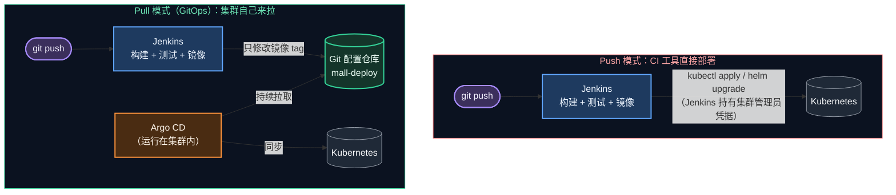

### 0.6.2 详细对比

| 对比项 | Push 模式（Jenkins 直接部署） | Pull 模式（Argo CD GitOps） |
|---|---|---|
| **集群凭据放在哪** | Jenkins 里存着集群管理员 kubeconfig，Jenkins 被攻破 = 集群被攻破 | Argo CD 在集群内部运行，外部系统不需要集群凭据 |
| **"线上跑的是什么版本"** | 要去翻 Jenkins 构建记录 | 直接看 Git 仓库，所见即所得 |
| **有人手工改了集群** | 发现不了，下次部署前一直是"脏"的 | Argo CD 立即发现漂移（OutOfSync），可自动改回 |
| **回滚** | 找到旧的构建记录重新执行 | `git revert` 一个提交 |
| **审计** | Jenkins 日志（会被清理） | Git 提交历史（永久保留，谁、何时、改了什么） |
| **多集群** | 每个集群都要在 Jenkins 配凭据 | 每个集群各自拉取，天然支持 |
| **上手难度** | 简单 | 多一个组件、多一个仓库 |

> 💡 **本教程的做法 = 两者结合**：Jenkins 负责 CI（构建、测试、扫描、镜像）+ 修改 Git 配置仓库；Argo CD 负责 CD（把 Git 配置同步到集群）。这也是目前业界最主流的做法。
> 你会看到 Jenkinsfile 里**没有任何一行 `kubectl` 命令**。

### 0.6.3 为什么要拆成两个仓库

你可能会问：为什么不把 K8s 配置直接放在 `mall` 源码仓库里，而要单独建一个 `mall-deploy`？

```text
 mall（源码仓库）                          mall-deploy（配置仓库）
 ├── mall-user/       ← 开发改这里          ├── charts/springboot-app/  ← 部署模板
 ├── mall-order/                            ├── envs/dev/*.yaml         ← Jenkins 自动改 image.tag
 ├── Jenkinsfile      ← 流水线定义           ├── envs/prod/*.yaml        ← 审批后改 image.tag
 └── pom.xml                                 ├── infra/mysql/            ← 数据库
                                             └── argocd/                 ← Argo CD 应用定义
```

| 原因 | 说明 |
|---|---|
| **避免死循环** | 如果在同一个仓库，Jenkins 修改 image.tag 后 push，又会触发 Jenkins 构建…… |
| **职责分离** | 改代码和改部署配置的人、审批流程、权限通常不同 |
| **历史清晰** | 部署仓库的每一个提交都代表一次"部署变更"，回滚时一目了然 |
| **一个配置仓库可以管多个服务** | 环境级别的配置（如所有服务共用的 MySQL）有地方放 |

---

## 0.7 练习项目：mall 迷你商城

选练习项目时，我调研了市面上几个知名的 Java 微服务开源项目：

| 项目 | 简介 | 用来练 CI/CD 的问题 |
|---|---|---|
| **spring-petclinic-microservices** | Spring 官方社区的微服务示例：网关、配置中心、注册中心、3 个业务服务、监控 | 7~10 个容器，每个 512MB；依赖 Eureka、Config Server，在 K8s 里这些都是多余的 |
| **mall-swarm** | 国内很火的电商微服务项目 | 依赖 Nacos、Sentinel、Seata、RabbitMQ、ES、MongoDB、Redis……光中间件就要十几个 GB |
| **RuoYi-Cloud** | 国内很火的后台管理微服务脚手架 | 依赖 Nacos、Sentinel、Redis 等，同样很重 |

结论：这些项目**业务很完整，但对学习 CI/CD 来说太重了**——你会把 80% 的时间花在调中间件上，而不是学流水线。

所以本教程**参考上述项目的结构**，编写了一个精简但"五脏俱全"的迷你商城 `mall`：

```text
                         Ingress（Traefik）
                       /api/users   /api/orders
                          │              │
                          ▼              ▼
                  ┌─────────────┐  HTTP  ┌──────────────┐
                  │  mall-user  │◀───────│  mall-order  │   下单时远程调用用户服务校验用户
                  │   :8081     │        │    :8082     │
                  └──────┬──────┘        └──────┬───────┘
                         │ mall_user 库         │ mall_order 库
                         └──────────┬───────────┘
                                    ▼
                               ┌─────────┐
                               │  MySQL  │      每个服务独立数据库（Database per Service）
                               └─────────┘
```

它覆盖了实际项目中最常见的 CI/CD 场景：

| 场景 | 在 mall 中的体现 |
|---|---|
| 多模块 Maven 项目 | 父 POM + `mall-user` + `mall-order` |
| 服务间调用 | `mall-order` 通过 `RestClient` 调用 `mall-user`，K8s 中靠 Service DNS 发现，不需要注册中心 |
| 有状态依赖 | MySQL 用 StatefulSet + 持久卷部署 |
| 配置外部化 | 所有连接信息都可通过环境变量覆盖，K8s 中用 ConfigMap + Secret 注入 |
| 健康检查 | Actuator 的 liveness / readiness 端点，对接 K8s 探针 |
| 版本可观测 | `/api/users/version` 返回当前版本和 Pod 名，用来观察滚动更新、负载均衡、回滚 |
| 单元测试 + 覆盖率 | MockMvc + H2 内存库，CI 中无需真实数据库；JaCoCo 生成覆盖率报告 |

详细设计和代码讲解在 [第 2 章](02-project-mall.md)。学完整个教程后，第 14 章会布置一个"毕业作业"：把同样的流水线套到 spring-petclinic-microservices 上。

---

## 0.8 学习路线图

### 0.8.1 四个阶段

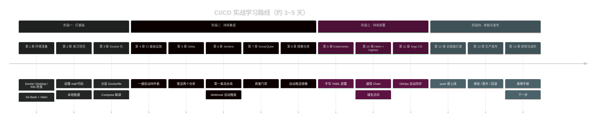

### 0.8.2 每章产出物一览

| 章 | 产出物（学完后你手里有什么） | 预计耗时 |
|---|---|---|
| 01 | 配置好的 Git Bash、Helm、实验目录 `/d/cicd-lab`、预拉取的镜像 | 1 小时 |
| 02 | 本地跑通的 `mall-user`、`mall-order`，通过的单元测试 | 1 小时 |
| 03 | `mall/mall-user:local`、`mall/mall-order:local` 镜像，Compose 全栈联调成功 | 1.5 小时 |
| 04 | 运行中的 Gitea、Registry、SonarQube、Jenkins | 1.5 小时 |
| 05 | Gitea 中的 `mall/mall`、`mall/mall-deploy` 两个私有仓库，访问令牌 | 1 小时 |
| 06 | Jenkins 多分支流水线 `mall`，push 自动触发构建 | 2 小时 |
| 07 | SonarQube 质量报告，质量门禁失败可以阻断流水线 | 1.5 小时 |
| 08 | 仓库中的 `v1` 镜像，流水线自动推送带 Git 哈希的镜像 | 1 小时 |
| 09 | 手工部署到 `mall-lab` 命名空间的完整应用，理解 K8s 核心资源 | 2.5 小时 |
| 10 | Traefik 入口，用 Helm 部署 mall，通过域名访问 | 2 小时 |
| 11 | Argo CD 管理的 `mall-dev`、`mall-prod` 两个环境 | 2 小时 |
| 12 | 完整流水线：push 代码 → 自动部署到开发环境 | 1.5 小时 |
| 13 | 生产发布流水线 `mall-promote-prod`，发布 / 回滚演练 | 2 小时 |
| 14 | 排错能力、清理环境、进阶方向 | 1 小时 |

### 0.8.3 Jenkinsfile 的成长过程

流水线不是一次写完的，而是随着章节逐步"长大"：

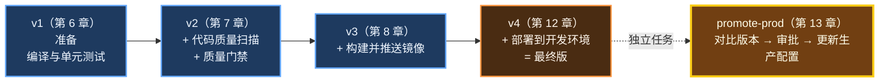

最终版就是教程目录中的 [`mall/Jenkinsfile`](../mall/Jenkinsfile)，生产发布流水线是 [`mall-deploy/jenkins/promote-prod.Jenkinsfile`](../mall-deploy/jenkins/promote-prod.Jenkinsfile)。

---

## 0.9 学习方法建议

### 0.9.1 怎么用这份教程

| 标记 | 含义 | 怎么做 |
|---|---|---|
| `# 位置：/d/cicd-lab/xxx` | 代码块第一行注释，表示命令要在哪个目录执行 | **先 `cd` 到这个目录再执行**，90% 的"命令报错"都是目录不对 |
| ✅ 检查点 | 一组验证命令 + 预期结果 | **必须通过才往下走**，否则后面的问题会层层叠加，很难排查 |
| 🧠 原理 | 解释"为什么这样做" | 第一遍可以略读，做完实验再回头细看 |
| ⚠️ 常见坑 | 前人踩过的坑 | 遇到报错时先看这里 |
| 💡 提示 | 补充知识、实用技巧 | — |

### 0.9.2 遇到问题怎么办

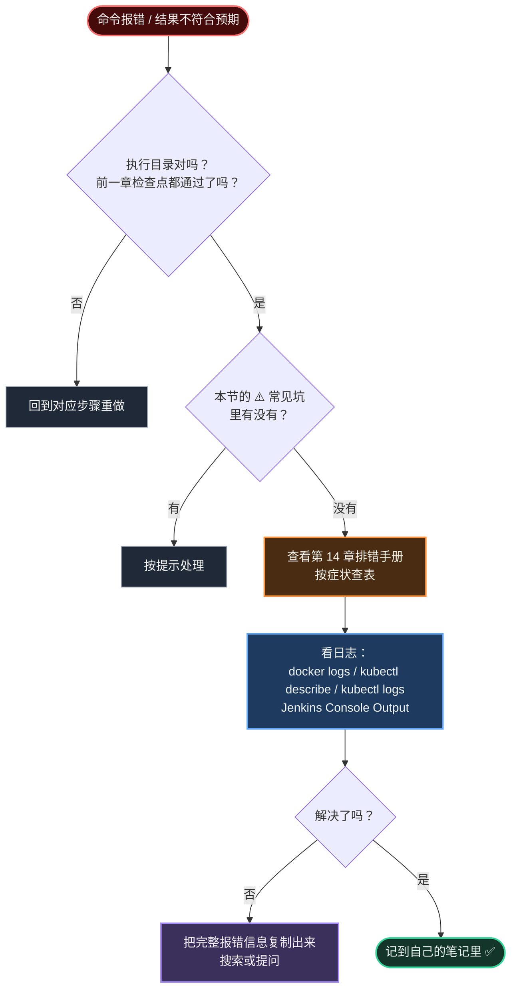

### 0.9.3 学习中途要暂停怎么办

全部组件跑起来会占用约 9GB 内存。如果中途要去做别的事：

| 想做的事 | 命令 / 操作 | 说明 |
|---|---|---|
| 暂停 CI 四件套 | `cd /d/cicd-lab/infra && docker compose stop` | 数据保存在 Docker 卷里，`docker compose start` 即可恢复 |
| 暂停全部（CI + K8s） | 右键任务栏 Docker 图标 → **Quit Docker Desktop** | 下次启动 Docker Desktop 后，K8s 集群和 CI 容器（配置了 `restart: unless-stopped`）会自动恢复 |
| 完全不用了 | 第 14 章"资源清理" | 按步骤删除所有容器、卷、命名空间 |

> ⚠️ 不要用"在 Settings 里取消勾选 Enable Kubernetes"来暂停集群：停用 Kubernetes 会删除集群节点容器，集群里部署的所有东西都要重新来过。

### 0.9.4 几条学习建议

1. **不要复制粘贴完就走**：每个命令执行后，看一眼输出，和教程的"预期输出"对比一下。
2. **主动搞破坏**：教程里有不少"故意失败"的实验（测试失败、门禁失败、发布失败、手工改集群），这些比成功的实验更有价值。
3. **画图**：学完一章，试着不看教程，自己画出这一章组件之间的关系。
4. **记笔记**：遇到的每个报错和解决方法都记下来，这是你以后排查线上问题的宝贵经验。

---

## 本章小结

| 知识点 | 要点 |
|---|---|
| CI/CD 解决什么 | 把"上线"从个人手艺变成可版本管理、可重复执行、可审计的代码 |
| 持续集成 CI | 每次提交自动编译、测试、扫描，尽早发现问题 |
| 持续交付 vs 持续部署 | 区别只在于上生产前有没有人工审批 |
| GitOps | Git 是唯一事实来源，同步器保证集群 = Git |
| Push vs Pull | 本教程：Jenkins 做 CI 并改 Git，Argo CD 拉取并部署（Jenkinsfile 中没有 kubectl） |
| 两个仓库 | `mall` 放源码，`mall-deploy` 放部署配置 |
| 组件选择 | Gitea + Jenkins + SonarQube + Docker Registry + Kubernetes + Helm + Traefik + Argo CD |
| 唯一的"非主流"选择 | 本地用 Docker Registry 替代 Harbor：Docker Desktop kind 集群只从本机镜像库或 HTTPS 上游拉镜像 |

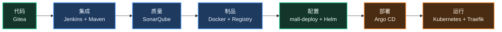

---

## 课后练习

1. **概念辨析**：你们公司（或你了解的公司）现在的发布流程，属于持续交付还是持续部署？用的是 Push 模式还是 Pull 模式？画出它的流程图。
2. **思考题**：如果有人绕过 Git，直接用 `kubectl scale deployment mall-user --replicas=5` 把开发环境的副本数改成 5，在 Push 模式和 Pull 模式（开启 selfHeal）下分别会发生什么？（第 11 章会让你亲手验证）
3. **思考题**：为什么镜像 tag 用 Git 提交哈希，而不是 `latest`？如果都用 `latest`，回滚时会遇到什么问题？（第 8 章揭晓）

---

下一章：[第 1 章 环境准备](01-environment.md)
