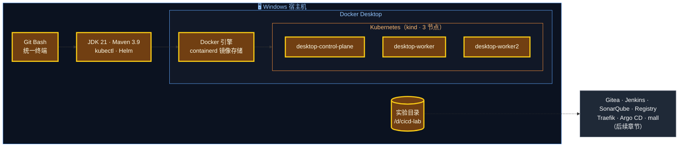
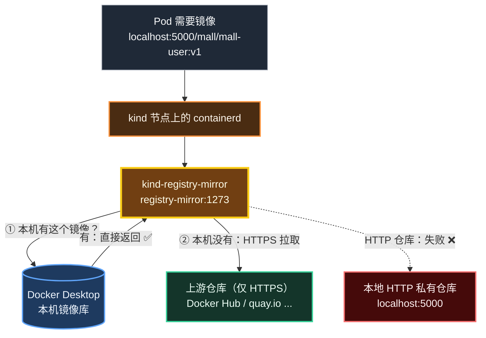
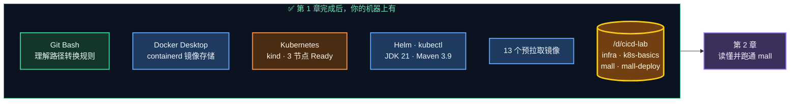

# 第 1 章 环境准备

> 工欲善其事，必先利其器。本章把 Docker Desktop、Kubernetes、终端、Helm、网络和实验目录一次性准备好，后面 13 章就可以专心学 CI/CD 本身。

---

## 本章目标

学完本章，你应该能够：

1. 确认 Docker Desktop 正常运行，并且使用的是 **containerd 镜像存储**
2. 确认 Docker Desktop 内置的 Kubernetes（**kind 模式，3 个节点**）全部 `Ready`
3. 说出 Docker Desktop 版 Kubernetes 的 **3 个特殊行为**（LoadBalancer、NodePort、镜像来源）
4. 配置好 **Git Bash**（理解并正确处理路径转换问题），并安装好 **Helm**
5. 预拉取后续章节要用的镜像，建立实验目录 **`/d/cicd-lab`**
6. 运行环境自检脚本，**全部通过**

预计耗时：**1 小时**（大部分时间在等镜像下载）。

---

## 本章在全景中的位置



本章准备的是**地基**：黄色部分都要在本章完成；灰色部分是后面章节要在这块地基上搭的东西。

---

## 1.1 本章的准备清单

我们按下面的顺序来，每一步都有检查点：

```mermaid
flowchart LR
    s1["1.2 硬件与<br/>Docker 资源"]:::ci --> s2["1.3 Git Bash<br/>统一终端"]:::ci --> s3["1.4 检查<br/>Docker Desktop"]:::ci --> s4["1.5 启用并检查<br/>Kubernetes"]:::cd
    s4 --> s5["1.6 理解 Docker Desktop<br/>K8s 的 3 个特性"]:::cd --> s6["1.7 安装 Helm"]:::cd --> s7["1.8 网络与<br/>预拉取镜像"]:::scm --> s8["1.9 建立<br/>实验目录"]:::scm --> s9["1.10 环境自检"]:::focus

    classDef ci fill:#1e3a5f,stroke:#60a5fa,stroke-width:2px,color:#eff6ff
    classDef cd fill:#4a2c12,stroke:#fb923c,stroke-width:2px,color:#fff7ed
    classDef scm fill:#14352a,stroke:#34d399,stroke-width:2px,color:#ecfdf5
    classDef focus fill:#713f12,stroke:#facc15,stroke-width:3px,color:#fefce8
```



> 💡 为什么先配终端再查 Docker？因为后面所有检查命令都在 Git Bash 里执行，而 Git Bash 有一个"路径自动转换"的坑，不先理解它，部分命令的输出会和教程对不上。

---

## 1.2 硬件要求与 Docker 资源

### 1.2.1 硬件要求

| 项目 | 最低 | 推荐 | 本机实测 |
|---|---|---|---|
| CPU | 4 核 | 8 核及以上 | 20 核 |
| 内存（整机） | 16GB | 32GB | 32GB |
| Docker 可用内存 | 8GB（需按需暂停组件） | 12GB 以上 | 15.5GiB |
| 磁盘剩余空间 | 30GB | 50GB 以上 | — |
| 系统 | Windows 10/11 64 位，开启虚拟化，已安装 WSL2 | Windows 11 | Windows 11 |

第 0 章估算过，全部组件运行时约占 **9GB** 内存。

### 1.2.2 Docker 的内存从哪来（WSL2 后端）

Docker Desktop 在 Windows 上默认使用 **WSL2 后端**：Docker 引擎运行在一个轻量的 Linux 虚拟机里。这个虚拟机能用多少内存，**不是在 Docker Desktop 里设置的，而是由 Windows 用户目录下的 `.wslconfig` 文件控制**。

> 你在 Docker Desktop 的 Settings → Resources → Advanced 中会看到类似提示："You are using the WSL 2 backend, so resource limits are managed by Windows"（使用 WSL2 后端，资源限制由 Windows 管理）。

**本机已有 15.5GiB 可用，不需要修改。** 如果你的机器 `docker info` 显示的 `Total Memory` 小于 10GB，可以按下面的步骤调整：

```bash
# 位置：任意目录（Git Bash）
# ⚠️ 仅在 Docker 可用内存不足时执行。~ 即 C:\Users\<你的用户名>
cat > ~/.wslconfig <<'EOF'
[wsl2]
# 分配给 WSL2 虚拟机（Docker Desktop 运行于其中）的最大内存
memory=12GB
# 可使用的 CPU 核数
processors=8
EOF
cat ~/.wslconfig
```

然后**让配置生效**：

1. 右键任务栏 Docker 图标 → **Quit Docker Desktop**（退出 Docker Desktop）
2. 在 Git Bash 或 PowerShell 执行 `wsl --shutdown`（关闭所有 WSL 虚拟机）
3. 重新打开 Docker Desktop，等左下角状态变为 **Engine running**

> ⚠️ `.wslconfig` 对**所有** WSL 发行版生效（包括你自己装的 Ubuntu 等），`wsl --shutdown` 也会把它们一起关掉，执行前保存好其它 WSL 里的工作。

---

## 1.3 统一终端：Git Bash

### 1.3.1 为什么统一用 Git Bash

Windows 上有 CMD、PowerShell、Git Bash 三种常见终端。本教程**所有命令都在 Git Bash 中执行**，原因有三：

| 原因 | 说明 |
|---|---|
| 和流水线一致 | Jenkins 的 `sh` 步骤、Dockerfile 的 `RUN`、K8s 容器里都是 Linux Shell，命令在 Git Bash 里练熟了可以直接搬过去 |
| 工具齐全 | `grep`、`sed`、`base64`、`curl`、`cat <<EOF` 等 Linux 常用命令开箱即用 |
| 教程可复制 | 只维护一套命令，不会出现"PowerShell 版本和 Bash 版本对不上" |

Git Bash 随 Git for Windows 一起安装。打开方式：开始菜单搜索 **Git Bash**，或在资源管理器任意文件夹空白处右键 → **Open Git Bash here**。

先确认一下 Git 版本：

```bash
# 位置：任意目录
git --version
```

预期输出（版本号不低于 2.40 即可）：

```text
git version 2.55.0.windows.2
```

### 1.3.2 必须了解的坑：路径自动转换

Git Bash 底层是 MSYS2。它有一个"贴心"的功能：当你调用 Windows 原生程序（`docker.exe`、`kubectl.exe`、`java.exe`、`helm.exe` 等）时，会把**以 `/` 开头的参数**当作 Linux 路径，自动转换成 Windows 路径。这个功能是一把双刃剑：

**好的一面**：`/d/cicd-lab/infra/k8s/argocd-values.yaml` 会被自动转换成 `D:/cicd-lab/infra/k8s/argocd-values.yaml`，所以 `helm install ... -f /d/cicd-lab/...`、`kubectl apply -f /d/cicd-lab/...` 才能找到文件；Maven 的 `mvn` 启动脚本也依赖它把 `/d/Env/Maven/...` 转换后交给 `java.exe`。

**坏的一面**：传给 Docker / K8s 的**容器内部路径**也会被"误伤"。我们来亲眼看一下：

```bash
# 位置：任意目录
# 第一次执行会自动拉取 busybox 镜像（约 2MB）
docker run --rm busybox:1.36 cat /etc/hostname
```

预期输出（**这是错误的结果**，路径前缀是你的 Git 安装目录）：

```text
cat: can't open 'C:/Program Files/Git/etc/hostname': No such file or directory
```

我们想读容器里的 `/etc/hostname`，结果 Git Bash 把它改成了 Git 安装目录下的 `C:/Program Files/Git/etc/hostname`。

**解决方法：只在"参数里有容器内部绝对路径"的那条命令前，临时加上 `MSYS_NO_PATHCONV=1`**：

```bash
# 位置：任意目录
MSYS_NO_PATHCONV=1 docker run --rm busybox:1.36 cat /etc/hostname
```

预期输出（一串随机的 12 位十六进制字符，即容器 ID）：

```text
3f9c2a7b1d4e
```

`变量=值 命令` 是 Bash 的语法：这个变量**只对这一条命令生效**，命令结束就失效，不会影响其他命令。本教程中所有需要它的命令都已经加好了前缀，判断规则如下：

| 命令中的参数 | 例子 | 要不要加前缀 |
|---|---|---|
| 容器 / Pod **内部**的绝对路径 | `docker exec jenkins cat /var/jenkins_home/...`<br/>`kubectl exec mysql-0 -- ls /var/lib/mysql` | ✅ 要加 |
| Windows 命令的 `/` 开头选项 | `tasklist /FI "PID eq 1234"`、`taskkill /PID 1234 /F` | ✅ 要加 |
| 本机文件路径 | `helm install ... -f /d/cicd-lab/...`、`kubectl apply -f /d/cicd-lab/...` | ❌ 不能加（靠自动转换才能找到文件） |
| URL、相对路径、`svc/xxx` 等 | `curl http://localhost:5000/v2/`、`kubectl port-forward svc/mall-user ...` | ❌ 不需要 |

> ⚠️ **千万不要把 `export MSYS_NO_PATHCONV=1` 写进 `~/.bashrc` 全局关闭转换！** 这是一个真实踩过的坑：全局关闭后，`mvn -v` 会直接报错：
>
> ```text
> 错误: 找不到或无法加载主类 org.codehaus.plexus.classworlds.launcher.Launcher
> 原因: java.lang.ClassNotFoundException: org.codehaus.plexus.classworlds.launcher.Launcher
> ```
>
> 原因是 `mvn` 脚本传给 `java.exe` 的 classpath（`/d/Env/Maven/.../boot/plexus-classworlds-*.jar`）不再被转换，Java 找不到这个 jar；同理 `helm ... -f /d/cicd-lab/...` 也会报找不到文件。
>
> 如果你按本教程的旧版本已经加过，请这样恢复：用编辑器打开 `~/.bashrc`（即 `C:\Users\<用户名>\.bashrc`），删除 `export MSYS_NO_PATHCONV=1` 这一行，然后在当前窗口执行 `unset MSYS_NO_PATHCONV`，再执行 `mvn -v` 验证。

> ✅ **检查点**：执行 `echo "[$MSYS_NO_PATHCONV]"`，输出 `[]`（为空，说明没有全局关闭）；执行 `mvn -v`，正常输出 Maven 版本。

> 🧠 **原理**：MSYS2 的转换规则是"参数以 `/` 开头且不是 `//` 开头，就当作 POSIX 路径转换"（`--opt=/path` 这种 `=` 后面的部分同理）。设置 `MSYS_NO_PATHCONV` 后参数会原样传给 Windows 程序。另一种不加前缀的写法是把开头写成双斜杠，如 `//etc/hostname`、`//FI`，效果相同，但可读性差，本教程统一使用前缀写法。

### 1.3.3 Git 的基础配置

```bash
# 位置：任意目录
# 1) 提交时的身份（如果之前配过可以跳过，用 git config --global user.name 查看）
git config --global user.name  "你的名字"
git config --global user.email "you@example.com"

# 2) 新建仓库的默认分支名为 main（和 Gitea、本教程保持一致）
git config --global init.defaultBranch main

# 3)（推荐，可选）关闭换行符自动转换
git config --global core.autocrlf false

# 查看结果
git config --global --list | grep -E "user\.|init\.|autocrlf"
```

预期输出：

```text
user.name=你的名字
user.email=you@example.com
init.defaultbranch=main
core.autocrlf=false
```

**为什么要关心换行符？** Windows 的换行是 `CRLF`（`\r\n`），Linux 是 `LF`（`\n`）。我们的 Jenkinsfile、Shell 片段、YAML 最终都在 Linux 容器里执行，如果混进了 `\r`，会出现诸如 `$'\r': command not found`、`bad interpreter` 这类莫名其妙的错误。

本教程用两道保险：

| 保险 | 作用范围 | 说明 |
|---|---|---|
| 仓库内的 `.gitattributes` | 只对该仓库生效，**优先级最高** | `mall/` 和 `mall-deploy/` 里都已经放好了，内容见下 |
| `core.autocrlf false` | 你电脑上的所有仓库 | 让 Git 不再自作主张转换换行符；如果担心影响公司项目，可以不改全局，只依赖 `.gitattributes` |

`mall/.gitattributes` 的内容：

```text
# 统一使用 LF 换行：Jenkinsfile、Shell 片段、YAML 在 Linux 容器中执行，CRLF 会导致奇怪的错误
* text=auto eol=lf
*.jar binary
```

> 💡 IDEA 用户再加一道保险：Settings → Editor → Code Style → **Line separator** 选 `Unix and macOS (\n)`。

### 1.3.4 Git Bash 里的交互式命令：winpty

Git Bash 默认的终端程序 mintty 不是真正的 Windows 控制台，执行**交互式**命令（`-it`）时可能报错：

```text
the input device is not a TTY.  If you are using mintty, try prefixing the command with 'winpty'
```

或者：

```text
Unable to use a TTY - input is not a terminal or the right kind of file
```

解决方法就是报错里说的——在命令前加 `winpty`：

```bash
# 示例：进入容器的交互式 Shell（后面章节会用到，现在不用执行）
winpty docker exec -it jenkins bash
winpty kubectl exec -it -n mall-lab mysql-0 -- mysql -umall -pmall123
```

> 💡 新版 Git for Windows 已经改善了这个问题，你的环境不报错就不用加。**非交互式**命令（不带 `-it`）永远不需要 `winpty`。

### 1.3.5 如果你坚持用 PowerShell

可以，但需要自己"翻译"命令。几个最常见的差异：

| 场景 | Git Bash（本教程写法） | PowerShell |
|---|---|---|
| 续行符 | 行尾 `\` | 行尾 `` ` ``（反引号） |
| 环境变量 | `export FOO=bar`、`$FOO` | `$env:FOO="bar"`、`$env:FOO` |
| curl | `curl` | Windows PowerShell 5.1 中 `curl` 是 `Invoke-WebRequest` 的别名，**必须写 `curl.exe`** |
| 输出重定向 `>` | UTF-8 | Windows PowerShell 5.1 写出的是 **UTF-16**，第 4 章生成的 `htpasswd` 文件会因此失效；要用 `Out-File -Encoding ascii` |
| base64 解码 | `base64 -d` | `[Text.Encoding]::UTF8.GetString([Convert]::FromBase64String("..."))` |
| heredoc `cat <<'EOF'` | 支持 | 不支持，改用 `@' ... '@` |

---

## 1.4 检查 Docker Desktop

### 步骤 1：Docker 版本

```bash
# 位置：任意目录
docker version
```

预期输出（关键部分，版本号不低于本教程即可）：

```text
Client:
 Version:           29.7.2
 API version:       1.55
 ...
 Context:           desktop-linux

Server: Docker Desktop 4.86.0 (236216)
 Engine:
  Version:          29.7.2
  ...
 containerd:
  Version:          v2.2.5
 ...
```

| 字段 | 含义 |
|---|---|
| `Client` | 你敲的 `docker` 命令本身（Windows 程序） |
| `Server` | Docker 引擎（运行在 Docker Desktop 的 Linux 虚拟机里）。如果这一段报错 `error during connect`，说明 Docker Desktop 没启动 |
| `Context: desktop-linux` | 当前连接的是 Docker Desktop 的 Linux 引擎 |

> 🧠 **客户端 / 服务端分离**：`docker` 命令只是一个客户端，通过 API 把指令发给引擎执行。第 4 章 Jenkins 构建镜像，用的正是这个原理——Jenkins 容器里只装了 `docker` 客户端，通过挂载 `docker.sock` 指挥宿主机的引擎干活。

### 步骤 2：Docker 引擎的关键配置

```bash
# 位置：任意目录
docker info 2>/dev/null | grep -E "Server Version|Storage Driver|driver-type|CPUs|Total Memory|HTTP Proxy|HTTPS Proxy"
```

预期输出（本机实测）：

```text
 Server Version: 29.7.2
 Storage Driver: overlayfs
  driver-type: io.containerd.snapshotter.v1
 CPUs: 20
 Total Memory: 15.54GiB
 HTTP Proxy: http.docker.internal:3128
 HTTPS Proxy: http.docker.internal:3128
```

再看一下"允许 HTTP 访问的镜像仓库"：

```bash
# 位置：任意目录
docker info 2>/dev/null | sed -n '/Insecure Registries/,/Live Restore/p'
```

预期输出：

```text
 Insecure Registries:
  hubproxy.docker.internal:5555
  ::1/128
  127.0.0.0/8
 Live Restore Enabled: false
```

逐个解读：

| 字段 | 本机值 | 说明 | 后面哪里用到 |
|---|---|---|---|
| `driver-type` | `io.containerd.snapshotter.v1` | 表示使用 **containerd 镜像存储**。kind 模式的 K8s **必须**开启它 | 第 9 章：集群如何拿到本机镜像 |
| `CPUs` / `Total Memory` | 20 / 15.54GiB | Docker 虚拟机可用的资源 | 全程 |
| `HTTP(S) Proxy` | `http.docker.internal:3128` | Docker Desktop 内置代理已生效，引擎拉镜像会走代理 | 1.8 节网络准备 |
| `Insecure Registries` | 包含 `127.0.0.0/8` | 引擎允许用 **HTTP** 访问 `localhost` / `127.x` 上的仓库 | 第 4、8 章：`docker push localhost:5000/...` 无需 HTTPS |

> ⚠️ 如果你看不到 `driver-type: io.containerd.snapshotter.v1`：打开 Docker Desktop → **Settings → General**，勾选 **Use containerd for pulling and storing images**（使用 containerd 拉取和存储镜像）→ **Apply & restart**。
> 切换镜像存储后，之前拉取的镜像会"消失"（它们还在旧存储里），需要重新拉取。

---

## 1.5 启用并检查 Kubernetes

### 1.5.1 kind 模式 vs kubeadm 模式

Docker Desktop 内置的 Kubernetes 有两种创建方式（Docker 官方称为 provisioner）：

| 对比项 | kubeadm（旧） | kind（新） |
|---|---|---|
| 节点数量 | 只能单节点 | **支持多节点** |
| K8s 版本 | Docker Desktop 决定，不能选 | 可以选择 |
| 创建速度 | 约 1 分钟 | 约 30 秒 |
| 镜像存储要求 | Docker 镜像存储、containerd 镜像存储均可 | **只支持 containerd 镜像存储** |
| 节点是什么 | Docker Desktop 虚拟机本身 | 一个个 Docker 容器（kind = Kubernetes IN Docker） |
| 本机构建的镜像能否直接用 | 能（节点直接用 Docker 引擎的镜像） | 能（通过内置镜像代理，见 1.6 节） |
| 本教程 | 也能跑通，个别现象不同（如节点名为 `docker-desktop`，只有 1 个节点） | ✅ **以此为准** |

我们选 kind 多节点，是因为多节点更接近真实集群：你能看到 Pod 被**调度到不同节点**、滚动更新时新旧 Pod 分布在不同机器上——这些在单节点上是体会不到的。

### 1.5.2 启用 Kubernetes（已启用可跳过）

> 本机实测：集群已在 90 天前创建并正常运行，**可以直接跳到 1.5.3 检查**。下面的步骤供新环境参考。

1. 打开 Docker Desktop → 右上角齿轮 **Settings**（设置）
2. 左侧选择 **Kubernetes**
3. 按下表配置（不同版本菜单位置可能略有差异；部分新版本把集群管理放到了左侧独立的 **Kubernetes** 页面，通过 **Create cluster** 按钮创建）：

| 配置项 | 填写 / 选择 | 说明 |
|---|---|---|
| **Enable Kubernetes** | ☑ 勾选 | 启用内置 K8s |
| **Cluster settings / Provisioner** | **kind** | 多节点模式 |
| **Node(s)** | `3` | 1 个控制平面 + 2 个工作节点 |
| **Kubernetes version** | 默认最新（本机为 v1.36.x） | — |
| **Show system containers (advanced)** | 不勾选 | 勾选后 `docker ps` 能看到节点容器，一般不需要 |

4. 点击 **Apply & restart**（或 **Apply** / **Create**），首次需要下载镜像，等待几分钟
5. Docker Desktop 左下角出现 **Kubernetes running**（绿色）即完成

### 1.5.3 检查集群

**步骤 1：确认 kubectl 连的是 Docker Desktop 的集群**

```bash
# 位置：任意目录
kubectl config current-context
```

预期输出：

```text
docker-desktop
```

> ⚠️ 如果输出是别的名字（比如你连过公司的测试集群），执行 `kubectl config use-context docker-desktop` 切换回来。**本教程所有 kubectl 命令都必须在 docker-desktop 上下文中执行，千万别误操作了公司集群！**

**步骤 2：查看节点**

```bash
# 位置：任意目录
kubectl get nodes -o wide
```

预期输出（本机实测，`AGE` 会不同）：

```text
NAME                    STATUS   ROLES           AGE   VERSION   INTERNAL-IP   EXTERNAL-IP   OS-IMAGE                       KERNEL-VERSION                              CONTAINER-RUNTIME
desktop-control-plane   Ready    control-plane   90d   v1.36.1   172.19.0.2    <none>        Debian GNU/Linux 13 (trixie)   6.18.40.1-microsoft-standard-WSL2 (amd64)   containerd://2.3.1
desktop-worker          Ready    <none>          90d   v1.36.1   172.19.0.4    <none>        Debian GNU/Linux 13 (trixie)   6.18.40.1-microsoft-standard-WSL2 (amd64)   containerd://2.3.1
desktop-worker2         Ready    <none>          90d   v1.36.1   172.19.0.6    <none>        Debian GNU/Linux 13 (trixie)   6.18.40.1-microsoft-standard-WSL2 (amd64)   containerd://2.3.1
```

| 列 | 解读 |
|---|---|
| `STATUS: Ready` | 节点健康，可以运行 Pod。三个都必须是 `Ready` |
| `ROLES` | `control-plane` 是控制平面（大脑），另外两个是工作节点（干活的） |
| `INTERNAL-IP` | 节点在 Docker 网络 `kind` 中的 IP，`172.19.0.x` |
| `CONTAINER-RUNTIME` | 节点上用 **containerd** 运行容器（不是 Docker） |

**步骤 3：查看系统组件**

```bash
# 位置：任意目录
kubectl get pods -A
```

预期输出（全部 `Running`，`RESTARTS` 次数不用在意——每次重启电脑都会增加）：

```text
NAMESPACE            NAME                                            READY   STATUS    RESTARTS   AGE
kube-system          coredns-589f44dc88-vh8r7                        1/1     Running   107        90d
kube-system          coredns-589f44dc88-z8sm5                        1/1     Running   107        90d
kube-system          etcd-desktop-control-plane                      1/1     Running   0          9h
kube-system          kindnet-vmzc5                                   1/1     Running   107        90d
kube-system          kindnet-w4vkv                                   1/1     Running   107        90d
kube-system          kindnet-zxlw9                                   1/1     Running   107        90d
kube-system          kube-apiserver-desktop-control-plane            1/1     Running   0          9h
kube-system          kube-controller-manager-desktop-control-plane   1/1     Running   107        90d
kube-system          kube-proxy-6hqr8                                1/1     Running   107        90d
kube-system          kube-proxy-ffrmc                                1/1     Running   107        90d
kube-system          kube-proxy-px74p                                1/1     Running   107        90d
kube-system          kube-scheduler-desktop-control-plane            1/1     Running   107        90d
local-path-storage   local-path-provisioner-855c7b7774-vwdbp         1/1     Running   212        90d
```

这些组件第 9 章会详细讲，现在先混个脸熟：

| 组件 | 一句话职责 |
|---|---|
| `kube-apiserver` | 集群的"前台"，`kubectl` 的所有命令都发给它 |
| `etcd` | 集群的"数据库"，存所有资源的状态 |
| `kube-scheduler` | 决定新 Pod 放到哪个节点 |
| `kube-controller-manager` | 不停地让"实际状态"向"期望状态"靠拢（Deployment 副本数不够就补） |
| `kube-proxy` | 每个节点一个，负责 Service 的流量转发 |
| `coredns` | 集群内的 DNS，让 `mall-user` 这样的服务名能被解析 |
| `kindnet` | kind 的网络插件，打通各节点上 Pod 之间的网络 |
| `local-path-provisioner` | 存储插件，为 MySQL 这类有状态应用自动分配磁盘 |

**步骤 4：查看存储类**

```bash
# 位置：任意目录
kubectl get storageclass
```

预期输出：

```text
NAME                 PROVISIONER             RECLAIMPOLICY   VOLUMEBINDINGMODE      ALLOWVOLUMEEXPANSION   AGE
hostpath             rancher.io/local-path   Delete          WaitForFirstConsumer   false                  90d
standard (default)   rancher.io/local-path   Delete          WaitForFirstConsumer   false                  90d
```

`standard (default)` 是**默认存储类**，第 9 章部署 MySQL 时申请的磁盘就由它自动创建。

> ✅ **检查点**：`kubectl get nodes` 显示 3 个 `Ready` 节点；`kubectl get pods -A` 全部 `Running`；存在 `(default)` 存储类。

---

## 1.6 Docker Desktop 版 Kubernetes 的 3 个特性

Docker Desktop 的 kind 集群和公司里的"真集群"有几处行为不同。这些都是编写教程时在本机**逐一实测**过的结论，提前知道能帮你少走很多弯路。

### 1.6.1 结论速览

| # | 特性 | 实测结果 | 对本教程的影响 |
|---|---|---|---|
| 1 | **LoadBalancer 类型的 Service** | 自动暴露到 Windows 的 `localhost:<端口>`（实测返回 200）；`EXTERNAL-IP` 显示为 `172.19.0.x` | 第 9 章用它直接访问服务；第 10 章 Traefik 用它占用 `localhost:80` |
| 2 | **NodePort 类型的 Service** | 从 Windows 访问 `localhost:<NodePort>` **不通** | 本教程**不用** NodePort |
| 3 | **镜像来源** | Pod 拉镜像时**优先使用本机 Docker 镜像库**里的镜像，任何仓库前缀都行；本机没有时只会通过 **HTTPS** 去上游仓库拉 | Jenkins 在本机构建的镜像，集群能直接用；只存在于本地 HTTP 私有仓库里的镜像，集群**拉不到** |

### 1.6.2 一张图看懂

```text
                Windows 宿主机（浏览器 / Git Bash）
                  │                                   │
                  │ localhost:8082  ✅                │ localhost:3xxxx（NodePort） ❌
                  ▼                                   ✗
 ┌──────────────────────────── Docker Desktop 虚拟机 ─────────────────────────────┐
 │                                                                               │
 │   kind-cloud-provider ── 实现 LoadBalancer，把服务端口映射到 Windows localhost │
 │          │                                                                    │
 │  ┌───────▼──────────────── Docker 网络 "kind"（172.19.0.0/16）──────────────┐  │
 │  │                                                                       │  │
 │  │  desktop-control-plane    desktop-worker      desktop-worker2         │  │
 │  │     172.19.0.2              172.19.0.4           172.19.0.6           │  │
 │  │  （节点 = 容器，NodePort 只监听在这些容器 IP 上，Windows 访问不到）     │  │
 │  │          │                                                            │  │
 │  │          │ 所有镜像拉取请求（不管镜像名写的是哪个仓库）                │  │
 │  │          ▼                                                            │  │
 │  │  kind-registry-mirror（registry-mirror:1273）                         │  │
 │  │     ① 先查本机 Docker 镜像库 ──── 有 ──▶ 直接返回 ✅                   │  │
 │  │     ② 没有 ──▶ 用 HTTPS 访问上游仓库（Docker Hub 等）                  │  │
 │  │                 └─ 上游是 HTTP 的私有仓库 ──▶ 失败 ❌                   │  │
 │  └───────────────────────────────────────────────────────────────────────┘  │
 │                                                                               │
 │   Docker 引擎 + 本机镜像库（docker build / docker pull 得到的镜像都在这里）    │
 └───────────────────────────────────────────────────────────────────────────────┘
```

同样的内容用 Mermaid 再画一次，重点看镜像拉取的路径：



### 1.6.3 自己验证一下（只读命令，不会改动任何东西）

**看看 kind 网络里都有谁：**

```bash
# 位置：任意目录
docker network inspect kind --format '{{range .Containers}}{{.Name}} {{.IPv4Address}}{{"\n"}}{{end}}'
```

预期输出（顺序可能不同）：

```text
desktop-control-plane 172.19.0.2/16
desktop-worker 172.19.0.4/16
kind-registry-mirror 172.19.0.3/16
kind-cloud-provider 172.19.0.5/16
desktop-worker2 172.19.0.6/16
```

除了 3 个节点，还有两个"幕后功臣"：`kind-registry-mirror`（镜像代理，特性 3）和 `kind-cloud-provider`（LoadBalancer 的实现者，特性 1）。它们是 Docker Desktop 的系统容器，默认在 `docker ps` 中是隐藏的。

**看看节点上的镜像拉取配置：**

```bash
# 位置：任意目录（参数是容器内路径，所以要加 MSYS_NO_PATHCONV=1 前缀，见 1.3.2）
MSYS_NO_PATHCONV=1 docker exec desktop-control-plane cat /etc/containerd/certs.d/_default/hosts.toml
```

预期输出：

```text

[host."http://registry-mirror:1273"]
capabilities = ["pull", "resolve"]
skip_verify = true
```

`_default` 目录意味着：**对所有镜像仓库**（`docker.io`、`quay.io`、`localhost:5000`……）的拉取请求，统一先交给 `registry-mirror:1273` 处理。这就是特性 3 的来源。

> 🧠 **这对 CI/CD 意味着什么？** 我们的 Jenkins 会通过 `docker.sock` 使用宿主机 Docker 引擎构建镜像，镜像构建完就躺在本机镜像库里，集群自然能用；同时 Jenkins 照常把镜像推送到 Registry，保持和生产环境一致的流程。生产环境的集群节点则是真正从 Harbor 等仓库拉取镜像的。第 9 章会用一个小实验让你亲眼看到这个区别。

> ⚠️ **推论**：不要随手执行 `docker image prune -a` / `docker system prune -a` 清理镜像！这会删掉本机镜像库中"暂时没有容器在用"的镜像，集群在新节点上重建 Pod 时就会因为找不到镜像而 `ImagePullBackOff`。

---

## 1.7 安装 Helm

Helm 是 Kubernetes 的"包管理器 + 模板引擎"，第 10 章用它安装 Traefik、编写我们自己的 Chart，第 11 章用它安装 Argo CD。

### 步骤 1：用 winget 安装（推荐）

`winget` 是 Windows 10/11 自带的包管理器：

```bash
# 位置：任意目录
winget install Helm.Helm --accept-source-agreements --accept-package-agreements
```

预期输出（版本号可能更新）：

```text
已找到 Helm [Helm.Helm] 版本 4.3.0
此应用程序由其所有者授权给你。
...
正在下载 https://get.helm.sh/helm-v4.3.0-windows-amd64.zip
  ██████████████████████████████  xx.x MB / xx.x MB
已成功验证安装程序哈希
...
已成功安装
```

> ⚠️ **安装完一定要关闭 Git Bash 再重新打开**，新的 PATH 环境变量才会生效。否则会提示 `helm: command not found`。

### 步骤 2：验证

```bash
# 位置：任意目录（新打开的 Git Bash）
helm version
```

预期输出：

```text
version.BuildInfo{Version:"v4.3.0", GitCommit:"...", GitTreeState:"clean", GoVersion:"go1.xx.x"}
```

> ⚠️ **重开终端后仍然提示 `helm: command not found`？** 这是一个真实踩过的坑：winget 显示"找到已安装的现有包……找不到可用的升级"，说明 Helm **已经装好了**，只是安装目录没有被加入 PATH（winget 安装"便携版"软件时，有时无法创建快捷链接或修改 PATH，用户 PATH 过长时尤其常见）。排查和解决分三步：
>
> ```bash
> # 位置：任意目录
> # ① 找到 helm.exe 的真实位置
> find "$LOCALAPPDATA/Microsoft/WinGet/Packages" -maxdepth 3 -iname helm.exe
> # 预期输出类似：C:\Users\<你的用户名>\AppData\Local/Microsoft/WinGet/Packages/Helm.Helm_Microsoft.Winget.Source_8wekyb3d8bbwe/windows-amd64/helm.exe
>
> # ② 把该目录加入 Git Bash 的 PATH（注意必须写成 /c/Users/... 形式，C:\ 中的冒号会和 PATH 分隔符冲突）
> cat >> ~/.bashrc <<'EOF'
> # Helm（winget 安装后未自动加入 PATH）
> export PATH="$PATH:/c/Users/<你的用户名>/AppData/Local/Microsoft/WinGet/Packages/Helm.Helm_Microsoft.Winget.Source_8wekyb3d8bbwe/windows-amd64"
> EOF
>
> # ③ 让配置立即生效并验证
> source ~/.bashrc
> helm version
> ```
>
> 记得把 `<你的用户名>` 替换成真实用户名（`echo $USERNAME` 可以查看）。winget 以后升级 Helm 时这个目录名不变，所以不用再改。这种方式只对 Git Bash 生效；如果还想在 PowerShell/CMD 中使用，按下面"备选方案"第 3 步把同一个目录加入 Windows 用户 PATH。

> 💡 **Helm 3 还是 Helm 4？** Helm 4.0 于 2025 年 11 月发布，2026 年 9 月最新稳定版为 4.3.0。本教程用到的命令（`repo add`、`install`、`upgrade`、`template`、`lint`、`history`、`rollback`、`uninstall`）在 Helm 3.x 和 4.x 中**完全通用**，如果你电脑上已经有 Helm 3 也没问题。

### 备选方案：手动安装（winget 不可用时）

1. 浏览器打开 https://github.com/helm/helm/releases ，在最新版本的 **Installation and Upgrading** 部分找到 **Windows amd64** 下载链接（形如 `https://get.helm.sh/helm-v4.3.0-windows-amd64.zip`）
2. 解压得到 `windows-amd64/helm.exe`，放到一个固定目录，例如 `D:\Env\Tool\helm\helm.exe`
3. 把该目录加入 PATH：开始菜单搜索"**编辑系统环境变量**" → **环境变量** → 在"用户变量"中选中 **Path** → **编辑** → **新建** → 填入 `D:\Env\Tool\helm` → 一路**确定**
4. 重新打开 Git Bash，执行 `helm version` 验证

> 也可以用 Scoop（`scoop install helm`）或 Chocolatey（`choco install kubernetes-helm`），效果一样。

### 顺便确认 kubectl 版本

```bash
# 位置：任意目录
kubectl version --client
```

预期输出：

```text
Client Version: v1.36.1
Kustomize Version: v5.8.1
```

> 💡 kubectl 随 Docker Desktop 一起安装，客户端版本和集群版本相差不超过 1 个小版本即可。顺便一提，`Kustomize Version` 说明 kubectl 内置了 Kustomize，第 10 章会提到它。

---

## 1.8 网络准备与预拉取镜像

后续章节要下载大量镜像（Docker Hub、quay.io、docker.gitea.com 等）和 Maven 依赖。网络不顺畅是国内学习 CI/CD 的**头号拦路虎**，我们提前解决。

### 1.8.1 Docker 镜像：代理（推荐）

本机 `docker info` 显示 `HTTP Proxy: http.docker.internal:3128`，说明 Docker Desktop 的代理已经生效，**可以直接拉取 Docker Hub 镜像**。

如果你的机器需要手动配置代理：打开 Docker Desktop → **Settings → Resources → Proxies**（不同版本菜单位置可能略有差异）：

| 配置项 | 填写 | 说明 |
|---|---|---|
| **Manual proxy configuration** | 打开开关 | 默认跟随 Windows 系统代理；系统代理不生效时才手动配置 |
| **Web Server (HTTP)** | `http://127.0.0.1:7890` | 换成你本地代理软件的 HTTP 端口 |
| **Secure Web Server (HTTPS)** | `http://127.0.0.1:7890` | 同上 |
| **Bypass proxy settings for these hosts & domains** | `localhost,127.0.0.1,host.docker.internal,*.localhost` | 本地地址不走代理 |

点击 **Apply & restart** 后，用 `docker info | grep -i proxy` 确认。

> ⚠️ 如果你在 `~/.docker/config.json` 里配置过 `"proxies"`（会把代理环境变量注入到**每个新建的容器**里），要确保 `noProxy` 中包含 `localhost,127.0.0.1,host.docker.internal,gitea,jenkins,sonarqube,registry,sonar-db`，否则第 4 章之后容器之间互相访问会被错误地发给代理。没配置过就不用管。

### 1.8.2 Docker 镜像：镜像加速器（备选）

没有代理时，可以在 Docker Desktop → **Settings → Docker Engine** 的 JSON 中添加镜像加速地址：

```json
{
  "registry-mirrors": [
    "https://<你找到的可用加速地址>"
  ]
}
```

点击 **Apply & restart** 生效。

> ⚠️ 两点提醒：
> 1. 国内公共镜像加速站**可用性变化非常频繁**（很多在 2024 年后陆续停止服务），请自行搜索当前可用的地址，用之前先 `docker pull busybox:1.36` 测一下。
> 2. `registry-mirrors` **只对 Docker Hub 的镜像生效**，对 `docker.gitea.com`、`quay.io`、`ghcr.io` 上的镜像无效。这些镜像拉不下来时，只能依靠代理。

### 1.8.3 Maven 依赖：阿里云镜像

本机构建（第 2 章）使用你自己的 `~/.m2/settings.xml`。如果你还没配过镜像，加入下面的 `<mirror>`（放在 `<mirrors>` 标签里）：

```xml
<mirror>
    <id>aliyun</id>
    <mirrorOf>*</mirrorOf>
    <name>Aliyun Public</name>
    <url>https://maven.aliyun.com/repository/public</url>
</mirror>
```

查看当前生效的镜像：

```bash
# 位置：任意目录
grep -A4 "<mirror>" ~/.m2/settings.xml | grep -E "<id>|<url>"
```

> 💡 Jenkins 容器里的 Maven 用的是另一份配置：[`infra/jenkins/settings.xml`](../infra/jenkins/settings.xml)，已经预置了阿里云镜像，第 4 章构建 Jenkins 镜像时会自动放进去。

### 1.8.4 预拉取镜像

把后面章节要用的镜像**提前拉到本机**，有两个好处：

1. 后面章节不用再等下载，节奏更连贯
2. **配合 1.6 节的特性 3**：只要镜像在本机镜像库里，kind 集群里的 Pod 就能直接拿到，不受集群自身网络的影响

镜像清单：

| 镜像 | 用途 | 用于章节 |
|---|---|---|
| `mysql:8.4` | 数据库 | 2、3、9、11 |
| `eclipse-temurin:21-jre` | 应用镜像的基础镜像 | 3、8 |
| `registry:2` | Docker 私有镜像仓库 | 4 |
| `httpd:2` | 借用其中的 `htpasswd` 命令生成仓库账号文件 | 4 |
| `postgres:17-alpine` | SonarQube 的数据库 | 4 |
| `sonarqube:26.9.0.129388-community` | 代码质量平台 | 4、7 |
| `docker.gitea.com/gitea:28.1.0` | 代码托管 | 4、5 |
| `jenkins/jenkins:lts-jdk21` | Jenkins 基础镜像 | 4 |
| `docker:cli` | 定制 Jenkins 镜像时从中复制 docker 命令 | 4 |
| `maven:3.9-eclipse-temurin-21` | 定制 Jenkins 镜像时从中复制 Maven | 4 |
| `mikefarah/yq:4` | 定制 Jenkins 镜像时从中复制 yq（修改 YAML 的工具） | 4 |
| `curlimages/curl` | 在集群内发 HTTP 请求做调试 | 9 |
| `busybox:1.36` | 在集群内做 DNS / 网络调试 | 1、9 |

执行拉取（大约 4GB，耗时取决于网速）：

```bash
# 位置：任意目录
for img in \
    mysql:8.4 \
    eclipse-temurin:21-jre \
    registry:2 \
    httpd:2 \
    postgres:17-alpine \
    sonarqube:26.9.0.129388-community \
    docker.gitea.com/gitea:28.1.0 \
    jenkins/jenkins:lts-jdk21 \
    docker:cli \
    maven:3.9-eclipse-temurin-21 \
    mikefarah/yq:4 \
    curlimages/curl \
    busybox:1.36
do
    echo ">>> 拉取 $img"
    docker pull "$img" > /dev/null && echo "    ✔ 成功" || echo "    ✘ 失败：$img"
done
```

预期输出：

```text
>>> 拉取 mysql:8.4
    ✔ 成功
>>> 拉取 eclipse-temurin:21-jre
    ✔ 成功
...
>>> 拉取 busybox:1.36
    ✔ 成功
```

如果有失败的，**单独重试**那一个，并查看完整报错：

```bash
# 位置：任意目录
docker pull docker.gitea.com/gitea:28.1.0
```

| 报错关键字 | 原因 | 解决 |
|---|---|---|
| `toomanyrequests` | 触发了 Docker Hub 匿名拉取频率限制 | 到 hub.docker.com 注册免费账号，执行 `docker login` 后重试 |
| `i/o timeout` / `connection reset` | 网络不通 | 检查 1.8.1 代理配置 |
| `manifest unknown` / `not found` | 镜像名或 tag 写错 | 对照上表检查拼写 |
| `docker.gitea.com` 相关的超时 | Gitea 官方镜像源访问不畅 | 可尝试 Docker Hub 上的 `gitea/gitea` 同版本标签，第 4 章时相应修改 `infra/docker-compose.yml` 中的 `image` |

最后确认一下：

```bash
# 位置：任意目录
docker images --format '{{.Repository}}:{{.Tag}}\t{{.Size}}' | grep -E "^(mysql:8.4|eclipse-temurin|registry:2|httpd:2|postgres:17|sonarqube|docker.gitea.com|jenkins/jenkins|docker:cli|maven:3.9-eclipse|mikefarah/yq|curlimages/curl|busybox:1.36)"
```

预期输出（13 行，大小仅供参考）：

```text
mysql:8.4                                  1.07GB
eclipse-temurin:21-jre                     ...
registry:2                                 ...
...
busybox:1.36                               ...
```

> 🧠 **为什么 kind 集群能用宿主机拉的镜像？** 回顾 1.6 节：集群节点所有的拉取请求都先交给 `registry-mirror`，它会先查本机镜像库。所以"在宿主机 `docker pull`"就相当于"给集群准备好了镜像"。以后遇到 Pod 卡在 `ImagePullBackOff`，第一个办法就是：用 `kubectl describe pod` 看清镜像全名，在宿主机 `docker pull` 它，然后删掉 Pod 让它重建。

---

## 1.9 建立实验工作目录

### 1.9.1 为什么要单独建一个目录

教程资料目录（`cicd-study/`）是"教材"，我们要在一个独立的"实验室"里动手：

| 原因 | 说明 |
|---|---|
| 不污染教材 | 实验中会修改代码、生成密码文件、产生构建产物，教材保持原样，随时可以对照 |
| 避免仓库套仓库 | 第 5 章要在 `mall/`、`mall-deploy/` 里 `git init`。如果它们在教程目录里，而教程目录本身又在一个 Git 仓库中，会形成"仓库套仓库"，Git 行为会很混乱 |
| 路径统一 | 教程中所有命令都基于 `/d/cicd-lab`，复制即可执行 |

```text
 教程资料（只读参考）                       实验目录（动手的地方）
 cicd-study/                                /d/cicd-lab/
 ├── README.md                              ├── infra/        ← 复制
 ├── docs/            ──── 不复制           ├── k8s-basics/   ← 复制
 ├── infra/           ─┐                    ├── mall/         ← 复制，第 5 章变成 Git 仓库
 ├── k8s-basics/       ├── cp -r ────────▶  └── mall-deploy/  ← 复制，第 5 章变成 Git 仓库
 ├── mall/             │
 └── mall-deploy/     ─┘
```

### 1.9.2 动手复制

```bash
# 位置：任意目录
# ① 教程资料所在目录：本机是下面这个路径，换成你自己的（注意 Git Bash 中 D:\ 写作 /d/）
TUTORIAL=/d/Work/Java/study/study/cicd-study

# ② 创建实验目录并复制四个子目录
mkdir -p /d/cicd-lab
cp -r "$TUTORIAL"/{infra,k8s-basics,mall,mall-deploy} /d/cicd-lab/

# ③ 查看结果
cd /d/cicd-lab && ls
```

预期输出：

```text
infra  k8s-basics  mall  mall-deploy
```

再确认隐藏文件（`.gitattributes`、`.gitignore`、`.dockerignore`）也一起复制过来了——它们很重要：

```bash
# 位置：/d/cicd-lab
ls -a mall mall/mall-user mall-deploy
```

预期输出：

```text
mall:
.  ..  .gitattributes  .gitignore  Jenkinsfile  docker  docker-compose.yml  mall-order  mall-user  pom.xml

mall/mall-user:
.  ..  .dockerignore  Dockerfile  pom.xml  src

mall-deploy:
.  ..  .gitattributes  README.md  argocd  charts  envs  infra  jenkins
```

> ⚠️ 如果你的电脑没有 D 盘，可以改用 `/c/cicd-lab`，但**后续所有章节的 `/d/cicd-lab` 都要相应替换**。建议还是在 D 盘或其它非系统盘建目录。

### 1.9.3 实验目录导览

```text
/d/cicd-lab
├── infra/                         CI 基础设施
│   ├── docker-compose.yml         ← 第 4 章：一键启动 Gitea / Registry / SonarQube / Jenkins
│   ├── jenkins/                   ← 第 4 章：定制 Jenkins 镜像（Dockerfile、插件清单、Maven 配置）
│   ├── k8s/argocd-values.yaml     ← 第 11 章：Argo CD 安装参数
│   └── registry/auth/             ← 第 4 章：在这里生成镜像仓库的账号文件 htpasswd
├── k8s-basics/                    第 9 章手写的 K8s 清单
│   ├── mall-user.yaml
│   └── mall-order.yaml
├── mall/                          练习项目源码（第 2 章起使用，第 5 章推送到 Gitea）
│   ├── pom.xml                    ← 父 POM
│   ├── mall-user/                 ← 用户服务
│   ├── mall-order/                ← 订单服务
│   ├── docker-compose.yml         ← 第 3 章：本地联调
│   └── Jenkinsfile                ← 第 6~12 章：流水线（最终版）
└── mall-deploy/                   GitOps 配置仓库（第 5 章推送到 Gitea）
    ├── charts/springboot-app/     ← 第 10 章：通用 Helm Chart
    ├── envs/{dev,prod}/           ← 第 10~13 章：各环境参数
    ├── infra/mysql/               ← 第 9 章：MySQL 清单
    ├── argocd/                    ← 第 11 章：Argo CD 应用定义
    └── jenkins/                   ← 第 13 章：生产发布流水线
```

> 💡 建议在 IDEA 中用 **File → Open** 打开 `D:\cicd-lab\mall`（作为 Maven 项目），再单独打开 `D:\cicd-lab\mall-deploy` 浏览 YAML。

---

## 1.10 环境自检

最后，我们写一个自检脚本，一次性检查本章的全部成果。

### 步骤 1：创建自检脚本

```bash
# 位置：/d/cicd-lab
cat > /d/cicd-lab/check-env.sh <<'EOF'
#!/usr/bin/env bash
# 第 1 章环境自检：全部 ✔ 才进入第 2 章
ok=0; bad=0
check() {   # 用法：check "检查项描述" 要执行的命令...
    local desc="$1"; shift
    if "$@" >/dev/null 2>&1; then
        echo "  ✔ $desc"; ok=$((ok + 1))
    else
        echo "  ✘ $desc"; bad=$((bad + 1))
    fi
}

echo "================ 环境自检 ================"
echo "[Docker]"
check "Docker 引擎运行中"                 docker version
check "使用 containerd 镜像存储"           sh -c 'docker info 2>/dev/null | grep -q io.containerd.snapshotter'

echo "[Kubernetes]"
check "kubectl 上下文是 docker-desktop"    sh -c '[ "$(kubectl config current-context)" = "docker-desktop" ]'
check "所有节点 Ready"                     sh -c 'n=$(kubectl get nodes --no-headers | wc -l); r=$(kubectl get nodes --no-headers | grep -c " Ready "); [ "$n" -ge 1 ] && [ "$n" = "$r" ]'
check "存在默认 StorageClass"              sh -c 'kubectl get storageclass | grep -q "(default)"'

echo "[工具]"
check "Helm 已安装"                        helm version
check "JDK 21"                             sh -c 'java -version 2>&1 | grep -q "version \"21"'
check "Maven 3.9.x"                        sh -c 'mvn -v | grep -q "Apache Maven 3.9"'
check "Git 默认分支为 main"                sh -c '[ "$(git config --global init.defaultBranch)" = "main" ]'

echo "[Git Bash]"
check "未全局关闭路径转换"                sh -c '[ -z "$MSYS_NO_PATHCONV" ]'
check "hosts 中有 host.docker.internal"    grep -q host.docker.internal /c/Windows/System32/drivers/etc/hosts

echo "[实验目录]"
check "/d/cicd-lab 下四个目录齐全"          sh -c 'cd /d/cicd-lab && ls -d infra k8s-basics mall mall-deploy'
check "mall/.gitattributes 存在"           test -f /d/cicd-lab/mall/.gitattributes

echo "[预拉取镜像]"
for img in mysql:8.4 eclipse-temurin:21-jre registry:2 httpd:2 postgres:17-alpine \
           sonarqube:26.9.0.129388-community docker.gitea.com/gitea:28.1.0 \
           jenkins/jenkins:lts-jdk21 docker:cli maven:3.9-eclipse-temurin-21 \
           mikefarah/yq:4 curlimages/curl busybox:1.36; do
    check "$img"                           docker image inspect "$img"
done

echo "=========================================="
echo "通过 $ok 项，失败 $bad 项"
[ "$bad" -eq 0 ] && echo "🎉 环境准备完成，可以进入第 2 章！" || echo "请根据 ✘ 项回到对应小节处理"
EOF
```

### 步骤 2：运行

```bash
# 位置：/d/cicd-lab
bash check-env.sh
```

预期输出：

```text
================ 环境自检 ================
[Docker]
  ✔ Docker 引擎运行中
  ✔ 使用 containerd 镜像存储
[Kubernetes]
  ✔ kubectl 上下文是 docker-desktop
  ✔ 所有节点 Ready
  ✔ 存在默认 StorageClass
[工具]
  ✔ Helm 已安装
  ✔ JDK 21
  ✔ Maven 3.9.x
  ✔ Git 默认分支为 main
[Git Bash]
  ✔ 未全局关闭路径转换
  ✔ hosts 中有 host.docker.internal
[实验目录]
  ✔ /d/cicd-lab 下四个目录齐全
  ✔ mall/.gitattributes 存在
[预拉取镜像]
  ✔ mysql:8.4
  ✔ eclipse-temurin:21-jre
  ...
  ✔ busybox:1.36
==========================================
通过 26 项，失败 0 项
🎉 环境准备完成，可以进入第 2 章！
```

失败项与对应小节：

| ✘ 的检查项 | 回到 |
|---|---|
| Docker 引擎 / containerd 镜像存储 | 1.4 |
| kubectl 上下文 / 节点 / StorageClass | 1.5 |
| Helm | 1.7（安装后重开 Git Bash；仍找不到按 1.7 中的 PATH 排查处理） |
| JDK / Maven | 安装 JDK 21 与 Maven 3.9，并配置 `JAVA_HOME`、`PATH` |
| Git 默认分支 | 1.3.3 |
| 未全局关闭路径转换 | 1.3.2（从 `~/.bashrc` 删除 `export MSYS_NO_PATHCONV=1`） |
| host.docker.internal | 重启 Docker Desktop（它会重新写入 hosts 文件） |
| 实验目录 | 1.9 |
| 预拉取镜像 | 1.8.4 |

### 步骤 3：检查端口占用（手动）

后面章节会占用下列端口（见 README 全局约定），先确认它们**没有被其它程序占用**：

```bash
# 位置：任意目录
netstat -ano | grep -E ":(80|443|3000|3307|5000|8080|8081|8082|9000) " | grep -iE "listening|侦听"
```

- **没有任何输出** → 全部空闲 ✅
- 有输出 → 最后一列是进程 PID，用下面的命令看是哪个程序：

```bash
# 位置：任意目录（1234 换成实际 PID）
MSYS_NO_PATHCONV=1 tasklist /FI "PID eq 1234"
```

| 常见占用者 | 端口 | 处理 |
|---|---|---|
| 本机安装的 MySQL | 3306 | 不冲突，我们的 Compose MySQL 用的是 3307 |
| IIS / `System`（PID 4，HTTP.sys） | 80 | 第 10 章装 Traefik 前需要释放 80 端口，或按第 10 章的备选方案改端口 |
| 其它 Java 项目、本地 Tomcat | 8080 / 8081 / 8082 | 学习期间先停掉 |
| 之前跑过的 Docker 容器 | 任意 | `docker ps` 找到它，`docker stop <容器名>` |

> 💡 Windows 命令输出的中文在 Git Bash 里可能显示为乱码，不影响看端口号和 PID。

---

## 本章小结

| 完成项 | 关键命令 / 位置 | 要记住的点 |
|---|---|---|
| Docker 资源 | `docker info` | WSL2 后端内存由 `~/.wslconfig` 控制 |
| containerd 镜像存储 | `driver-type: io.containerd.snapshotter.v1` | kind 模式 K8s 的前提 |
| Kubernetes | `kubectl get nodes` | kind 模式 3 节点，上下文 `docker-desktop` |
| 三个特性 | LoadBalancer → localhost ✅、NodePort ❌、镜像优先取本机 | 不要随手 `docker image prune -a` |
| Git Bash | 容器内路径的命令前加 `MSYS_NO_PATHCONV=1` | **不要**全局 export；交互式命令必要时加 `winpty` |
| 换行符 | `.gitattributes`：`* text=auto eol=lf` | CRLF 进入 Linux 会出怪错 |
| Helm | `helm version` | 3.x / 4.x 均可 |
| 网络 | Docker 代理、Maven 阿里云镜像 | Pod 拉不到镜像 → 宿主机 `docker pull` |
| 实验目录 | `/d/cicd-lab` | 后续所有命令都基于它 |



---

## 课后练习

1. **验证特性 1（LoadBalancer）**：在 `default` 命名空间运行一个 nginx 并以 LoadBalancer 暴露，用浏览器访问，然后清理：

   ```bash
   # 位置：任意目录
   kubectl create deployment hello --image=nginx:1.27-alpine
   kubectl expose deployment hello --type=LoadBalancer --port=18080 --target-port=80
   kubectl get svc hello            # 观察 EXTERNAL-IP（172.19.0.x）
   curl -s -o /dev/null -w "%{http_code}\n" http://localhost:18080    # 预期 200
   kubectl delete svc hello && kubectl delete deployment hello        # 清理
   ```

   思考：`EXTERNAL-IP` 是 `172.19.0.x`，为什么用 `localhost` 也能访问？（提示：1.6.3 中的 `kind-cloud-provider`）

2. **验证特性 3（镜像来源）**：给本机已有的镜像打一个"不存在的仓库"的标签，看 Pod 能不能拉到：

   ```bash
   # 位置：任意目录
   docker tag busybox:1.36 localhost:5999/demo/busybox:v1
   kubectl run demo --image=localhost:5999/demo/busybox:v1 --restart=Never -- echo "hello from local image"
   sleep 10 && kubectl logs demo      # 预期输出：hello from local image
   kubectl delete pod demo && docker rmi localhost:5999/demo/busybox:v1    # 清理
   ```

   思考：`localhost:5999` 上根本没有仓库，镜像是从哪来的？

3. **思考题**：如果把 Docker Desktop 的镜像存储从 containerd 切回 Docker 原生存储，kind 模式的集群会怎样？（提示：1.5.1 对比表）

---

下一章：[第 2 章 练习项目 mall：调研、设计与本地运行](02-project-mall.md)
