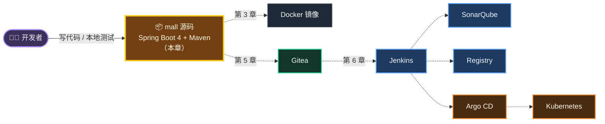
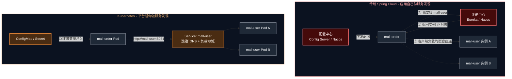
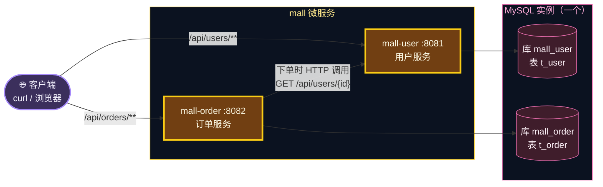
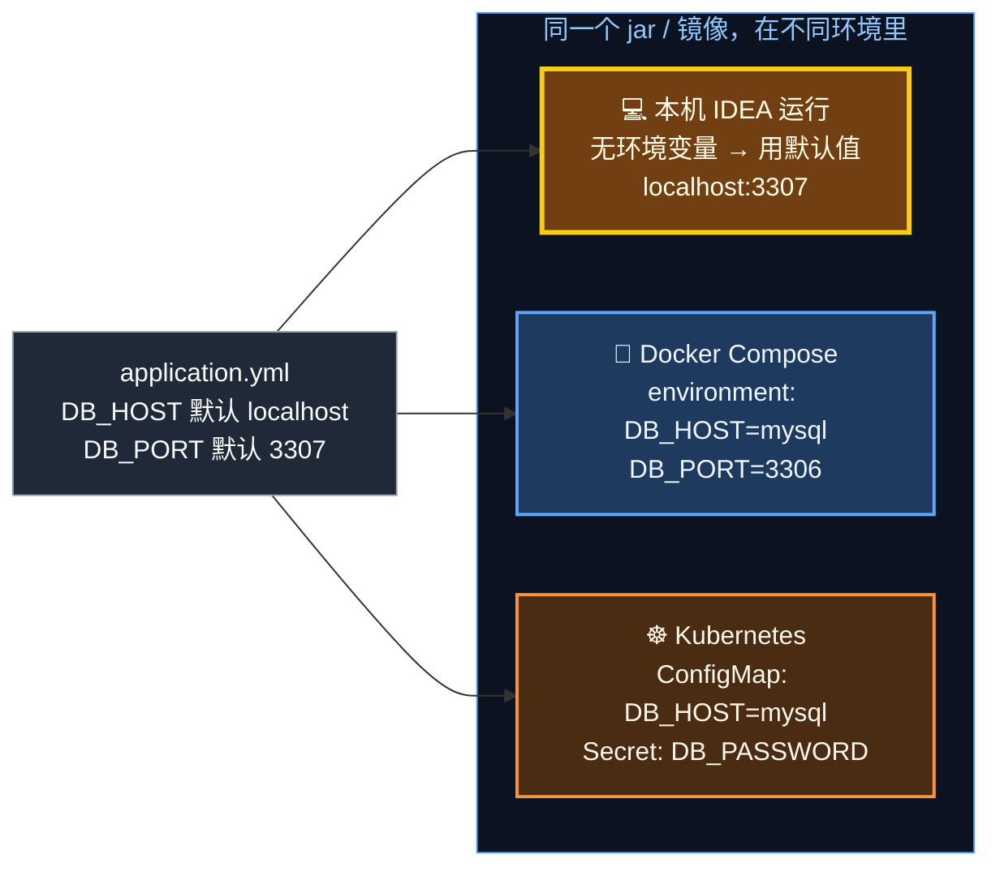
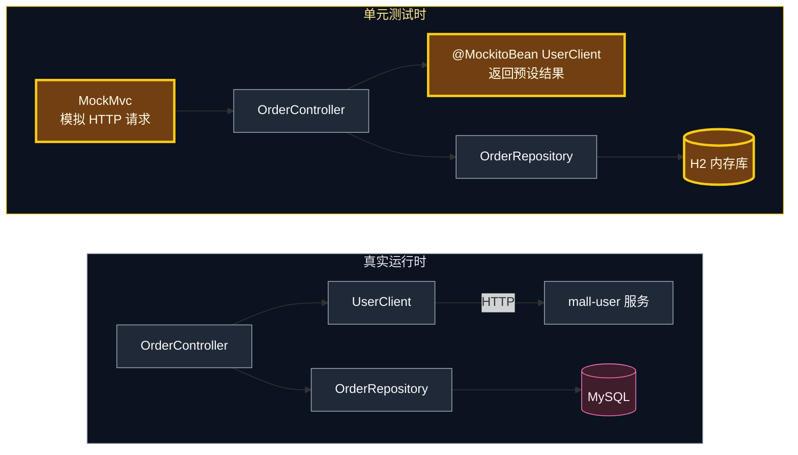
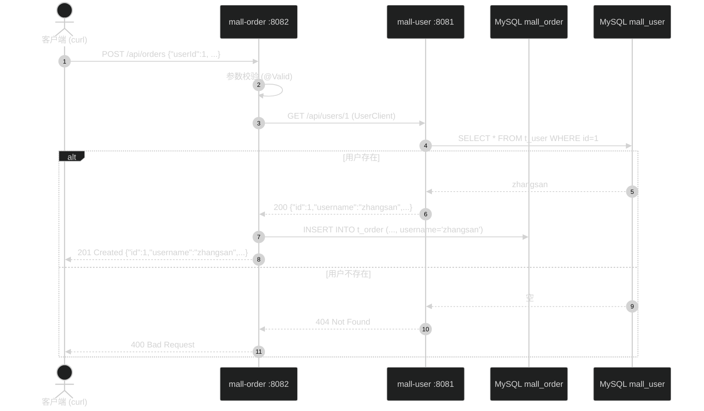
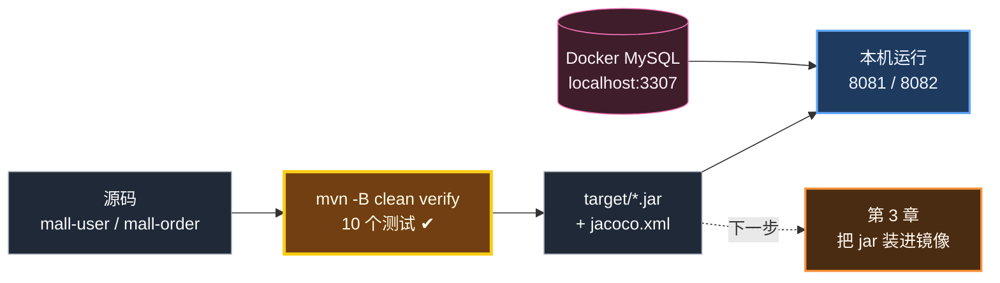

# 第 2 章 练习项目 mall：调研、设计与本地运行

> CI/CD 是"交付软件的流水线"，流水线上总得有一件"货"。这一章我们先把这件货——微服务项目 `mall`——看懂、跑通，后面 12 章都围绕它展开。

---

## 本章目标

学完本章，你应该能够：

1. 说出为什么本教程**没有直接使用** spring-petclinic-microservices、mall-swarm 等开源项目，而是自建了一个精简版 `mall`
2. 画出 `mall` 的架构：两个服务、一个数据库实例、两个库，以及服务之间如何调用
3. 读懂 `mall` 中和 CI/CD 强相关的代码设计：配置外部化、健康检查、版本接口、覆盖率插件
4. 在本机执行 `mvn -B clean verify`，看到 **10 个测试全部通过**并打开覆盖率报告
5. 用 Docker 启动 MySQL，在本机同时运行 `mall-user`（8081）和 `mall-order`（8082），用 curl 完成"创建用户 → 下单"的完整调用链

预计耗时：**60～90 分钟**

---

## 本章在全景中的位置



本章只关注最左边的"货"本身：**代码能编译、测试能通过、服务能在本机跑起来**。这也是 CI 流水线第一步要自动化的事情——如果你在本机都跑不通，流水线一定跑不通。

---

## 2.1 选型调研：为什么不直接用开源微服务项目？

### 2.1.1 选练习项目的四条标准

在动手之前，老师先带你做一次"技术选型"——这也是工作中经常要做的事。我们要选的是**练习 CI/CD 的载体**，而不是学习微服务框架本身，所以标准是：

| 标准 | 解释 |
|---|---|
| ① 是真正的"微服务" | 至少两个可以独立构建、独立部署的服务，并且服务之间有调用关系 |
| ② 资源占用可控 | 笔记本上要同时跑 Gitea、Jenkins、SonarQube、Argo CD、K8s，留给业务应用的内存有限 |
| ③ 构建足够快 | 流水线要反复运行几十次，每次构建 10 分钟会严重拖慢学习节奏 |
| ④ 覆盖常见场景 | 数据库、服务间调用、配置外部化、健康检查、多环境……这些是 CI/CD 真正要处理的东西 |

### 2.1.2 市面主流项目对比

| 项目 | 技术栈 | 规模（服务 / 中间件） | 本地资源压力 | 作为 CI/CD 练习的优点 | 作为 CI/CD 练习的不足 |
|---|---|---|---|---|---|
| [spring-petclinic-microservices](https://github.com/spring-petclinic/spring-petclinic-microservices) | Spring Boot + Spring Cloud（Config Server、Eureka、Gateway）、Spring Boot Admin、Zipkin、Prometheus/Grafana | 业务服务 4 个左右（customers / vets / visits / genai），加上配置中心、注册中心、网关、Admin、链路追踪、监控，`docker compose` 一次要起十个左右容器 | 高。官方 README 明确提醒 Windows/macOS 上要给 Docker 分配足够内存，默认配置通常不够 | Spring 官方社区维护，代码规范；按业务拆分服务、每个服务独立数据存储，结构非常"教科书" | 配置中心/注册中心在 K8s 里本来就可以被替代，搬上 K8s 要额外改造；容器多，构建慢 |
| [mall-swarm](https://github.com/macrozheng/mall-swarm) | Spring Boot 3.5 + Spring Cloud Alibaba（Nacos）、Sa-Token 等 | 认证、网关、后台、搜索、门户、监控等若干模块；依赖 MySQL、Redis、MongoDB、Elasticsearch、RabbitMQ、MinIO、Nacos 等多个中间件 | 很高。光中间件就要占用数 GB 内存 | 国内知名的电商实战项目，业务完整，资料多 | 中间件太多，大量时间会花在"把中间件跑起来"，偏离 CI/CD 主题 |
| [RuoYi-Cloud](https://gitee.com/y_project/RuoYi-Cloud) | Spring Cloud Alibaba（Nacos、Sentinel、Seata）+ Vue 前端 | 网关、认证、系统、文件、任务等若干服务 + Nacos/Redis/MySQL 等 | 高 | 国内企业后台脚手架，很多公司在用 | 同上；另外还有前端构建，主题更分散 |
| [PiggyMetrics](https://github.com/sqshq/piggymetrics) | Spring Cloud Netflix 全家桶 | 若干服务 + Config/Eureka/Turbine 等 | 中高 | 曾经的经典示例 | 技术栈较老，已多年未更新，依赖版本与现代 JDK 脱节 |
| [Online Boutique](https://github.com/GoogleCloudPlatform/microservices-demo) | Go / C# / Node.js / Python / Java 混合 | 十余个服务 | 中高 | K8s 官方生态常用演示项目 | 以多语言为主，对 Java 工程师参考价值有限 |

> 💡 上表中的规模数字只是量级参考，开源项目一直在演进，以各项目仓库的最新 README 为准。

### 2.1.3 结论：自建精简版 `mall`

我们取长补短：

- **结构借鉴 petclinic**：按业务拆分服务，每个服务拥有自己的数据库（Database per Service）
- **领域借鉴 mall-swarm**：用电商里最经典的"用户 + 订单"作为业务
- **砍掉所有与 CI/CD 无关的中间件**：只保留 MySQL；不用 Eureka/Nacos 注册中心，也不用 Config Server 配置中心

为什么可以不要注册中心和配置中心？因为我们最终跑在 Kubernetes 上，**K8s 自带了这两样能力**：



- **服务发现**：K8s 的 Service 有一个固定的 DNS 名（比如 `mall-user`），背后自动关联所有健康的 Pod，并做负载均衡。应用只要访问 `http://mall-user:8081` 即可。
- **配置管理**：K8s 的 ConfigMap / Secret 可以把配置以环境变量注入容器，应用只要支持"从环境变量读配置"就行（2.3.3 节会讲）。

> 🧠 这并不是说 Nacos/Eureka 没用了。很多公司的系统同时跑在虚拟机和 K8s 上，或者需要动态配置推送，仍然会用注册/配置中心。但对"学习 CI/CD"这个目标而言，它们是噪音。

> 🎓 第 14 章会给你一份"毕业作业"：用本教程学到的整套流水线，去部署 spring-petclinic-microservices。到那时你会发现，换一个项目，流水线几乎不用改——这正是 CI/CD 的价值。

---

## 2.2 mall 项目设计

### 2.2.1 架构



几个设计要点：

- **两个服务、两个库**：`mall-user` 只能访问 `mall_user` 库，`mall-order` 只能访问 `mall_order` 库。订单里需要用户名，就**通过 HTTP 接口问用户服务要**，而不是去跨库查表——这就是"每个服务拥有自己的数据"。
- **一个 MySQL 实例**：为了省资源，两个库放在同一个 MySQL 实例里。生产环境往往会拆成不同实例，但对应用来说只是连接地址不同。
- **订单冗余用户名**：订单表里保存了下单时的用户名快照（`username` 字段），这样查订单时不必每次再调用用户服务。

### 2.2.2 接口清单

| 服务 | 方法 | 路径 | 说明 | 成功状态码 | 常见失败 |
|---|---|---|---|---|---|
| mall-user | GET | `/api/users` | 查询全部用户 | 200 | — |
| mall-user | GET | `/api/users/{id}` | 按 id 查询用户 | 200 | 404 用户不存在 |
| mall-user | POST | `/api/users` | 创建用户，body：`{"username","nickname"}` | 201 | 400 参数不合法；409 用户名重复 |
| mall-user | GET | `/api/users/version` | 版本信息（服务名、版本、主机名） | 200 | — |
| mall-order | GET | `/api/orders` | 查询全部订单 | 200 | — |
| mall-order | GET | `/api/orders/{id}` | 按 id 查询订单 | 200 | 404 订单不存在 |
| mall-order | POST | `/api/orders` | 下单，body：`{"userId","productName","amount"}` | 201 | 400 参数不合法或用户不存在 |
| mall-order | GET | `/api/orders/version` | 版本信息 | 200 | — |
| 两者 | GET | `/actuator/health` `/actuator/health/liveness` `/actuator/health/readiness` | 健康检查（K8s 探针用） | 200 | 503 不健康 |

> 💡 注意两个服务的路径前缀不同（`/api/users`、`/api/orders`），而且版本接口也挂在各自前缀下。这是为第 10 章做准备：Ingress 只需要按路径前缀就能把请求分发到正确的服务。

### 2.2.3 目录结构

```text
mall/
├── pom.xml                       ← 父 POM：统一 Spring Boot 版本、JaCoCo 覆盖率、Sonar 插件
├── Jenkinsfile                   ← 流水线定义（第 6～12 章逐步完善）
├── docker-compose.yml            ← 本地联调：MySQL + 两个服务（第 3 章）
├── docker/mysql/init.sql         ← MySQL 首次启动时执行：创建 mall_order 库并授权
├── .gitignore / .gitattributes   ← 忽略 target/；统一 LF 换行
├── mall-user/
│   ├── pom.xml
│   ├── Dockerfile / .dockerignore    ← 第 3 章
│   └── src/
│       ├── main/java/com/xiaozhi/mall/user/
│       │   ├── MallUserApplication.java   启动类
│       │   ├── User.java                  实体（表 t_user）
│       │   ├── UserRepository.java        Spring Data JPA 仓库
│       │   ├── UserController.java        REST 接口
│       │   └── VersionController.java     版本接口
│       ├── main/resources/application.yml
│       ├── test/java/.../UserControllerTest.java   5 个测试
│       └── test/resources/application-test.yml     测试用 H2 配置
└── mall-order/                   ← 结构同上，多一个 UserClient.java（调用用户服务）
```

### 2.2.4 "麻雀虽小五脏俱全"：常见场景对照

你在公司项目里会遇到的场景，`mall` 里基本都有对应，后续每一章都会用到它们：

| 实际项目中的场景 | mall 中的体现 | 在哪一章发挥作用 |
|---|---|---|
| 多模块 Maven 工程 | 父 POM + `mall-user` + `mall-order` | 第 6 章流水线一次构建多个服务 |
| 服务间调用 | `mall-order` 通过 RestClient 调 `mall-user` | 第 9 章 K8s Service DNS |
| 数据库 | MySQL，每个服务独立库 | 第 9 章 StatefulSet + 持久卷 |
| 配置外部化 | `application.yml` 中 `${环境变量:默认值}` | 第 3 章 Compose、第 9 章 ConfigMap |
| 敏感信息 | 数据库密码通过 `DB_PASSWORD` 注入 | 第 9 章 Secret |
| 健康检查 | Actuator liveness / readiness | 第 9 章探针、第 13 章滚动更新保护 |
| 多环境 | dev / prod 只是环境变量和副本数不同 | 第 10 章 Helm values、第 13 章晋升 |
| 版本追踪 | `/version` 接口返回镜像版本和主机名 | 第 9、12、13 章观察发布与回滚 |
| 单元测试与覆盖率 | JUnit 5 + MockMvc + H2 + JaCoCo | 第 6 章测试报告、第 7 章质量门禁 |

---

## 2.3 关键代码导读

业务代码很简单（就是 CRUD），老师只挑**和 CI/CD 强相关**的部分讲。

### 2.3.1 父 POM：统一版本 + 质量工具

打开 `mall/pom.xml`，关键部分如下：

```xml
<parent>
    <groupId>org.springframework.boot</groupId>
    <artifactId>spring-boot-starter-parent</artifactId>
    <version>4.1.1</version>
    <relativePath/>
</parent>

<groupId>com.xiaozhi.mall</groupId>
<artifactId>mall</artifactId>
<version>1.0.0</version>
<packaging>pom</packaging>

<modules>
    <module>mall-user</module>
    <module>mall-order</module>
</modules>

<properties>
    <java.version>21</java.version>
    <jacoco.version>0.8.14</jacoco.version>
    <sonar-maven-plugin.version>5.8.0.7211</sonar-maven-plugin.version>
    <!-- SonarQube 中的项目标识 -->
    <sonar.projectKey>mall</sonar.projectKey>
    <sonar.projectName>mall</sonar.projectName>
</properties>
```

```xml
<build>
    <pluginManagement>
        <plugins>
            <!-- 声明版本后即可直接执行 mvn sonar:sonar -->
            <plugin>
                <groupId>org.sonarsource.scanner.maven</groupId>
                <artifactId>sonar-maven-plugin</artifactId>
                <version>${sonar-maven-plugin.version}</version>
            </plugin>
        </plugins>
    </pluginManagement>
    <plugins>
        <!-- 单元测试覆盖率：生成 target/site/jacoco/jacoco.xml，供 SonarQube 读取 -->
        <plugin>
            <groupId>org.jacoco</groupId>
            <artifactId>jacoco-maven-plugin</artifactId>
            <version>${jacoco.version}</version>
            <executions>
                <execution>
                    <id>prepare-agent</id>
                    <goals>
                        <goal>prepare-agent</goal>
                    </goals>
                </execution>
                <execution>
                    <id>report</id>
                    <phase>verify</phase>
                    <goals>
                        <goal>report</goal>
                    </goals>
                </execution>
            </executions>
        </plugin>
    </plugins>
</build>
```

逐项解释：

| 配置 | 作用 | 和 CI/CD 的关系 |
|---|---|---|
| `spring-boot-starter-parent 4.1.1` | 统一管理几百个依赖的版本 | 流水线和你本机用的依赖版本完全一致，避免"我这能跑" |
| `<modules>` | 声明两个子模块 | 在父目录执行一次 `mvn verify` 就能构建、测试所有服务 |
| `jacoco-maven-plugin` | `prepare-agent` 在测试运行时插桩统计覆盖率，`report` 在 `verify` 阶段生成报告 | 第 7 章 SonarQube 读取 `jacoco.xml` 显示覆盖率、做质量门禁 |
| `sonar-maven-plugin`（pluginManagement） | 只声明版本，不绑定到生命周期 | 平时 `mvn verify` 不会触发扫描；流水线里显式执行 `mvn sonar:sonar` 才会扫描 |
| `sonar.projectKey` | SonarQube 中的项目唯一标识 | 第 7 章在 SonarQube 中看到名为 `mall` 的项目 |

> 🧠 **为什么 `mvn sonar:sonar` 能直接识别 `sonar` 这个前缀？** Maven 解析插件前缀时，会先查当前项目 POM 中声明过的插件（包括 `pluginManagement`）。我们在父 POM 里声明了 `sonar-maven-plugin`，所以不用在 `settings.xml` 里额外配置 `pluginGroup`。编写本教程时已在本机实测通过。

### 2.3.2 子 POM：Boot 4 的新 starter 与固定产物名

`mall-user/pom.xml` 的依赖：

| 依赖 | 作用 |
|---|---|
| `spring-boot-starter-webmvc` | Web MVC（Spring Boot 4 起推荐的新名字，替代原来的 `spring-boot-starter-web`） |
| `spring-boot-starter-data-jpa` | JPA + Hibernate 7 |
| `spring-boot-starter-validation` | 参数校验（`@NotBlank`、`@Size` 等） |
| `spring-boot-starter-actuator` | 健康检查端点，供 K8s 探针使用 |
| `mysql-connector-j`（runtime） | MySQL 驱动，只在运行时需要 |
| `spring-boot-starter-webmvc-test`（test） | Boot 4 中 MockMvc 测试切片被拆到了独立模块，需要这个测试 starter |
| `h2`（test） | 单元测试用的内存数据库 |

`mall-order` 比它多一个 `spring-boot-starter-restclient`——Spring Boot 4 把 `RestClient` 的自动配置拆成了独立模块，要调用其他服务就需要它。

两个子 POM 的 `<build>` 都有这样一行：

```xml
<!-- 产物固定为 target/mall-user.jar，方便 Dockerfile 引用 -->
<finalName>${project.artifactId}</finalName>
```

默认情况下 jar 包名是 `mall-user-1.0.0.jar`，带着版本号。一旦升级版本，Dockerfile 里的 `COPY target/mall-user-1.0.0.jar` 就得跟着改。**固定产物名**让 Dockerfile 与版本号解耦——这是写流水线时很常见的小技巧。

### 2.3.3 配置外部化：`${环境变量:默认值}`

`mall-user/src/main/resources/application.yml`：

```yaml
server:
  port: 8081

spring:
  application:
    name: mall-user
  # 所有连接信息都可以被环境变量覆盖（12-Factor 配置原则）：
  # 本地开发使用冒号后的默认值；Docker / K8s 中通过环境变量注入
  datasource:
    url: jdbc:mysql://${DB_HOST:localhost}:${DB_PORT:3307}/${DB_NAME:mall_user}?useSSL=false&allowPublicKeyRetrieval=true&serverTimezone=Asia/Shanghai
    username: ${DB_USERNAME:mall}
    password: ${DB_PASSWORD:mall123}
  jpa:
    open-in-view: false
    hibernate:
      # 学习项目直接由 Hibernate 建表；生产项目建议使用 Flyway / Liquibase 管理表结构
      ddl-auto: update

management:
  endpoints:
    web:
      exposure:
        include: health,info
  endpoint:
    health:
      # 开启 /actuator/health/liveness 与 /actuator/health/readiness（K8s 环境中会自动开启，这里显式声明便于本地验证）
      probes:
        enabled: true

app:
  version: ${APP_VERSION:local}
```

`${DB_HOST:localhost}` 的含义是：**如果存在环境变量 `DB_HOST` 就用它，否则用 `localhost`**。这一个小语法撑起了整个多环境部署：



这就是 [12-Factor App](https://12factor.net/zh_cn/config) 中的第三条"**配置存储在环境中**"：代码（镜像）只构建一次，配置随环境注入。第 13 章你会看到，生产环境用的镜像和开发环境**一模一样**，差别只在注入的配置——这正是靠这里打下的基础。

> ❓ **为什么 `DB_PORT` 的默认值是 3307 而不是 MySQL 默认的 3306？**
> 因为很多同学本机已经装了 MySQL（本教程编写所用的机器上就装着 MySQL 8.3），占用了 3306。我们用 Docker 启动的练习 MySQL 映射到宿主机的 3307，避免冲突。在容器和 K8s 中，环境变量会把端口改回 3306——因为容器之间直接访问容器端口，不经过宿主机映射。

> 💡 `ddl-auto: update` 让 Hibernate 自动建表，省去写 SQL 的麻烦。真实项目请使用 Flyway/Liquibase 把表结构变更也纳入版本管理，这样数据库变更同样可以走 CI/CD。

### 2.3.4 服务间调用：`UserClient`

`mall-order/src/main/java/com/xiaozhi/mall/order/UserClient.java`：

```java
/**
 * 用户服务客户端。
 * <p>
 * 服务地址来自配置 mall.user-service.url：
 * 本地为 http://localhost:8081；Docker Compose 中为 http://mall-user:8081；
 * K8s 中同样是 http://mall-user:8081 —— 由 K8s Service 的 DNS 完成服务发现，无需注册中心。
 */
@Component
public class UserClient {

    private final RestClient restClient;

    public UserClient(RestClient.Builder builder, @Value("${mall.user-service.url}") String userServiceUrl) {
        this.restClient = builder.baseUrl(userServiceUrl).build();
    }

    public UserDTO getUser(Long userId) {
        try {
            return restClient.get()
                    .uri("/api/users/{id}", userId)
                    .retrieve()
                    .body(UserDTO.class);
        } catch (HttpClientErrorException.NotFound e) {
            throw new ResponseStatusException(HttpStatus.BAD_REQUEST, "用户不存在: " + userId);
        }
    }

    public record UserDTO(Long id, String username, String nickname) {
    }
}
```

对应的配置在 `mall-order` 的 `application.yml` 中：

```yaml
mall:
  user-service:
    url: ${USER_SERVICE_URL:http://localhost:8081}
```

同一段代码在三个环境中访问用户服务的地址：

| 运行环境 | `USER_SERVICE_URL` | 谁负责把名字解析成 IP |
|---|---|---|
| 本机 IDEA | 未设置 → `http://localhost:8081` | 操作系统（localhost） |
| Docker Compose | `http://mall-user:8081` | Compose 网络内置 DNS（服务名即主机名） |
| Kubernetes | `http://mall-user:8081` | K8s 集群 DNS（Service 名即主机名） |

> 🧠 用户服务返回 404 时，订单服务把它转换成 **400 Bad Request**——对调用方来说，"你传的 userId 不存在"是请求参数错误，而不是"订单不存在"。这种错误语义转换在微服务里很常见。

### 2.3.5 版本接口：`VersionController`

```java
/**
 * 版本信息：用来观察"当前请求落在哪个 Pod、运行的是哪个镜像版本"，
 * 是验证滚动更新、负载均衡、回滚效果的利器。
 */
@RestController
public class VersionController {

    /** 由部署环境注入（K8s 中等于镜像 tag），本地运行时为 local */
    @Value("${app.version}")
    private String version;

    @GetMapping("/api/users/version")
    public Map<String, String> version() throws UnknownHostException {
        return Map.of(
                "service", "mall-user",
                "version", version,
                "host", InetAddress.getLocalHost().getHostName());
    }
}
```

这个接口返回三样东西：

- `service`：哪个服务
- `version`：来自环境变量 `APP_VERSION`。后面部署到 K8s 时，Helm 会把**镜像 tag（Git 提交短哈希）**注入进来，于是你一眼就能看出线上跑的是哪次提交
- `host`：主机名。在容器里就是容器 ID，在 K8s 里就是 **Pod 名**

后面的章节你会反复用它：第 9 章看负载均衡（多次请求 `host` 在两个 Pod 之间切换），第 12 章确认新版本已上线（`version` 变成新的提交哈希），第 13 章观察滚动更新和回滚。

### 2.3.6 健康检查：Actuator 探针端点

`spring-boot-starter-actuator` + `management.endpoint.health.probes.enabled: true` 会提供两个专门给 K8s 用的端点：

| 端点 | 含义 | K8s 怎么用（第 9 章详解） |
|---|---|---|
| `/actuator/health/liveness` | 存活：应用进程还"活着"吗？ | 失败 → 重启容器 |
| `/actuator/health/readiness` | 就绪：应用准备好接收流量了吗？ | 失败 → 暂时不把请求转给它 |

> 💡 Spring Boot 检测到自己运行在 K8s 中时会自动开启这两个端点。我们显式开启，是为了**在本机就能先验证**。

### 2.3.7 单元测试：不依赖任何外部环境

CI 流水线最怕"测试要连真实数据库/真实服务才能跑"——Jenkins 上可没有这些东西。所以 `mall` 的测试做到了**零外部依赖**：

**① 数据库换成 H2 内存库**。`src/test/resources/application-test.yml`：

```yaml
# 单元测试使用 H2 内存数据库（MySQL 兼容模式），CI 流水线中无需准备真实数据库
spring:
  datasource:
    url: jdbc:h2:mem:mall_user;MODE=MySQL;DB_CLOSE_DELAY=-1
    username: sa
    password:
  jpa:
    hibernate:
      ddl-auto: create-drop
```

测试类上的 `@ActiveProfiles("test")` 会激活这个 `test` profile，覆盖 `application.yml` 里的 MySQL 连接。

**② 远程调用用 Mock 替代**。`OrderControllerTest` 片段：

```java
@SpringBootTest
@AutoConfigureMockMvc
@ActiveProfiles("test")
class OrderControllerTest {

    @Autowired
    private MockMvc mockMvc;

    /** 单元测试不依赖真实的 mall-user 服务，用 Mock 模拟远程调用结果 */
    @MockitoBean
    private UserClient userClient;

    @Test
    void createOrderWhenUserExists() throws Exception {
        given(userClient.getUser(1L)).willReturn(new UserClient.UserDTO(1L, "zhangsan", "张三"));

        mockMvc.perform(post("/api/orders")
                        .contentType(MediaType.APPLICATION_JSON)
                        .content("""
                                {"userId": 1, "productName": "机械键盘", "amount": 299.00}
                                """))
                .andExpect(status().isCreated())
                .andExpect(jsonPath("$.id").isNumber())
                .andExpect(jsonPath("$.username").value("zhangsan"))
                .andExpect(jsonPath("$.productName").value("机械键盘"));
    }
    // ……
}
```



两个测试类各有 5 个用例：

| 测试类 | 用例 | 验证点 |
|---|---|---|
| `UserControllerTest` | `createAndGetUser` | 创建返回 201，再按 id 查询能查到 |
| | `duplicateUsernameReturns409` | 用户名重复返回 409 |
| | `blankUsernameReturns400` | 用户名为空返回 400（参数校验生效） |
| | `unknownUserReturns404` | 查询不存在的用户返回 404 |
| | `versionEndpoint` | 版本接口返回 `service=mall-user`、`version=local` |
| `OrderControllerTest` | `createOrderWhenUserExists` | 用户存在时下单成功，订单带上用户名 |
| | `createOrderWhenUserNotExists` | 用户不存在时返回 400 |
| | `invalidAmountReturns400` | 金额为 0 返回 400 |
| | `unknownOrderReturns404` | 查询不存在的订单返回 404 |
| | `versionEndpoint` | 版本接口返回 `service=mall-order` |

> 🧠 `@MockitoBean` 是 Spring Framework 6.2 引入的注解，用来替代老版本 Spring Boot 中的 `@MockBean`（Spring Boot 4 已移除 `@MockBean`）。`@AutoConfigureMockMvc` 在 Boot 4 中的包名变成了 `org.springframework.boot.webmvc.test.autoconfigure`。如果你从网上抄 Boot 2/3 的测试代码，注意这两处差异。

---

## 2.4 动手：编译与运行单元测试

> 前提：已完成第 1 章，`D:\cicd-lab\mall` 目录存在，Git Bash 中 `java -version` 显示 21、`mvn -v` 正常。

### 步骤 1：进入项目目录

```bash
# 位置：任意目录
cd /d/cicd-lab/mall
ls
```

预期输出（顺序可能不同）：

```text
Jenkinsfile  docker  docker-compose.yml  mall-order  mall-user  pom.xml
```

### 步骤 2：执行完整构建

```bash
# 位置：/d/cicd-lab/mall
mvn -B clean verify
```

参数说明：

| 部分 | 含义 |
|---|---|
| `-B` | Batch 模式，非交互、不输出下载进度条。**流水线里一律加 `-B`**，日志会干净很多 |
| `clean` | 删除 `target/`，保证从零构建 |
| `verify` | 执行到 verify 阶段：编译 → 测试 → 打包 → 生成覆盖率报告 |

第一次执行要下载依赖，可能需要几分钟。注意观察这几段关键输出：

```text
[INFO] Reactor Build Order:
[INFO]
[INFO] mall                                                               [pom]
[INFO] mall-user                                                          [jar]
[INFO] mall-order                                                         [jar]
...
[INFO]  T E S T S
[INFO] -------------------------------------------------------
[INFO] Running com.xiaozhi.mall.user.UserControllerTest
...
[INFO] Tests run: 5, Failures: 0, Errors: 0, Skipped: 0, Time elapsed: ... s -- in com.xiaozhi.mall.user.UserControllerTest
[INFO]
[INFO] Results:
[INFO]
[INFO] Tests run: 5, Failures: 0, Errors: 0, Skipped: 0
...
[INFO] --- jacoco:0.8.14:report (report) @ mall-user ---
...
[INFO] Reactor Summary for mall 1.0.0:
[INFO]
[INFO] mall ............................................... SUCCESS [  0.xxx s]
[INFO] mall-user .......................................... SUCCESS [ xx.xxx s]
[INFO] mall-order ......................................... SUCCESS [ xx.xxx s]
[INFO] ------------------------------------------------------------------------
[INFO] BUILD SUCCESS
[INFO] ------------------------------------------------------------------------
```

测试过程中你还会看到一些类似下面的警告：

```text
Mockito is currently self-attaching to enable the inline-mock-maker. This will no longer work in future releases of the JDK...
WARNING: A Java agent has been loaded dynamically (...byte-buddy-agent-....jar)
```

**这是正常现象，不影响结果。** 原因是 JDK 21 开始对"运行时动态加载 Java Agent"给出警告，而 Mockito 默认就是这样工作的。未来的 JDK 可能会禁止这种行为，到时按 Mockito 文档把它配置成启动时 agent 即可，本教程不处理。

> ✅ **检查点 1**：确认产物和报告都已生成
>
> ```bash
> # 位置：/d/cicd-lab/mall
> ls mall-user/target/*.jar mall-order/target/*.jar
> ls mall-user/target/site/jacoco/
> ```
>
> 预期：
>
> ```text
> mall-order/target/mall-order.jar  mall-user/target/mall-user.jar
> index.html  jacoco.csv  jacoco.xml  ...（还有一些资源目录）
> ```

### 步骤 3：查看覆盖率报告

```bash
# 位置：/d/cicd-lab/mall
start mall-user/target/site/jacoco/index.html
```

浏览器会打开 JaCoCo 报告。点击包名 `com.xiaozhi.mall.user` 可以逐类查看，绿色是被测试覆盖的代码行，红色是没覆盖到的。

> 🧠 **覆盖率是怎么统计的？** `jacoco:prepare-agent` 在测试 JVM 启动参数里加入了一个 Java Agent，它在类加载时给字节码"插桩"，记录哪些行被执行过；测试结束后 `jacoco:report` 把记录（`target/jacoco.exec`）转换成 HTML 和 XML。第 7 章的 SonarQube 读取的正是 `jacoco.xml`。

> ⚠️ **常见坑**
> - `mvn` 下载依赖很慢：检查 `~/.m2/settings.xml` 是否配置了阿里云等镜像（第 1 章）
> - 报 `release version 21 not supported`：`mvn -v` 显示的 Java 版本不是 21，调整 `JAVA_HOME`
> - 测试失败：看 `mall-user/target/surefire-reports/` 下的 `.txt` 文件，里面有完整的失败原因

---

## 2.5 动手：用 Docker 启动 MySQL

服务要跑起来需要 MySQL。本机装 MySQL 太麻烦，我们直接用项目自带的 `docker-compose.yml`，**只启动其中的 mysql 一个服务**（另外两个服务第 3 章再用容器跑）。

先看 Compose 文件里 mysql 部分（`mall/docker-compose.yml`）：

```yaml
services:
  mysql:
    image: mysql:8.4
    environment:
      MYSQL_ROOT_PASSWORD: root123
      MYSQL_DATABASE: mall_user
      MYSQL_USER: mall
      MYSQL_PASSWORD: mall123
      TZ: Asia/Shanghai
    ports:
      # 宿主机用 3307，避免与本机已安装的 MySQL(3306) 冲突
      - "3307:3306"
    volumes:
      - ./docker/mysql/init.sql:/docker-entrypoint-initdb.d/init.sql:ro
      - mysql-data:/var/lib/mysql
    healthcheck:
      test: ["CMD-SHELL", "mysqladmin ping -h 127.0.0.1 -uroot -p$$MYSQL_ROOT_PASSWORD"]
      interval: 5s
      timeout: 3s
      retries: 30
```

以及初始化脚本 `mall/docker/mysql/init.sql`：

```sql
-- MySQL 容器首次初始化时执行（数据目录为空时才会执行）
-- mall_user 库和 mall 账号由环境变量 MYSQL_DATABASE / MYSQL_USER 自动创建，这里补充订单库并授权
CREATE DATABASE IF NOT EXISTS mall_order DEFAULT CHARACTER SET utf8mb4 COLLATE utf8mb4_0900_ai_ci;
GRANT ALL PRIVILEGES ON mall_order.* TO 'mall'@'%';
FLUSH PRIVILEGES;
```

MySQL 官方镜像第一次启动时的初始化流程：

```text
容器启动
   │
   ├─ 数据目录 /var/lib/mysql 为空？ ──否──▶ 直接启动 MySQL（不再执行任何初始化）
   │        │
   │        是
   │        ▼
   ├─ 1. 初始化数据目录，设置 root 密码（MYSQL_ROOT_PASSWORD）
   ├─ 2. 创建库 mall_user（MYSQL_DATABASE）
   ├─ 3. 创建账号 mall/mall123，并授予 mall_user 库全部权限（MYSQL_USER/MYSQL_PASSWORD）
   ├─ 4. 按文件名顺序执行 /docker-entrypoint-initdb.d/ 下的 *.sql、*.sh
   │       └─ init.sql：创建 mall_order 库，并授权给 mall
   └─ 5. 以正式模式启动 MySQL，开始对外服务
```

### 步骤 1：启动 MySQL

```bash
# 位置：/d/cicd-lab/mall
docker compose up -d mysql
```

`up -d mysql` 的意思是：后台（`-d`）启动名为 `mysql` 的服务。没指定的服务（mall-user、mall-order）不会启动。

预期输出（首次会先拉取 `mysql:8.4` 镜像）：

```text
[+] Running 3/3
 ✔ Network mall_default       Created
 ✔ Volume "mall_mysql-data"   Created
 ✔ Container mall-mysql-1     Started
```

### 步骤 2：等待 MySQL 健康

首次初始化需要 20～60 秒。反复执行下面的命令，直到 STATUS 出现 `(healthy)`：

```bash
# 位置：/d/cicd-lab/mall
docker compose ps
```

预期输出：

```text
NAME           IMAGE       COMMAND                  SERVICE   CREATED          STATUS                    PORTS
mall-mysql-1   mysql:8.4   "docker-entrypoint.s…"   mysql     40 seconds ago   Up 39 seconds (healthy)   33060/tcp, 0.0.0.0:3307->3306/tcp
```

> ✅ **检查点 2**：确认两个库都已创建、`mall` 账号能访问
>
> ```bash
> # 位置：/d/cicd-lab/mall
> docker compose exec mysql mysql -umall -pmall123 -e "show databases;"
> ```
>
> 预期（第一行警告可忽略）：
>
> ```text
> mysql: [Warning] Using a password on the command line interface can be insecure.
> +--------------------+
> | Database           |
> +--------------------+
> | information_schema |
> | mall_order         |
> | mall_user          |
> | performance_schema |
> +--------------------+
> ```

> ⚠️ **常见坑**
> - `Bind for 0.0.0.0:3307 failed: port is already allocated`：3307 也被占了。用 `netstat -ano | findstr 3307` 找到占用进程，或者把 Compose 文件里的 `3307` 改成别的端口，同时启动服务时设置环境变量 `DB_PORT`
> - 看不到 `mall_order` 库：说明 `init.sql` 没执行，通常是因为数据卷里已经有旧数据（初始化只在数据目录为空时执行）。执行 `docker compose down -v`（**会删除数据卷里的全部数据**）后重新 `up -d mysql`
> - 镜像拉取失败（`failed to resolve reference "docker.io/library/mysql:8.4"`）：Docker Hub 网络问题，参考第 1 章配置代理或镜像加速

---

## 2.6 动手：在本机运行两个服务

两种方式任选其一。推荐先用命令行跑一次，体会"不依赖 IDE 也能启动"——这正是流水线里的工作方式。

### 方式 A：命令行（两个 Git Bash 窗口）

**窗口 1**，启动用户服务：

```bash
# 位置：/d/cicd-lab/mall
mvn -pl mall-user spring-boot:run
```

`-pl mall-user`（project list）表示只对 `mall-user` 这个模块执行 `spring-boot:run`。看到下面这行说明启动成功：

```text
... Tomcat started on port 8081 (http) with context path '/'
... Started MallUserApplication in x.xxx seconds (process running for x.xxx)
```

**窗口 2**，启动订单服务：

```bash
# 位置：/d/cicd-lab/mall
mvn -pl mall-order spring-boot:run
```

看到下面这行说明启动成功：

```text
... Tomcat started on port 8082 (http) with context path '/'
... Started MallOrderApplication in x.xxx seconds (process running for x.xxx)
```

### 方式 B：IntelliJ IDEA

1. `File` → `Open...`，选择 `D:\cicd-lab\mall` 目录（选目录，不是选 pom.xml 也可以），弹出提示时选择 **Trust Project**
2. 等待右下角 Maven 导入完成
3. `File` → `Project Structure...` → `Project`，确认 **SDK** 为 JDK 21
4. 打开 `mall-user/src/main/java/com/xiaozhi/mall/user/MallUserApplication.java`，点击类名左侧的绿色 ▶ → `Run 'MallUserApplication'`
5. 同样运行 `mall-order` 下的 `MallOrderApplication`

> 💡 不需要配置任何环境变量——`application.yml` 中的默认值（`localhost:3307`、`mall/mall123`、`http://localhost:8081`）正好对应刚启动的 MySQL 和用户服务。这就是"默认值服务于本地开发"的设计。

> ⚠️ **常见坑**
> - `Communications link failure`：MySQL 没起来或端口不对，回到 2.5 节检查 `docker compose ps`
> - `Access denied for user 'mall'@...`：数据卷是旧的、账号没按预期创建，按 2.5 节的方法 `down -v` 后重建
> - `Port 8081 was already in use`：有别的程序占用了端口，`netstat -ano | findstr 8081` 找到 PID，`MSYS_NO_PATHCONV=1 taskkill /PID <PID> /F` 结束它（确认不是重要程序）

---

## 2.7 动手：接口演练

先看一眼"下单"这个最关键的请求在系统里是怎么流转的：



打开**第三个** Git Bash 窗口执行下面的请求。

> 💡 Git Bash 中的 curl 可以直接发送中文 JSON。如果你习惯用 PowerShell，请写 `curl.exe`（PowerShell 里的 `curl` 是 `Invoke-WebRequest` 的别名），并注意引号转义规则不同——本教程统一使用 Git Bash。

### 步骤 1：创建用户

```bash
# 位置：任意目录
curl -s -X POST http://localhost:8081/api/users \
  -H "Content-Type: application/json" \
  -d '{"username":"zhangsan","nickname":"张三"}'
```

预期（时间不同；字段顺序可能略有差异）：

```json
{"id":1,"username":"zhangsan","nickname":"张三","createdAt":"2026-10-12T20:15:30.123456"}
```

### 步骤 2：查询用户

```bash
# 位置：任意目录
curl -s http://localhost:8081/api/users/1
curl -s http://localhost:8081/api/users
```

预期：第一条返回单个用户对象，第二条返回包含它的数组 `[{...}]`。

### 步骤 3：重复创建，观察 409

```bash
# 位置：任意目录
curl -s -i -X POST http://localhost:8081/api/users \
  -H "Content-Type: application/json" \
  -d '{"username":"zhangsan","nickname":"张三"}'
```

`-i` 会把响应头也打印出来，预期第一行：

```text
HTTP/1.1 409
```

响应体是 Spring Boot 默认的错误格式：

```json
{"timestamp":"...","status":409,"error":"Conflict","path":"/api/users"}
```

> 💡 你可能注意到响应里没有"用户名已存在"这句话。Spring Boot 出于安全考虑，默认不把异常消息返回给调用方（`server.error.include-message` 默认为 `never`），但服务端日志里能看到。

### 步骤 4：下单（会触发服务间调用）

```bash
# 位置：任意目录
curl -s -X POST http://localhost:8082/api/orders \
  -H "Content-Type: application/json" \
  -d '{"userId":1,"productName":"机械键盘","amount":299.00}'
```

预期：

```json
{"id":1,"userId":1,"username":"zhangsan","productName":"机械键盘","amount":299.00,"createdAt":"2026-10-12T20:16:02.654321"}
```

注意 `username` 字段——订单服务本身并不知道 1 号用户叫什么，这个值是它**实时调用用户服务**拿到的。

### 步骤 5：用不存在的用户下单

```bash
# 位置：任意目录
curl -s -i -X POST http://localhost:8082/api/orders \
  -H "Content-Type: application/json" \
  -d '{"userId":999,"productName":"机械键盘","amount":299.00}'
```

预期第一行：

```text
HTTP/1.1 400
```

此时去看**窗口 1（mall-user）**的日志，没有异常（对它来说只是返回了一个 404）；看**窗口 2（mall-order）**的日志，会看到 `ResponseStatusException ... 用户不存在: 999` 相关的输出。

### 步骤 6：版本接口与健康检查

```bash
# 位置：任意目录
curl -s http://localhost:8081/api/users/version; echo
curl -s http://localhost:8082/api/orders/version; echo
curl -s http://localhost:8081/actuator/health/readiness; echo
curl -s http://localhost:8082/actuator/health/liveness; echo
```

预期（`host` 是你的电脑名；`Map.of` 不保证字段顺序）：

```text
{"service":"mall-user","version":"local","host":"DESKTOP-XXXXXXX"}
{"service":"mall-order","version":"local","host":"DESKTOP-XXXXXXX"}
{"status":"UP"}
{"status":"UP"}
```

`version` 是 `local`，因为本机没有设置 `APP_VERSION` 环境变量。第 3 章在容器里它会变成 `compose`，第 9 章在 K8s 里会变成 `v1`，第 12 章会变成 Git 提交哈希——**同一个接口，见证整个交付链的演进**。

> ✅ **检查点 3**：全部满足即本章完成
>
> | 检查项 | 预期 |
> |---|---|
> | 创建用户 | 201，返回带 id 的用户 |
> | 重复创建 | 409 |
> | 下单（userId=1） | 201，订单中 `username` 为 `zhangsan` |
> | 下单（userId=999） | 400 |
> | 两个 `/version` | `version` 为 `local` |
> | 两个健康检查 | `{"status":"UP"}` |

### 步骤 7：收尾

- 在窗口 1、窗口 2 中按 `Ctrl + C` 停止两个服务（IDEA 中点红色方块停止）
- **MySQL 保持运行即可**，第 3 章会继续使用它

---

## 本章小结

| 要点 | 一句话总结 |
|---|---|
| 项目选型 | 开源项目中间件多、资源重；自建 `mall` 聚焦 CI/CD，结构借鉴 petclinic，领域借鉴 mall-swarm |
| 服务拆分 | 用户、订单两个服务，各自一个库，订单通过 HTTP 调用用户服务 |
| 服务发现 | K8s Service DNS 替代 Eureka/Nacos，代码里只写 `http://mall-user:8081` |
| 配置外部化 | `${ENV:默认值}`：默认值服务本地开发，环境变量服务容器与 K8s |
| 固定产物名 | `finalName` 让 Dockerfile 与版本号解耦 |
| 健康检查 | Actuator liveness / readiness，后面给 K8s 探针用 |
| 版本接口 | `/version` 返回版本和主机名，用来观察发布、负载均衡、回滚 |
| 可在 CI 中运行的测试 | H2 替代 MySQL，`@MockitoBean` 替代远程服务，零外部依赖 |
| 覆盖率 | JaCoCo 在 `verify` 阶段生成 `jacoco.xml`，第 7 章交给 SonarQube |



---

## 课后练习

1. **体验测试失败**：把 `UserControllerTest.versionEndpoint` 中期望的 `"local"` 改成 `"v1"`，执行 `mvn -B clean verify`，观察 Maven 的失败输出格式以及 `BUILD FAILURE`。记住这个输出——第 6 章你会在 Jenkins 里看到一模一样的东西。**做完记得改回来。**
2. **只构建一个模块**：执行 `mvn -B -pl mall-order clean verify`，对比耗时。思考：如果一个仓库里有 20 个服务，流水线每次都全量构建合理吗？（第 14 章进阶部分会讨论）
3. **环境变量覆盖**：停止 mall-user，用 `APP_VERSION=hello mvn -pl mall-user spring-boot:run` 启动，再请求 `/api/users/version`，确认 `version` 变成了 `hello`。这就是后面 K8s 注入版本号的原理。

---

下一章：[第 3 章 Docker 化：分层镜像与 Compose 联调](03-docker.md)
