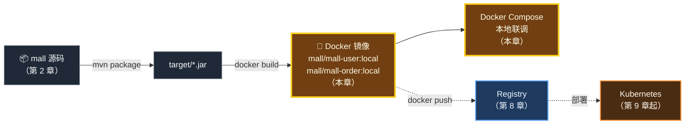
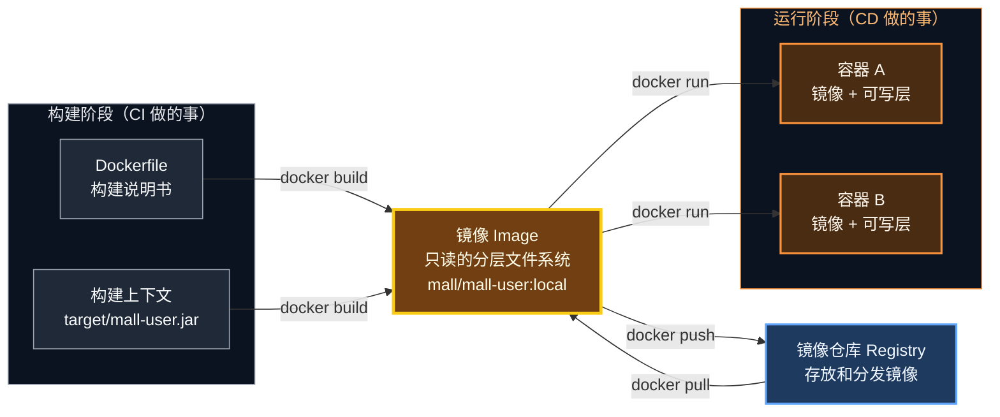
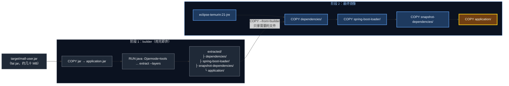
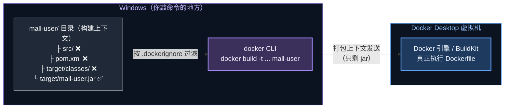
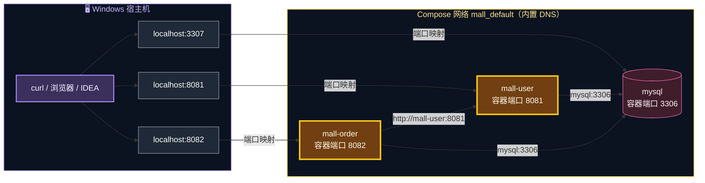

# 第 3 章 Docker 化：分层镜像与 Compose 联调

> 上一章的交付物是一个 jar 包；从这一章开始，交付物变成**镜像**。镜像是 CI 和 CD 之间的"标准集装箱"——CI 负责把它造出来，CD 负责把它运到各个环境。

---

## 本章目标

学完本章，你应该能够：

1. 说清楚"为什么交付物要从 jar 变成镜像"，以及镜像、层、容器、仓库之间的关系
2. 逐行读懂 `mall` 的**生产级 Dockerfile**：多阶段构建、Spring Boot 分层解压、非 root 用户、容器内存参数、exec 形式启动
3. 理解**构建上下文**和 `.dockerignore` 的作用
4. 亲手构建 `mall/mall-user:local`、`mall/mall-order:local` 两个镜像，并通过实验观察**层缓存**的效果
5. 用一条 `docker compose up -d --build` 拉起"MySQL + 两个服务"的完整环境，并完成接口演练
6. 用 `docker compose down` 正确收尾，释放 3307 / 8081 / 8082 端口

预计耗时：**60～90 分钟**

---

## 本章在全景中的位置



---

## 3.1 为什么要容器化？

### 3.1.1 jar 包交付的老问题

在没有容器之前，交付一个 Spring Boot 服务通常是这样的：

```text
开发：mvn package 得到 mall-user.jar
  │
  ▼
运维：登录服务器 → 确认装了哪个版本的 JDK → 上传 jar → 写启动脚本（JVM 参数、日志路径）
      → nohup java -jar ... & → 换一台服务器再来一遍
```

问题在于 **jar 包只是"应用"，不包含"运行环境"**：

| 问题 | 典型表现 |
|---|---|
| 环境不一致 | 开发用 JDK 21，测试服务器装的是 JDK 17，启动直接报 `UnsupportedClassVersionError` |
| 启动方式五花八门 | 每个服务一套 shell 脚本，JVM 参数散落各处 |
| 无法标准化调度 | K8s 这样的平台不认识"jar + 脚本"，它只认识镜像 |

### 3.1.2 镜像：应用 + 运行环境的"集装箱"

镜像把**操作系统基础文件 + JRE + 依赖 + 业务代码 + 启动命令**全部打包在一起。只要有 Docker（或任何兼容 OCI 标准的运行时），它在哪里都以完全相同的方式运行。



你已经会用 `docker run/ps/logs` 这些命令了，所以本章不重复基础，**重点讲两件事：镜像是怎么"分层"构建的，以及怎样构建才算"生产级"**。

### 3.1.3 层（Layer）：理解镜像的关键

Dockerfile 中每一条会修改文件系统的指令（`FROM`、`COPY`、`RUN` 等）都会产生一个**层**。镜像就是这些层自下而上叠起来的结果：

- **层是只读的、可复用的**：两个镜像如果基础层相同，磁盘上只存一份；推送/拉取时，仓库里已有的层直接跳过
- **构建有缓存**：某一层的输入（指令 + 文件内容）没变，就直接复用上次的结果（日志里显示 `CACHED`）
- **一旦某层变了，它之后的所有层都要重建**

所以写 Dockerfile 有一条黄金法则：**越不常变的内容越往前放，越常变的内容越往后放。** 下面的 Dockerfile 就是围绕这条法则设计的。

---

## 3.2 逐行读懂 mall 的 Dockerfile

打开 `mall/mall-user/Dockerfile`：

```dockerfile
# ============================================================
# mall-user 镜像
# 前置条件：已执行 mvn package，生成 target/mall-user.jar
# 构建命令（在 mall 目录下）：docker build -t mall/mall-user:local mall-user
# ============================================================

# ---------- 第 1 阶段：把 fat jar 按"变化频率"拆成多层 ----------
FROM eclipse-temurin:21-jre AS builder
WORKDIR /builder
COPY target/mall-user.jar application.jar
# Spring Boot 官方推荐的分层解压：依赖层 / 加载器层 / 快照依赖层 / 业务代码层
RUN java -Djarmode=tools -jar application.jar extract --layers --destination extracted

# ---------- 第 2 阶段：运行时镜像 ----------
FROM eclipse-temurin:21-jre
WORKDIR /application

# 使用非 root 用户运行，降低容器被攻破后的风险
RUN groupadd --system spring && useradd --system --gid spring spring

# 越不常变的层越靠前：只改业务代码时，前三层都能命中缓存，推送/拉取只传最后一层
COPY --from=builder /builder/extracted/dependencies/ ./
COPY --from=builder /builder/extracted/spring-boot-loader/ ./
COPY --from=builder /builder/extracted/snapshot-dependencies/ ./
COPY --from=builder /builder/extracted/application/ ./

USER spring
EXPOSE 8081
# 让 JVM 按容器内存上限计算堆大小（K8s 中由 resources.limits.memory 决定）
ENV JAVA_TOOL_OPTIONS="-XX:MaxRAMPercentage=75.0"
ENTRYPOINT ["java", "-jar", "application.jar"]
```

`mall-order/Dockerfile` 结构完全相同，只是 jar 名和端口（8082）不同。下面分块讲解。

### 3.2.1 多阶段构建（Multi-stage Build）

文件里有两个 `FROM`，代表两个**阶段**：



- **阶段 1（builder）**：只是个"工作台"，负责把 fat jar 拆开。它产生的层**不会**进入最终镜像
- **阶段 2**：最终镜像，用 `COPY --from=builder` 只拷贝拆好的目录

> 💡 多阶段构建另一个常见用法是"在第 1 阶段用 Maven 镜像编译源码，第 2 阶段只放 jar"。本项目没有这样做，因为流水线里已经用 Maven 跑过测试、打好了 jar，再在 Docker 里编译一遍是重复劳动。所以我们的约定是：**先 `mvn package`，再 `docker build`**。

### 3.2.2 Spring Boot 分层解压：为什么要拆 jar？

`java -Djarmode=tools -jar application.jar extract --layers --destination extracted` 是 Spring Boot 官方推荐的做法（见 Spring Boot 文档 *Efficient Container Images / Dockerfiles* 一节）。它按"变化频率"把 fat jar 拆成四个目录：

| 目录 | 内容 | 什么时候变 |
|---|---|---|
| `dependencies/` | 所有第三方依赖 jar（Spring、Hibernate、MySQL 驱动……） | 升级依赖时（很少） |
| `spring-boot-loader/` | Spring Boot 启动器相关的类（本项目的解压模式下通常为空或极小） | 几乎不变 |
| `snapshot-dependencies/` | `-SNAPSHOT` 版本的依赖（本项目没有，为空） | 偶尔 |
| `application/` | `application.jar`：你的业务代码和配置文件 | **每次提交都变** |

最终镜像的层结构是这样的（大小为量级参考，以实际为准）：

```text
                                                        变化频率            大小量级
┌──────────────────────────────────────────────┐
│ ⑦ COPY application/        业务代码           │ ◀── 每次提交         几十 KB
├──────────────────────────────────────────────┤
│ ⑥ COPY snapshot-dependencies/                 │ ◀── 偶尔             本项目为空
├──────────────────────────────────────────────┤
│ ⑤ COPY spring-boot-loader/                    │ ◀── 几乎不变         极小
├──────────────────────────────────────────────┤
│ ④ COPY dependencies/       第三方依赖         │ ◀── 升级依赖时       几十 MB
├──────────────────────────────────────────────┤
│ ③ RUN groupadd/useradd     创建 spring 用户   │ ◀── 几乎不变         KB 级
│ ② WORKDIR /application                        │
├──────────────────────────────────────────────┤
│ ① eclipse-temurin:21-jre   Ubuntu + JRE 21    │ ◀── 升级基础镜像时   一两百 MB
└──────────────────────────────────────────────┘
```

**收益**：日常开发 99% 的提交只改业务代码，于是：

- **构建快**：①～⑥ 层全部命中缓存，只重建 ⑦
- **推送快**：仓库里已有 ①～⑥，只推几十 KB 的 ⑦
- **部署快**：K8s 节点上已有 ①～⑥，只拉 ⑦

对比一下"直接把 fat jar 拷进去"的写法：

```dockerfile
# ❌ 反例：不分层
FROM eclipse-temurin:21-jre
COPY target/mall-user.jar /app.jar
ENTRYPOINT ["java", "-jar", "/app.jar"]
```

改一行业务代码，整个几十 MB 的 jar 都变了，这一层就得整个重建、重推、重拉。服务一多、发布一频繁，浪费的带宽和时间相当可观。

### 3.2.3 非 root 用户

```dockerfile
RUN groupadd --system spring && useradd --system --gid spring spring
...
USER spring
```

容器默认以 root 运行。一旦应用有漏洞被攻破，攻击者在容器里就是 root，逃逸到宿主机的风险更高。很多公司的 K8s 集群会通过安全策略**直接拒绝以 root 运行的容器**，所以养成习惯：业务镜像一律用普通用户运行。

### 3.2.4 容器里的 JVM 内存

```dockerfile
ENV JAVA_TOOL_OPTIONS="-XX:MaxRAMPercentage=75.0"
```

- JDK 10 之后，JVM 能识别容器的内存限制（cgroup），但默认**最大堆只取可用内存的 25%**，对单进程容器太保守
- `MaxRAMPercentage=75.0` 表示最大堆取容器内存上限的 75%，剩下 25% 留给元空间、线程栈、直接内存等堆外开销
- 第 9 章在 K8s 中我们会设置 `limits.memory: 768Mi`，于是最大堆约为 576Mi
- `JAVA_TOOL_OPTIONS` 是 JVM 会自动读取的环境变量，启动时日志第一行会打印 `Picked up JAVA_TOOL_OPTIONS: -XX:MaxRAMPercentage=75.0`，这是正常的

> 💡 为什么不直接写死 `-Xmx512m`？因为同一个镜像在 dev 和 prod 的内存配额不同（第 10 章 prod 的 limit 是 1Gi）。用百分比，镜像就不用为不同环境改动——又一次"镜像不变，配置随环境"。

### 3.2.5 EXPOSE 与 ENTRYPOINT

```dockerfile
EXPOSE 8081
ENTRYPOINT ["java", "-jar", "application.jar"]
```

- `EXPOSE` 只是**文档性声明**，告诉使用者"这个镜像监听 8081"，并不会真的发布端口。真正把端口映射到宿主机的是 `docker run -p` 或 Compose 的 `ports`
- `ENTRYPOINT` 使用 **exec 形式**（JSON 数组），这一点非常重要：

```text
exec 形式  ENTRYPOINT ["java","-jar","application.jar"]
   PID 1 = java
   docker stop / K8s 删除 Pod ──SIGTERM──▶ java  ✅ Spring Boot 收到信号，优雅停机
                                                    （处理完进行中的请求再退出）

shell 形式 ENTRYPOINT java -jar application.jar
   PID 1 = /bin/sh -c "java ..."，java 是它的子进程
   docker stop ──SIGTERM──▶ sh  ✖ sh 不转发信号给 java
   等待超时（Docker 默认 10 秒）后 ──SIGKILL──▶ 强制杀死  ❌ 进行中的请求直接失败
```

> 🧠 优雅停机在第 13 章的滚动更新中至关重要：K8s 下线旧 Pod 时发送 SIGTERM，如果应用收不到信号，每次发布都会有一批请求报错。Spring Boot 3.4 起默认就开启了优雅停机（`server.shutdown=graceful`），前提是信号要能送达 Java 进程。

### 3.2.6 `.dockerignore` 与构建上下文

`mall/mall-user/.dockerignore`：

```text
# 构建上下文只需要打好的 jar，其余文件一律不发送给 Docker 引擎（构建更快、避免泄露源码）
*
!target/mall-user.jar
```

要理解它，先要知道 **docker CLI 和 Docker 引擎是分开的**：



`docker build ... mall-user` 最后那个 `mall-user` 就是**构建上下文**目录。Docker 引擎运行在 Docker Desktop 的虚拟机里，看不到你的 Windows 文件，所以 CLI 要先把上下文打包发过去，Dockerfile 里的 `COPY` 只能从这个包里取文件。

`.dockerignore` 的写法是"先全部排除（`*`），再把需要的加回来（`!target/mall-user.jar`）"——白名单方式最安全，既减少传输量，又避免把源码、配置、密钥意外打进镜像。

> 🧠 第 4 章的 Jenkins 也是同样的结构：Jenkins 容器里的 docker CLI 通过 `docker.sock` 把构建上下文发给 Docker Desktop 的引擎。理解了这张图，到时就不会困惑"镜像到底建在哪"。

---

## 3.3 动手：构建镜像

> 前提：第 2 章的 MySQL 仍在运行（`docker compose ps` 能看到 `mall-mysql-1`）；两个服务的本地进程已经停止。

### 步骤 1：打包 jar

```bash
# 位置：/d/cicd-lab/mall
mvn -B clean package -DskipTests
```

`-DskipTests` 跳过测试（第 2 章已经测过），只为快速得到 jar。预期结尾：

```text
[INFO] mall ............................................... SUCCESS
[INFO] mall-user .......................................... SUCCESS
[INFO] mall-order ......................................... SUCCESS
[INFO] BUILD SUCCESS
```

```bash
# 位置：/d/cicd-lab/mall
ls -lh mall-user/target/mall-user.jar mall-order/target/mall-order.jar
```

可以看到两个 jar 都是几十 MB——这就是"fat jar"，里面打包了全部依赖。

### 步骤 2：构建 mall-user 镜像

```bash
# 位置：/d/cicd-lab/mall
docker build -t mall/mall-user:local mall-user
```

| 部分 | 含义 |
|---|---|
| `-t mall/mall-user:local` | 给镜像起名（tag）：命名空间 `mall`，名称 `mall-user`，标签 `local` |
| `mall-user` | 构建上下文目录；Dockerfile 默认取上下文目录下的 `Dockerfile` |

首次构建需要拉取 `eclipse-temurin:21-jre`，预期输出类似（步骤编号、耗时以实际为准）：

```text
[+] Building 35.2s (14/14) FINISHED                              docker:desktop-linux
 => [internal] load build definition from Dockerfile
 => [internal] load metadata for docker.io/library/eclipse-temurin:21-jre
 => [internal] load .dockerignore
 => [internal] load build context
 => => transferring context: 6x.xxMB                       ← 只传了 jar
 => [builder 1/4] FROM docker.io/library/eclipse-temurin:21-jre@sha256:...
 => [builder 2/4] WORKDIR /builder
 => [builder 3/4] COPY target/mall-user.jar application.jar
 => [builder 4/4] RUN java -Djarmode=tools -jar application.jar extract --layers --destination extracted
 => [stage-1 2/7] WORKDIR /application
 => [stage-1 3/7] RUN groupadd --system spring && useradd --system --gid spring spring
 => [stage-1 4/7] COPY --from=builder /builder/extracted/dependencies/ ./
 => [stage-1 5/7] COPY --from=builder /builder/extracted/spring-boot-loader/ ./
 => [stage-1 6/7] COPY --from=builder /builder/extracted/snapshot-dependencies/ ./
 => [stage-1 7/7] COPY --from=builder /builder/extracted/application/ ./
 => exporting to image
 => => naming to docker.io/mall/mall-user:local
```

> 💡 注意最后一行 `docker.io/mall/mall-user:local`：名字里没写仓库地址时，Docker 默认补全为 `docker.io`（Docker Hub）。这个镜像目前只存在于本机，并不会被推到 Docker Hub。

### 步骤 3：构建 mall-order 镜像

```bash
# 位置：/d/cicd-lab/mall
docker build -t mall/mall-order:local mall-order
```

这次你会发现很多步骤显示 `CACHED`——基础镜像、创建用户这些层和 mall-user 完全一样，直接复用了。

> ✅ **检查点 1**：两个镜像都已存在
>
> ```bash
> # 位置：任意目录
> docker image ls --filter "reference=mall/*"
> ```
>
> 预期能看到两行（列名和大小显示方式随 Docker 版本略有差异）：
>
> ```text
> REPOSITORY        TAG     IMAGE ID       CREATED          SIZE
> mall/mall-order   local   xxxxxxxxxxxx   10 seconds ago   ...MB
> mall/mall-user    local   xxxxxxxxxxxx   1 minute ago     ...MB
> ```

### 步骤 4：用 `docker history` 看清每一层

```bash
# 位置：任意目录
docker history mall/mall-user:local
```

输出从上到下是**从最新层到最底层**，示意如下（大小为量级参考）：

```text
IMAGE          CREATED         CREATED BY                                      SIZE
xxxxxxxxxxxx   2 minutes ago   ENTRYPOINT ["java" "-jar" "application.jar"]    0B
<missing>      2 minutes ago   ENV JAVA_TOOL_OPTIONS=-XX:MaxRAMPercentage=7…   0B
<missing>      2 minutes ago   EXPOSE map[8081/tcp:{}]                         0B
<missing>      2 minutes ago   USER spring                                     0B
<missing>      2 minutes ago   COPY /builder/extracted/application/ ./ # bu…   几十 KB   ← 业务代码
<missing>      2 minutes ago   COPY /builder/extracted/snapshot-dependencie…   0B 左右
<missing>      2 minutes ago   COPY /builder/extracted/spring-boot-loader/ …   很小
<missing>      2 minutes ago   COPY /builder/extracted/dependencies/ ./ # b…   几十 MB   ← 第三方依赖
<missing>      2 minutes ago   RUN /bin/sh -c groupadd --system spring && u…   KB 级
<missing>      2 minutes ago   WORKDIR /application                            0B
<missing>      ...             （以下为 eclipse-temurin:21-jre 基础镜像的层）    ...
```

几点观察：

- `ENTRYPOINT`、`ENV`、`USER`、`EXPOSE` 这类只改元数据的指令，层大小为 0
- builder 阶段的层（`COPY target/mall-user.jar`、`RUN ... extract`）**根本没出现**——多阶段构建的中间产物不会进入最终镜像
- 业务代码层只有几十 KB，依赖层有几十 MB，差了上千倍

### 步骤 5：实验——只改业务代码，观察缓存

我们来验证"只改代码时，只有最后一层重建"。

**① 修改一行业务代码**：把用户不存在时的提示语改一下。

```bash
# 位置：/d/cicd-lab/mall
sed -i 's/用户不存在: /用户不存在，id=/' mall-user/src/main/java/com/xiaozhi/mall/user/UserController.java
grep -n "用户不存在" mall-user/src/main/java/com/xiaozhi/mall/user/UserController.java
```

预期：

```text
39:                .orElseThrow(() -> new ResponseStatusException(HttpStatus.NOT_FOUND, "用户不存在，id=" + id));
```

（行号可能略有不同。）

**② 重新打包并构建**：

```bash
# 位置：/d/cicd-lab/mall
mvn -B -pl mall-user clean package -DskipTests
docker build -t mall/mall-user:local mall-user
```

**③ 观察输出**。你应该看到类似这样的结果：

```text
 => CACHED [builder 2/4] WORKDIR /builder
 => [builder 3/4] COPY target/mall-user.jar application.jar                 ← jar 变了，重新执行
 => [builder 4/4] RUN java -Djarmode=tools -jar application.jar extract ... ← 重新解压
 => CACHED [stage-1 2/7] WORKDIR /application
 => CACHED [stage-1 3/7] RUN groupadd --system spring && useradd ...
 => CACHED [stage-1 4/7] COPY --from=builder /builder/extracted/dependencies/ ./        ← 依赖内容没变，命中缓存！
 => CACHED [stage-1 5/7] COPY --from=builder /builder/extracted/spring-boot-loader/ ./
 => CACHED [stage-1 6/7] COPY --from=builder /builder/extracted/snapshot-dependencies/ ./
 => [stage-1 7/7] COPY --from=builder /builder/extracted/application/ ./               ← 只有业务层重建
```

> 🧠 **为什么 builder 阶段重新执行了，后面的 COPY 依然能 CACHED？** BuildKit 判断 `COPY` 能否复用缓存，看的是**被拷贝文件的内容校验和**，而不是"上一步有没有重新执行"。依赖 jar 解压出来逐字节相同，校验和不变，于是命中缓存。（如果你的环境偶尔没有命中，也不影响后续学习，原理是一样的。）

**④ 还原代码**（重要，避免影响后面的章节）：

```bash
# 位置：/d/cicd-lab/mall
sed -i 's/用户不存在，id=/用户不存在: /' mall-user/src/main/java/com/xiaozhi/mall/user/UserController.java
grep -n "用户不存在" mall-user/src/main/java/com/xiaozhi/mall/user/UserController.java
mvn -B -pl mall-user clean package -DskipTests
docker build -t mall/mall-user:local mall-user
```

预期 `grep` 输出恢复为 `"用户不存在: " + id`。

> ⚠️ **常见坑**
> - `COPY failed: ... "/target/mall-user.jar": not found`：忘了先 `mvn package`，或者执行 `mvn clean` 之后没有重新打包。**镜像构建依赖 jar 存在**，这也是流水线里"先 Maven、后 Docker"的原因
> - `failed to resolve source metadata for docker.io/library/eclipse-temurin:21-jre`：Docker Hub 拉取失败，参考第 1 章配置代理/镜像加速，然后重试
> - 构建日志里 `transferring context` 有几百 MB：`.dockerignore` 没生效，检查文件名是否正确（以点开头、没有 `.txt` 后缀）、是否放在**构建上下文目录**（`mall-user/`）下

---

## 3.4 Docker Compose：一条命令拉起整套环境

单独 `docker run` 三个容器，你需要手工创建网络、记住每个容器的环境变量和启动顺序。Compose 用一个 YAML 文件把这些**声明**下来——这是你接触到的第一个"声明式"配置，第 9 章的 K8s 会把这种思想发挥到极致。

### 3.4.1 读懂 docker-compose.yml

完整的 `mall/docker-compose.yml`：

```yaml
# ============================================================
# 本地联调：一条命令启动 MySQL + mall-user + mall-order
# 使用前先打包：mvn -B clean package -DskipTests
# 启动：docker compose up -d --build
# ============================================================
name: mall

services:
  mysql:
    image: mysql:8.4
    environment:
      MYSQL_ROOT_PASSWORD: root123
      MYSQL_DATABASE: mall_user
      MYSQL_USER: mall
      MYSQL_PASSWORD: mall123
      TZ: Asia/Shanghai
    ports:
      # 宿主机用 3307，避免与本机已安装的 MySQL(3306) 冲突
      - "3307:3306"
    volumes:
      - ./docker/mysql/init.sql:/docker-entrypoint-initdb.d/init.sql:ro
      - mysql-data:/var/lib/mysql
    healthcheck:
      test: ["CMD-SHELL", "mysqladmin ping -h 127.0.0.1 -uroot -p$$MYSQL_ROOT_PASSWORD"]
      interval: 5s
      timeout: 3s
      retries: 30

  mall-user:
    build: ./mall-user
    image: mall/mall-user:local
    environment:
      DB_HOST: mysql          # 同一个 Compose 网络内，用服务名访问
      DB_PORT: "3306"         # 容器之间走容器端口，而不是宿主机映射的 3307
      DB_NAME: mall_user
      DB_USERNAME: mall
      DB_PASSWORD: mall123
      APP_VERSION: compose
    ports:
      - "8081:8081"
    depends_on:
      mysql:
        condition: service_healthy

  mall-order:
    build: ./mall-order
    image: mall/mall-order:local
    environment:
      DB_HOST: mysql
      DB_PORT: "3306"
      DB_NAME: mall_order
      DB_USERNAME: mall
      DB_PASSWORD: mall123
      USER_SERVICE_URL: http://mall-user:8081
      APP_VERSION: compose
    ports:
      - "8082:8082"
    depends_on:
      mysql:
        condition: service_healthy
      mall-user:
        condition: service_started

volumes:
  mysql-data:
```

逐个知识点讲解：

| 配置 | 含义 | 要点 |
|---|---|---|
| `name: mall` | Compose 项目名 | 容器名会是 `mall-<服务名>-1`，网络是 `mall_default`，卷是 `mall_mysql-data` |
| `build` + `image` | 用 `./mall-user` 目录构建，并命名为 `mall/mall-user:local` | 和你 3.3 节手工构建的镜像是同一个名字 |
| `ports: "8081:8081"` | **宿主机端口:容器端口** | 只影响"从 Windows 访问容器"，容器之间互访不经过它 |
| `environment` | 注入环境变量 | 覆盖 `application.yml` 里 `${DB_HOST:localhost}` 等默认值 |
| `DB_HOST: mysql` | 服务名即主机名 | Compose 为项目创建一个网络，网络内置 DNS 把服务名解析为容器 IP |
| `DB_PORT: "3306"` | 容器端口 | 容器之间直接通信，用的是 MySQL 容器内部的 3306，不是宿主机的 3307 |
| `depends_on` + `condition: service_healthy` | 等 MySQL **健康**后再启动服务 | 只写 `depends_on: [mysql]` 只保证"MySQL 容器已启动"，不保证"MySQL 已能接受连接" |
| `condition: service_started` | mall-order 只要求 mall-user 已启动 | 订单服务启动时不需要调用用户服务，下单时才调用，所以不必等它健康 |
| `healthcheck` | 每 5 秒执行一次 `mysqladmin ping` | `$$` 是 Compose 的转义：`$$MYSQL_ROOT_PASSWORD` 传给容器后变成 `$MYSQL_ROOT_PASSWORD`，由容器里的 shell 展开 |
| `volumes: mysql-data` | 命名卷，由 Docker 管理 | 删除容器数据不丢；只有 `down -v` 才会删除 |

### 3.4.2 网络拓扑



请把这张图和第 2 章 2.3.4 节的表格对照着看：**同样的代码，因为环境变量不同，在本机连 `localhost:3307`，在 Compose 里连 `mysql:3306`**。

---

## 3.5 动手：Compose 全栈联调

### 步骤 1：确认 jar 是最新的

3.3 节最后已经还原代码并重新打包过。如果你不确定，再打包一次：

```bash
# 位置：/d/cicd-lab/mall
mvn -B clean package -DskipTests
```

### 步骤 2：一键启动

```bash
# 位置：/d/cicd-lab/mall
docker compose up -d --build
```

- `--build`：启动前先按 `build` 配置重新构建镜像（层缓存让它很快）
- MySQL 在第 2 章已经启动，Compose 发现它的配置没变，会保持原样不重建

预期输出（顺序和细节以实际为准）：

```text
[+] Building ...
 ...
[+] Running 3/3
 ✔ Container mall-mysql-1       Healthy
 ✔ Container mall-mall-user-1   Started
 ✔ Container mall-mall-order-1  Started
```

### 步骤 3：查看状态与日志

```bash
# 位置：/d/cicd-lab/mall
docker compose ps
```

预期三个容器都是 `Up`，MySQL 带 `(healthy)`：

```text
NAME                IMAGE                   SERVICE      STATUS                   PORTS
mall-mall-order-1   mall/mall-order:local   mall-order   Up 20 seconds            0.0.0.0:8082->8082/tcp
mall-mall-user-1    mall/mall-user:local    mall-user    Up 20 seconds            0.0.0.0:8081->8081/tcp
mall-mysql-1        mysql:8.4               mysql        Up 30 minutes (healthy)  33060/tcp, 0.0.0.0:3307->3306/tcp
```

跟踪订单服务的启动日志（`Ctrl + C` 退出跟踪，不会停止容器）：

```bash
# 位置：/d/cicd-lab/mall
docker compose logs -f mall-order
```

应能看到：

```text
mall-order-1  | Picked up JAVA_TOOL_OPTIONS: -XX:MaxRAMPercentage=75.0
mall-order-1  |
mall-order-1  |   .   ____          _            __ _ _
mall-order-1  |  /\\ / ___'_ __ _ _(_)_ __  __ _ \ \ \ \
...
mall-order-1  | ... Tomcat started on port 8082 (http) with context path '/'
mall-order-1  | ... Started MallOrderApplication in x.xxx seconds (process running for x.xxx)
```

### 步骤 4：接口演练（这次请求的是容器）

```bash
# 位置：任意目录
# 1) 创建一个新用户（第 2 章的 zhangsan 还在库里，所以换个名字）
curl -s -X POST http://localhost:8081/api/users \
  -H "Content-Type: application/json" \
  -d '{"username":"lisi","nickname":"李四"}'; echo

# 2) 查看所有用户：应能看到 zhangsan 和 lisi —— 数据在 MySQL 卷里，与运行方式无关
curl -s http://localhost:8081/api/users; echo

# 3) 下单：订单服务在容器网络里通过 http://mall-user:8081 调用用户服务
curl -s -X POST http://localhost:8082/api/orders \
  -H "Content-Type: application/json" \
  -d '{"userId":1,"productName":"显示器","amount":1299.00}'; echo

# 4) 不存在的用户下单：预期 HTTP/1.1 400
curl -s -i -X POST http://localhost:8082/api/orders \
  -H "Content-Type: application/json" \
  -d '{"userId":999,"productName":"显示器","amount":1299.00}' | head -1
```

预期：

```text
{"id":2,"username":"lisi","nickname":"李四","createdAt":"..."}
[{"id":1,"username":"zhangsan",...},{"id":2,"username":"lisi",...}]
{"id":2,"userId":1,"username":"zhangsan","productName":"显示器","amount":1299.00,"createdAt":"..."}
HTTP/1.1 400
```

（id 取决于你之前创建了多少条数据。）

### 步骤 5：版本接口——看看"我在哪"

```bash
# 位置：任意目录
curl -s http://localhost:8081/api/users/version; echo
curl -s http://localhost:8082/api/orders/version; echo
docker ps --format "table {{.ID}}\t{{.Names}}" --filter "name=mall-mall"
```

预期：

```text
{"service":"mall-user","version":"compose","host":"3f9c2a1b7d4e"}
{"service":"mall-order","version":"compose","host":"8a7b6c5d4e3f"}
CONTAINER ID   NAMES
8a7b6c5d4e3f   mall-mall-order-1
3f9c2a1b7d4e   mall-mall-user-1
```

- `version` 从第 2 章的 `local` 变成了 `compose`——来自 Compose 文件里的 `APP_VERSION: compose`
- `host` 是一串 12 位十六进制，正好等于 `docker ps` 里的**容器 ID**：容器的主机名默认就是容器 ID

### 步骤 6：进入容器看一看

```bash
# 位置：/d/cicd-lab/mall
# ① 应用进程是以什么用户运行的？
docker compose exec mall-user id

# ② 镜像里的文件布局（分层解压后的结果）
MSYS_NO_PATHCONV=1 docker compose exec mall-user ls -l /application

# ③ 用 mall 账号查看数据库
docker compose exec mysql mysql -umall -pmall123 -e "select id, username, product_name, amount from mall_order.t_order;"
```

预期：

```text
uid=999(spring) gid=999(spring) groups=999(spring)
```

（数字可能不同，**关键是不为 0**，说明没有以 root 运行。）

```text
total ...
-rw-r--r-- 1 root root  ... application.jar
drwxr-xr-x 2 root root  ... lib
```

`lib/` 下就是第三方依赖，`application.jar` 是只含业务代码的"瘦 jar"，它的 `MANIFEST.MF` 里用 `Class-Path` 引用了 `lib/` 下的依赖——这就是分层解压后能直接 `java -jar application.jar` 的原因。

```text
+----+----------+--------------+---------+
| id | username | product_name | amount  |
+----+----------+--------------+---------+
|  1 | zhangsan | 机械键盘     |  299.00 |
|  2 | zhangsan | 显示器       | 1299.00 |
+----+----------+--------------+---------+
```

> ✅ **检查点 2**：全部满足即可进入收尾
>
> | 检查项 | 预期 |
> |---|---|
> | `docker compose ps` | 3 个容器 Up，MySQL `(healthy)` |
> | 下单（userId=1） | 201，带 `username` |
> | 下单（userId=999） | 400 |
> | `/version` | `version` 为 `compose`，`host` 为容器 ID |
> | `docker compose exec mall-user id` | uid 不为 0 |

---

## 3.6 镜像命名与 tag：先打个预防针

我们现在的镜像叫 `mall/mall-user:local`。完整的镜像名其实有四段：

```text
  localhost:5000  /  mall  /  mall-user  :  3f2a1b9
  └─ 仓库地址 ─┘     └命名空间┘  └─ 名称 ─┘    └─ 标签 ─┘
  省略时默认           通常是项目/                常见：版本号、Git 提交哈希
  docker.io            团队名                     省略时默认 latest
```

- 第 8 章推送到私有仓库时，镜像名会变成 `localhost:5000/mall/mall-user:<tag>`
- 流水线使用 **Git 提交短哈希**作为 tag，任何一个运行中的容器都能精确追溯到源码版本

> ⚠️ **为什么不用 `latest`？** `latest` 只是一个"默认标签名"，**不代表最新**。用它部署会带来一系列问题：无法知道线上到底是哪个版本、无法回滚到"上一个 latest"、K8s 对 `latest` 默认每次都重新拉取……第 8 章会详细展开，这里先记住：**生产部署永远不要用 `latest`**。

---

## 3.7 收尾：停止并移除容器

```bash
# 位置：/d/cicd-lab/mall
docker compose down
```

预期：

```text
[+] Running 4/4
 ✔ Container mall-mall-order-1  Removed
 ✔ Container mall-mall-user-1   Removed
 ✔ Container mall-mysql-1       Removed
 ✔ Network mall_default         Removed
```

`down` 和 `down -v` 的区别：

| 命令 | 删除容器 | 删除网络 | 删除命名卷（MySQL 数据） | 删除镜像 |
|---|---|---|---|---|
| `docker compose stop` | ❌（只停止） | ❌ | ❌ | ❌ |
| `docker compose down` | ✅ | ✅ | ❌ **数据保留** | ❌ |
| `docker compose down -v` | ✅ | ✅ | ✅ **数据全部删除** | ❌ |

我们用 `down` 而不是 `stop`，是为了**彻底释放 3307、8081、8082 端口**：第 9 章会在 K8s 里创建一个 LoadBalancer 类型的 Service，它要占用宿主机的 8082 端口。镜像 `mall/mall-user:local`、`mall/mall-order:local` 会保留在本机，后面还会用到。

> ✅ **检查点 3**
>
> ```bash
> # 位置：任意目录
> docker ps --filter "name=mall-" --format "{{.Names}}"
> docker image ls --filter "reference=mall/*"
> ```
>
> 预期：第一条**没有任何输出**（容器已全部移除）；第二条仍能看到两个 `local` 镜像。

---

## 3.8 常见坑汇总

| 现象 | 原因 | 解决 |
|---|---|---|
| `COPY ... target/mall-user.jar: not found` | 没先 `mvn package`，或刚执行过 `mvn clean` | 先 `mvn -B clean package -DskipTests` 再构建 |
| `Bind for 0.0.0.0:8081 failed: port is already allocated` | 第 2 章的本地服务没停，或其他程序占用 | 停掉本地 `spring-boot:run` 进程；`netstat -ano \| findstr 8081` 查占用 |
| 拉取 `mysql:8.4`、`eclipse-temurin:21-jre` 失败 | Docker Hub 网络不通 | 第 1 章：Docker Desktop 代理或镜像加速 |
| mall-user 容器反复重启，日志 `Communications link failure` | MySQL 未就绪或 `DB_HOST/DB_PORT` 写错 | 检查 `depends_on` 的 `service_healthy`；容器里应连 `mysql:3306` 而非 `localhost:3307` |
| 在 Windows 上编辑过的 `init.sql` 或脚本在容器里执行报奇怪的语法错误 | 文件被保存成了 CRLF 换行 | 项目的 `.gitattributes` 已强制 LF；编辑器右下角确认是 `LF` |
| 容器日志时间比北京时间慢 8 小时 | `eclipse-temurin` 镜像默认时区是 UTC | 学习环境可忽略；需要时在 Compose/K8s 中加环境变量 `TZ: Asia/Shanghai`（JVM 会读取它） |
| `docker build` 时 `transferring context` 非常大 | `.dockerignore` 不在上下文目录或没生效 | 确认 `mall-user/.dockerignore` 存在且内容正确 |

---

## 本章小结

| 要点 | 一句话总结 |
|---|---|
| 交付物 | 从 jar 变成镜像：应用 + 运行环境一起交付，到哪都一样 |
| 分层 | 每条改文件的指令一层；层可复用、可缓存；常变的放后面 |
| 多阶段构建 | builder 阶段拆 jar，最终镜像只拿需要的文件 |
| Spring Boot 分层解压 | `-Djarmode=tools extract --layers`：依赖 / 加载器 / 快照依赖 / 业务代码 四层 |
| 安全 | 非 root 用户运行 |
| 内存 | `-XX:MaxRAMPercentage=75.0`，堆大小随容器内存上限自适应 |
| 优雅停机 | `ENTRYPOINT` 用 exec 形式，SIGTERM 能直达 Java 进程 |
| 构建上下文 | CLI 把上下文发给引擎；`.dockerignore` 白名单只发 jar |
| Compose | 服务名即 DNS；`ports` 只管宿主机访问；环境变量覆盖默认配置；`service_healthy` 控制启动顺序 |
| 收尾 | `down` 保留数据卷、释放端口；`down -v` 会删数据 |


到这里，你已经能在本机**手工**完成"打包 → 构建镜像 → 运行"。从下一章开始，我们要把这些手工步骤交给机器：先搭好 Gitea、Registry、SonarQube、Jenkins 这套 CI 基础设施。

---

## 课后练习

1. **对比不分层的镜像**：用下面的命令构建一个"fat jar 直接拷贝"的镜像，然后用 `docker history` 对比两个镜像的层结构。思考：如果每天发布 20 次，两种方式每天分别要向仓库推送多少数据？

   ```bash
   # 位置：/d/cicd-lab/mall
   docker build -t mall/mall-user:fat -f - mall-user <<'EOF'
   FROM eclipse-temurin:21-jre
   COPY target/mall-user.jar /app.jar
   ENTRYPOINT ["java", "-jar", "/app.jar"]
   EOF
   docker history mall/mall-user:fat
   docker rmi mall/mall-user:fat   # 看完删除
   ```

2. **体验优雅停机**：执行 `docker compose up -d` 后，用 `time docker compose stop mall-user` 记录停止耗时；再思考如果把 `ENTRYPOINT` 改成 shell 形式，耗时会变成多少？为什么？（不需要真的改，能说出"约 10 秒，因为 SIGTERM 没送达 Java 进程，等超时后被 SIGKILL"即可。做完记得 `docker compose down`。）

3. **观察环境变量注入**：执行 `docker compose up -d` 后运行 `docker compose exec mall-order env | grep -E "DB_|USER_SERVICE|APP_VERSION"`，把输出和 `docker-compose.yml` 对照，理解"配置从哪里来"。做完记得 `docker compose down`。

---

下一章：[第 4 章 一键搭建 CI 基础设施](04-ci-infra.md)
