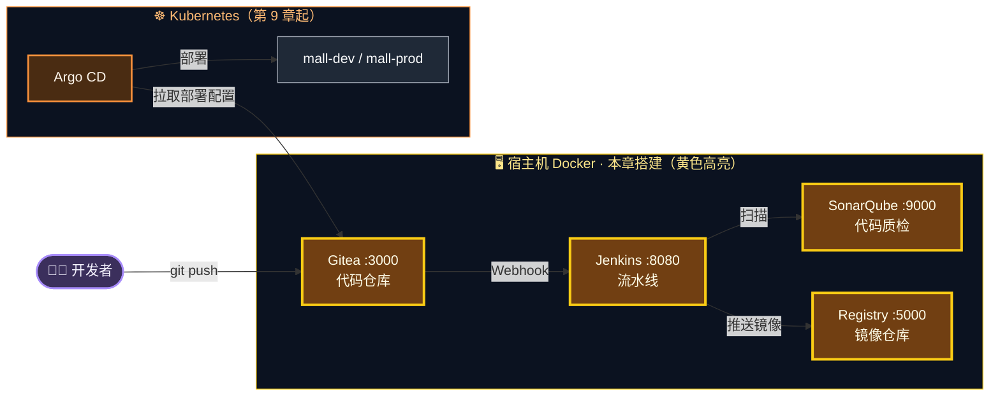
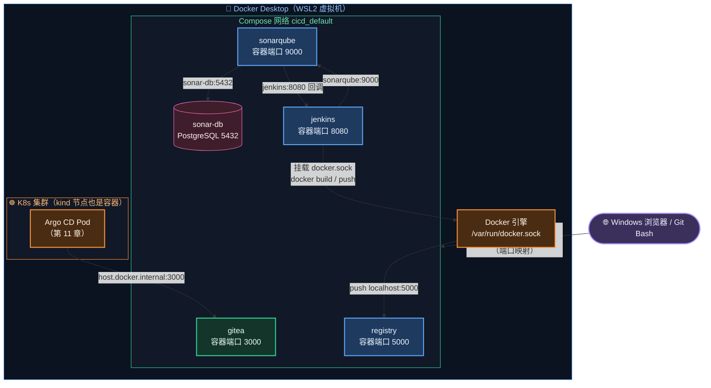
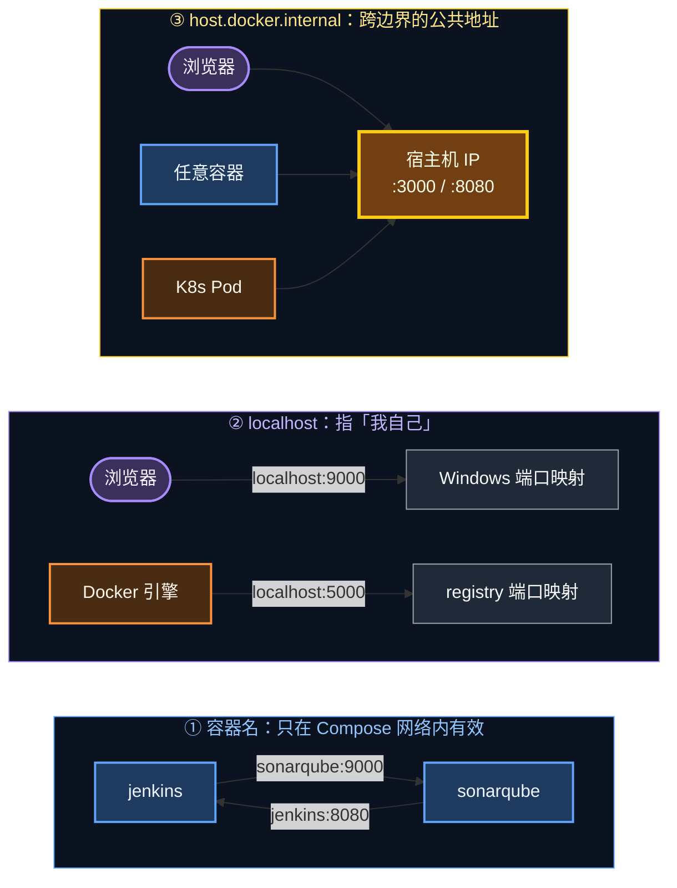
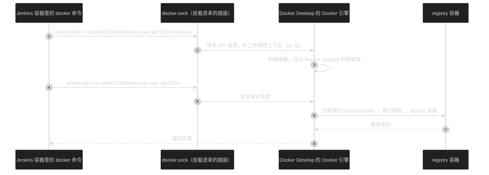
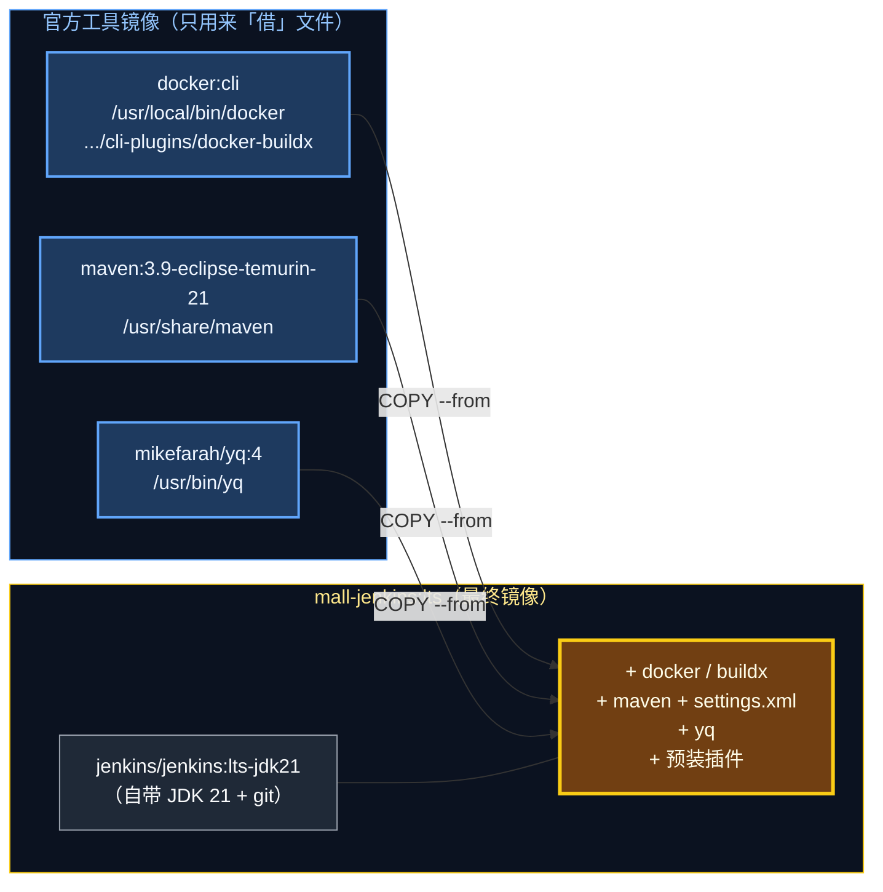
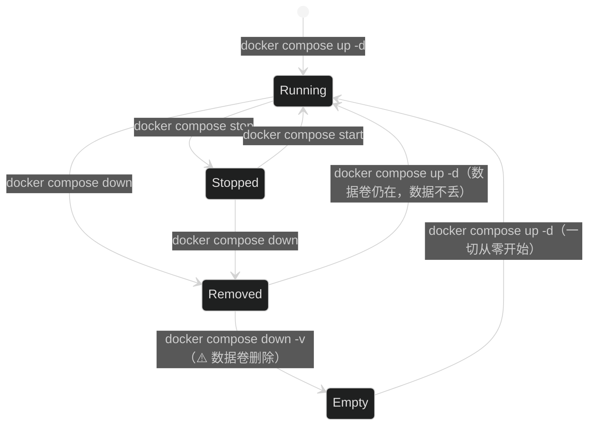
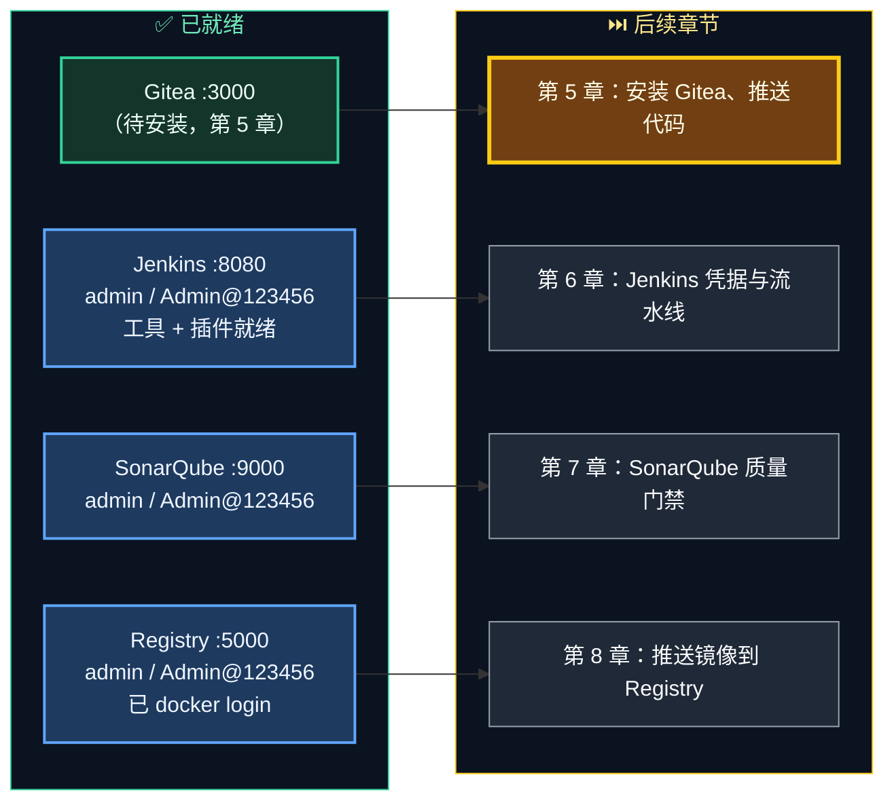

# 第 4 章 一键搭建 CI 基础设施（Gitea / Registry / SonarQube / Jenkins）

> 前三章我们在"自己的电脑上"把代码跑起来、打成镜像。从这一章开始，我们要搭一座"自动化工厂"：用一份 `docker-compose.yml`，一次性拉起 **代码仓库、镜像仓库、代码质检、流水线** 四大件。

---

## 本章目标

学完本章，你应该能够：

1. 说出 Gitea、Registry、SonarQube、Jenkins 四个组件**各自负责什么**，以及它们之间如何协作。
2. 分清**"容器名 / localhost / host.docker.internal"三种地址**分别在什么场景下使用（这是后面所有网络问题的根源）。
3. 读懂 `infra/docker-compose.yml` 和 Jenkins 定制镜像的 `Dockerfile`，知道每一行为什么这样写。
4. 用一条命令启动全部基础设施，并逐个验证它们工作正常。
5. 完成 Jenkins 初始化向导、SonarQube 首次登录改密、`docker login` 私有仓库。

预计耗时：**60～90 分钟**（其中首次拉取镜像、构建 Jenkins 镜像约 10～20 分钟，取决于网速）。

---

## 本章在全景中的位置



本章只负责把左边四个黄色组件**跑起来、能访问**。它们之间的"串联"（Webhook、凭据、流水线）放在第 5～8 章逐个完成。

---

## 4.1 四大组件各司其职

先用一个"工厂"的比喻建立直觉：

| 组件 | 工厂里的角色 | 在本教程中负责 | 你在公司里可能见到的同类产品 |
|---|---|---|---|
| **Gitea** | 图纸库 | 存放源码仓库 `mall`、部署配置仓库 `mall-deploy`；代码一提交就通过 Webhook 通知 Jenkins | GitLab、GitHub、Gitee、Bitbucket |
| **Jenkins** | 流水线工头 | 拉代码 → 编译测试 → 代码扫描 → 构建镜像 → 推送镜像 → 修改部署配置 | GitLab CI、GitHub Actions、云效、Gitea Actions |
| **SonarQube** | 质检员 | 检查代码坏味道、Bug、漏洞、测试覆盖率；不达标就"打回"（质量门禁） | SonarCloud、Checkmarx、阿里云代码扫描 |
| **Registry** | 成品仓库 | 存放打好的 Docker 镜像，供 K8s 部署时拉取 | Harbor、Nexus、阿里云 ACR、腾讯云 TCR |
| sonar-db（PostgreSQL） | 质检档案室 | SonarQube 的后台数据库，存放分析历史 | — |

所以本章会启动 **5 个容器**：`gitea`、`registry`、`sonar-db`、`sonarqube`、`jenkins`。

> 💡 为什么这些组件用 Docker Compose 跑在宿主机上，而不是装进 K8s？
> 1. **符合真实情况**：大多数公司的 GitLab / Jenkins / Harbor 都是独立部署的"基础平台"，并不和业务应用跑在同一个 K8s 集群里。
> 2. **简单可靠**：Jenkins 需要调用 Docker 构建镜像，跑在宿主机 Docker 上最直接（后面 4.4.4 会详细讲）。
> 3. **互不影响**：后面你在 K8s 里随便折腾、甚至重置集群，CI 平台的数据都不会丢。

---

## 4.2 部署架构总览

先看全貌，再看细节：



同样的内容用字符图再画一遍，方便你对照端口：

```text
 Windows 宿主机
 ├── 浏览器 / Git Bash
 │     http://localhost:5000 ─────┐      http://host.docker.internal:3000 ──┐（Gitea）
 │     http://localhost:9000 ─────┤      http://host.docker.internal:8080 ──┤（Jenkins）
 │                                ▼                                          ▼
 └── Docker Desktop ── 端口映射 0.0.0.0:3000/5000/8080/9000 ──────────────────────────────┐
        │                                                                                  │
        ├── Docker 引擎（/var/run/docker.sock）◀───── jenkins 容器通过挂载的 sock 调用        │
        │                                                                                  ▼
        ├── 网络 cicd_default ───────────────────────────────────────────────────────────────┐
        │     gitea:3000   registry:5000   sonarqube:9000 ── sonar-db:5432   jenkins:8080   │
        │       ▲                                 │  ▲                          │            │
        │       │                                 │  └──── sonarqube:9000 ──────┘            │
        │       │                                 └─────── jenkins:8080（Webhook 回调）──────▶│
        │       │                                                                            │
        └── 网络 kind（K8s 节点）                                                             │
              Argo CD ── host.docker.internal:3000 ──┘                                       │
```

---

## 4.3 重点概念：三种地址

这一节是本章**最重要**的内容。后面 90% 的"连不上"问题，都是因为地址用错了。

### 4.3.1 三种地址分别是什么

| 地址写法 | 它指向哪里 | 谁能用 | 典型例子 |
|---|---|---|---|
| **容器名**（如 `sonarqube`、`jenkins`） | 同一个 Compose 网络中的那个容器 | 只有**同一个 Compose 网络里的容器** | Jenkins → `http://sonarqube:9000`；SonarQube → `http://jenkins:8080/sonarqube-webhook/` |
| **localhost** | "我自己"——谁在用，就指谁 | 浏览器里指 Windows；容器里指容器自己；Docker 引擎里指引擎所在的虚拟机 | 浏览器访问 `http://localhost:9000`；Docker 引擎 `docker push localhost:5000/...` |
| **host.docker.internal** | Windows 宿主机（局域网 IP） | Windows 自己、**任何容器**、**K8s 里的 Pod** 都能解析 | Gitea 的 `ROOT_URL`、Jenkins URL、Argo CD 拉取 Gitea 仓库 |

> 🧠 原理：`host.docker.internal` 是怎么来的？
> - Docker Desktop 安装时往 Windows 的 `C:\Windows\System32\drivers\etc\hosts` 写入了一行 `192.168.x.x host.docker.internal`（x 是你电脑的局域网 IP），所以 Windows 上的浏览器能解析它。
> - 同时 Docker Desktop 的内置 DNS 会让**每个容器**也能解析这个名字，指向宿主机。
> - 宿主机上通过 `ports` 映射出来的端口（3000、8080……）监听在 `0.0.0.0`，所以访问"宿主机 IP:3000"就能到达 Gitea 容器。
>
> 结论：**`host.docker.internal` 是唯一一个"浏览器、容器、K8s Pod 三方都认识"的地址**，所以凡是需要被多方访问的服务，我们就把它的"对外地址"定成它。

### 4.3.2 谁访问谁、用哪个地址

把整个教程里所有的访问关系一次列清楚（后面各章配置时回来查这张表）：

| 访问方 | 被访问方 | 使用的地址 | 原因 |
|---|---|---|---|
| 浏览器 | Gitea | `http://host.docker.internal:3000` | 与 Gitea 的 `ROOT_URL` 保持一致，否则页面里的链接、克隆地址会对不上 |
| 浏览器 | Jenkins | `http://host.docker.internal:8080` | 与 Jenkins URL 保持一致（用 `localhost:8080` 也能打开，但建议统一） |
| 浏览器 | SonarQube | `http://localhost:9000` | 只有浏览器和 Jenkins 访问它，没有"统一地址"的需求 |
| Git Bash（git push） | Gitea | `http://host.docker.internal:3000/mall/xxx.git` | Gitea 生成的克隆地址就是这个 |
| Jenkins 容器 | Gitea（拉代码） | `http://host.docker.internal:3000/...` | Gitea API 返回的克隆地址基于 `ROOT_URL` |
| Gitea 容器 | Jenkins（Webhook） | `http://host.docker.internal:8080/gitea-webhook/post` | Jenkins 根据自己的 Jenkins URL 自动注册 Webhook |
| Jenkins 容器 | SonarQube | `http://sonarqube:9000` | 同一个 Compose 网络，用容器名最直接 |
| SonarQube 容器 | Jenkins（质量门禁回调） | `http://jenkins:8080/sonarqube-webhook/` | 同上 |
| Jenkins 中执行的 `docker push` | Registry | `localhost:5000` | 真正执行推送的是 Docker 引擎，引擎侧的 `localhost:5000` 就是 registry 的映射端口 |
| K8s 中的 Argo CD | Gitea | `http://host.docker.internal:3000/...` | Pod 不在 Compose 网络里，只能走宿主机地址 |

用一张图把三种地址的"适用范围"画出来：



> ⚠️ 常见误区：在 Jenkins 容器里访问 `http://localhost:3000` 想连 Gitea —— 这时的 `localhost` 是 **Jenkins 容器自己**，里面根本没有 3000 端口，必然失败。

> ⚠️ 为什么推送镜像不用 `host.docker.internal:5000`？
> 我们实测过：`docker push host.docker.internal:5000/...` 会报错 `http: server gave HTTP response to HTTPS client`。因为 Docker 默认要求镜像仓库使用 HTTPS，**只有 `127.0.0.0/8`（即 localhost）被默认豁免**，允许走 HTTP。我们的 Registry 没配证书，所以推送统一用 `localhost:5000`。

---

## 4.4 读懂 docker-compose.yml

打开 `/d/cicd-lab/infra/docker-compose.yml`（与教程目录中的 [infra/docker-compose.yml](../infra/docker-compose.yml) 内容相同），我们逐个服务讲解。

文件开头：

```yaml
name: cicd
```

`name: cicd` 是 Compose 的**项目名**。它决定了：

- 网络名：`cicd_default`（项目名 + `_default`）
- 数据卷名：`cicd_gitea-data`、`cicd_jenkins-home` ……
- 在 Docker Desktop 界面上，这 5 个容器会归在一个名为 `cicd` 的分组里

### 4.4.1 Gitea：代码托管

```yaml
  gitea:
    image: docker.gitea.com/gitea:28.1.0
    container_name: gitea
    restart: unless-stopped
    environment:
      USER_UID: "1000"
      USER_GID: "1000"
      GITEA__database__DB_TYPE: sqlite3
      # 统一对外地址：浏览器、Jenkins 容器、K8s 中的 Argo CD 都能通过它访问 Gitea
      GITEA__server__ROOT_URL: http://host.docker.internal:3000/
      GITEA__server__HTTP_PORT: "3000"
      GITEA__server__DISABLE_SSH: "true"
      # 默认只允许 Webhook 发往公网地址；本地实验需要发往 Jenkins（私有地址），因此放开（⚠️ 仅限本地）
      GITEA__webhook__ALLOWED_HOST_LIST: "*"
    ports:
      - "3000:3000"
    volumes:
      - gitea-data:/data
```

逐项解释：

| 配置 | 含义 | 为什么这样配 |
|---|---|---|
| `image: docker.gitea.com/gitea:28.1.0` | Gitea 官方镜像 | Gitea 在 2026 年把版本号从 `1.x` 改成了 `28.x`，官方镜像地址也改为 `docker.gitea.com`。**固定版本号**而不用 `latest`，保证每次启动的都是同一个版本 |
| `GITEA__段名__键名` | Gitea 的"环境变量 → 配置文件"约定 | 容器启动时会自动写入 `app.ini` 的 `[段名]` 下的 `键名`。例如 `GITEA__server__ROOT_URL` 就是 `[server] ROOT_URL` |
| `DB_TYPE: sqlite3` | 用 SQLite 存数据 | 单文件数据库，零维护，学习足够；生产一般用 MySQL / PostgreSQL |
| `ROOT_URL` | Gitea 认为"自己对外的地址" | 页面链接、**仓库克隆地址**、Webhook 里的仓库地址都由它生成。见 4.3 节 |
| `DISABLE_SSH: "true"` | 关闭 SSH 克隆 | 全程使用 HTTP + 令牌，少一个端口、少一套密钥配置 |
| `ALLOWED_HOST_LIST: "*"` | Webhook 允许发往任何地址 | Gitea 默认值是 `external`，**会拦截发往私有 IP 的 Webhook**（防止 SSRF 攻击）。我们的 Jenkins 在私有地址上，不放开的话 Webhook 永远发不出去 |
| `gitea-data:/data` | 数据持久化 | 仓库、数据库、配置文件都在 `/data` 下，容器删了数据还在 |

> ⚠️ `ALLOWED_HOST_LIST: "*"` 只适合本地实验。生产环境应写成具体的 Jenkins 地址或网段。

### 4.4.2 Registry：镜像仓库

```yaml
  registry:
    image: registry:2
    container_name: registry
    restart: unless-stopped
    environment:
      REGISTRY_AUTH: htpasswd
      REGISTRY_AUTH_HTPASSWD_REALM: mall-registry
      REGISTRY_AUTH_HTPASSWD_PATH: /auth/htpasswd
      REGISTRY_STORAGE_DELETE_ENABLED: "true"
    ports:
      - "5000:5000"
    volumes:
      - ./registry/auth:/auth:ro
      - registry-data:/var/lib/registry
```

| 配置 | 含义 |
|---|---|
| `registry:2` | Docker 官方开源镜像仓库（Docker Distribution），Harbor 的底层也是它 |
| `REGISTRY_AUTH: htpasswd` | 开启"用户名 + 密码"认证，没登录不能推送/拉取 |
| `REGISTRY_AUTH_HTPASSWD_PATH` | 密码文件在容器内的路径。我们把宿主机的 `./registry/auth` 只读（`:ro`）挂载到 `/auth` |
| `REGISTRY_AUTH_HTPASSWD_REALM` | 认证域名称，会出现在 401 响应头里，随便起 |
| `REGISTRY_STORAGE_DELETE_ENABLED` | 允许通过 API 删除镜像（默认禁止） |
| `registry-data:/var/lib/registry` | 镜像层文件存放处 |

> 💡 为什么要给 Registry 加密码？
> 真实公司里的镜像仓库（Harbor、ACR）都要求登录。加上认证后，我们就能在第 8 章练习"在 Jenkins 里安全地使用凭据推送镜像"——这是 CI 中非常典型的场景。

> 💡 Registry 和 Harbor 什么关系？
> Harbor = Registry + 网页界面 + 项目/权限管理 + 漏洞扫描 + 镜像复制……对开发者来说，**命令完全一样**：`docker login`、`docker tag`、`docker push`、`docker pull`。只是地址从 `localhost:5000/mall/xxx` 变成 `harbor.公司.com/项目/xxx`。

### 4.4.3 SonarQube + PostgreSQL：代码质检

```yaml
  sonar-db:
    image: postgres:17-alpine
    container_name: sonar-db
    restart: unless-stopped
    environment:
      POSTGRES_USER: sonar
      POSTGRES_PASSWORD: sonar
      POSTGRES_DB: sonar
    volumes:
      - sonar-db-data:/var/lib/postgresql/data

  sonarqube:
    image: sonarqube:26.9.0.129388-community
    container_name: sonarqube
    restart: unless-stopped
    depends_on:
      - sonar-db
    environment:
      SONAR_JDBC_URL: jdbc:postgresql://sonar-db:5432/sonar
      SONAR_JDBC_USERNAME: sonar
      SONAR_JDBC_PASSWORD: sonar
      # 关闭内置 Elasticsearch 的生产环境自检（vm.max_map_count 等），本地学习环境专用
      SONAR_ES_BOOTSTRAP_CHECKS_DISABLE: "true"
    ports:
      - "9000:9000"
    volumes:
      - sonar-data:/opt/sonarqube/data
      - sonar-extensions:/opt/sonarqube/extensions
      - sonar-logs:/opt/sonarqube/logs
```

| 配置 | 含义 |
|---|---|
| `sonarqube:26.9.0.129388-community` | SonarQube 社区版（Community Build），免费，功能对学习完全够用 |
| `sonar-db` 没有 `ports` | 数据库只给 SonarQube 用，**不需要暴露给宿主机**，更安全 |
| `SONAR_JDBC_URL: jdbc:postgresql://sonar-db:5432/sonar` | 注意这里用的是**容器名** `sonar-db`——这就是 4.3 节的"第①种地址" |
| `depends_on: sonar-db` | 先启动数据库容器，再启动 SonarQube（只保证启动顺序，不保证数据库已就绪；SonarQube 自己会重试连接） |
| `SONAR_ES_BOOTSTRAP_CHECKS_DISABLE` | SonarQube 内嵌了 Elasticsearch，ES 启动时会检查 Linux 内核参数 `vm.max_map_count ≥ 262144`，在 Docker Desktop 上通常不满足导致启动失败。本地学习直接跳过这项检查 |
| 三个数据卷 | `data` 存分析数据和索引；`extensions` 存插件；`logs` 存日志 |

> 💡 为什么 SonarQube 要单独配一个 PostgreSQL？它内置了 H2 数据库，但官方明确说明 H2 仅供试用、不支持升级迁移。用 PostgreSQL 更接近真实部署，而且只多占 50MB 左右内存。

### 4.4.4 Jenkins：流水线

```yaml
  jenkins:
    build: ./jenkins
    image: mall-jenkins:lts
    container_name: jenkins
    restart: unless-stopped
    # 以 root 运行是为了能访问挂载进来的 docker.sock（⚠️ 仅限本地学习，生产应使用独立构建节点）
    user: root
    environment:
      TZ: Asia/Shanghai
    ports:
      - "8080:8080"
    volumes:
      - jenkins-home:/var/jenkins_home
      # Maven 本地仓库单独持久化：重建 Jenkins 容器也不用重新下载依赖
      - jenkins-m2:/root/.m2
      # 把宿主机（Docker Desktop）的 Docker 引擎"借给" Jenkins：Jenkins 里执行 docker build，
      # 镜像实际构建在 Docker Desktop 中 —— K8s 集群因此能直接用到这些镜像（原理见第 9 章）
      - /var/run/docker.sock:/var/run/docker.sock
```

这是五个服务里最值得细讲的一个：

**① `build: ./jenkins` + `image: mall-jenkins:lts`**

不直接用官方镜像，而是以 `./jenkins/Dockerfile` 为蓝本**构建一个定制镜像**，构建结果命名为 `mall-jenkins:lts`。为什么要定制？下一节 4.5 详细讲。

**② `/var/run/docker.sock:/var/run/docker.sock`（最关键的一行）**

`docker.sock` 是 Docker 引擎对外提供 API 的"插座"。你在 Git Bash 里敲 `docker ps`，本质上就是 docker 命令行通过这个插座给引擎发了一个 HTTP 请求。

把它挂载进 Jenkins 容器后，Jenkins 里执行的 `docker build`、`docker push`，**实际上是让 Docker Desktop 的引擎去干活**。这种方式俗称 **DooD（Docker outside of Docker）**：



这样做有两个好处：

1. **不用在 Jenkins 容器里再装一个 Docker 引擎**（那叫 DinD，Docker in Docker，需要特权模式，更复杂）。
2. **构建出来的镜像就在 Docker Desktop 的镜像库里**。第 9 章你会看到，Docker Desktop 的 K8s 集群可以直接使用这个镜像库里的镜像——这是我们本地环境能跑通的关键。

**③ `user: root`**

挂载进来的 `docker.sock` 在容器内属于 root 用户，官方 Jenkins 镜像默认以 `jenkins` 普通用户运行，没有权限访问它。最简单的办法就是以 root 身份运行 Jenkins。

> ⚠️ 风险提示：能访问 `docker.sock` 就等于拥有了宿主机 Docker 的完全控制权，再加上 root 运行，安全性很差。**这只适用于本地学习**。生产环境的做法是：Jenkins 主节点只做调度，构建任务放到独立的构建节点（Agent），或者在 K8s 中用 Kaniko / BuildKit 无特权构建镜像（第 14 章进阶路线会提到）。

**④ 两个数据卷**

| 数据卷 | 挂载点 | 存什么 |
|---|---|---|
| `jenkins-home` | `/var/jenkins_home` | Jenkins 的一切：系统配置、凭据、任务、构建记录、插件、工作空间 |
| `jenkins-m2` | `/root/.m2` | Maven 本地仓库。因为 Jenkins 以 root 运行，Maven 的 `~/.m2` 就是 `/root/.m2`。单独持久化后，即使删掉重建 Jenkins 容器，依赖也不用重新下载 |

**⑤ 没有映射 50000 端口**

很多 Jenkins 教程会映射 `50000` 端口，那是给远程构建节点（Agent）连接用的。我们所有构建都在 Jenkins 内置节点上执行，用不到。

### 4.4.5 数据卷汇总

```yaml
volumes:
  gitea-data:
  registry-data:
  sonar-db-data:
  sonar-data:
  sonar-extensions:
  sonar-logs:
  jenkins-home:
  jenkins-m2:
```

这里声明的都是 **命名数据卷（Named Volume）**，由 Docker 管理，实际名称会加上项目名前缀，例如 `cicd_jenkins-home`。

> 💡 命名卷 vs 目录挂载：Registry 的密码文件用的是 `./registry/auth:/auth:ro` 这种**目录挂载**（Bind Mount），因为这个文件需要我们在宿主机上生成和修改；其他数据只需要"别丢"，交给 Docker 管理的命名卷更省心，也避免了 Windows 文件系统的权限和性能问题。

---

## 4.5 读懂 Jenkins 定制镜像

### 4.5.1 Dockerfile 全文

打开 `/d/cicd-lab/infra/jenkins/Dockerfile`：

```dockerfile
# ============================================================
# 定制 Jenkins 镜像：在官方 LTS 镜像基础上预装流水线需要的工具和插件
# ============================================================
FROM jenkins/jenkins:lts-jdk21

USER root

# 1) Docker CLI + buildx：通过挂载的 docker.sock 调用宿主机 Docker 引擎构建/推送镜像
COPY --from=docker:cli /usr/local/bin/docker /usr/local/bin/docker
COPY --from=docker:cli /usr/local/libexec/docker/cli-plugins/docker-buildx /usr/local/libexec/docker/cli-plugins/docker-buildx

# 2) Maven：直接从官方 Maven 镜像复制，避免 apt 安装缓慢；settings.xml 配置了阿里云镜像
COPY --from=maven:3.9-eclipse-temurin-21 /usr/share/maven /usr/share/maven
RUN ln -s /usr/share/maven/bin/mvn /usr/bin/mvn
COPY settings.xml /usr/share/maven/conf/settings.xml

# 3) yq：在流水线中修改 GitOps 仓库里的 YAML
COPY --from=mikefarah/yq:4 /usr/bin/yq /usr/bin/yq

USER jenkins

# 4) 预装插件。国内下载慢时，可取消下一行注释，使用清华镜像站下载插件
# ENV JENKINS_UC_DOWNLOAD=https://mirrors.tuna.tsinghua.edu.cn/jenkins
COPY plugins.txt /usr/share/jenkins/ref/plugins.txt
RUN jenkins-plugin-cli --plugin-file /usr/share/jenkins/ref/plugins.txt
```

### 4.5.2 为什么要定制：流水线需要哪些工具

回顾一下我们的流水线（第 6～12 章会逐步写出来）每一步要用到的工具：

| 流水线步骤 | 需要的工具 | 官方 Jenkins 镜像里有吗 |
|---|---|---|
| 拉取代码 | git | ✅ 有 |
| 编译、单元测试、代码扫描 | JDK 21 + Maven | JDK ✅ 有（`lts-jdk21`）；Maven ❌ 没有 |
| 构建、推送镜像 | docker 命令行 + buildx 插件 | ❌ 没有 |
| 修改 GitOps 仓库中的镜像 tag | yq（YAML 命令行编辑器） | ❌ 没有 |

缺的工具，我们就在 Dockerfile 里补上。

### 4.5.3 `COPY --from`：从别的镜像"借"工具

安装软件的常规做法是 `apt-get install`，但在国内网络下又慢又容易失败。这里用了一个很实用的技巧——**直接从官方工具镜像里复制编译好的二进制文件**：



| 指令 | 借了什么 | 说明 |
|---|---|---|
| `COPY --from=docker:cli /usr/local/bin/docker ...` | docker 命令行 | Go 语言编写的静态二进制，复制过来就能用，不依赖系统库 |
| `COPY --from=docker:cli .../docker-buildx ...` | buildx 插件 | 新版 Docker 的 `docker build` 默认由 BuildKit（buildx）执行，缺了它会退化成已废弃的旧构建器 |
| `COPY --from=maven:3.9-eclipse-temurin-21 /usr/share/maven ...` | 整个 Maven 安装目录 | Maven 是纯 Java 程序，有 JDK 就能跑；再用 `ln -s` 把 `mvn` 放进 PATH |
| `COPY settings.xml /usr/share/maven/conf/settings.xml` | 全局 Maven 配置 | 配置了阿里云镜像，Jenkins 下载依赖更快 |
| `COPY --from=mikefarah/yq:4 /usr/bin/yq ...` | yq | 同样是 Go 静态二进制 |

> 🧠 原理：`COPY --from=<镜像>` 是多阶段构建的语法。当 `--from` 后面写的是一个**镜像名**而不是前面定义的阶段名时，Docker 会把这个镜像拉下来，只取出指定的文件，**镜像本身不会进入最终产物**。所以最终镜像只多了这几个文件，没有多余的体积。

`settings.xml` 的内容（`/d/cicd-lab/infra/jenkins/settings.xml`）：

```xml
    <mirrors>
        <!-- 所有依赖都从阿里云镜像下载；公司内网有 Nexus 时替换为 Nexus 地址即可 -->
        <mirror>
            <id>aliyun</id>
            <mirrorOf>*</mirrorOf>
            <name>Aliyun Public</name>
            <url>https://maven.aliyun.com/repository/public</url>
        </mirror>
    </mirrors>
```

> 💡 放在 `/usr/share/maven/conf/settings.xml` 的是 **全局配置**，对容器里所有用户生效；而你本机的 `~/.m2/settings.xml` 是**用户配置**。两者都存在时会合并，用户配置优先。

### 4.5.4 预装插件：每个插件干什么

`USER jenkins` 切回普通用户后，用官方的 `jenkins-plugin-cli` 工具按 `plugins.txt` 预装插件。`/d/cicd-lab/infra/jenkins/plugins.txt` 内容如下：

```text
workflow-aggregator
pipeline-graph-view
git
gitea
sonar
credentials-binding
timestamper
ws-cleanup
junit
```

| 插件 ID | 插件名称（界面上显示） | 用途 | 在哪一章用到 |
|---|---|---|---|
| `workflow-aggregator` | Pipeline | 流水线核心，让 Jenkins 能读懂 `Jenkinsfile` | 第 6 章 |
| `pipeline-graph-view` | Pipeline Graph View | 以图形方式展示每个阶段（Stage）的执行情况 | 第 6 章起 |
| `git` | Git | 拉取 Git 仓库代码 | 第 6 章 |
| `gitea` | Gitea | 对接 Gitea：自动注册 Webhook、发现分支/PR、回写构建状态 | 第 6 章 |
| `sonar` | SonarQube Scanner | 提供 `withSonarQubeEnv`、`waitForQualityGate` 步骤 | 第 7 章 |
| `credentials-binding` | Credentials Binding | 提供 `withCredentials`，在流水线中安全地使用密码/令牌 | 第 8 章 |
| `timestamper` | Timestamper | 日志每行加时间戳（`options { timestamps() }`） | 第 6 章 |
| `ws-cleanup` | Workspace Cleanup | 提供 `cleanWs()`，构建结束清理工作空间 | 第 6 章 |
| `junit` | JUnit | 收集单元测试报告，展示测试结果趋势 | 第 6 章 |

> 💡 为什么插件要"预装"而不是在网页上点安装？
> 1. **可重复**：任何人用这份 Dockerfile 构建，得到的 Jenkins 一模一样（这就是"基础设施即代码"）。
> 2. **省事**：插件依赖关系复杂，`jenkins-plugin-cli` 会自动下载所有依赖插件。
> 3. **初始化向导可以跳过插件安装**，后面 4.8.3 就会用到。

**国内网络下载插件慢怎么办？** 编辑 `/d/cicd-lab/infra/jenkins/Dockerfile`，把这一行的注释去掉：

```dockerfile
# 修改前
# ENV JENKINS_UC_DOWNLOAD=https://mirrors.tuna.tsinghua.edu.cn/jenkins
# 修改后
ENV JENKINS_UC_DOWNLOAD=https://mirrors.tuna.tsinghua.edu.cn/jenkins
```

`JENKINS_UC_DOWNLOAD` 环境变量会让 `jenkins-plugin-cli` 从清华大学镜像站下载插件文件。修改后重新执行 4.7 节的构建命令即可。

---

## 4.6 动手 1：生成 Registry 密码文件

Registry 启动时需要读取 `registry/auth/htpasswd`，所以必须**先生成密码文件，再启动**。

### 步骤 1：进入 infra 目录

```bash
# 位置：任意目录
cd /d/cicd-lab/infra
ls
```

预期输出：

```text
docker-compose.yml  jenkins/  k8s/  registry/
```

### 步骤 2：用 httpd 镜像生成 htpasswd

`htpasswd` 是 Apache 自带的密码文件生成工具。新版 `registry:2` 镜像已经不再内置它，所以我们借用 Apache 官方镜像 `httpd:2` 来运行一次：

```bash
# 位置：/d/cicd-lab/infra
docker run --rm --entrypoint htpasswd httpd:2 -Bbn admin 'Admin@123456' > registry/auth/htpasswd
```

命令拆解：

| 片段 | 含义 |
|---|---|
| `docker run --rm` | 运行一个临时容器，执行完自动删除 |
| `--entrypoint htpasswd` | 不启动 Apache，而是直接执行容器里的 `htpasswd` 程序 |
| `httpd:2` | Apache HTTP Server 官方镜像（首次执行会自动拉取，约 50MB） |
| `-B` | 使用 bcrypt 加密（Registry 只支持 bcrypt） |
| `-b` | 密码从命令行参数读取（而不是交互输入） |
| `-n` | 结果输出到屏幕（标准输出），而不是写入文件 |
| `admin 'Admin@123456'` | 用户名和密码。密码用单引号包起来，避免特殊字符被 Shell 解释 |
| `> registry/auth/htpasswd` | 把屏幕输出重定向保存到文件 |

### 步骤 3：检查生成结果

```bash
# 位置：/d/cicd-lab/infra
cat registry/auth/htpasswd
```

预期输出（加密串每次都不一样，这是正常的）：

```text
admin:$2y$05$Xz8Kq3m1vYb7c2...（一长串）
```

> ✅ 检查点：文件只有一行，以 `admin:$2y$05$` 开头。如果是空文件，说明 `docker run` 失败了（多半是镜像拉取失败），请往上翻看报错信息。

> ⚠️ 常见坑：**这条命令必须在 Git Bash 中执行**。如果你在 PowerShell 里执行，`>` 重定向会把文件写成 **UTF-16 编码**，Registry 读不懂，结果就是"密码明明对，就是登录不上"。如果你已经踩坑，在 Git Bash 里重新执行一遍覆盖即可。

---

## 4.7 动手 2：启动全部基础设施

### 步骤 1：确认端口空闲

本章要占用 `3000`、`5000`、`8080`、`9000` 四个端口。先检查一下有没有被别的程序占用：

```bash
# 位置：任意目录
netstat -ano | grep -E ":(3000|5000|8080|9000) " | grep -i listen
```

预期：**没有任何输出**（表示四个端口都空闲）。

如果有输出，例如：

```text
  TCP    0.0.0.0:8080     0.0.0.0:0     LISTENING     12345
```

最后一列 `12345` 是占用进程的 PID，可以用下面的命令看看是哪个程序：

```bash
MSYS_NO_PATHCONV=1 tasklist /FI "PID eq 12345"
```

> 💡 命令前的 `MSYS_NO_PATHCONV=1` 让 `/FI` 原样传给 Windows 命令（否则 Git Bash 会把它当成路径转换掉，见第 1 章 1.3.2）。占用端口的程序关掉即可；实在关不掉，见 4.10 节"端口冲突"的处理办法。

### 步骤 2：一键构建并启动

```bash
# 位置：/d/cicd-lab/infra
docker compose up -d --build
```

| 参数 | 含义 |
|---|---|
| `up` | 创建并启动 compose 文件中的所有服务 |
| `-d` | 后台运行（detached），不占用当前终端 |
| `--build` | 对于有 `build:` 的服务（Jenkins），先构建镜像再启动 |

**首次执行会比较慢**，Docker 要做这些事：

```text
① 拉取基础镜像        jenkins/jenkins:lts-jdk21、docker:cli、maven:3.9-eclipse-temurin-21、mikefarah/yq:4
② 构建 Jenkins 镜像   复制工具 + 下载约 80 个插件（含依赖）         ← 最慢，3～10 分钟
③ 拉取其它镜像        gitea、registry、postgres、sonarqube（约 1GB）
④ 创建网络和数据卷，依次启动 5 个容器
```

整体耗时一般在 **10～20 分钟**，期间你会看到大量下载进度。最后的输出类似（数量和顺序可能不同）：

```text
[+] Running 14/14
 ✔ Network cicd_default             Created
 ✔ Volume "cicd_gitea-data"         Created
 ✔ Volume "cicd_registry-data"      Created
 ✔ Volume "cicd_sonar-db-data"      Created
 ✔ Volume "cicd_sonar-data"         Created
 ✔ Volume "cicd_sonar-extensions"   Created
 ✔ Volume "cicd_sonar-logs"         Created
 ✔ Volume "cicd_jenkins-home"       Created
 ✔ Volume "cicd_jenkins-m2"         Created
 ✔ Container gitea                  Started
 ✔ Container registry               Started
 ✔ Container sonar-db               Started
 ✔ Container jenkins                Started
 ✔ Container sonarqube              Started
```

> ⚠️ 如果构建 Jenkins 镜像时卡在 `jenkins-plugin-cli` 很久或报下载超时，按 4.5.4 节开启清华镜像后重新执行 `docker compose up -d --build`。已经下载好的镜像层会被缓存，不会重复下载。

### 步骤 3：查看容器状态

```bash
# 位置：/d/cicd-lab/infra
docker compose ps
```

预期输出（示意，时间和列宽会有差异）：

```text
NAME        IMAGE                               SERVICE     STATUS          PORTS
gitea       docker.gitea.com/gitea:28.1.0       gitea       Up 2 minutes    22/tcp, 0.0.0.0:3000->3000/tcp
jenkins     mall-jenkins:lts                    jenkins     Up 2 minutes    0.0.0.0:8080->8080/tcp, 50000/tcp
registry    registry:2                          registry    Up 2 minutes    0.0.0.0:5000->5000/tcp
sonar-db    postgres:17-alpine                  sonar-db    Up 2 minutes    5432/tcp
sonarqube   sonarqube:26.9.0.129388-community   sonarqube   Up 2 minutes    0.0.0.0:9000->9000/tcp
```

怎么读这张表：

- `STATUS` 全部是 `Up ...`：容器在运行。如果某个是 `Restarting` 或 `Exited`，说明它启动失败了，用 `docker compose logs <服务名>` 查原因。
- `PORTS` 中 `0.0.0.0:3000->3000/tcp` 表示"宿主机所有网卡的 3000 端口 → 容器的 3000 端口"。
- `sonar-db` 只有 `5432/tcp` 没有箭头：只在容器网络内可访问，宿主机访问不到——这正是我们想要的。
- `jenkins` 的 `50000/tcp`、`gitea` 的 `22/tcp` 是镜像里声明的端口，我们没有映射，可以忽略。

### 步骤 4：看看资源占用

```bash
# 位置：任意目录
docker stats --no-stream gitea registry sonar-db sonarqube jenkins
```

预期输出（数值仅供参考）：

```text
CONTAINER ID   NAME        CPU %     MEM USAGE / LIMIT     MEM %
a1b2c3d4e5f6   gitea       0.10%     120MiB / 15.5GiB      0.76%
b2c3d4e5f6a7   registry    0.00%     12MiB / 15.5GiB       0.08%
c3d4e5f6a7b8   sonar-db    0.02%     60MiB / 15.5GiB       0.38%
d4e5f6a7b8c9   sonarqube   2.50%     1.8GiB / 15.5GiB      11.6%
e5f6a7b8c9d0   jenkins     0.30%     800MiB / 15.5GiB      5.04%
```

整套 CI 基础设施大约占用 **3GB 内存**，其中 SonarQube 是"大户"。后面 K8s 中的 Argo CD 和应用还要再用掉 3～4GB，所以第 1 章建议给 Docker Desktop 分配 8GB 以上内存。

---

## 4.8 动手 3：逐个验证

启动成功 ≠ 能正常工作。我们按"从简单到复杂"的顺序，逐个验证。

### 4.8.1 Registry：认证是否生效

**验证 1：不带账号访问，应该被拒绝**

```bash
# 位置：任意目录
curl -i http://localhost:5000/v2/_catalog
```

预期输出（关键是 `401 Unauthorized`）：

```text
HTTP/1.1 401 Unauthorized
Content-Type: application/json; charset=utf-8
Docker-Distribution-Api-Version: registry/2.0
Www-Authenticate: Basic realm="mall-registry"
...

{"errors":[{"code":"UNAUTHORIZED","message":"authentication required",...}]}
```

注意响应头 `Www-Authenticate: Basic realm="mall-registry"`，这里的 `mall-registry` 就是 compose 中配置的 `REGISTRY_AUTH_HTPASSWD_REALM`。

**验证 2：带上账号访问，应该成功**

```bash
# 位置：任意目录
curl -u admin:Admin@123456 http://localhost:5000/v2/_catalog
```

预期输出：

```text
{"repositories":[]}
```

`/v2/_catalog` 是 Registry 的 HTTP API，作用是"列出所有镜像仓库"。现在还是空的，第 8 章推送镜像后这里就会出现 `mall/mall-user`、`mall/mall-order`。

**验证 3：用 docker login 登录**

```bash
# 位置：任意目录
echo 'Admin@123456' | docker login localhost:5000 -u admin --password-stdin
```

预期输出：

```text
Login Succeeded
```

> ⚠️ 为什么不用交互式的 `docker login localhost:5000 -u admin`？
> Git Bash 默认的终端（mintty）不是 Windows 原生控制台，交互式输入密码时 docker 可能报错 `Cannot perform an interactive login from a non TTY device`。用 `--password-stdin` 从管道读取密码可以绕过这个问题。（如果你使用 Windows Terminal 里的 Git Bash，交互式输入通常也没问题。）另外，**不要用 `-p 密码` 参数**，密码会被记录在命令历史和进程列表里。

> 🧠 原理：登录信息存在哪里？
> 打开 `C:\Users\<你的用户名>\.docker\config.json`，你会看到类似内容：
> ```json
> {
>   "auths": {
>     "localhost:5000": {}
>   },
>   "credsStore": "desktop"
> }
> ```
> `auths` 里只记录了"登录过哪个仓库"，密码本身并不在这个文件里。`"credsStore": "desktop"` 表示密码交给 Docker Desktop 的凭据助手，最终保存在 **Windows 凭据管理器**中，比明文存储安全得多。
>
> **请保持这个登录状态**，第 8 章手工推送镜像时要用到。

### 4.8.2 SonarQube：等待启动并修改初始密码

SonarQube 要启动内嵌的 Elasticsearch、连接数据库、初始化表结构，首次启动需要 **1～3 分钟**。

**步骤 1：观察启动日志**

```bash
# 位置：/d/cicd-lab/infra
docker compose logs -f sonarqube
```

`-f`（follow）表示持续输出新日志。耐心等待，直到看到这一行：

```text
sonarqube  | ... INFO  app[][o.s.a.SchedulerImpl] SonarQube is operational
```

看到 `SonarQube is operational` 就说明启动完成了，按 `Ctrl + C` 退出日志查看（**只是退出日志，不会停止容器**）。

**步骤 2：首次登录**

浏览器打开 http://localhost:9000 ，出现登录页：

| 字段 | 填写 |
|---|---|
| Login | `admin` |
| Password | `admin` |

点击 **Log in**。

**步骤 3：强制修改密码**

首次登录后，SonarQube 会跳转到 **Update your password（修改密码）** 页面，强制你修改默认密码：

| 字段 | 填写 | 说明 |
|---|---|---|
| Old Password（旧密码） | `admin` | |
| New Password（新密码） | `Admin@123456` | 密码策略要求至少 12 位，包含大写、小写、数字、特殊字符，`Admin@123456` 恰好满足 |
| Confirm Password（确认密码） | `Admin@123456` | |

点击 **Update**，进入 SonarQube 首页（可能会显示 "How do you want to create your project?" 之类的引导，**先不用管**，第 7 章再创建项目）。

> ✅ 检查点：
> ```bash
> curl -s -u admin:Admin@123456 http://localhost:9000/api/system/status
> ```
> 预期输出（版本号可能略有不同）：
> ```text
> {"id":"...","version":"26.9.0.129388","status":"UP"}
> ```
> `status` 为 `UP` 说明 SonarQube 一切正常。

### 4.8.3 Jenkins：验证工具 + 完成初始化向导

**步骤 1：验证定制镜像中的工具都在**

```bash
# 位置：任意目录
docker exec jenkins docker version
```

预期输出（重点看 Server 部分）：

```text
Client:
 Version:           29.x.x
 ...
Server: Docker Desktop 4.86.0 (xxxxxx)
 Engine:
  Version:          29.7.2
  ...
```

> 🧠 这个输出很有意思：命令是在 **Jenkins 容器里**执行的，但 `Server` 显示的是 **Docker Desktop**。这就证明了 4.4.4 节说的——Jenkins 通过挂载的 `docker.sock`，使用的是宿主机的 Docker 引擎。

接着检查其余工具：

```bash
# 位置：任意目录
docker exec jenkins mvn -v
```

预期输出：

```text
Apache Maven 3.9.x (...)
Maven home: /usr/share/maven
Java version: 21.0.x, vendor: Eclipse Adoptium, runtime: /opt/java/openjdk
...
```

```bash
# 位置：任意目录
docker exec jenkins yq --version
```

预期输出：

```text
yq (https://github.com/mikefarah/yq/) version v4.x.x
```

```bash
# 位置：任意目录
docker exec jenkins java -version
```

预期输出：

```text
openjdk version "21.0.x" ...
OpenJDK Runtime Environment Temurin-21.0.x ...
```

再验证两条后面会用到的网络路径（对照 4.3.2 节的表）：

```bash
# 位置：任意目录
# ① Jenkins → SonarQube（容器名）
docker exec jenkins curl -s http://sonarqube:9000/api/system/status
# ② Jenkins → Gitea（host.docker.internal）
#    /dev/null 是容器内的路径，所以要加 MSYS_NO_PATHCONV=1 前缀（见第 1 章 1.3.2）
MSYS_NO_PATHCONV=1 docker exec jenkins curl -s -o /dev/null -w "%{http_code}\n" http://host.docker.internal:3000
```

预期输出：

```text
{"id":"...","version":"26.9.0.129388","status":"UP"}
200
```

> ⚠️ 第②条如果没有输出 `200`，说明 Jenkins 容器访问不到 `host.docker.internal`，后面的流水线会拉不到代码。请先看 4.10 节"host.docker.internal 无法访问"。

**步骤 2：获取初始解锁密码**

Jenkins 首次启动时会生成一个随机的管理员密码，保存在 `jenkins_home` 下：

```bash
# 位置：任意目录
MSYS_NO_PATHCONV=1 docker exec jenkins cat /var/jenkins_home/secrets/initialAdminPassword
```

预期输出（一串 32 位十六进制字符，每个人都不一样）：

```text
3f9c2a7e5b1d4c8e9a6f0b2d7e1c4a5b
```

复制它，下一步要用。

> ⚠️ 如果报错 `cat: 'C:/Program Files/Git/var/jenkins_home/...': No such file or directory`，说明 Git Bash 把 `/var/...` 当成 Windows 路径"贴心地"转换了——检查命令前是否漏了 `MSYS_NO_PATHCONV=1` 前缀（见第 1 章 1.3.2）。

**步骤 3：解锁 Jenkins（Unlock Jenkins）**

浏览器打开 http://host.docker.internal:8080 ，看到 **Unlock Jenkins（解锁 Jenkins）** 页面：

| 字段 | 填写 |
|---|---|
| Administrator password（管理员密码） | 粘贴上一步复制的 32 位密码 |

点击 **Continue**。

> 💡 为什么用 `host.docker.internal:8080` 而不是 `localhost:8080`？两个都能打开。但稍后我们要把 Jenkins URL 设为 `http://host.docker.internal:8080/`，用同一个地址访问可以避免 Jenkins 提示"反向代理配置可能有问题"之类的警告。

**步骤 4：自定义 Jenkins（Customize Jenkins）**

页面给出两个大按钮：

- **Install suggested plugins**（安装推荐插件）——❌ 不要点
- **Select plugins to install**（选择要安装的插件）——✅ 点这个

进入插件选择页后，在页面顶部的筛选链接中点击 **None**（全部取消勾选），然后点击右下角 **Install**。

```text
┌──────────────────────────────────────────────────────────┐
│  Getting Started                                          │
│  ┌────────────────────────────────────────────────────┐  │
│  │ All | None | Suggested      ← 点 None              │  │
│  │ ☐ Folders  ☐ OWASP Markup Formatter  ...          │  │
│  └────────────────────────────────────────────────────┘  │
│                                    [ Back ]  [ Install ]  │  ← 再点 Install
└──────────────────────────────────────────────────────────┘
```

> 🧠 为什么选"不安装任何插件"？因为我们需要的插件已经在构建镜像时通过 `plugins.txt` 预装好了（4.5.4 节）。如果再点"安装推荐插件"，Jenkins 会去在线下载 20 多个我们用不到的插件，国内网络下很容易卡住失败。

**步骤 5：创建第一个管理员用户（Create First Admin User）**

| 字段 | 填写 |
|---|---|
| Username（用户名） | `admin` |
| Password（密码） | `Admin@123456` |
| Confirm password（确认密码） | `Admin@123456` |
| Full name（全名） | `admin` |
| E-mail address（邮箱） | `admin@mall.local` |

点击 **Save and Continue**。

**步骤 6：实例配置（Instance Configuration）**

| 字段 | 填写 | 说明 |
|---|---|---|
| Jenkins URL | `http://host.docker.internal:8080/` | **注意末尾的 `/`**。Jenkins 用这个地址生成页面链接、自动注册 Gitea Webhook。Gitea 容器要能访问它，所以不能写 `localhost`（见 4.3 节） |

点击 **Save and Finish**，再点击 **Start using Jenkins**，进入 Jenkins 首页（Dashboard）。

**步骤 7：确认插件已安装**

依次点击左侧 **Manage Jenkins（系统管理）** → **Plugins（插件管理）** → **Installed plugins（已安装插件）**（不同版本菜单位置可能略有差异），在搜索框中依次搜索下列名称，确认都存在且处于启用状态：

| 搜索关键词 | 应该看到的插件 |
|---|---|
| `Pipeline` | Pipeline、Pipeline Graph View 等一系列插件 |
| `Gitea` | Gitea Plugin |
| `SonarQube` | SonarQube Scanner for Jenkins |
| `Credentials Binding` | Credentials Binding Plugin |
| `Timestamper` | Timestamper |
| `Workspace Cleanup` | Workspace Cleanup Plugin |
| `JUnit` | JUnit Plugin |

> 💡 在 **Manage Jenkins** 页面顶部，你可能会看到一条黄色提示：*Building on the built-in node can be a security issue. You should set up distributed builds.*（在内置节点上构建存在安全风险，建议配置分布式构建）。这是 Jenkins 推荐生产环境把构建放到独立 Agent 上。**本地学习环境可以直接点 Dismiss（忽略）**，我们所有构建都在内置节点上执行。

> ✅ 检查点：
> ```bash
> curl -s -o /dev/null -w "%{http_code}\n" -u admin:Admin@123456 http://localhost:8080/api/json
> ```
> 预期输出 `200`，说明管理员账号可用。

### 4.8.4 Gitea：看到安装页即可

浏览器打开 http://host.docker.internal:3000 ，应该看到 Gitea 的 **Initial Configuration（初始配置）** 安装页面，页面上已经预填了数据库类型、站点地址等信息（它们来自 compose 中的环境变量）。

> ⚠️ **现在先不要点安装按钮**。安装页的每个字段我们放到第 5 章逐项讲解后再填。

> ✅ 检查点：
> ```bash
> curl -s -o /dev/null -w "%{http_code}\n" http://host.docker.internal:3000
> ```
> 预期输出 `200`。

### 4.8.5 验证结果汇总

| 组件 | 验证方式 | 预期结果 | 完成 |
|---|---|---|---|
| Registry | `curl -u admin:Admin@123456 http://localhost:5000/v2/_catalog` | `{"repositories":[]}` | ☐ |
| Registry | `docker login localhost:5000` | `Login Succeeded` | ☐ |
| SonarQube | `/api/system/status` | `"status":"UP"`，已改密为 `Admin@123456` | ☐ |
| Jenkins | `docker exec jenkins docker version` | Server 为 Docker Desktop | ☐ |
| Jenkins | 浏览器登录 | `admin / Admin@123456` 可登录，Jenkins URL 已设置 | ☐ |
| Jenkins → SonarQube | `docker exec jenkins curl http://sonarqube:9000/...` | `"status":"UP"` | ☐ |
| Jenkins → Gitea | `docker exec jenkins curl http://host.docker.internal:3000` | `200` | ☐ |
| Gitea | 浏览器访问 | 显示安装页 | ☐ |

全部打勾，本章的动手部分就完成了。

---

## 4.9 日常启停与资源管理

这套基础设施会一直陪你到教程结束，掌握下面几个命令就够用了：

| 场景 | 命令（在 `/d/cicd-lab/infra` 下执行） | 数据是否保留 |
|---|---|---|
| 暂时不用，释放 CPU/内存 | `docker compose stop` | ✅ 保留 |
| 继续学习 | `docker compose start` | ✅ 保留 |
| 只停 SonarQube（最占内存） | `docker compose stop sonarqube sonar-db` | ✅ 保留 |
| 修改了 compose 文件或 Dockerfile 后生效 | `docker compose up -d --build` | ✅ 保留 |
| 删除容器和网络（下次 `up` 重建） | `docker compose down` | ✅ 保留（数据卷还在） |
| ⚠️ 彻底清空，从零开始 | `docker compose down -v` | ❌ **全部删除**：Gitea 仓库、Jenkins 配置、SonarQube 数据、镜像仓库 |
| 查看某个服务的日志 | `docker compose logs -f --tail=100 jenkins` | — |



**`restart: unless-stopped` 是什么意思？**

每个服务都配置了这个重启策略：

- 容器异常退出 → Docker 自动重启它
- 电脑重启 / Docker Desktop 重启 → 容器自动启动
- 你**手动** `docker compose stop` 过 → 不会自动启动，直到你手动 `start`

所以正常情况下，你开机启动 Docker Desktop 后，CI 平台会自动恢复运行，不需要每次手动启动。

> 💡 资源紧张时的建议：
> - 学第 9～11 章（K8s 部分）时，可以先 `docker compose stop sonarqube sonar-db`，能省下近 2GB 内存；第 12 章跑全链路前再 `start`。
> - Docker Desktop 的内存上限在第 1 章已经讲过如何调整。

---

## 4.10 常见坑

| 现象 | 原因 | 解决办法 |
|---|---|---|
| `Bind for 0.0.0.0:8080 failed: port is already allocated` | 端口被其他程序或其他容器占用 | 用 4.7 节的 `netstat` 找到占用者并关闭；如果是别的容器，`docker ps` 找到后 `docker stop`。实在不能关，可以把 compose 中的 `"8080:8080"` 改成 `"18080:8080"`，但要注意**全教程中 Jenkins 地址都要跟着改**，不推荐 |
| `docker login` 一直提示 `unauthorized: authentication required` | htpasswd 文件编码错误（在 PowerShell 中生成）或密码输错 | 在 Git Bash 中重新执行 4.6 节命令，然后 `docker compose restart registry` |
| `docker login` 报 `Cannot perform an interactive login from a non TTY device` | Git Bash 的 mintty 终端不支持交互输入 | 使用 `--password-stdin` 方式（4.8.1 节），或在命令前加 `winpty` |
| SonarQube 状态反复 `Restarting` | 内存不足；或 ES 启动检查失败 | `docker compose logs sonarqube` 查看日志。如出现 `max virtual memory areas vm.max_map_count` 字样，检查 `SONAR_ES_BOOTSTRAP_CHECKS_DISABLE` 是否写对；如出现 `OutOfMemoryError` 或被 kill，调大 Docker Desktop 内存 |
| SonarQube 日志报 `Connection to sonar-db:5432 refused` | 数据库还没启动完成 | 一般会自动重试恢复，稍等 1 分钟；长时间不恢复则 `docker compose restart sonarqube` |
| 构建 Jenkins 镜像时插件下载超时 | 访问 Jenkins 官方更新站点慢 | 按 4.5.4 节开启清华镜像 `JENKINS_UC_DOWNLOAD`，重新 `docker compose up -d --build` |
| 拉取 `docker.gitea.com/gitea:28.1.0` 失败 | 网络无法访问 Gitea 官方镜像站 | 把 compose 中的镜像改成 Docker Hub 上的 `gitea/gitea:28.1.0` 再试 |
| Jenkins 流水线中 `docker` 命令报 `permission denied ... docker.sock` | Jenkins 没有以 root 运行 | 确认 compose 中 `jenkins` 服务有 `user: root`，然后 `docker compose up -d` |
| `docker exec jenkins cat /var/...` 报找不到 `C:/Program Files/Git/var/...` | Git Bash 自动把 Linux 路径转换成了 Windows 路径 | 命令前加 `MSYS_NO_PATHCONV=1` 前缀（只对这一条命令生效；**不要**全局 export，否则 `mvn` 会报错，见第 1 章 1.3.2） |
| host.docker.internal 无法访问（浏览器打不开或容器内 curl 失败） | 切换了网络（Wi-Fi/有线/VPN），Windows hosts 中记录的局域网 IP 已过期 | 重启 Docker Desktop，它会重新写入 hosts；用 `grep host.docker.internal /c/Windows/System32/drivers/etc/hosts` 检查 IP 是否与 `ipconfig` 中当前网卡 IP 一致 |
| 浏览器访问 Jenkins 显示 "It appears that your reverse proxy set up is broken" | 浏览器地址与 Jenkins URL 不一致 | 统一使用 `http://host.docker.internal:8080` 访问 |

---

## 本章小结

| 知识点 | 一句话总结 |
|---|---|
| 四大组件 | Gitea 管代码、Jenkins 跑流水线、SonarQube 查质量、Registry 存镜像 |
| Compose 项目名 | `name: cicd` 决定了网络 `cicd_default` 和数据卷前缀 `cicd_` |
| 三种地址 | 容器名只在同一 Compose 网络内有效；localhost 指"我自己"；host.docker.internal 是浏览器、容器、Pod 都认识的宿主机地址 |
| 推送镜像用 localhost:5000 | Docker 默认只允许 127.0.0.0/8 使用 HTTP 仓库 |
| docker.sock 挂载 | Jenkins 借用宿主 Docker 引擎（DooD），镜像直接落在 Docker Desktop 镜像库 |
| 定制 Jenkins 镜像 | `COPY --from` 借工具 + `plugins.txt` 预装插件 = 可重复的基础设施 |
| 初始化 | Jenkins 向导选 None 插件、URL 设为 host.docker.internal；SonarQube 首登改密 |
| 数据安全 | `stop/down` 不丢数据，`down -v` 会清空一切 |

本章完成后的状态：



---

## 课后练习

1. **验证"容器名只在网络内有效"**：在 Git Bash（宿主机）里执行 `curl http://sonarqube:9000`，观察报错；再执行 `docker exec jenkins curl -s http://sonarqube:9000/api/system/status`，对比结果并解释原因。
2. **用 Registry API 探索**：先推送一个测试镜像：
   ```bash
   docker pull hello-world
   docker tag hello-world localhost:5000/test/hello:v1
   docker push localhost:5000/test/hello:v1
   curl -u admin:Admin@123456 http://localhost:5000/v2/_catalog
   curl -u admin:Admin@123456 http://localhost:5000/v2/test/hello/tags/list
   ```
   观察 API 返回结果。思考：为什么 `docker push` 前必须先 `docker tag`？
3. **数据持久化实验**：执行 `docker compose down`（不带 `-v`），再 `docker compose up -d`，确认 Jenkins 仍然可以用 `admin / Admin@123456` 登录、不需要重新走初始化向导。然后用 `docker volume ls | grep cicd` 看看数据存在哪些卷里。

---

下一章：[第 5 章 Gitea：代码托管](05-gitea.md)
