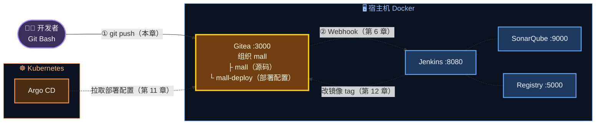
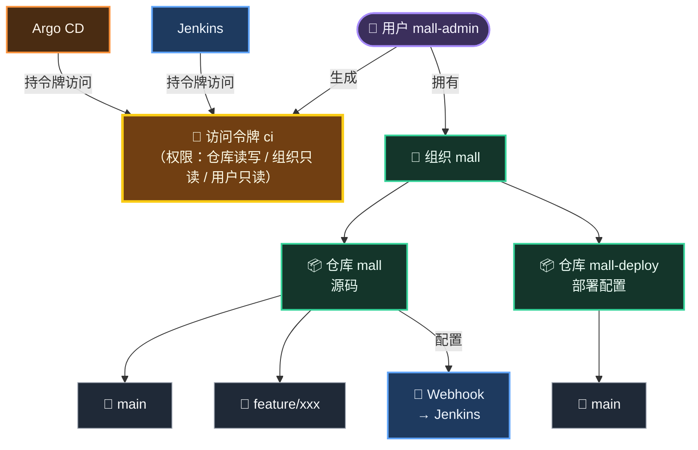
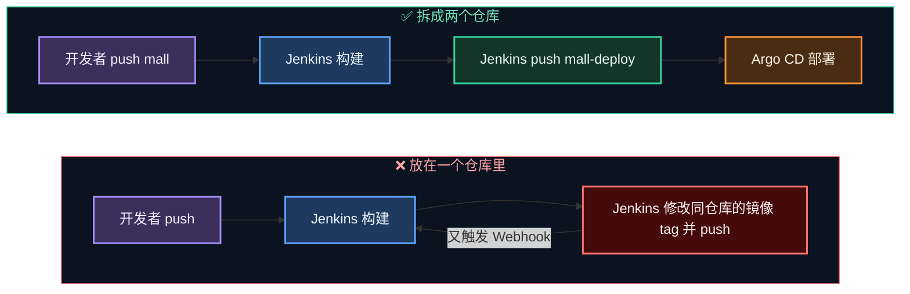
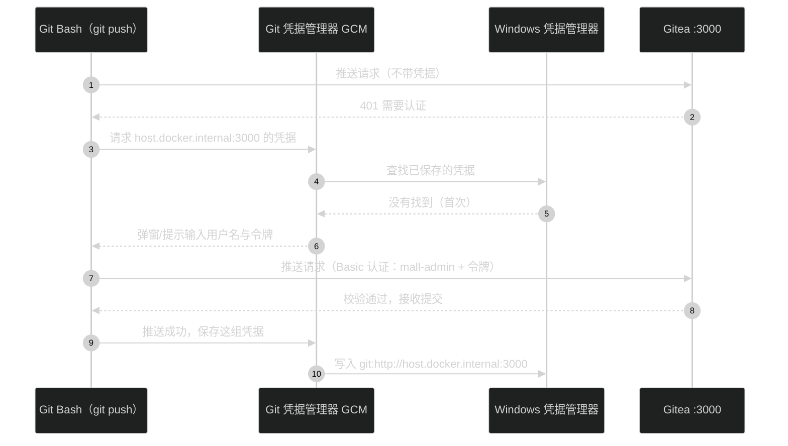
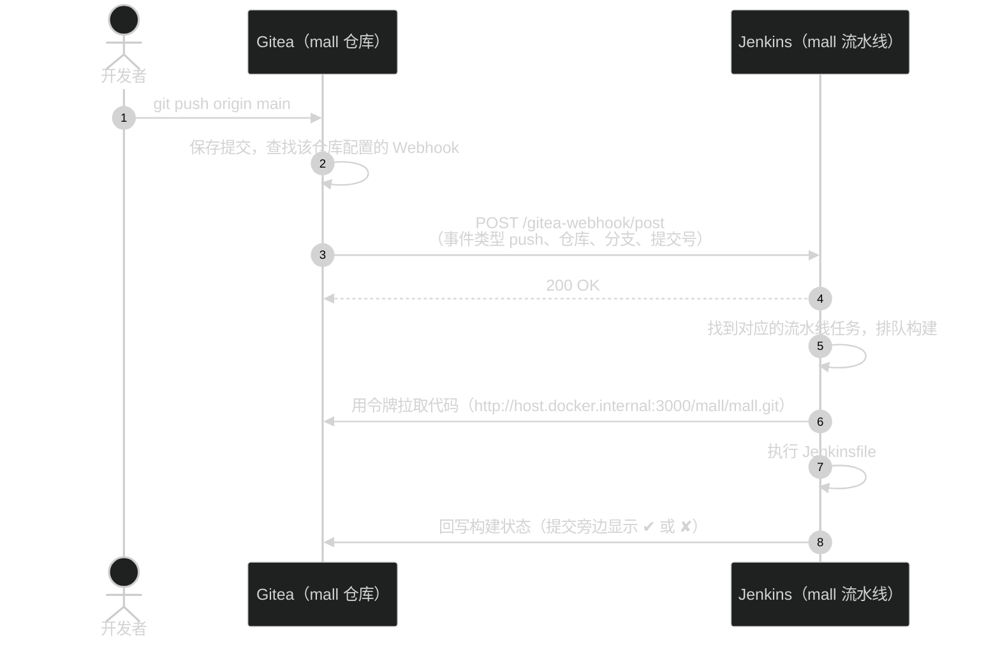
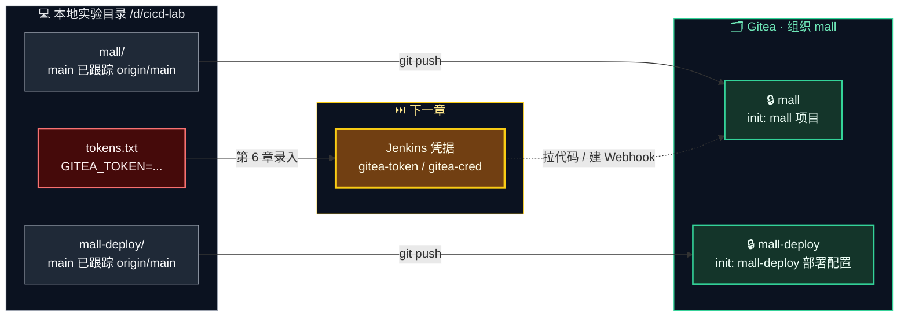

# 第 5 章 Gitea：代码托管

> 流水线的起点永远是"代码仓库"。这一章我们完成 Gitea 安装，建好组织和两个仓库，生成一把给机器用的"钥匙"（访问令牌），并把 `mall` 和 `mall-deploy` 推送上去。

---

## 本章目标

学完本章，你应该能够：

1. 完成 Gitea 的安装，用管理员 `mall-admin / Admin@123456` 登录。
2. 说清楚**用户、组织、仓库、分支、PR、Webhook、访问令牌**这些概念分别是什么。
3. 解释**为什么要把"源码"和"部署配置"拆成两个仓库**（这是 GitOps 的基本功）。
4. 在组织 `mall` 下创建私有仓库 `mall`、`mall-deploy`。
5. 生成名为 `ci` 的访问令牌并妥善保存，后面 Jenkins 和 Argo CD 都要用它。
6. 把本地的 `mall`、`mall-deploy` 推送到 Gitea 的 `main` 分支。

预计耗时：**40～60 分钟**。

---

## 本章在全景中的位置



图中实线是本章要完成的，虚线是后面章节会建立的连接。可以看到，Gitea 是整个链路的**枢纽**：开发者往里推代码，Jenkins 从里面拉代码、又往里写配置，Argo CD 从里面读配置。

---

## 5.1 Gitea 是什么

Gitea 是一个用 Go 编写的**轻量级自托管 Git 服务**，功能和你熟悉的 GitLab、GitHub 非常像：仓库管理、分支、Pull Request、代码审查、Webhook、访问令牌……一应俱全。

| 对比项 | Gitea | GitLab（社区版） | GitHub |
|---|---|---|---|
| 部署方式 | 自托管，单个容器 | 自托管，单个容器但内含十几个服务 | SaaS（云服务） |
| 内存占用 | ~150MB | 4GB 起步 | — |
| 自带 CI | Gitea Actions（兼容 GitHub Actions 语法） | GitLab CI | GitHub Actions |
| 国内公司使用 | 中小团队、内网环境常见 | **非常普遍** | 开源项目为主 |
| 本教程为什么选它 | 轻量，在笔记本上和 Jenkins、SonarQube、K8s 同时运行毫无压力 | 太重 | 无法直接访问本地 K8s |

> 💡 **学会 Gitea 就等于学会了 GitLab 的日常使用**。两者在"组织 / 仓库 / 令牌 / Webhook / 合并请求"这些概念上几乎一一对应，只是菜单名称略有不同（GitLab 里组织叫 Group，PR 叫 Merge Request）。你在公司里用 GitLab 的经验可以直接迁移过来，反之亦然。

---

## 5.2 核心概念

| 概念 | 是什么 | GitLab 中的叫法 | 本教程中的例子 |
|---|---|---|---|
| 用户（User） | 一个登录账号 | User | `mall-admin` |
| 组织（Organization） | 一组仓库的"容器"，可以给团队分配权限 | Group | `mall` |
| 仓库（Repository） | 一个 Git 项目 | Project | `mall/mall`、`mall/mall-deploy` |
| 分支（Branch） | 仓库中的一条开发线 | Branch | `main`、`feature/xxx` |
| 拉取请求（Pull Request，PR） | "请把我分支上的改动合并进 main"的申请，可以在上面做代码审查 | Merge Request（MR） | 第 6 章演示 |
| Webhook | 仓库发生事件（推送、PR 等）时，Gitea **主动**发一个 HTTP 请求通知别的系统 | Webhook | Gitea → Jenkins |
| 访问令牌（Access Token） | 给**程序**用的"密码"，可以限定权限范围、随时吊销 | Personal Access Token | `ci` 令牌，给 Jenkins 和 Argo CD 用 |

它们之间的关系：



> 🧠 **访问令牌 vs 密码**，为什么程序要用令牌？
>
> | 对比 | 账号密码 | 访问令牌 |
> |---|---|---|
> | 权限范围 | 账号能做的事全都能做（包括改密码、删仓库） | 只能做生成时勾选的事 |
> | 泄露后 | 必须改密码，所有用到它的地方都要改 | 在网页上删掉这个令牌即可，不影响账号本身 |
> | 能否给多个系统分别发放 | 只有一个 | 可以给 Jenkins、Argo CD 各发一个，分别吊销 |
> | 使用方式 | 用户名 + 密码 | 当作密码使用（HTTP Basic 认证），或放在请求头 `Authorization: token xxx` |
>
> 所以规矩是：**人登录用密码，机器调用用令牌**。

---

## 5.3 为什么要两个仓库

你可能会想：部署配置（Helm Chart、各环境的 values）放在源码仓库的某个目录里不就行了？为什么要单独建一个 `mall-deploy`？

先看看两个仓库分别放什么：

| | `mall`（源码仓库） | `mall-deploy`（配置仓库） |
|---|---|---|
| 内容 | Java 代码、`pom.xml`、`Dockerfile`、`Jenkinsfile` | Helm Chart、`envs/dev`、`envs/prod`、MySQL 清单、Argo CD 应用定义 |
| 谁来改 | 开发人员 | Jenkins（自动改镜像 tag）、运维/发布负责人（改副本数、资源等） |
| 改动后触发什么 | Jenkins 流水线：编译、测试、扫描、构建镜像 | Argo CD：把集群同步成配置描述的样子 |
| 一次提交代表什么 | "代码变了" | "环境要变了"（发布、扩容、回滚） |

拆开的四个理由：

**① 避免"流水线自己触发自己"的死循环**



放在一个仓库里，Jenkins 改完镜像 tag 一推送，又会触发一次构建，构建完又改 tag……虽然可以用"提交信息里带 `[skip ci]`"之类的技巧规避，但很别扭。拆开之后，`mall-deploy` 根本没有配置构建流水线，天然没有这个问题。

**② 权限分离**

开发人员需要改源码，但不一定应该能直接改生产环境配置；反过来，负责发布的人不需要源码的写权限。两个仓库可以分别授权。

**③ 发布审计清晰**

`mall-deploy` 的提交历史就是一份完整的**发布记录**：

```text
$ git log --oneline   （在 mall-deploy 中，第 13 章之后你会看到类似内容）
9c1e2ab release(prod): promote 3f8a2c1 from dev       ← 谁在什么时候发布了生产
4d7b9e0 deploy(dev): mall 3f8a2c1                       ← Jenkins 自动部署了 dev
a12f6c3 deploy(dev): mall 7be0d44
5e0c1aa init: mall-deploy 部署配置
```

如果配置和源码混在一起，这份记录会被淹没在大量代码提交里。

**④ 回滚粒度合适**

要回滚某次发布，只需要在 `mall-deploy` 里 `git revert` 那一次"改镜像 tag"的提交，不会牵扯任何源码。第 13 章会实际演练。

> 💡 这种"源码仓库 + 配置仓库"的拆分，是 Argo CD 官方推荐的 GitOps 最佳实践，在业界被广泛采用。

---

## 5.4 动手 1：完成 Gitea 安装

### 步骤 1：打开安装页

确认第 4 章启动的容器都在运行：

```bash
# 位置：/d/cicd-lab/infra
docker compose ps gitea
```

预期 `STATUS` 为 `Up ...`。然后在浏览器打开：

**http://host.docker.internal:3000**

> ⚠️ **请一定用 `host.docker.internal:3000`，而不是 `localhost:3000`**。原因：
> - 我们在 compose 中把 Gitea 的 `ROOT_URL` 设置成了 `http://host.docker.internal:3000/`，Gitea 生成的所有链接、克隆地址、Webhook 中的仓库地址都基于它。
> - 如果浏览器用 `localhost:3000` 访问，Gitea 会提示"当前访问地址与 ROOT_URL 不一致"，登录状态（Cookie）也可能因为域名不同而丢失。
> - 第 4 章讲过：`host.docker.internal` 是浏览器、Jenkins 容器、K8s Pod 三方都能访问的地址，统一用它，整条链路的地址就只有一个版本。

### 步骤 2：逐项核对预填字段

页面标题是 **Initial Configuration（初始配置）**。因为我们在 compose 中通过环境变量预设了配置，大部分字段已经填好，你只需要**核对**（不同版本字段名和顺序可能略有差异）：

**Database Settings（数据库设置）**

| 字段 | 应显示的值 | 说明 |
|---|---|---|
| Database Type（数据库类型） | `SQLite3` | 来自 `GITEA__database__DB_TYPE` |
| Path（路径） | `/data/gitea/gitea.db` | 保持默认，位于数据卷 `gitea-data` 中 |

**General Settings（一般设置）**

| 字段 | 填写 / 核对 | 说明 |
|---|---|---|
| Site Title（站点名称） | 可改为 `Mall Gitea` | 显示在浏览器标签页上，随意 |
| Repository Root Path（仓库根目录） | `/data/git/repositories` | 保持默认 |
| Git LFS Root Path | `/data/git/lfs` | 保持默认 |
| Run As Username（运行用户） | `git` | 保持默认 |
| Server Domain（服务器域名） | 改为 `host.docker.internal` | 只影响 SSH 克隆地址；我们禁用了 SSH，填它只是为了统一 |
| SSH Server Port（SSH 端口） | 留空 / 已禁用 | 来自 `GITEA__server__DISABLE_SSH`，留空表示禁用 SSH |
| Gitea HTTP Listen Port（HTTP 监听端口） | `3000` | 来自 `GITEA__server__HTTP_PORT` |
| Gitea Base URL（基础 URL） | `http://host.docker.internal:3000/` | **最重要的一项**，来自 `GITEA__server__ROOT_URL`，务必确认没有被改成 localhost |
| Log Path（日志路径） | `/data/gitea/log` | 保持默认 |

**Optional Settings（可选设置）**——点击展开：

| 区块 | 操作 |
|---|---|
| Email Settings（邮件设置） | 不填，跳过 |
| Server and Third-Party Service Settings（服务器和第三方服务设置） | 建议勾选 **Disable Self-Registration（禁止用户自助注册）**：内部平台一般由管理员分配账号；其余保持默认 |
| **Administrator Account Settings（管理员账号设置）** | **必须展开填写**，见下表 |

**Administrator Account Settings（管理员账号设置）**

| 字段 | 填写 |
|---|---|
| Administrator Username（管理员用户名） | `mall-admin` |
| Email Address（邮箱） | `admin@mall.local` |
| Password（密码） | `Admin@123456` |
| Confirm Password（确认密码） | `Admin@123456` |

> 💡 为什么管理员不叫 `admin`？因为 `admin` 是 Gitea 的**保留用户名**（和 `api`、`assets`、`explore` 等一样，会与网页路由冲突），无法注册。
>
> 💡 如果这里不填管理员，Gitea 会把"第一个注册的用户"自动设为管理员。但我们刚刚禁用了自助注册，所以**这里必须填**。

### 步骤 3：安装

点击页面最下方的 **Install Gitea（立即安装）**。

页面会显示"正在加载"，大约 5～15 秒后跳转到 Gitea 首页，并且**已经以 `mall-admin` 身份登录**（右上角能看到头像）。

> ✅ 检查点：
> ```bash
> # 位置：任意目录
> curl -s -u mall-admin:Admin@123456 http://host.docker.internal:3000/api/v1/user
> ```
> 预期输出（节选）：
> ```text
> {"id":1,"login":"mall-admin",...,"email":"admin@mall.local",...,"is_admin":true,...}
> ```
> `"is_admin":true` 说明管理员创建成功。

> 🧠 原理：安装页的内容最终写到了哪里？
> 点击安装后，Gitea 把所有配置写入容器内的 `/data/gitea/conf/app.ini`，并设置 `INSTALL_LOCK = true`（安装锁），以后再访问就不会出现安装页了。你可以看一眼：
> ```bash
> MSYS_NO_PATHCONV=1 docker exec gitea grep -A3 "^\[server\]" /data/gitea/conf/app.ini
> ```
> 能看到 `ROOT_URL = http://host.docker.internal:3000/` 等配置。

---

## 5.5 动手 2：创建组织 mall

### 为什么要建组织

把仓库放在组织下（`mall/mall`），而不是个人名下（`mall-admin/mall`），好处是：

- 仓库归属于"团队"而不是"某个人"，人员离职不影响仓库
- 可以在组织内建团队（Team），按团队分配仓库权限
- Jenkins 的 Gitea 插件可以按组织批量发现仓库

### 操作步骤

1. 点击页面右上角的 **+**（加号）图标 → **New Organization（创建组织）**。
2. 填写表单：

| 字段 | 填写 | 说明 |
|---|---|---|
| Organization Name（组织名称） | `mall` | 会成为仓库地址的一部分：`/mall/仓库名` |
| Visibility（可见性） | `Public`（公开，默认） | 组织本身公开无妨，**仓库会单独设为私有** |
| Permission（权限） | 保持默认勾选 *Repository admins can add and remove access for teams* | |

3. 点击 **Create Organization（创建组织）**。

创建后会进入组织主页 `http://host.docker.internal:3000/mall`，目前还没有仓库。

---

## 5.6 动手 3：创建两个仓库

### 步骤 1：创建 mall 仓库

在组织 `mall` 的主页，点击右侧的 **New Repository（创建仓库）** 按钮（或右上角 **+** → **New Repository**，再把 Owner 选为 `mall`）。

| 字段 | 填写 | 说明 |
|---|---|---|
| Owner（拥有者） | `mall` | ⚠️ 确认是组织 `mall`，不是个人 `mall-admin` |
| Repository Name（仓库名称） | `mall` | |
| Visibility（可见性） | ✅ 勾选 **Make repository private**（私有仓库） | 公司代码一般都是私有的，这样也能练习"带认证访问" |
| Description（描述） | `迷你商城源码` | 选填 |
| Template（模板） | 不选 | |
| Issue Labels（工单标签） | 不选 | |
| .gitignore | 不选 | ⚠️ 本地已有 |
| License（许可证） | 不选 | |
| README | 不选 | |
| Initialize Repository（初始化仓库） | ❌ **不要勾选** | 见下方说明 |
| Default Branch（默认分支） | `main` | |
| Object Format（对象格式） | `sha1`（默认） | |

点击 **Create Repository（创建仓库）**。

> ⚠️ 为什么**不要**初始化仓库（不要勾选 README/.gitignore/License）？
> 一旦勾选，Gitea 会在远程仓库里先创建一个提交。而我们本地也有一个独立的初始提交，两者没有共同的祖先，`git push` 时会被拒绝（`rejected ... fetch first`），你就不得不处理"合并无关历史"的麻烦。**推送已有项目时，远程仓库一定要是空的。**

创建后，页面显示空仓库的引导信息，其中 **HTTP 克隆地址**是：

```text
http://host.docker.internal:3000/mall/mall.git
```

注意它的前缀正是 `ROOT_URL`——这就是第 4 章反复强调地址一致性的原因。

### 步骤 2：创建 mall-deploy 仓库

回到组织主页，重复上面的操作，只改下面两项：

| 字段 | 填写 |
|---|---|
| Repository Name（仓库名称） | `mall-deploy` |
| Description（描述） | `GitOps 部署配置` |

其余字段与 `mall` 相同（私有、不初始化、默认分支 `main`）。

> ✅ 检查点：打开 http://host.docker.internal:3000/mall ，能看到两个带🔒（私有）标记的空仓库：`mall`、`mall-deploy`。

---

## 5.7 动手 4：生成访问令牌

### 步骤 1：打开令牌管理页面

点击右上角头像 → **Settings（设置）** → 左侧菜单 **Applications（应用）**，在 **Manage Access Tokens（管理访问令牌）** 区域找到 **Generate New Token（生成新令牌）** 表单（不同版本菜单位置可能略有差异）。

### 步骤 2：填写令牌信息

| 字段 | 填写 | 说明 |
|---|---|---|
| Token Name（令牌名称） | `ci` | 给 CI/CD 系统使用 |
| Repository and Organization Access（仓库和组织访问范围） | **All (public, private, and limited)** | 必须能访问私有仓库 |

**Select permissions（选择权限）**——每一类权限都有下拉框，按下表设置：

| 权限类别 | 设置为 | 谁需要 / 为什么 |
|---|---|---|
| repository（仓库） | **Read and Write（读写）** | Jenkins 拉代码、推送 `mall-deploy`、自动创建 Webhook、回写构建状态；Argo CD 拉配置 |
| organization（组织） | **Read（只读）** | Jenkins Gitea 插件需要读取组织信息 |
| user（用户） | **Read（只读）** | 插件需要读取当前用户信息 |
| 其余（activitypub、admin、issue、misc、notification、package） | **No Access（无权限）** | 最小权限原则，用不到的不给 |

点击 **Generate Token（生成令牌）**。

> 💡 如果第 6 章 Jenkins 扫描仓库或创建 Webhook 时报 `403 Forbidden`，回到这里把 **organization** 改为 **Read and Write** 再试（Gitea 允许编辑已有令牌的权限，或者删除后重新生成一个）。

### 步骤 3：立即保存令牌

页面顶部会出现一条蓝色提示，里面是一串 40 位左右的字符，形如：

```text
f3a1c9e7b2d4...（共 40 个字符左右）
```

> ⚠️ **令牌只显示这一次**！刷新页面就再也看不到了。如果丢了，只能删除后重新生成。

马上把它保存到实验目录下的 `tokens.txt` 中（把 `粘贴你的令牌` 替换成真实内容）：

```bash
# 位置：任意目录
echo "GITEA_TOKEN=粘贴你的令牌" > /d/cicd-lab/tokens.txt
cat /d/cicd-lab/tokens.txt
```

预期输出：

```text
GITEA_TOKEN=f3a1c9e7b2d4...
```

以后需要用令牌时，可以这样加载到当前终端：

```bash
# 位置：任意目录
source /d/cicd-lab/tokens.txt
echo $GITEA_TOKEN
```

> ⚠️ `tokens.txt` 放在 `/d/cicd-lab` 根目录，**不在** `mall`、`mall-deploy` 任何一个仓库目录里，所以不会被误提交。**任何令牌、密码文件都不要提交到 Git**——这是一条铁律。

### 步骤 4：验证令牌

用令牌调用 Gitea API，列出组织 `mall` 下的仓库：

```bash
# 位置：任意目录
source /d/cicd-lab/tokens.txt
curl -s -H "Authorization: token $GITEA_TOKEN" \
  http://host.docker.internal:3000/api/v1/orgs/mall/repos | grep -o '"full_name":"[^"]*"'
```

预期输出：

```text
"full_name":"mall/mall"
"full_name":"mall/mall-deploy"
```

能看到两个**私有**仓库，说明令牌有效且权限正确。

这把令牌后面会被用在这些地方：

| 使用者 | 用法 | 章节 |
|---|---|---|
| 你自己（git push） | 推送时当作密码输入 | 本章 |
| Jenkins 凭据 `gitea-token` | Gitea 服务器配置、多分支流水线拉代码 | 第 6 章 |
| Jenkins 凭据 `gitea-cred` | 用户名 `mall-admin` + 令牌，流水线推送 `mall-deploy` | 第 6、12 章 |
| Argo CD 仓库凭据 | 用户名 `mall-admin` + 令牌，拉取 `mall-deploy` | 第 11 章 |

---

## 5.8 动手 5：推送 mall

### 步骤 1：确认 Git 身份

每个提交都要记录作者，先看看全局配置：

```bash
# 位置：任意目录
git config --global user.name
git config --global user.email
```

- 如果两行都有输出，跳过本步骤。
- 如果没有输出，设置一下（换成你自己的名字和邮箱）：

```bash
git config --global user.name "你的名字"
git config --global user.email "you@example.com"
```

### 步骤 2：允许凭据管理器处理 HTTP 地址

Git for Windows 自带 **Git Credential Manager（GCM，凭据管理器）**，它会在推送时弹窗让你输入账号，并把凭据保存到 Windows 凭据管理器中，下次就不用再输了。

但新版 GCM 出于安全考虑，**默认拒绝为 `http://`（非加密）地址保存和发送凭据**。我们的 Gitea 是本地 HTTP 服务，需要为它单独放行：

```bash
# 位置：任意目录
git config --global credential.http://host.docker.internal:3000.allowUnsafeRemotes true
```

这条配置**只对 `http://host.docker.internal:3000` 生效**，不影响你访问 GitHub、公司 GitLab 等其他地址。

> 💡 如果你的 GCM 版本较旧、没有这个开关，这条配置会被直接忽略，没有副作用。

### 步骤 3：初始化本地仓库并提交

```bash
# 位置：/d/cicd-lab/mall
cd /d/cicd-lab/mall
git init -b main
```

预期输出：

```text
Initialized empty Git repository in D:/cicd-lab/mall/.git/
```

`-b main` 表示初始分支名为 `main`（与 Gitea 仓库的默认分支一致）。

```bash
# 位置：/d/cicd-lab/mall
git add .
git status --short
```

预期能看到所有项目文件都处于待提交（`A`）状态，类似：

```text
A  .gitattributes
A  .gitignore
A  Jenkinsfile
A  docker-compose.yml
A  docker/mysql/init.sql
A  mall-order/.dockerignore
A  mall-order/Dockerfile
A  mall-order/pom.xml
A  mall-order/src/main/java/com/xiaozhi/mall/order/MallOrderApplication.java
...
A  pom.xml
```

> ✅ 检查一下：列表里**不应该**出现 `target/` 目录下的文件。如果出现了，说明第 2、3 章编译产生的 `target` 没有被忽略——确认 `.gitignore` 存在且包含 `target/`。

> 💡 如果看到 `warning: in the working copy of '...', CRLF will be replaced by LF the next time Git touches it`，这是**正常且符合预期**的：项目中的 `.gitattributes` 规定了 `* text=auto eol=lf`，Git 会把仓库中的文本文件统一存成 LF 换行。Jenkinsfile、Shell 片段、YAML 都要在 Linux 容器里执行，CRLF 会引发各种奇怪错误。

提交：

```bash
# 位置：/d/cicd-lab/mall
git commit -m "init: mall 项目"
```

预期输出（文件数可能略有不同）：

```text
[main (root-commit) 1a2b3c4] init: mall 项目
 27 files changed, 1100 insertions(+)
 create mode 100644 .gitattributes
 ...
```

> 💡 你可能注意到，这次提交的 `Jenkinsfile` 是教程目录中的**最终版**（包含扫描、镜像、部署等全部阶段）。没关系——现在还没有任何 Jenkins 任务会读它。第 6 章开头我们会先把它替换成最简单的 v1 版本，然后在第 7、8、12 章一步步加回来，让你看清每个阶段的作用。

### 步骤 4：关联远程仓库并推送

```bash
# 位置：/d/cicd-lab/mall
git remote add origin http://host.docker.internal:3000/mall/mall.git
git remote -v
```

预期输出：

```text
origin  http://host.docker.internal:3000/mall/mall.git (fetch)
origin  http://host.docker.internal:3000/mall/mall.git (push)
```

推送：

```bash
# 位置：/d/cicd-lab/mall
git push -u origin main
```

此时会要求你输入账号，可能是弹出一个窗口，也可能直接在终端里提示（取决于 GCM 版本和设置）：

| 提示 | 填写 |
|---|---|
| Username（用户名） | `mall-admin` |
| Password（密码） | **粘贴访问令牌**（`tokens.txt` 中 `GITEA_TOKEN=` 后面的内容） |

> 💡 这里用密码 `Admin@123456` 其实也能推送成功。但养成"命令行和程序一律用令牌"的习惯更好：令牌可以随时吊销，而且很多公司的 GitLab 会禁止命令行使用账号密码。

预期输出（数字会有差异）：

```text
Enumerating objects: 45, done.
Counting objects: 100% (45/45), done.
Delta compression using up to 20 threads
Compressing objects: 100% (32/32), done.
Writing objects: 100% (45/45), 15.20 KiB | 3.04 MiB/s, done.
Total 45 (delta 4), reused 0 (delta 0), pack-reused 0 (from 0)
remote: . Processing 1 references
remote: Processed 1 references in total
To http://host.docker.internal:3000/mall/mall.git
 * [new branch]      main -> main
branch 'main' set up to track 'origin/main'.
```

`-u`（`--set-upstream`）让本地 `main` 跟踪远程 `origin/main`，以后直接 `git push`、`git pull` 即可，不用再写 `origin main`。

整个推送过程的交互：



第二次推送时，第 4 步就能找到凭据，不会再弹窗。

---

## 5.9 动手 6：推送 mall-deploy

步骤与上一节完全相同，只是目录、提交信息和远程地址不同：

```bash
# 位置：/d/cicd-lab/mall-deploy
cd /d/cicd-lab/mall-deploy
git init -b main
git add .
git commit -m "init: mall-deploy 部署配置"
git remote add origin http://host.docker.internal:3000/mall/mall-deploy.git
git push -u origin main
```

这次因为凭据已经保存过，**不会再弹窗**，直接推送成功：

```text
...
To http://host.docker.internal:3000/mall/mall-deploy.git
 * [new branch]      main -> main
branch 'main' set up to track 'origin/main'.
```

推送了哪些内容，可以对照一下目录结构：

```text
mall-deploy/
├── .gitattributes
├── README.md
├── argocd/
│   ├── dev.yaml                  # 第 11 章：开发环境的 Argo CD 应用
│   └── prod.yaml                 # 第 13 章：生产环境的 Argo CD 应用
├── charts/springboot-app/        # 第 10 章：通用 Spring Boot Helm Chart
├── envs/
│   ├── dev/                      # 开发环境参数（image.tag 由 Jenkins 自动改）
│   └── prod/                     # 生产环境参数（image.tag 由发布流水线晋升）
├── infra/mysql/                  # 第 9 章：MySQL 的 K8s 清单
└── jenkins/
    └── promote-prod.Jenkinsfile  # 第 13 章：生产发布流水线
```

---

## 5.10 检查点：确认两个仓库都推送成功

**方式一：命令行**

```bash
# 位置：/d/cicd-lab/mall
git ls-remote origin
```

预期输出（哈希值不同）：

```text
1a2b3c4d5e6f...    HEAD
1a2b3c4d5e6f...    refs/heads/main
```

`HEAD` 和 `refs/heads/main` 指向同一个提交，且与本地 `git log -1 --format=%H` 的结果一致，说明远程和本地同步了。

```bash
# 位置：/d/cicd-lab/mall-deploy
git ls-remote origin
git log --oneline
```

**方式二：网页**

| 页面 | 应该看到 |
|---|---|
| http://host.docker.internal:3000/mall/mall | 文件列表（`mall-user`、`mall-order`、`Jenkinsfile`……），最近提交 `init: mall 项目` |
| http://host.docker.internal:3000/mall/mall-deploy | 文件列表（`charts`、`envs`、`argocd`……），最近提交 `init: mall-deploy 部署配置`；`README.md` 会被渲染展示在下方 |

点进 `mall` 仓库的 **Commits（提交）**，可以看到这次提交的作者、时间、改动文件——这就是代码托管平台最基础的价值：**每一行代码的来龙去脉都可追溯**。

---

## 5.11 预告：Webhook 是怎么把 Gitea 和 Jenkins 连起来的

推送成功了，但现在什么都不会自动发生——因为 Gitea 还不知道"代码变了要通知谁"。这就需要 **Webhook**。

Webhook 的思路是"**你别一直问我，有事我通知你**"：

```text
 轮询（Polling）：Jenkins 每分钟问一次 Gitea"有新提交吗？"——慢，而且大部分询问都是白问
 Webhook：     Gitea 一收到推送，立刻主动 POST 一条消息给 Jenkins——实时、省资源
```

第 6 章配置好 Jenkins 后，Jenkins 的 Gitea 插件会**自动**在 `mall` 仓库中创建一个 Webhook。届时你可以在仓库的 **Settings（设置）→ Webhooks（Web 钩子）** 中看到它，地址类似：

```text
http://host.docker.internal:8080/gitea-webhook/post
```

完整的触发过程：



> 🧠 还记得第 4 章 compose 里的 `GITEA__webhook__ALLOWED_HOST_LIST: "*"` 吗？第 3 步 Gitea 要把请求发往 `host.docker.internal:8080`，它解析出来是一个**私有 IP**。Gitea 默认只允许 Webhook 发往公网地址（防止有人利用 Webhook 探测内网，即 SSRF 攻击），不放开的话，第 3 步会被 Gitea 直接拦截。

---

## 5.12 可选：分支保护规则

在真实团队里，`main` 分支通常会开启**分支保护**：禁止直接推送，必须通过 PR 合并，且 PR 需要至少一人审核、CI 通过。

配置入口：仓库 **Settings（设置）→ Branches（分支）→ Add New Rule（添加新规则）**（不同版本菜单位置可能略有差异），常用选项：

| 选项 | 作用 |
|---|---|
| Protected Branch Name Pattern（受保护分支名称模式） | 填 `main` |
| Disable Push / Enable Push（禁止 / 允许推送） | 禁止任何人直接推送到 `main` |
| Required approvals（需要的批准数） | PR 至少需要几个人审核通过 |
| Enable Status Check（启用状态检查） | PR 必须 CI 通过才能合并 |

**本教程暂不开启**，原因是：

1. 第 12 章演示全链路时，为了节省篇幅，我们会直接向 `mall` 的 `main` 推送代码；
2. Jenkins 需要直接向 `mall-deploy` 的 `main` 推送镜像 tag 的修改。

学完整个教程后，你可以给 `mall` 仓库开启分支保护，体验"feature 分支 → PR → CI 通过 → 合并 → 自动部署"的完整团队协作流程（第 6 章会先演示 feature 分支和 PR 的构建）。

---

## 5.13 常见坑

| 现象 | 原因 | 解决办法 |
|---|---|---|
| 浏览器访问 `localhost:3000`，页面提示 ROOT_URL 不一致，或登录后又跳回登录页 | 访问地址与 `ROOT_URL` 不同，Cookie 域名不匹配 | 统一使用 `http://host.docker.internal:3000` |
| 安装页的 Gitea Base URL 显示的是 `http://localhost:3000/` | compose 中 `GITEA__server__ROOT_URL` 没生效（拼写错误或改错了文件） | 检查 `infra/docker-compose.yml` 后 `docker compose up -d gitea`；也可以直接在安装页手工改成 `http://host.docker.internal:3000/` |
| 创建管理员提示 "名称不可用" | 用了保留用户名 `admin` | 改用 `mall-admin` |
| `git push` 报 `rejected ... (fetch first)` | 创建仓库时勾选了初始化，远程已有提交 | 最简单：在 Gitea 中删除仓库（Settings → Danger Zone → Delete This Repository）后按 5.6 节重新创建（不勾选初始化），再推送 |
| `git push` 报 `401 Unauthorized` / `Authentication failed` | 用户名或令牌输错；令牌没有 repository 写权限 | 重新生成令牌并确认 repository 为 Read and Write；然后清除错误的凭据缓存（见下一行） |
| 凭据输错后不再弹窗，一直认证失败 | GCM 把错误的凭据保存进了 Windows 凭据管理器 | 方法一：Windows 搜索"凭据管理器"→ **Windows 凭据** → 找到 `git:http://host.docker.internal:3000` → 删除。方法二（命令行）：`printf "protocol=http\nhost=host.docker.internal:3000\n\n" \| git credential reject`。然后重新 `git push` |
| 推送时报与 "unsafe remote" / HTTP 不安全相关的错误 | GCM 默认拒绝 HTTP 地址 | 执行 5.8 节步骤 2 的 `allowUnsafeRemotes` 配置 |
| 大量 `CRLF will be replaced by LF` 警告 | `.gitattributes` 规定仓库统一 LF | 正常现象，可忽略 |
| `git add` 后出现了 `target/` 下的文件 | 缺少 `.gitignore` | 确认复制项目时 `.gitignore` 也复制过来了；已加入暂存区的用 `git rm -r --cached mall-user/target mall-order/target` 移除 |
| 换了网络（Wi-Fi/VPN）后，`host.docker.internal:3000` 打不开 | hosts 中记录的局域网 IP 已变化 | 重启 Docker Desktop，让它重新写入 hosts；用 `grep host.docker.internal /c/Windows/System32/drivers/etc/hosts` 与 `ipconfig` 对比确认 |

---

## 本章小结

| 知识点 | 一句话总结 |
|---|---|
| Gitea | 轻量版 GitLab，概念一一对应：组织≈Group、PR≈MR |
| ROOT_URL | Gitea 生成一切链接的基准，浏览器访问地址必须与它一致 |
| 组织与私有仓库 | 仓库归属团队而非个人；私有仓库让我们练习"带认证访问" |
| 两个仓库 | 源码 `mall` 触发 CI，配置 `mall-deploy` 驱动 CD；避免死循环、权限分离、审计清晰、回滚方便 |
| 访问令牌 | 机器用令牌、人用密码；最小权限；只显示一次；不进 Git |
| 推送已有项目 | 远程仓库必须为空（不初始化） |
| GCM | 为 HTTP 地址开启 `allowUnsafeRemotes`，凭据保存在 Windows 凭据管理器 |
| Webhook | Gitea 主动通知 Jenkins，第 6 章由 Jenkins 自动创建 |

本章完成后的状态：



---

## 课后练习

1. **体验分支与网页对比**：在 `mall` 中新建分支并推送：
   ```bash
   cd /d/cicd-lab/mall
   git switch -c feature/hello
   echo "# mall" > README.md
   git add README.md && git commit -m "docs: 添加 README"
   git push -u origin feature/hello
   ```
   到 Gitea 网页上切换分支查看，并尝试点击 **New Pull Request** 创建一个 PR（先不要合并，第 6 章会用到 PR 构建；不想保留的话也可以关闭 PR 并删除分支）。完成后执行 `git switch main` 切回主分支。
2. **用 API 代替网页**：用令牌调用 Gitea API 查看 `mall` 仓库的分支列表：
   ```bash
   source /d/cicd-lab/tokens.txt
   curl -s -H "Authorization: token $GITEA_TOKEN" \
     http://host.docker.internal:3000/api/v1/repos/mall/mall/branches | grep -o '"name":"[^"]*"'
   ```
   思考：Jenkins 的 Gitea 插件"发现分支"时，本质上做的就是类似的 API 调用。
3. **理解令牌的权限边界**：再生成一个只有 repository **Read** 权限的令牌 `readonly-test`，用它 `git clone` 和 `git push` 分别试试，观察推送时的报错。试完记得在 Settings → Applications 中删除这个令牌。

---

下一章：[第 6 章 Jenkins：第一条流水线](06-jenkins-ci.md)
