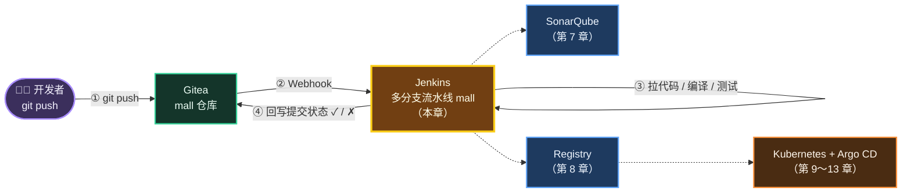
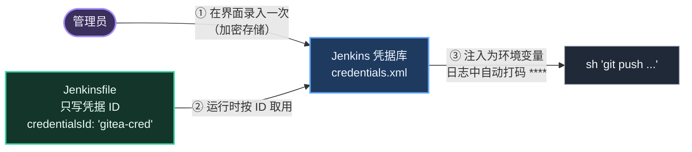
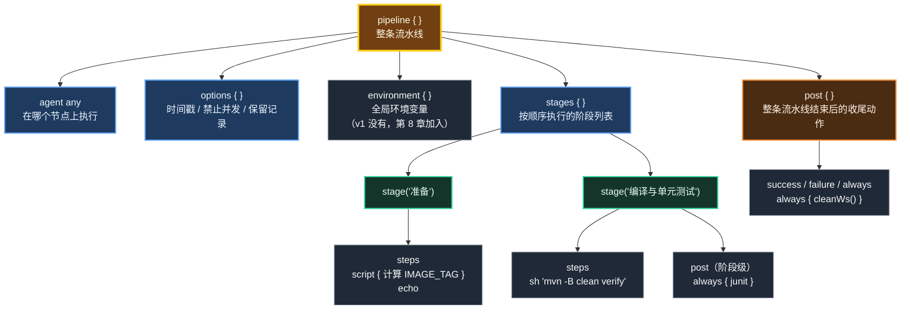
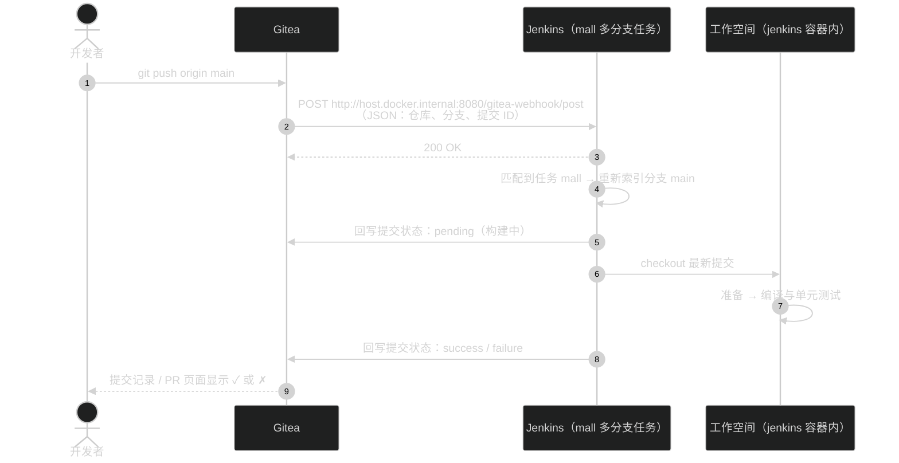
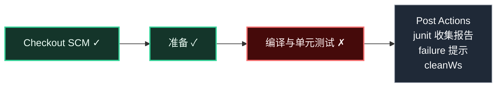
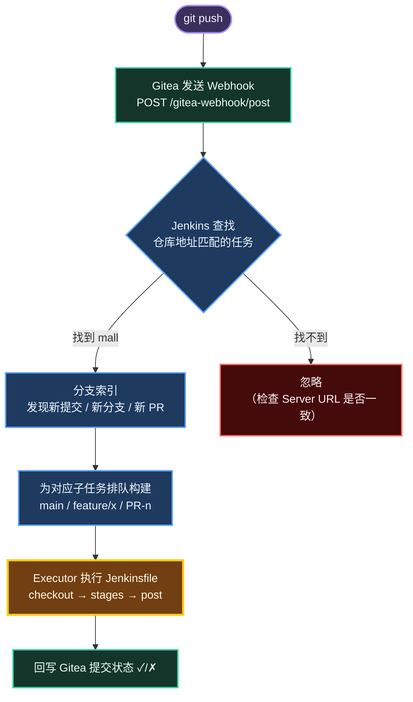
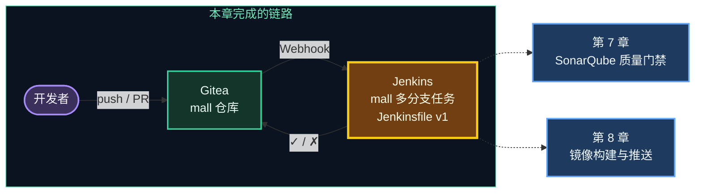

# 第 6 章 Jenkins：第一条流水线

> 上一章代码已经放进了 Gitea，但"代码提交之后"什么都不会发生。本章我们请来流水线的总指挥 Jenkins：**代码一推送，自动拉代码、编译、跑单元测试，再把结果（✓ / ✗）回写到 Gitea**。这就是持续集成（CI）最核心的样子。

---

## 本章目标

完成本章后，你应该能够：

1. 说清楚 Jenkins 的 Controller / Agent / Executor、任务类型和"流水线即代码"（Pipeline as Code）这几个核心概念。
2. 在 Jenkins 中创建 4 个凭据中的 3 个：`gitea-token`、`gitea-cred`、`registry-cred`，并理解凭据的作用域。
3. 配置 Gitea 服务器，创建多分支流水线任务 `mall`，看懂首次扫描日志和构建页面。
4. 读懂 Jenkinsfile v1 的每一行：`pipeline` → `agent` → `options` → `stages` → `stage` → `steps` → `post`。
5. 验证 **push 即构建**：Gitea Webhook 自动触发 Jenkins，构建结果回写到 Gitea 提交记录上。
6. 走一遍真实开发流程：**feature 分支 → Pull Request → 合并**；故意让测试失败，学会根据测试报告定位问题并修复。

预计耗时：**90～120 分钟**（第一次构建要下载 Maven 依赖，耐心等待）。

---

## 本章在全景中的位置



虚线部分是后续章节要接上的。本章结束时，**实线部分全部打通**。

---

## 6.1 Jenkins 是什么：流水线的"总指挥"

### 6.1.1 一个类比

把软件交付想象成一条**汽车装配线**：

- **Gitea** 是图纸库，工程师（开发者）每改一次图纸就存进去；
- **Jenkins** 是车间主任，看到新图纸就按照**作业指导书（Jenkinsfile）**安排工人一步步干活：备料（拉代码）→ 加工（编译）→ 质检（测试）→ 喷漆（打镜像）→ 出厂（部署）；
- 哪一步出了问题，车间主任立刻叫停，并在图纸上盖一个红章（✗）。

Jenkins 本身**不会编译代码、也不会跑测试**，它只负责"在正确的时间、正确的机器上，按顺序执行正确的命令，并记录结果"。真正干活的是 `mvn`、`docker`、`git` 这些工具——这也是第 4 章要把这些工具预装进 Jenkins 镜像的原因。

### 6.1.2 Controller、Agent、Executor

```text
┌──────────────────────────── Jenkins Controller（主节点 / 控制器）────────────────────────────┐
│  · Web 界面、系统配置、凭据、任务定义、构建记录                                                │
│  · 调度：决定哪个构建在哪个节点上执行                                                          │
│                                                                                                │
│  内置节点 Built-In Node（本教程就用它干活）                                                    │
│   ┌──────────────┐ ┌──────────────┐                                                            │
│   │ Executor #1  │ │ Executor #2  │   ← 执行器 = "工位"，一个工位同一时间只跑一个构建          │
│   └──────────────┘ └──────────────┘                                                            │
└───────────────────────────────┬────────────────────────────────────────────────────────────────┘
                                │ 生产环境中通常会挂载多个 Agent（构建节点）
        ┌───────────────────────┼────────────────────────┐
        ▼                       ▼                        ▼
 ┌─────────────┐        ┌─────────────┐          ┌──────────────────┐
 │ Agent: java │        │ Agent: node │          │ Agent: K8s Pod   │   ← 按需创建，用完即销毁
 │ (JDK+Maven) │        │ (前端构建)  │          │ (Kubernetes 插件) │
 └─────────────┘        └─────────────┘          └──────────────────┘
```

| 概念 | 是什么 | 本教程中 |
|---|---|---|
| **Controller** | Jenkins 的"大脑"：界面、配置、调度、存储 | `jenkins` 容器 |
| **Agent（Node）** | 真正执行构建的机器 | 直接使用 Controller 自带的 **Built-In Node** |
| **Executor** | 节点上的"工位"，决定能同时跑几个构建 | 默认 2 个 |
| **Workspace** | 每个任务在节点上的工作目录，代码就 checkout 到这里 | `/var/jenkins_home/workspace/...` |

> ⚠️ 在 Controller 上直接跑构建，Jenkins 会在系统管理页提示"不建议在内置节点上构建"。这在生产环境确实是安全隐患（构建脚本能读到 Jenkins 的全部数据），但对于本地学习足够了。第 14 章会介绍"Jenkins on Kubernetes"——每次构建临时起一个 Pod 当 Agent。

### 6.1.3 四种常见任务类型

| 任务类型 | 构建逻辑写在哪 | 分支支持 | 适用场景 |
|---|---|---|---|
| **Freestyle project**（自由风格） | Jenkins 网页上点点点 | 单分支 | 早期用法，配置无法版本化，**不推荐** |
| **Pipeline**（流水线） | Jenkinsfile（可放在网页上或仓库里） | 单分支 | 单一用途的任务，例如第 13 章的生产发布任务 `mall-promote-prod` |
| **Multibranch Pipeline**（多分支流水线） | 仓库中的 Jenkinsfile | **每个分支 / PR 自动生成一个子任务** | **一个仓库一条流水线**——本章的 `mall` 任务 |
| **Organization Folder**（组织文件夹） | 各仓库中的 Jenkinsfile | 自动发现组织下所有仓库 | 仓库很多的团队，一次配置管所有仓库 |

我们选择 **Multibranch Pipeline**，原因很实际：开发中天天在拉 feature 分支、提 PR，多分支任务会**自动为每个分支和 PR 创建子任务**，分支删了子任务也自动清理，完全不用人工维护。

### 6.1.4 Pipeline as Code：流水线即代码

所谓"流水线即代码"，就是把构建步骤写成一个名为 `Jenkinsfile` 的文件，**和业务代码放在同一个仓库里**：

| 对比项 | 网页上配置（Freestyle） | Jenkinsfile（Pipeline as Code） |
|---|---|---|
| 修改记录 | 谁改的、改了啥，无从查起 | Git 历史一清二楚 |
| 代码评审 | 不可能 | 改流水线也要提 PR、走 Code Review |
| 分支差异 | 所有分支共用一份配置 | 每个分支可以有自己的 Jenkinsfile |
| 迁移 / 重建 | Jenkins 坏了就得重新点一遍 | 新 Jenkins 指向仓库，立刻恢复 |

Jenkinsfile 有两种写法：

| 写法 | 长什么样 | 特点 |
|---|---|---|
| **声明式（Declarative）** | `pipeline { agent ... stages { ... } }` | 结构固定、可读性好、有语法校验，**官方推荐，本教程使用** |
| 脚本式（Scripted） | `node { stage('x') { ... } }` | 本质是 Groovy 脚本，灵活但容易写乱 |

声明式中需要写一点逻辑时，可以用 `script { }` 块"临时切换"成脚本式，后面 Jenkinsfile 中的「准备」阶段就是这么用的。

### 6.1.5 凭据（Credentials）：密码不进代码

流水线需要访问 Gitea、镜像仓库、SonarQube，难免要用到令牌和密码。规则只有一条：**密码绝不写进 Jenkinsfile**。Jenkins 提供了凭据系统：



凭据有两个关键属性：

| 属性 | 选项 | 含义 |
|---|---|---|
| **Kind（类型）** | Username with password / Secret text / Gitea Personal Access Token / SSH key / Certificate… | 凭据的数据结构 |
| **Scope（作用域）** | **Global** | Jenkins 系统配置 **和** 所有任务都能用 |
| | **System** | **只有** Jenkins 系统配置能用（例如"Gitea 服务器"配置），任务里看不到 |

本教程的凭据既要给"系统配置"用，又要给"任务"用，所以**统一选 Global**。

---

## 6.2 动手前的检查

### 步骤 1：确认 Jenkins 和 Gitea 都在运行

```bash
# 位置：/d/cicd-lab/infra
docker compose ps --format "table {{.Name}}\t{{.Status}}"
```

预期输出（顺序可能不同，`Up` 即正常）：

```text
NAME        STATUS
gitea       Up 2 hours
jenkins     Up 2 hours
registry    Up 2 hours
sonar-db    Up 2 hours
sonarqube   Up 2 hours
```

### 步骤 2：确认 Jenkins 容器里的工具齐全

```bash
# 位置：任意目录
docker exec jenkins mvn -v | head -1
docker exec jenkins docker version --format '{{.Server.Version}}'
docker exec jenkins yq --version
docker exec jenkins git --version
```

预期输出（版本号可能略有差异）：

```text
Apache Maven 3.9.x (...)
29.7.2
yq (https://github.com/mikefarah/yq/) version v4.x.x
git version 2.x.x
```

> 🧠 `docker exec jenkins docker version` 返回的 Server 版本就是你 Windows 上 Docker Desktop 的引擎版本——这证明 Jenkins 容器里的 docker 命令，操作的是宿主机的 Docker 引擎（第 8 章会详细讲）。

### 步骤 3：准备好 Gitea 令牌

打开 `/d/cicd-lab/tokens.txt`，找到第 5 章保存的 **Gitea 访问令牌**（`GITEA_TOKEN=` 后面那一串 40 位左右的十六进制字符）。接下来创建凭据时要粘贴两次。

```bash
# 位置：/d/cicd-lab
cat /d/cicd-lab/tokens.txt
```

预期输出：

```text
GITEA_TOKEN=3f9c1e...（你的令牌）
```

> 💡 `tokens.txt` 统一使用 `KEY=VALUE` 格式，执行 `source /d/cicd-lab/tokens.txt` 后即可用 `$GITEA_TOKEN` 引用令牌。复制时**只复制等号后面的部分**。

---

## 6.3 动手：先把 Jenkinsfile 换成 v1

第 5 章推送到 Gitea 的 `Jenkinsfile` 是教程目录中的**最终版**，里面引用了 SonarQube、镜像仓库、GitOps 仓库，这些现在都还没配置好。我们要像真实项目一样，**从最简单的版本开始，每章加一点**。

### 步骤 1：用编辑器覆盖 Jenkinsfile

用 IDEA 或 VS Code 打开 `D:\cicd-lab\mall\Jenkinsfile`，**全选删除**，粘贴下面的内容并保存（编码 UTF-8）：

```groovy
// ============================================================
// mall 流水线 v1（第 6 章）
//   所有分支：编译 + 单元测试（CI）
// ============================================================
pipeline {
    agent any

    options {
        timestamps()                                    // 日志带时间戳
        disableConcurrentBuilds()                       // 同一分支不并发构建，避免互相覆盖镜像/配置
        buildDiscarder(logRotator(numToKeepStr: '20'))  // 只保留最近 20 次构建记录
    }

    stages {
        stage('准备') {
            steps {
                script {
                    // 镜像 tag 使用 Git 提交短哈希：任何一个运行中的镜像都能精确追溯到源码版本
                    env.IMAGE_TAG = sh(script: 'git rev-parse --short=7 HEAD', returnStdout: true).trim()
                }
                echo "分支: ${env.BRANCH_NAME}，镜像 tag: ${env.IMAGE_TAG}"
            }
        }

        stage('编译与单元测试') {
            steps {
                sh 'mvn -B clean verify'
            }
            post {
                always {
                    // 收集测试报告，Jenkins 页面上可以看到测试趋势和失败用例
                    junit allowEmptyResults: true, testResults: '**/target/surefire-reports/*.xml'
                }
            }
        }
    }

    post {
        success { echo '流水线执行成功' }
        failure { echo '流水线执行失败，请查看上面的日志定位失败的阶段' }
        always  { cleanWs() }   // 清理工作空间，避免下次构建受残留文件影响
    }
}
```

> 💡 为什么用编辑器而不是 `cat > Jenkinsfile <<EOF`？Jenkinsfile 里有中文和 `$` 符号，在终端里粘贴 heredoc 容易被转义或出现编码问题。用编辑器最稳妥。仓库里的 `.gitattributes` 会在提交时把换行符统一成 LF，不用担心 Windows 的 CRLF。

### 步骤 2：逐行读懂 v1

先看整体结构：



再逐段解释：

| 代码 | 含义 | 为什么这么写 |
|---|---|---|
| `pipeline { ... }` | 声明式流水线的根 | 所有内容都在它里面 |
| `agent any` | 在任意可用节点上执行 | 我们只有内置节点；多节点时可写 `agent { label 'java' }` |
| `timestamps()` | 每行日志前加时间 | 排查"哪一步慢"时非常有用（需要 Timestamper 插件，已预装） |
| `disableConcurrentBuilds()` | 同一分支同一时间只跑一个构建 | 后面要推送镜像、修改 GitOps 仓库，并发会互相覆盖 |
| `buildDiscarder(logRotator(numToKeepStr: '20'))` | 只保留最近 20 次构建 | 防止构建记录把磁盘撑满 |
| `stage('准备')` | 第一个阶段 | 阶段名会显示在构建页面上，用中文一目了然 |
| `script { env.IMAGE_TAG = sh(...).trim() }` | 执行 `git rev-parse --short=7 HEAD`，把输出存入环境变量 `IMAGE_TAG` | `returnStdout: true` 表示"把命令输出作为返回值"；**v1 只是先算出来打印一下，第 8 章打镜像 tag 时才真正用到** |
| `echo "分支: ${env.BRANCH_NAME}..."` | 打印分支名和 tag | `BRANCH_NAME` 是多分支任务自动注入的变量：`main`、`feature/hello`、`PR-1` |
| `sh 'mvn -B clean verify'` | 执行 Maven：清理 → 编译 → 测试 → 打包 → JaCoCo 覆盖率报告 | `-B` 是批处理模式，日志里不会出现下载进度条刷屏 |
| 阶段内 `post { always { junit ... } }` | 无论测试成败都收集测试报告 | 测试失败时 `mvn` 返回非 0，阶段失败；`always` 保证失败时报告也能被收集，方便定位 |
| `allowEmptyResults: true` | 没有报告文件时不报错 | 比如编译阶段就失败了，根本没生成报告 |
| 流水线 `post { success / failure / always }` | 整条流水线结束时执行 | `cleanWs()` 删除工作空间（需要 Workspace Cleanup 插件，已预装） |

> 🧠 **Groovy 字符串小知识**：`"分支: ${env.BRANCH_NAME}"` 用的是**双引号**，Groovy 会替换 `${...}`；`sh 'mvn -B clean verify'` 用单引号，内容原样交给 Shell。后面章节在 `sh '''...'''` 里写 `$REG_USER` 这类变量，由 Shell 而不是 Groovy 解析——这是避免密码出现在 Groovy 字符串中的推荐写法。

### 步骤 3：提交并推送

```bash
# 位置：/d/cicd-lab/mall
git add Jenkinsfile
git commit -m "ci: 流水线 v1 - 编译与单元测试"
git push
```

预期输出末尾类似：

```text
To http://host.docker.internal:3000/mall/mall.git
   1a2b3c4..5d6e7f8  main -> main
```

此时 Jenkins 还没有任务，所以什么也不会发生。下面开始配置 Jenkins。

---

## 6.4 动手：创建凭据

### 步骤 1：进入凭据管理页面

浏览器打开 http://host.docker.internal:8080 ，用 `admin / Admin@123456` 登录，然后依次点击：

**Manage Jenkins（系统管理）** → **Credentials（凭据）** → 表格中 Stores scoped to Jenkins 下的 **System** → **Global credentials (unrestricted)（全局凭据）** → 右上角 **Add Credentials（添加凭据）**

（不同版本菜单位置可能略有差异）

```text
Manage Jenkins
 └─ Security 分组
     └─ Credentials
         └─ Stores scoped to Jenkins
             └─ System
                 └─ Global credentials (unrestricted)
                     └─ [+ Add Credentials]
```

### 步骤 2：创建 `gitea-token`（Gitea 访问令牌类型）

在 **Kind** 下拉框中选择 **Gitea Personal Access Token**，然后填写：

| 字段 | 填写值 | 说明 |
|---|---|---|
| Kind（类型） | `Gitea Personal Access Token` | Gitea 插件提供的专用类型 |
| Scope（作用域） | `Global (Jenkins, nodes, items, all child items, etc)` | 系统配置和任务都要用 |
| Token（令牌） | 粘贴 `tokens.txt` 中 `GITEA_TOKEN=` 后面的值 | |
| ID | `gitea-token` | **必须一字不差**，后面按 ID 引用 |
| Description（描述） | `Gitea 访问令牌（管理 Webhook、拉取代码）` | 方便以后辨认 |

点击 **Create（创建）**。

> 💡 Gitea 插件官方文档推荐 Manage hooks 使用 Scope = System 的令牌凭据。我们选 Global，是因为同一个凭据还要在多分支任务的"分支源"里使用，而 System 作用域的凭据**在任务配置页面里看不到**。

### 步骤 3：创建 `gitea-cred`（用户名 + 令牌）

再次点击 **Add Credentials**：

| 字段 | 填写值 | 说明 |
|---|---|---|
| Kind | `Username with password` | 通用的用户名/密码类型 |
| Scope | `Global` | |
| Username | `mall-admin` | Gitea 用户名 |
| Treat username as secret | 不勾选 | 勾选后日志中用户名也会被打码，没必要 |
| Password | 粘贴 `GITEA_TOKEN=` 后面的值（**不是**登录密码） | Gitea 支持用"用户名 + 令牌"进行 HTTP 克隆/推送 |
| ID | `gitea-cred` | |
| Description | `Gitea 用户名 + 令牌（流水线中 git push 用）` | |

> 🧠 为什么同一个令牌要建两个凭据？因为**使用方需要的格式不同**：Gitea 插件（服务器配置、分支源）认 `Gitea Personal Access Token` 类型；而流水线中的 `withCredentials([usernamePassword(...)])` 需要"用户名 + 密码"两个变量来拼 `http://用户名:令牌@host/...` 地址。第 12 章推送 GitOps 仓库、第 13 章的生产发布任务都会用到 `gitea-cred`。

### 步骤 4：顺手创建 `registry-cred`（第 8 章用）

| 字段 | 填写值 |
|---|---|
| Kind | `Username with password` |
| Scope | `Global` |
| Username | `admin` |
| Password | `Admin@123456` |
| ID | `registry-cred` |
| Description | `私有镜像仓库 localhost:5000` |

> ✅ 检查点：回到 **Global credentials (unrestricted)** 列表，应看到 3 条凭据：
>
> | ID | Name（显示名） | Kind |
> |---|---|---|
> | `gitea-token` | Gitea 访问令牌（管理 Webhook、拉取代码） | Gitea Personal Access Token |
> | `gitea-cred` | mall-admin/****** | Username with password |
> | `registry-cred` | admin/****** | Username with password |
>
> 第 4 个凭据 `sonar-token` 会在第 7 章创建。

---

## 6.5 动手：配置 Gitea 服务器与 Git 身份

### 步骤 1：添加 Gitea 服务器

**Manage Jenkins** → **System（系统配置）** → 向下滚动到 **Gitea Servers** 区域 → **Add** → **Gitea Server**

| 字段 | 填写值 | 说明 |
|---|---|---|
| Name（名称） | `gitea` | 在多分支任务中选择服务器时显示的名字 |
| Server URL | `http://host.docker.internal:3000` | **不要**写 `localhost`：Jenkins 容器里的 localhost 是它自己 |
| Manage hooks（管理钩子） | ✅ 勾选 | 让 Jenkins **自动**在 Gitea 仓库里创建 Webhook |
| Credentials（勾选 Manage hooks 后出现） | 选择 `Gitea 访问令牌（管理 Webhook、拉取代码）` | 即 `gitea-token` |

填完 Server URL 后，输入框下方通常会显示连接测试结果（如 `Gitea Version: 28.1.0`）；如果显示连接失败，先检查地址拼写和 Gitea 是否在运行。

### 步骤 2：设置 Git 全局身份（预防 PR 构建报错）

在同一个 **System** 页面中找到 **Git plugin** 区域：

| 字段 | 填写值 |
|---|---|
| Global Config user.name Value | `jenkins` |
| Global Config user.email Value | `jenkins@mall.local` |

> 🧠 为什么要设置？构建 Pull Request 时，Jenkins 默认会把 PR 分支**在本地合并**到目标分支后再构建（这样测的是"合并后的代码"），合并操作需要一个 Git 身份。不设置的话，PR 构建可能报 `Please tell me who you are` 错误。

### 步骤 3：确认 Jenkins URL

同一页面的 **Jenkins Location** 区域，确认第 4 章设置的值仍在：

| 字段 | 值 |
|---|---|
| Jenkins URL | `http://host.docker.internal:8080/` |

点击页面底部 **Save（保存）**。

> ⚠️ Jenkins URL 直接决定自动创建的 Webhook 地址：`<Jenkins URL>gitea-webhook/post`。如果这里是 `http://localhost:8080/`，Gitea 容器就会把通知发给它自己，Webhook 永远到不了 Jenkins。

---

## 6.6 动手：创建多分支流水线任务 `mall`

### 步骤 1：新建任务

Jenkins 首页 → 左侧 **New Item（新建任务）**：

| 字段 | 填写值 |
|---|---|
| Enter an item name（任务名称） | `mall` |
| 任务类型 | 选择 **Multibranch Pipeline（多分支流水线）** |

点击 **OK**，进入配置页面。

### 步骤 2：填写配置

**General（常规）**

| 字段 | 填写值 |
|---|---|
| Display Name | 留空 |
| Description | `mall 微服务 CI/CD 流水线` |

**Branch Sources（分支源）** → **Add source（添加源）** → 选择 **Gitea**：

| 字段 | 填写值 | 说明 |
|---|---|---|
| Server | `gitea (http://host.docker.internal:3000)` | 6.5 节配置的服务器 |
| Credentials | `Gitea 访问令牌（管理 Webhook、拉取代码）` | 即 `gitea-token`；用来调 Gitea API 和克隆代码 |
| Owner | `mall` | **组织名**，不是用户名 |
| Repository | 下拉选择 `mall` | 填好 Owner 后会自动列出该组织的仓库 |
| Behaviours（行为） | **保持默认** | 默认包含：Discover branches（发现分支）、Discover pull requests from origin（发现同仓库的 PR）、Discover pull requests from forks（发现 fork 仓库的 PR） |

**Build Configuration（构建配置）**

| 字段 | 填写值 |
|---|---|
| Mode | `by Jenkinsfile` |
| Script Path | `Jenkinsfile` |

**Scan Multibranch Pipeline Triggers（扫描触发器）**

| 字段 | 填写值 | 说明 |
|---|---|---|
| Periodically if not otherwise run | 先**不勾选** | 我们靠 Webhook 实时触发；6.10 节会讲什么时候需要勾选它作为兜底 |

**Orphaned Item Strategy（孤儿项策略）**

| 字段 | 填写值 | 说明 |
|---|---|---|
| Discard old items | ✅ 保持勾选 | 分支在 Gitea 中删除后，对应的子任务自动删除 |

点击 **Save（保存）**。

### 步骤 3：读懂首次扫描日志

保存后 Jenkins 会立即执行一次 **Scan Repository（扫描仓库）**，页面跳转到 **Scan Repository Log**。日志大致如下（不同版本措辞略有差异）：

```text
Started
[Mon Oct 12 20:01:02 CST 2026] Starting branch indexing...
Looking up repository mall/mall
  Checking branches...
    Checking branch main
      ‘Jenkinsfile’ found
    Met criteria
Scheduled build for branch: main
  1 branches were processed
  Checking pull requests...
  0 pull requests were processed
Finished examining mall/mall
[Mon Oct 12 20:01:05 CST 2026] Finished branch indexing. Indexing took 3 sec
Finished: SUCCESS
```

| 日志 | 含义 |
|---|---|
| `Looking up repository mall/mall` | 通过 Gitea API 找到了仓库 → 服务器地址、令牌、Owner 都正确 |
| `‘Jenkinsfile’ found` / `Met criteria` | `main` 分支下有 Jenkinsfile，符合"可构建分支"的条件 |
| `Scheduled build for branch: main` | 为 `main` 创建了子任务并安排了第一次构建 |
| `0 pull requests were processed` | 目前没有 PR |

> ⚠️ 如果日志中出现 `HTTP 401` / `HTTP 403` 或 `Could not find repository`：检查 `gitea-token` 中的令牌是否完整、令牌权限是否包含仓库读写（第 5 章）、Owner 是否写成了 `mall`。

> ✅ 检查点：回到任务 `mall` 页面，**Branches（分支）** 标签下出现一个子任务 `main`，并且正在构建（或已有构建 `#1`）。

---

## 6.7 看懂第一次构建

点击 `main` → 构建记录 `#1`。第一次构建要从阿里云镜像下载 Spring Boot 4.1 的全部依赖，**大约需要 3～10 分钟**；以后依赖缓存在数据卷 `jenkins-m2` 里，一次构建约 1 分钟。

### 6.7.1 三个最常用的页面

| 页面（构建页左侧菜单） | 看什么 |
|---|---|
| **Pipeline Overview / Stages**（Pipeline Graph View 插件提供，不同版本名称可能为 Pipeline Graph） | 各阶段的执行顺序、耗时、成败，点击某个阶段直接看该阶段日志 |
| **Console Output（控制台输出）** | 完整日志，排错最终都要看这里 |
| **Tests / Test Result（测试结果）** | 测试用例总数、失败用例及失败原因 |

阶段视图大致如下：

```text
 ┌──────────────────────┐   ┌────────┐   ┌────────────────┐   ┌──────────────────────────┐
 │ Declarative: Checkout│──▶│  准备  │──▶│ 编译与单元测试 │──▶│ Declarative: Post Actions│
 │ SCM            ✓ 2s  │   │ ✓ 1s   │   │ ✓ 4m 12s       │   │ ✓ 1s                     │
 └──────────────────────┘   └────────┘   └────────────────┘   └──────────────────────────┘
```

`Declarative: Checkout SCM` 和 `Declarative: Post Actions` 是声明式流水线自动加上的：前者把代码 checkout 到工作空间，后者执行 `post` 块。

### 6.7.2 Console Output 关键行解读

```text
20:01:08  Checking out Revision 5d6e7f8... (main)                       ← 拉取的提交
20:01:09  + git rev-parse --short=7 HEAD
20:01:09  分支: main，镜像 tag: 5d6e7f8                                   ← 「准备」阶段的输出
20:01:10  + mvn -B clean verify
20:01:12  [INFO] Downloading from aliyun: https://maven.aliyun.com/...   ← 首次构建大量下载依赖
...
20:04:58  [INFO] Tests run: 5, Failures: 0, Errors: 0, Skipped: 0        ← mall-user 的 5 个测试
...
20:05:15  [INFO] Tests run: 5, Failures: 0, Errors: 0, Skipped: 0        ← mall-order 的 5 个测试
20:05:16  [INFO] Reactor Summary for mall 1.0.0:
20:05:16  [INFO] mall ............................................... SUCCESS
20:05:16  [INFO] mall-user .......................................... SUCCESS
20:05:16  [INFO] mall-order ......................................... SUCCESS
20:05:16  [INFO] BUILD SUCCESS
20:05:17  Recording test results                                         ← junit 收集报告
20:05:18  流水线执行成功
20:05:18  [WS-CLEANUP] Deleting project workspace...                     ← cleanWs()
20:05:18  Finished: SUCCESS
```

> ✅ 检查点：
> 1. 构建 `#1` 为绿色 ✓（SUCCESS）；
> 2. **Tests** 页面显示共 10 个测试、0 失败；
> 3. 在 Gitea 中打开 `mall/mall` 仓库 → 提交历史，最新提交旁边出现一个绿色 ✓——这是 Jenkins 通过 Gitea API 回写的**提交状态（Commit Status）**，鼠标悬停可看到构建链接。

---

## 6.8 动手：验证 Webhook——push 即构建

### 6.8.1 Webhook 是怎么工作的



对比一下没有 Webhook 时的做法——**轮询（Polling）**：Jenkins 每隔 N 分钟问一次 Gitea"有没有新提交？"。轮询既有延迟又浪费资源，Webhook 是"有事你通知我"，实时且高效。

### 6.8.2 查看自动创建的 Webhook

因为 6.5 节勾选了 **Manage hooks**，Jenkins 在保存任务时已经帮我们在仓库里创建好了 Webhook。

Gitea 中打开 `mall/mall` 仓库 → **Settings（仓库设置）** → **Webhooks（Web 钩子）**，应看到一条：

| 列 | 值 |
|---|---|
| URL | `http://host.docker.internal:8080/gitea-webhook/post` |
| 状态 | 最近一次投递成功时显示绿色 ✓ |

点击这条 Webhook 进入详情，页面底部有 **Test Delivery（测试推送）** 按钮。点击后在 **Recent Deliveries（最近推送记录）** 中会出现一条记录，展开可看到：

| 项目 | 预期 |
|---|---|
| Request（请求） | `X-Gitea-Event: push` 等请求头和 JSON 请求体 |
| Response（响应） | 状态码 **200** |

> ⚠️ 如果没有看到自动创建的 Webhook，可以手工创建：**Add Webhook** → **Gitea**，Target URL 填 `http://host.docker.internal:8080/gitea-webhook/post`，HTTP Method `POST`，POST Content Type `application/json`，Trigger On 选 **All Events**，保存后点 Test Delivery 验证。

### 6.8.3 推送一个提交，看它自动构建

给项目加一个 README：

```bash
# 位置：/d/cicd-lab/mall
cat > README.md <<'EOF'
# mall

CI/CD 实战练习项目：迷你商城微服务（mall-user + mall-order）。

- 构建：mvn -B clean verify
- 流水线：Jenkinsfile
EOF
git add README.md
git commit -m "docs: 添加 README"
git push
```

推送后**马上**切到 Jenkins 的 `mall` → `main` 页面：几秒之内就会出现构建 `#2`，**你没有点任何按钮**。

> ✅ 检查点：
> - Jenkins `main` 出现构建 `#2`，**Changes（变更记录）** 页面显示提交信息 `docs: 添加 README`；
> - 第二次构建明显变快（依赖已缓存，约 1 分钟）；
> - Gitea 中这次提交旁边先出现黄色圆点（构建中），之后变成绿色 ✓。

---

## 6.9 动手：真实开发流程——分支、PR、合并

团队开发中，一般不允许直接往 `main` 推代码，而是：**拉 feature 分支 → 推送 → 提 PR → CI 通过 + Code Review → 合并**。多分支流水线天生支持这个流程。

```text
 main           ──●─────────────────────────────────●──▶   ③ 合并 PR（Merge commit），触发 main 构建
                  │ docs: 添加 README                ▲
                  │                                  │
 feature/hello    └──▶ ●  docs: 补充开发规范 ────────┘
                       │
                       ├─ ① push 分支   → Jenkins 子任务 feature/hello：编译 + 测试
                       └─ ② 创建 PR #1 → Jenkins 子任务 PR-1：测"合并后的代码"，结果回写 PR
```

### 步骤 1：创建分支并推送

```bash
# 位置：/d/cicd-lab/mall
git switch -c feature/hello
cat >> README.md <<'EOF'

## 开发规范

1. 从 main 拉 feature/xxx 分支开发；
2. 推送后由 Jenkins 自动执行编译与单元测试；
3. 提 Pull Request，CI 通过并经过 Review 后合并。
EOF
git add README.md
git commit -m "docs: 补充开发规范"
git push -u origin feature/hello
```

预期输出末尾：

```text
 * [new branch]      feature/hello -> feature/hello
branch 'feature/hello' set up to track 'origin/feature/hello'.
```

> ✅ 检查点：Jenkins 的 `mall` 任务 **Branches** 标签下自动出现新的子任务 `feature/hello`（名称中的 `/` 可能显示为 `%2F`），并开始构建。构建日志中「准备」阶段打印 `分支: feature/hello`。

> 🧠 现在的 v1 对所有分支一视同仁。从第 7 章开始，代码扫描、打镜像、部署这些阶段会加上 `when { branch 'main' }`，**feature 分支只跑编译和测试**——这就是"分支策略"在流水线中的体现。

### 步骤 2：在 Gitea 中创建 Pull Request

Gitea 打开 `mall/mall` 仓库 → **Pull Requests（合并请求）** 标签 → **New Pull Request（创建合并请求）**：

| 字段 | 填写值 |
|---|---|
| merge into（合并到） | `main` |
| pull from（拉取自） | `feature/hello` |
| Title（标题） | `docs: 补充开发规范` |
| Description（描述） | `第一个 PR，验证 CI 流程` |

点击 **Create Pull Request（创建合并请求）**。

### 步骤 3：观察 PR 构建

回到 Jenkins `mall` 任务，会出现一个新的标签 **Pull Requests**，其中有子任务 **PR-1**（编号取决于 Gitea 中的序号），并自动开始构建。

| 子任务 | `BRANCH_NAME` | 构建的代码 |
|---|---|---|
| `main` | `main` | main 分支最新提交 |
| `feature/hello` | `feature/hello` | 分支最新提交 |
| `PR-1` | `PR-1` | **PR 分支合并到 main 之后的结果**（在 Jenkins 本地合并，不会推回 Gitea） |

> 💡 默认的分支发现策略下，一个分支一旦提了 PR，Jenkins 可能只保留 PR 任务而把同名分支任务标记为不再构建，具体以你的 Behaviours 默认值为准。两种任务都看到也属正常。

> ✅ 检查点：Gitea 的 PR 页面底部出现 Jenkins 回写的检查状态（绿色 ✓ 和 "This commit looks good" 之类的提示，点击可跳转到 Jenkins 构建）。

### 步骤 4：合并 PR

PR 页面 → **Create merge commit（创建合并提交）** → 确认合并 → 合并后可以点击 **Delete Branch（删除分支）**。

合并会产生一个新的提交推到 `main`，Webhook 再次触发 `main` 构建。分支删除后，Jenkins 下次扫描时会按 **Orphaned Item Strategy** 把 `feature/hello` 子任务清理掉。

最后同步本地仓库：

```bash
# 位置：/d/cicd-lab/mall
git switch main
git pull
git branch -d feature/hello
```

---

## 6.10 动手：故意让测试失败——CI 的价值就在这里

CI 的意义不是"一直绿"，而是**第一时间发现问题并指出问题在哪**。我们故意写错一个断言。

### 步骤 1：改坏断言

用编辑器打开 `D:\cicd-lab\mall\mall-user\src\test\java\com\xiaozhi\mall\user\UserControllerTest.java`，找到 `createAndGetUser` 方法的最后一行：

```java
                .andExpect(jsonPath("$.nickname").value("张三"));
```

改成：

```java
                .andExpect(jsonPath("$.nickname").value("张三丰"));
```

保存后提交推送：

```bash
# 位置：/d/cicd-lab/mall
git add mall-user
git commit -m "test: 故意写错断言，演示 CI 失败"
git push
```

### 步骤 2：观察红色构建



| 位置 | 你会看到 |
|---|---|
| 构建状态 | 红色 ✗（FAILURE）——测试失败使 `mvn` 返回非 0，阶段失败 |
| 阶段视图 | 「编译与单元测试」标红 |
| **Tests** 页面 | `1 failure`，失败用例 `com.xiaozhi.mall.user.UserControllerTest.createAndGetUser` |
| 失败详情 | `JSON path "$.nickname" expected:<张三丰> but was:<张三>` |
| Console Output 末尾 | `[ERROR] Tests run: 5, Failures: 1 ...`、`BUILD FAILURE`、`流水线执行失败，请查看上面的日志定位失败的阶段` |
| Gitea 提交记录 | 这次提交旁边是红色 ✗ |

> 💡 排错顺序（记住它，以后每次流水线红了都这么做）：
> 1. **哪个阶段红了？**——看阶段视图；
> 2. **测试失败还是编译/环境失败？**——有 Tests 报告就先看报告，没有就看 Console Output 中第一个 `ERROR`；
> 3. **本地复现**——在本机只跑这个测试类：
>
> ```bash
> # 位置：/d/cicd-lab/mall
> mvn -B -pl mall-user test -Dtest=UserControllerTest
> ```
>
> 本地预期同样看到 `Tests run: 5, Failures: 1` 和 `BUILD FAILURE`。

### 步骤 3：修复并恢复绿色

用 `git revert` 撤销上一个提交（会生成一个新的"反向提交"，比改回去更清晰）：

```bash
# 位置：/d/cicd-lab/mall
git revert --no-edit HEAD
git push
```

> ✅ 检查点：新构建恢复绿色 ✓；Tests 页面的 **测试趋势图** 上能看到中间那次失败的"红色凹陷"。

---

## 6.11 原理小结：一次 push 触发了什么



> 🧠 **"匹配"是怎么做的？** Webhook 的 JSON 里带有仓库地址（由 Gitea 的 `ROOT_URL` 生成，即 `http://host.docker.internal:3000/mall/mall`）。Gitea 插件拿它和各任务分支源中的 **Server URL + Owner + Repository** 对比，对上了才会触发。所以 **Gitea 的 ROOT_URL 与 Jenkins 中的 Server URL 必须一致**——这正是第 4 章统一使用 `host.docker.internal` 的原因之一。

---

## 6.12 常见坑

| 现象 | 原因 | 解决 |
|---|---|---|
| push 后 Jenkins 没反应，Gitea Webhook 推送记录报错 `webhook can only call allowed HTTP servers` | Gitea 默认禁止 Webhook 发往私有地址 | 确认 `infra/docker-compose.yml` 中有 `GITEA__webhook__ALLOWED_HOST_LIST: "*"`，修改后 `docker compose up -d gitea` |
| Webhook 推送记录显示 `connection refused` 或超时 | Jenkins URL 写成了 `localhost`，Webhook 地址错误 | Jenkins URL 改为 `http://host.docker.internal:8080/`；删除旧 Webhook，回到任务点 **Scan Repository Now** 或重新保存任务以重建 |
| Webhook 返回 200，但 Jenkins 不构建 | Server URL 与 Gitea ROOT_URL 不一致，匹配不到任务 | 两边统一为 `http://host.docker.internal:3000` |
| 扫描或构建时报 `HTTP 403 Forbidden`（尤其是回写提交状态时） | 令牌没有仓库 **Write** 权限 | 第 5 章重新生成带"仓库读写"权限的令牌，更新 `gitea-token` 和 `gitea-cred` |
| `No such DSL method 'xxx' found` | 用到的步骤对应插件没装，例如 `timestamps`、`cleanWs`、`junit` | Manage Jenkins → Plugins → Installed plugins 中确认第 4 章的插件都已启用；重启 Jenkins：`docker restart jenkins` |
| Maven 下载依赖很慢或超时 | 网络问题 | 确认 Jenkins 镜像中的 `settings.xml` 使用了阿里云镜像：`MSYS_NO_PATHCONV=1 docker exec jenkins cat /usr/share/maven/conf/settings.xml` |
| `/usr/bin/env: 'sh\r': No such file or directory` 或 Groovy 解析报奇怪的错 | 文件被保存成了 CRLF 换行 | 仓库中的 `.gitattributes` 已强制 LF；若仍有问题，检查编辑器右下角换行符设置为 LF |
| PR 构建报 `Please tell me who you are` | 本地合并 PR 时缺少 Git 身份 | 按 6.5 节步骤 2 设置 Git plugin 的全局 user.name / user.email |
| Webhook 偶尔丢失（例如 Jenkins 重启期间推送了代码） | Webhook 只投递一次，Jenkins 不在线就错过了 | 任务配置中勾选 **Scan Multibranch Pipeline Triggers → Periodically if not otherwise run**，间隔选 `1 minute` 或 `5 minutes`，作为兜底轮询 |

---

## 本章小结

| 知识点 | 一句话总结 |
|---|---|
| Jenkins 的角色 | 只负责"编排和记录"，真正干活的是 mvn、docker、git 等工具 |
| Controller / Agent / Executor | 大脑 / 干活的机器 / 机器上的工位 |
| 多分支流水线 | 一个仓库一个任务，分支和 PR 自动生成子任务 |
| Pipeline as Code | Jenkinsfile 和代码一起版本化、一起评审 |
| 声明式结构 | `pipeline → agent / options / environment / stages → stage → steps`，外加 `post` |
| 凭据 | 只在 Jenkinsfile 中引用 ID；Global 作用域可被任务使用 |
| Webhook | Gitea 主动通知 Jenkins；关键是 Jenkins URL 可达、ROOT_URL 与 Server URL 一致 |
| 提交状态 | Jenkins 把 ✓/✗ 回写 Gitea，PR 合并前就能看到 CI 结果 |



本章结束时，Jenkins 中应有：

- 凭据：`gitea-token`、`gitea-cred`、`registry-cred`
- 系统配置：Gitea 服务器 `gitea`、Git 全局身份、Jenkins URL
- 任务：多分支流水线 `mall`（`main` 分支构建为绿色）
- 仓库：`mall` 的 Jenkinsfile 为 v1，Gitea 中已自动创建 Webhook

---

## 课后练习

1. **加一个超时保护**：在 `options` 中加入 `timeout(time: 20, unit: 'MINUTES')`，推送后在构建日志里观察效果。想一想：为什么流水线一定要有超时？（练习完可以保留，也可以删掉，后续章节以教程给出的版本为准。）
2. **看看工作空间**：在构建运行期间执行 `MSYS_NO_PATHCONV=1 docker exec jenkins ls /var/jenkins_home/workspace/`，找到 `mall_main` 之类的目录；构建结束后再看一次，理解 `cleanWs()` 做了什么。
3. **思考题**：如果 Jenkins 和 Gitea 不在同一台机器、Gitea 在公网而 Jenkins 在内网，Webhook 还能用吗？有哪些替代方案？（提示：轮询、反向代理、Webhook 中继。）

---

下一章：[第 7 章 SonarQube：代码扫描与质量门禁](07-sonarqube.md)
