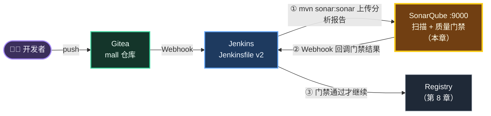
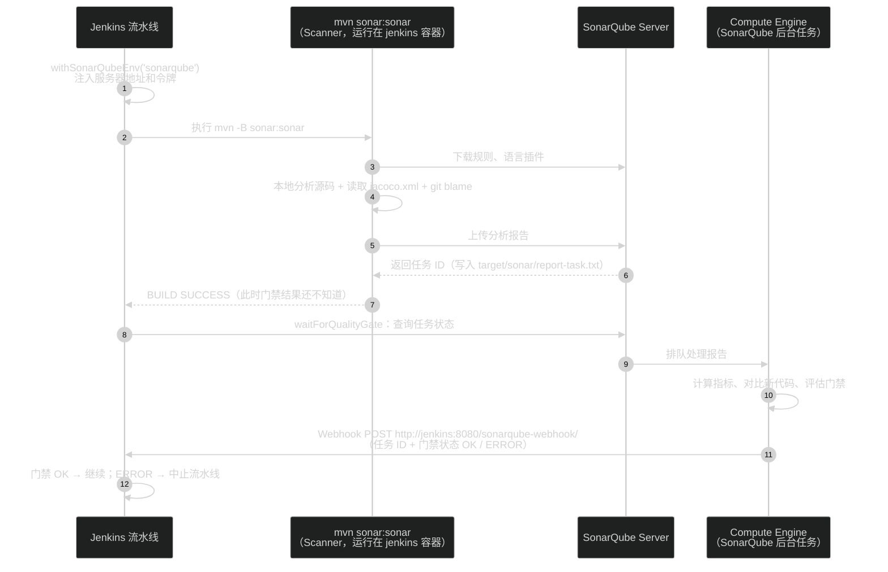
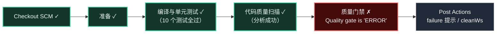
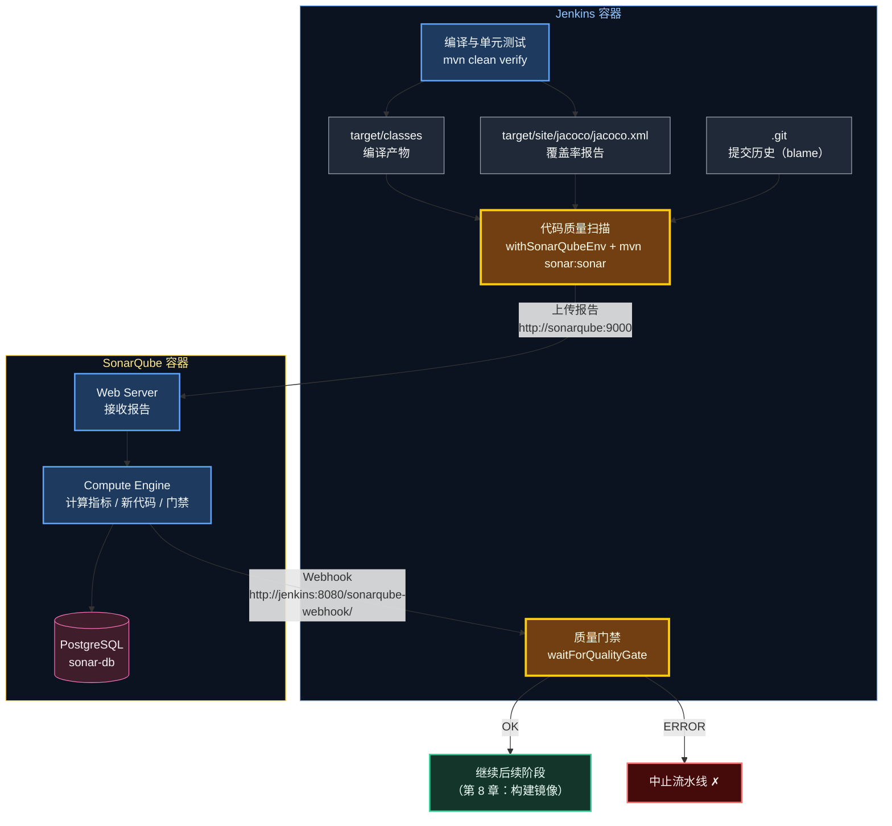
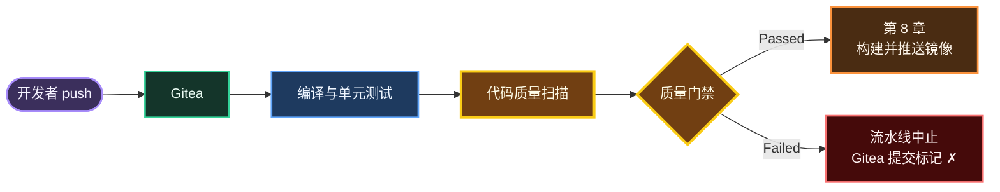

# 第 7 章 SonarQube：代码扫描与质量门禁

> 单元测试回答的是"代码**对不对**"，代码扫描回答的是"代码**好不好**"：有没有潜在 Bug、安全漏洞、坏味道、测试是否充分。本章把 SonarQube 接入流水线，并设置一道**质量门禁**——不达标的代码，连镜像都不配打。

---

## 本章目标

完成本章后，你应该能够：

1. 说清楚 SonarQube 检查哪些维度，以及 **Quality Profile（质量配置）** 和 **Quality Gate（质量门禁）** 的区别。
2. 理解 "Clean as You Code"：为什么默认门禁**只针对新代码（New Code）**、首次分析为什么一定通过。
3. 完成 SonarQube ↔ Jenkins 双向打通：Jenkins 用令牌提交分析，SonarQube 用 Webhook 回调结果。
4. 读懂 Jenkinsfile v2 新增的「代码质量扫描」「质量门禁」两个阶段，以及 `when { branch 'main' }` 的作用。
5. 亲手制造一次**门禁失败**（新代码覆盖率不足），再通过补单元测试让它通过。

预计耗时：**60～90 分钟**。

---

## 本章在全景中的位置



---

## 7.1 为什么需要代码扫描

先看一段能编译、单元测试也能通过的代码：

```java
public String findName(Long id) {
    User user = userRepository.findById(id).orElse(null);
    return user.getUsername();          // ① 可能空指针
}

public BigDecimal discount() {
    return new BigDecimal(0.1);         // ② 精度问题：实际是 0.1000000000000000055511151231257827...
}
```

如果测试用例刚好没覆盖到 `id` 不存在的情况，这两个问题就会悄悄上线。**静态代码分析**不运行代码，而是按上千条规则"读"代码，能在提交阶段就把这类问题揪出来。

SonarQube 从这几个维度给代码"体检"：

| 维度 | SonarQube 中的叫法 | 典型例子 | 对应评级 |
|---|---|---|---|
| 可靠性 | **Bug** / Reliability 问题 | 空指针、资源未关闭、`BigDecimal(double)` | Reliability Rating |
| 安全性 | **Vulnerability** / Security 问题 | SQL 注入、硬编码密码 | Security Rating |
| 安全热点 | **Security Hotspot** | 使用了需要人工确认是否安全的 API（如关闭 CSRF） | 需要人工 Review |
| 可维护性 | **Code Smell** / Maintainability 问题 | 方法太长、圈复杂度高、重复代码、魔法值 | Maintainability Rating |
| 测试覆盖率 | **Coverage** | 有多少行 / 分支被单元测试执行过 | — |
| 重复率 | **Duplications** | 复制粘贴的代码块 | — |

> 🧠 覆盖率不是 SonarQube 自己算的。它读取的是 **JaCoCo** 在跑单元测试时生成的报告 `target/site/jacoco/jacoco.xml`——这就是第 2 章父 `pom.xml` 中配置 `jacoco-maven-plugin` 的原因。

---

## 7.2 核心概念：质量配置、质量门禁、新代码

### 7.2.1 Quality Profile vs Quality Gate

```text
┌──────────────────────────── 一次分析 ─────────────────────────────┐
│                                                                    │
│   源代码 ──▶ Quality Profile（质量配置）= 用哪些规则去检查          │
│              例：Java 语言内置的 "Sonar way" 规则集（数百条规则）    │
│                          │                                         │
│                          ▼                                         │
│              得到：问题列表、覆盖率、重复率、评级……                  │
│                          │                                         │
│                          ▼                                         │
│   Quality Gate（质量门禁）= 这些指标达到什么标准才算"合格"           │
│              例：内置门禁 "Sonar way"                              │
│                          │                                         │
│                ┌─────────┴─────────┐                               │
│                ▼                   ▼                               │
│            Passed ✓            Failed ✗  → 流水线中止              │
└────────────────────────────────────────────────────────────────────┘
```

一句话：**Profile 决定"查什么"，Gate 决定"过不过"**。

### 7.2.2 Clean as You Code：只管新代码

老项目动辄几万个历史问题，如果门禁要求"全部问题清零才能上线"，那项目就永远发不了版。SonarQube 的思路是 **Clean as You Code**：

> **历史问题慢慢还，但新写的代码必须干净。**

所以内置门禁 "Sonar way" 的条件**全部针对新代码（New Code）**：

| 条件（On New Code） | 含义 | 不满足时 |
|---|---|---|
| No new issues are introduced | 新代码中**不允许出现任何新问题**（Bug、漏洞、坏味道都算） | 门禁失败 |
| All new Security Hotspots are reviewed | 新代码中的安全热点必须 100% 被人工审阅 | 门禁失败 |
| Coverage ≥ 80.0% | 新代码的测试覆盖率至少 80% | 门禁失败 |
| Duplicated Lines ≤ 3.0% | 新代码的重复率不超过 3% | 门禁失败 |

还有一条非常重要的"宽容规则"（官方称 fudge factor）：

- **新代码中可覆盖的行数少于 20 行时，覆盖率条件不检查**；
- **新代码行数少于 20 行时，重复率条件不检查**。

这样改一两行 bug 不至于因为"覆盖率 0%"被拦下。

### 7.2.3 什么算"新代码"

默认的新代码定义是 **Previous version（上一个版本）**：从**当前项目版本第一次被分析的那一刻起**，之后改动的代码都算新代码。项目版本来自 `pom.xml` 中的 `<version>1.0.0</version>`。

```text
 时间线 ─────────────────────────────────────────────────────────────▶
         │                                    │
   第一次分析（本章 7.7 节）              之后的每次提交
   版本 1.0.0                             版本仍是 1.0.0
         │                                    │
   此刻已有的代码 = 老代码               这之后新增/修改的行 = 新代码
   （不参与门禁判断）                    （必须满足 Sonar way 的 4 个条件）
```

由此可以推出两个结论：

1. **首次分析一定通过门禁**：那时还不存在"之后的改动"，新代码为空。
2. 如果哪天把版本改成 `1.1.0` 并分析，新代码的起点会重置到那次分析。

> 🧠 SonarQube 怎么知道某一行是"什么时候写的"？靠 **Git blame**。扫描时 Scanner 会读取工作空间里的 `.git` 目录，拿到每一行的最后修改时间。Jenkins 的多分支任务默认是完整克隆，所以没问题；如果你在别处用浅克隆（`--depth 1`），会出现 `Missing blame information` 警告，新代码判断也会出错。

---

## 7.3 工作原理：扫描、后台处理与回调



关键点：

- **分析是异步的**。`mvn sonar:sonar` 只负责"把报告交上去"，SonarQube 后台处理完才知道门禁结果。所以需要单独的「质量门禁」阶段等待结果。
- **结果靠 Webhook 推回来**。Jenkins 不会一直轮询，而是等 SonarQube 回调 `http://jenkins:8080/sonarqube-webhook/`。**这个 Webhook 没配好，「质量门禁」阶段就会一直等到超时。**
- 两个地址都使用**容器名**（`sonarqube`、`jenkins`），因为它们在同一个 Compose 网络中（第 4 章 4.3 节）。

---

## 7.4 动手：SonarQube 端配置

### 步骤 1：登录 SonarQube

浏览器打开 http://localhost:9000 ，用 `admin / Admin@123456` 登录（第 4 章已经修改过初始密码；如果还没改，用 `admin / admin` 登录后按提示改为 `Admin@123456`）。

先确认服务状态：

```bash
# 位置：任意目录
curl -s -u admin:Admin@123456 http://localhost:9000/api/system/status
```

预期输出（版本号以实际为准）：

```text
{"id":"...","version":"26.9.0.129388","status":"UP"}
```

### 步骤 2：生成用户令牌（User Token）

右上角头像（字母 **A**）→ **My Account（我的账号）** → **Security（安全）** 标签 → **Generate Tokens（生成令牌）** 区域：

| 字段 | 填写值 | 说明 |
|---|---|---|
| Name | `jenkins` | 令牌名称，便于识别用途 |
| Type | `User Token` | 用户令牌，拥有 admin 的全部权限 |
| Expires in | `No expiration`（或 `365 days`） | 学习环境选不过期，省得中途失效 |

点击 **Generate（生成）**，页面会显示一串以 `squ_` 开头的令牌。**它只显示这一次**，立刻保存：

```bash
# 位置：/d/cicd-lab
echo "SONAR_TOKEN=squ_把这里替换成你的令牌" >> /d/cicd-lab/tokens.txt
cat /d/cicd-lab/tokens.txt
```

预期输出（令牌值以你的实际为准）：

```text
GITEA_TOKEN=3f9c1e...（第 5 章保存的 Gitea 令牌）
SONAR_TOKEN=squ_8a7b6c...
```

> 💡 `tokens.txt` 统一使用 `KEY=VALUE` 格式（等号两边不要有空格），这样后续章节可以直接执行 `source /d/cicd-lab/tokens.txt`，把令牌加载成 Shell 变量 `$GITEA_TOKEN`、`$SONAR_TOKEN` 使用。

> 🧠 为什么选 **User Token** 而不是 **Global Analysis Token**？分析令牌只有"执行分析"权限；而 Jenkins 的 `waitForQualityGate` 还需要**读取后台任务和门禁状态**，用户令牌最省心。另外，第一次分析时项目 `mall` 会被**自动创建**，这也需要"创建项目"权限，admin 的用户令牌恰好具备。

### 步骤 3：配置回调 Jenkins 的 Webhook

顶部菜单 **Administration（配置）** → **Configuration（配置）** 下拉 → **Webhooks** → 右上角 **Create（创建）**：

| 字段 | 填写值 | 说明 |
|---|---|---|
| Name | `jenkins` | |
| URL | `http://jenkins:8080/sonarqube-webhook/` | **末尾的 `/` 不能少**；用容器名 `jenkins`，因为请求是 sonarqube 容器发出的 |
| Secret | 留空 | 可选的签名密钥，本地学习不需要 |

点击 **Create**。

> 💡 这里配置的是**全局 Webhook**，对所有项目生效。也可以在某个项目的 **Project Settings → Webhooks** 中只为单个项目配置。

> ✅ 检查点：Webhooks 列表中出现 `jenkins`，URL 为 `http://jenkins:8080/sonarqube-webhook/`。Last delivery（最近投递）此时为空，第一次分析完成后会显示投递结果。

---

## 7.5 动手：Jenkins 端配置

### 步骤 1：创建凭据 `sonar-token`

**Manage Jenkins** → **Credentials** → **System** → **Global credentials (unrestricted)** → **Add Credentials**：

| 字段 | 填写值 |
|---|---|
| Kind | `Secret text` |
| Scope | `Global` |
| Secret | 粘贴 `tokens.txt` 中 `SONAR_TOKEN=` 后面的值（`squ_` 开头） |
| ID | `sonar-token` |
| Description | `SonarQube 用户令牌` |

点击 **Create**。至此 4 个凭据全部就绪：`gitea-token`、`gitea-cred`、`registry-cred`、`sonar-token`。

### 步骤 2：添加 SonarQube 服务器

**Manage Jenkins** → **System** → 向下滚动到 **SonarQube servers** 区域（由 SonarQube Scanner 插件提供）：

| 字段 | 填写值 | 说明 |
|---|---|---|
| Environment variables | ✅ 勾选 **Enable injection of SonarQube server configuration as build environment variables** | 允许 `withSonarQubeEnv` 把服务器配置注入为环境变量 |
| 点击 **Add SonarQube** 后：Name | `sonarqube` | **必须与 Jenkinsfile 中 `withSonarQubeEnv('sonarqube')` 的参数一致** |
| Server URL | `http://sonarqube:9000` | Jenkins 容器通过容器名访问 SonarQube |
| Server authentication token | 选择 `SonarQube 用户令牌`（即 `sonar-token`） | 下拉框只列出 Secret text 类型的凭据 |

点击页面底部 **Save**。

> ⚠️ 不需要去 **Tools（全局工具配置）** 里安装 "SonarQube Scanner"。那是给非 Maven 项目用的命令行扫描器；我们直接用 Maven 插件 `sonar-maven-plugin`（父 POM 已声明版本 `5.8.0.7211`），由 `mvn sonar:sonar` 调用。

---

## 7.6 动手：Jenkinsfile v2

### 步骤 1：覆盖 Jenkinsfile

用编辑器打开 `D:\cicd-lab\mall\Jenkinsfile`，全选替换为以下内容并保存：

```groovy
// ============================================================
// mall 流水线 v2（第 7 章）
//   所有分支：编译 + 单元测试（CI）
//   main 分支：+ 代码扫描 + 质量门禁
// ============================================================
pipeline {
    agent any

    options {
        timestamps()                                    // 日志带时间戳
        disableConcurrentBuilds()                       // 同一分支不并发构建，避免互相覆盖镜像/配置
        buildDiscarder(logRotator(numToKeepStr: '20'))  // 只保留最近 20 次构建记录
    }

    stages {
        stage('准备') {
            steps {
                script {
                    // 镜像 tag 使用 Git 提交短哈希：任何一个运行中的镜像都能精确追溯到源码版本
                    env.IMAGE_TAG = sh(script: 'git rev-parse --short=7 HEAD', returnStdout: true).trim()
                }
                echo "分支: ${env.BRANCH_NAME}，镜像 tag: ${env.IMAGE_TAG}"
            }
        }

        stage('编译与单元测试') {
            steps {
                sh 'mvn -B clean verify'
            }
            post {
                always {
                    // 收集测试报告，Jenkins 页面上可以看到测试趋势和失败用例
                    junit allowEmptyResults: true, testResults: '**/target/surefire-reports/*.xml'
                }
            }
        }

        stage('代码质量扫描') {
            when { branch 'main' }   // SonarQube 社区版只支持分析一个分支
            steps {
                withSonarQubeEnv('sonarqube') {
                    sh 'mvn -B sonar:sonar'
                }
            }
        }

        stage('质量门禁') {
            when { branch 'main' }
            steps {
                timeout(time: 5, unit: 'MINUTES') {
                    // 等待 SonarQube 通过 Webhook 回调分析结果，门禁不通过则流水线失败
                    waitForQualityGate abortPipeline: true
                }
            }
        }
    }

    post {
        success { echo '流水线执行成功' }
        failure { echo '流水线执行失败，请查看上面的日志定位失败的阶段' }
        always  { cleanWs() }   // 清理工作空间，避免下次构建受残留文件影响
    }
}
```

### 步骤 2：本次新增逐行讲解

**「代码质量扫描」阶段**

| 代码 | 含义 |
|---|---|
| `when { branch 'main' }` | 只有 `main` 分支执行本阶段，其它分支和 PR 直接跳过（阶段视图中显示为灰色 "skipped"） |
| `withSonarQubeEnv('sonarqube') { ... }` | 找到 7.5 节名为 `sonarqube` 的服务器配置，在块内注入环境变量：`SONAR_HOST_URL`（服务器地址）、`SONAR_AUTH_TOKEN`（令牌），以及 Scanner 会自动读取的 `SONARQUBE_SCANNER_PARAMS`。同时它会记录本次分析的任务 ID，供下一阶段使用 |
| `sh 'mvn -B sonar:sonar'` | 运行 Maven 的 Sonar 插件做分析。**不需要再 `clean verify`**：上一阶段已经编译出 `target/classes` 并生成了 `jacoco.xml`，直接复用 |

> 🧠 为什么令牌不用写在命令里？因为 `withSonarQubeEnv` 已经把地址和令牌放进了环境变量，Maven 插件会自己读取。项目标识则来自父 POM 中的 `<sonar.projectKey>mall</sonar.projectKey>`。**Jenkinsfile 里没有出现任何地址和密钥**，这正是凭据系统的意义。

**为什么只扫 main？** SonarQube **社区版**（Community Build）只支持分析**一个分支**。如果 feature 分支也扫描，结果会和 main 的结果互相覆盖，新代码判断全乱。分支分析和 PR 分析是 Developer Edition 及以上的功能。

**「质量门禁」阶段**

| 代码 | 含义 |
|---|---|
| `timeout(time: 5, unit: 'MINUTES')` | 最多等 5 分钟。Webhook 没配好时不至于永远卡住 |
| `waitForQualityGate abortPipeline: true` | 用上一阶段记录的任务 ID 查询状态，然后等待 SonarQube 的 Webhook 回调；门禁不是 OK 时**将流水线标记为失败并中止** |

为什么要拆成两个阶段而不是写在一起？**职责清晰**：「代码质量扫描」失败说明分析本身出错（网络、令牌、编译产物缺失）；「质量门禁」失败说明代码不达标。在阶段视图上一眼就能区分是"环境问题"还是"代码问题"。

### 步骤 3：提交推送

```bash
# 位置：/d/cicd-lab/mall
git add Jenkinsfile
git commit -m "ci: 流水线 v2 - 接入 SonarQube 扫描与质量门禁"
git push
```

---

## 7.7 动手：第一次分析

### 步骤 1：观察 Jenkins 构建

`main` 的新构建阶段视图：

```text
 Checkout SCM ✓ ─▶ 准备 ✓ ─▶ 编译与单元测试 ✓ ─▶ 代码质量扫描 ✓ ─▶ 质量门禁 ✓ ─▶ Post Actions ✓
                                                     (首次约 1～2 分钟，     (几秒～十几秒)
                                                      需下载分析插件)
```

「代码质量扫描」阶段的关键日志（不同版本措辞略有差异）：

```text
+ mvn -B sonar:sonar
[INFO] --- sonar:5.8.0.7211:sonar (default-cli) @ mall ---
[INFO] Communicating with SonarQube Community Build 26.9.0.129388      ← 连接成功
[INFO] Project key: mall                                              ← 来自 pom 中的 sonar.projectKey
...
[INFO] Sensor JavaSensor [java]
[INFO] N source files to be analyzed                                   ← N 为该模块的源文件数
...
[INFO] Sensor JaCoCo XML Report Importer [jacoco]
[INFO] Importing 1 report(s). ...                                      ← 每个模块各导入一份 jacoco.xml
...
[INFO] SCM Publisher N source files to be analyzed                     ← git blame，用于判断新代码
...
[INFO] ANALYSIS SUCCESSFUL, you can find the results at: http://sonarqube:9000/dashboard?id=mall
[INFO] More about the report processing at http://sonarqube:9000/api/ce/task?id=AZ...
[INFO] BUILD SUCCESS
```

「质量门禁」阶段日志：

```text
Checking status of SonarQube task 'AZxxxxxxxxxxxx' on server 'sonarqube'
SonarQube task 'AZxxxxxxxxxxxx' status is 'IN_PROGRESS'
SonarQube task 'AZxxxxxxxxxxxx' status is 'SUCCESS'
SonarQube task 'AZxxxxxxxxxxxx' completed. Quality gate is 'OK'
```

> ⚠️ 日志里的结果链接是 `http://sonarqube:9000/...`，这是**容器之间**用的地址，浏览器打不开。在浏览器里把 `sonarqube` 换成 `localhost` 即可：http://localhost:9000/dashboard?id=mall 。

### 步骤 2：参观 SonarQube 项目页

打开 http://localhost:9000/dashboard?id=mall ：

| 区域 | 你会看到 | 说明 |
|---|---|---|
| 顶部 Quality Gate | **Passed** | 首次分析，新代码为空，必然通过（7.2.3 节） |
| **New Code** 标签 | 基本是空的 | 尚无新代码 |
| **Overall Code** 标签 | Issues 数量、Coverage（覆盖率）、Duplications（重复率）等 | 全量代码的体检报告 |
| 左侧/顶部 **Issues** | 全量问题列表 | 可按类型、严重级别筛选；点进去能看到问题所在代码行和修复建议 |
| **Code** 或 **Measures → Coverage** | 按文件查看覆盖率 | 打开某个 Java 文件，左侧行号旁的绿色/红色竖条表示该行是否被测试覆盖 |

> ✅ 检查点：
> 1. Jenkins `main` 构建为绿色，「质量门禁」日志中出现 `Quality gate is 'OK'`；
> 2. SonarQube 中出现项目 `mall`，Quality Gate 为 **Passed**，Overall Code 中 Coverage 有数值（不是 `—`）；
> 3. SonarQube **Administration → Configuration → Webhooks** 中 `jenkins` 的 Last delivery 显示成功（绿色 ✓ 和 200）。

> 💡 如果 Coverage 显示为 `—`，说明 JaCoCo 报告没被读取：确认「编译与单元测试」阶段执行的是 `verify`（不是 `test` 或 `compile`），并且日志里有 `Importing 1 report(s)`。

---

## 7.8 动手：制造一次质量门禁失败

现在我们模拟一个常见场景：**开发者写了一段新的业务逻辑，但没写单元测试**。

### 步骤 1：新增 PriceCalculator（不写测试）

新建文件 `D:\cicd-lab\mall\mall-order\src\main\java\com\xiaozhi\mall\order\PriceCalculator.java`，内容如下：

```java
package com.xiaozhi.mall.order;

import java.math.BigDecimal;
import java.math.RoundingMode;

/**
 * 订单价格计算：满减 + 会员折扣 + 运费
 */
public class PriceCalculator {

    /** 满 300 减 30 */
    private static final BigDecimal FULL_REDUCTION_THRESHOLD = new BigDecimal("300");
    private static final BigDecimal FULL_REDUCTION_AMOUNT = new BigDecimal("30");
    /** 实付满 99 包邮，否则运费 10 元 */
    private static final BigDecimal FREE_SHIPPING_THRESHOLD = new BigDecimal("99");
    private static final BigDecimal SHIPPING_FEE = new BigDecimal("10");
    /** 最低实付金额 0.01 元 */
    private static final BigDecimal MIN_PAY_AMOUNT = new BigDecimal("0.01");

    public enum MemberLevel {
        NORMAL, SILVER, GOLD
    }

    /**
     * 计算商品实付金额：先满减，再按会员等级打折，结果保留两位小数
     */
    public BigDecimal payAmount(BigDecimal originalPrice, MemberLevel level) {
        if (originalPrice == null || originalPrice.signum() <= 0) {
            throw new IllegalArgumentException("商品原价必须大于 0");
        }
        if (level == null) {
            throw new IllegalArgumentException("会员等级不能为空");
        }

        BigDecimal price = originalPrice;
        if (price.compareTo(FULL_REDUCTION_THRESHOLD) >= 0) {
            price = price.subtract(FULL_REDUCTION_AMOUNT);
        }

        price = price.multiply(discountRate(level));
        if (price.compareTo(MIN_PAY_AMOUNT) < 0) {
            price = MIN_PAY_AMOUNT;
        }
        return price.setScale(2, RoundingMode.HALF_UP);
    }

    /**
     * 计算运费：金牌会员始终包邮；其他会员实付满 99 包邮，否则 10 元
     */
    public BigDecimal shippingFee(BigDecimal payAmount, MemberLevel level) {
        if (level == MemberLevel.GOLD || payAmount.compareTo(FREE_SHIPPING_THRESHOLD) >= 0) {
            return BigDecimal.ZERO;
        }
        return SHIPPING_FEE;
    }

    private BigDecimal discountRate(MemberLevel level) {
        return switch (level) {
            case GOLD -> new BigDecimal("0.90");
            case SILVER -> new BigDecimal("0.95");
            case NORMAL -> BigDecimal.ONE;
        };
    }
}
```

这个类有 **24 行可执行代码、17 个分支**（JaCoCo 统计），超过了"20 行"的宽容线，覆盖率条件一定会被检查。

先在本地确认能编译、原有测试不受影响：

```bash
# 位置：/d/cicd-lab/mall
mvn -B -q -pl mall-order -am verify
echo "exit=$?"
```

预期：没有报错输出，最后打印 `exit=0`。

提交推送：

```bash
# 位置：/d/cicd-lab/mall
git add mall-order/src/main/java/com/xiaozhi/mall/order/PriceCalculator.java
git commit -m "feat(order): 新增价格计算器（未写测试）"
git push
```

### 步骤 2：观察门禁失败



注意这个细节：**单元测试全部通过、分析也成功了，流水线依然失败**。「质量门禁」阶段日志：

```text
Checking status of SonarQube task 'AZyyyyyyyyyyyy' on server 'sonarqube'
SonarQube task 'AZyyyyyyyyyyyy' status is 'SUCCESS'
SonarQube task 'AZyyyyyyyyyyyy' completed. Quality gate is 'ERROR'
ERROR: Pipeline aborted due to quality gate failure: ERROR
```

到 SonarQube 项目页查看原因：

| 位置 | 你会看到 |
|---|---|
| 顶部 Quality Gate | **Failed** |
| 失败条件 | `Coverage on New Code` 为 **0.0%**，要求 **≥ 80.0%** |
| **New Code** 标签 | New Lines（新代码行数）、Lines to Cover（可覆盖行数）≥ 20，Coverage 0.0% |
| 打开 `PriceCalculator.java` | 每一行左侧都是**红色**竖条（未覆盖） |

> ✅ 检查点：Jenkins 构建为红色 ✗，失败阶段是「质量门禁」；Gitea 中这次提交显示红色 ✗；SonarQube 显示 Failed，原因是新代码覆盖率 0%。

> 🧠 **门禁失败的意义**：从第 8 章开始，「质量门禁」之后就是「构建并推送镜像」和部署。门禁失败会让流水线在这里中止，**不合格的代码连镜像都不会产生，更不可能被部署**。这就是"质量左移"——问题越早发现，修复成本越低。

### 步骤 3：补上单元测试

新建文件 `D:\cicd-lab\mall\mall-order\src\test\java\com\xiaozhi\mall\order\PriceCalculatorTest.java`：

```java
package com.xiaozhi.mall.order;

import com.xiaozhi.mall.order.PriceCalculator.MemberLevel;
import org.junit.jupiter.api.Test;
import org.junit.jupiter.params.ParameterizedTest;
import org.junit.jupiter.params.provider.CsvSource;

import java.math.BigDecimal;

import static org.assertj.core.api.Assertions.assertThat;
import static org.assertj.core.api.Assertions.assertThatThrownBy;

/**
 * 纯单元测试：不启动 Spring 容器，毫秒级完成
 */
class PriceCalculatorTest {

    private final PriceCalculator calculator = new PriceCalculator();

    @ParameterizedTest(name = "原价 {0}，{1} 会员 → 实付 {2}")
    @CsvSource({
            "100,   NORMAL, 100.00",   // 未满 300：无满减、无折扣
            "300,   NORMAL, 270.00",   // 满 300 减 30
            "300,   GOLD,   243.00",   // (300 - 30) × 0.90
            "200,   SILVER, 190.00",   // 200 × 0.95
            "0.001, NORMAL, 0.01"      // 最低实付 0.01 元
    })
    void payAmount(BigDecimal originalPrice, MemberLevel level, BigDecimal expected) {
        assertThat(calculator.payAmount(originalPrice, level)).isEqualByComparingTo(expected);
    }

    @ParameterizedTest(name = "实付 {0}，{1} 会员 → 运费 {2}")
    @CsvSource({
            "50, GOLD,   0",    // 金牌会员始终包邮
            "99, NORMAL, 0",    // 满 99 包邮
            "50, SILVER, 10"    // 未满 99 收 10 元运费
    })
    void shippingFee(BigDecimal payAmount, MemberLevel level, BigDecimal expected) {
        assertThat(calculator.shippingFee(payAmount, level)).isEqualByComparingTo(expected);
    }

    @Test
    void invalidArgumentsAreRejected() {
        assertThatThrownBy(() -> calculator.payAmount(BigDecimal.ZERO, MemberLevel.NORMAL))
                .isInstanceOf(IllegalArgumentException.class);
        assertThatThrownBy(() -> calculator.payAmount(null, MemberLevel.NORMAL))
                .isInstanceOf(IllegalArgumentException.class);
        assertThatThrownBy(() -> calculator.payAmount(BigDecimal.TEN, null))
                .isInstanceOf(IllegalArgumentException.class);
    }
}
```

几个值得学习的写法：

| 写法 | 为什么 |
|---|---|
| 不加 `@SpringBootTest` | 价格计算是纯逻辑，不依赖 Spring 容器和数据库。纯 JUnit 测试**毫秒级**完成，而启动 Spring 上下文要好几秒。能写纯单元测试的地方就别启动容器 |
| `@ParameterizedTest` + `@CsvSource` | 一组输入/期望值一行，新增用例只需加一行。另外，SonarQube 有一条规则"相似的测试应合并为参数化测试"，写成 5 个几乎一样的 `@Test` 方法反而会产生新问题，而 Sonar way 要求**新代码零新增问题** |
| `isEqualByComparingTo` | `BigDecimal` 的 `equals` 会比较精度，`new BigDecimal("0")` 和 `new BigDecimal("0.00")` 用 `equals` 判断是不相等的；用 `compareTo` 语义比较才符合业务预期 |
| 覆盖每个分支 | 满减/不满减、三种会员、最低金额、包邮/不包邮、三种非法参数——让 17 个分支全部被执行 |

本地先跑一遍：

```bash
# 位置：/d/cicd-lab/mall
mvn -B -pl mall-order -am verify
```

预期日志中出现（顺序可能不同）：

```text
[INFO] Tests run: 9, Failures: 0, Errors: 0, Skipped: 0 -- in com.xiaozhi.mall.order.PriceCalculatorTest
[INFO] Tests run: 5, Failures: 0, Errors: 0, Skipped: 0 -- in com.xiaozhi.mall.order.OrderControllerTest
...
[INFO] BUILD SUCCESS
```

> 💡 两个参数化测试各展开成 5 个和 3 个用例，加上 1 个普通测试，共 9 个。

还可以打开 JaCoCo 的本地报告确认覆盖率：用浏览器打开 `D:\cicd-lab\mall\mall-order\target\site\jacoco\index.html`，进入 `com.xiaozhi.mall.order` → `PriceCalculator`，应看到 **Line 100%、Branch 100%**。

提交推送：

```bash
# 位置：/d/cicd-lab/mall
git add mall-order/src/test/java/com/xiaozhi/mall/order/PriceCalculatorTest.java
git commit -m "test(order): 补充价格计算器单元测试"
git push
```

> ✅ 检查点：
> 1. Jenkins 构建恢复绿色，「质量门禁」日志为 `Quality gate is 'OK'`；
> 2. SonarQube 项目页 Quality Gate 为 **Passed**，New Code 标签中 Coverage 为 **100.0%**；
> 3. Jenkins **Tests** 页面测试总数变成 19（mall-user 5 + mall-order 14）。

> 💡 演示结束后，`PriceCalculator` 和它的测试**保留在项目里即可**，不影响后续章节。

---

## 7.9 原理回顾：从扫描到门禁的完整链路



---

## 7.10 常见坑

| 现象 | 原因 | 解决 |
|---|---|---|
| 「质量门禁」阶段一直等，5 分钟后超时失败 | SonarQube 的 Webhook 没配或地址错，回调到不了 Jenkins | 检查 7.4 步骤 3：URL 必须是 `http://jenkins:8080/sonarqube-webhook/`（容器名、末尾 `/`）；在 Webhooks 页面查看 Last delivery 的错误信息 |
| `No SonarQube server named 'sonarqube'` 或 `withSonarQubeEnv` 报找不到配置 | Jenkins 系统配置中服务器的 Name 不是 `sonarqube` | 改成与 Jenkinsfile 一致 |
| 扫描阶段报 `Not authorized` / `401` | 令牌错误、过期或被删除 | 重新生成 User Token，更新凭据 `sonar-token` |
| 扫描阶段报 `Connection refused` 连不上 `sonarqube:9000` | SonarQube 还在启动，或容器挂了 | `docker compose ps` 查看状态；`docker logs sonarqube --tail 50` 查看日志 |
| SonarQube 容器反复重启，日志提到 `max virtual memory areas vm.max_map_count` | 内置 Elasticsearch 的系统参数检查 | 第 4 章 compose 中已设置 `SONAR_ES_BOOTSTRAP_CHECKS_DISABLE: "true"`；确认没被删掉 |
| Coverage 显示 `—` 或 0%，但明明有测试 | 没生成 jacoco.xml，或扫描前执行了 `clean` | 「编译与单元测试」必须用 `verify`；「代码质量扫描」不要再加 `clean` |
| 覆盖率达标，门禁还是失败 | 新代码中出现了新问题（Sonar way 要求零新增问题） | 项目页 **New Code → Issues** 查看问题和修复建议，改掉后重新推送 |
| 浏览器打不开日志里的结果链接 | 链接中是容器名 `sonarqube` | 把 `sonarqube:9000` 换成 `localhost:9000` |
| 想在 feature 分支或 PR 上也做扫描 | 社区版只支持单分支 | 升级 Developer Edition；或在 PR 中只跑单元测试，合并到 main 后再扫描（本教程做法） |
| 日志提示 `Missing blame information` | 工作空间没有完整的 Git 历史 | 不要使用浅克隆；多分支任务默认即完整克隆 |

---

## 本章小结

| 知识点 | 一句话总结 |
|---|---|
| 静态分析 | 不运行代码，按规则检查 Bug、漏洞、坏味道、重复和覆盖率 |
| Profile vs Gate | Profile 决定"查什么"，Gate 决定"过不过" |
| Clean as You Code | Sonar way 只要求**新代码**干净：零新增问题、热点已审、覆盖率 ≥ 80%、重复率 ≤ 3% |
| 宽容规则 | 新代码可覆盖行少于 20 行不查覆盖率；新代码行少于 20 行不查重复率 |
| 新代码定义 | 默认 Previous version：版本不变时，首次分析之后的改动都是新代码；首次分析必过 |
| 异步 + 回调 | `sonar:sonar` 只上传报告；门禁结果由 SonarQube Webhook 回调 `waitForQualityGate` |
| 只扫 main | 社区版只支持单分支，用 `when { branch 'main' }` 控制 |
| 门禁的价值 | 不达标就中止流水线，不合格的代码不会产生镜像，更不会上线 |



本章结束时：

- Jenkins 凭据 4 个齐全：`gitea-token`、`gitea-cred`、`registry-cred`、`sonar-token`
- Jenkins 系统配置新增 SonarQube 服务器 `sonarqube`（`http://sonarqube:9000`）
- SonarQube 新增全局 Webhook `jenkins`（`http://jenkins:8080/sonarqube-webhook/`）
- `mall` 仓库的 Jenkinsfile 为 v2，新增 `PriceCalculator` 及其测试，`main` 构建为绿色

---

## 课后练习

1. **自定义门禁**：在 SonarQube **Quality Gates** 页面复制（Copy）内置的 Sonar way，命名为 `mall-gate`，把新代码覆盖率要求改成 90%，并在项目 `mall` 的 **Project Settings → Quality Gate** 中切换为 `mall-gate`。推送一次，观察结果。（练习完记得切回 Sonar way，后续章节以默认门禁为准。）
2. **找一个真实问题**：在 `PriceCalculator` 中加一行 `BigDecimal bad = new BigDecimal(0.1);` 并在某处使用它，推送后看门禁因为"新增问题"而失败，然后在 SonarQube 的问题详情里阅读规则说明，再删掉这行恢复。
3. **思考题**：为什么说"覆盖率 100% 不代表没有 Bug"？覆盖率指标的局限在哪里？

---

下一章：[第 8 章 镜像构建与推送私有仓库](08-image-registry.md)
