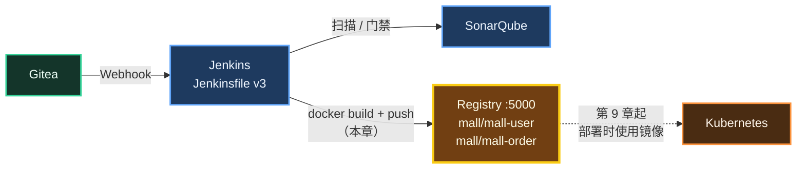
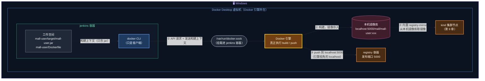
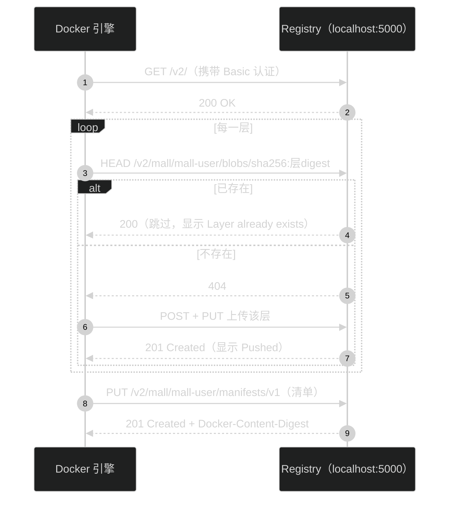
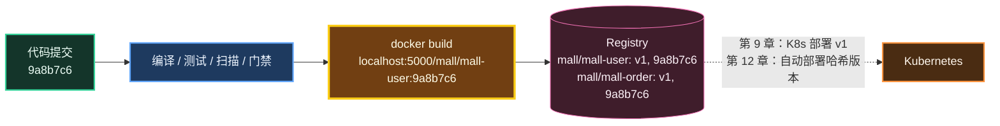

# 第 8 章 镜像构建与推送私有仓库

> 通过质量门禁的代码，下一步就是变成**镜像**，并存放到一个大家（以及 Kubernetes）都能取用的地方——**镜像仓库**。本章先手工走一遍 `build → login → push`，再把它写进流水线，最后聊聊镜像 tag 怎么起名才不会坑自己。

---

## 本章目标

完成本章后，你应该能够：

1. 说清楚镜像名的每一段含义（仓库地址 / 命名空间 / 镜像名 / tag / digest），以及镜像仓库在 CI/CD 中的位置。
2. 理解 Jenkins 容器中的 `docker` 命令**实际上由谁执行**，以及为什么推送地址用 `localhost:5000` 而不是 `host.docker.internal:5000`。
3. 手工构建并推送 `localhost:5000/mall/mall-user:v1` 和 `localhost:5000/mall/mall-order:v1`（**第 9 章依赖这两个镜像**）。
4. 用 Registry HTTP API 查看仓库、tag 和 digest。
5. 完成 Jenkinsfile v3：`main` 分支自动构建镜像并以 **7 位 Git 短哈希**作为 tag 推送。
6. 能说出 latest、语义化版本、Git 哈希、构建号等 tag 策略的优劣，知道公司里的 Harbor 和本教程的 Registry 有何异同。

预计耗时：**60 分钟**。

---

## 本章在全景中的位置



---

## 8.1 概念：镜像仓库是什么

### 8.1.1 类比 Maven 私服

作为 Java 工程师，你一定用过 Maven 仓库：

| Maven 世界 | 镜像世界 |
|---|---|
| jar 包 | 镜像（Image） |
| Maven Central / 阿里云镜像 | Docker Hub（公共镜像仓库） |
| 公司的 Nexus 私服 | 公司的 Harbor / Registry（私有镜像仓库） |
| `groupId:artifactId:version` | `仓库地址/命名空间/镜像名:tag` |
| `mvn deploy` | `docker push` |
| 在 pom 中声明依赖，构建时下载 | 在 K8s YAML 中写 `image:`，部署时拉取 |

CI 负责"生产"镜像并 `push` 到仓库，CD 负责让 Kubernetes 从仓库"取用"镜像。**镜像仓库就是 CI 和 CD 之间的交接点**。

### 8.1.2 拆解一个镜像名

```text
   localhost:5000 / mall / mall-user : 5d6e7f8
   └─────┬──────┘   └─┬┘   └───┬───┘   └──┬──┘
    仓库地址        命名空间   镜像名      tag（标签，可变的"别名"）
   (Registry)     (项目/组织) (Repository)

   localhost:5000/mall/mall-user@sha256:3f8a...c9e1
                                 └──────┬───────┘
                               digest（内容哈希，不可变的"身份证号"）
```

| 部分 | 说明 | 省略时的默认值 |
|---|---|---|
| 仓库地址 | 镜像存放在哪台仓库服务器上 | `docker.io`（Docker Hub） |
| 命名空间 | 组织或项目，用来分组和授权 | Docker Hub 官方镜像为 `library` |
| 镜像名 | 一个具体的应用 | 不可省略 |
| tag | 版本标签，**同一个 tag 可以被重新指向别的内容** | `latest` |
| digest | 镜像内容的 SHA256，**内容不变它就不变，内容一变它就变** | — |

所以 `mysql:8.4` 的完整名字其实是 `docker.io/library/mysql:8.4`。

### 8.1.3 镜像 = 多个层（Layer）+ 一份清单（Manifest）

第 3 章我们用分层方式构建镜像，推送时这些层是**分别上传**的：

```text
 localhost:5000/mall/mall-user:v1
 ├── manifest（清单）：列出下面每一层的 digest + 配置
 ├── 层 1  eclipse-temurin:21-jre 基础系统层   ┐
 ├── 层 2  ...JRE 等                            ├─ 几乎不变，推送/拉取一次以后就复用
 ├── 层 3  dependencies/（Spring Boot 依赖 jar）┘
 ├── 层 4  spring-boot-loader/
 ├── 层 5  snapshot-dependencies/
 └── 层 6  application/（我们的业务代码，最常变化，最小）
```

仓库按层的 digest 去重：**已经存在的层不会重复上传**。改一行业务代码再推送，实际只传最上面那一层几十 KB 的数据。

---

## 8.2 原理：Jenkins 里的 docker 命令是谁执行的

这是本教程最容易绕晕的地方，务必看懂这张图：



逐条解释：

1. **docker CLI 只是个客户端**。Jenkins 容器里的 `docker build`、`docker push` 通过挂载进来的 `/var/run/docker.sock`，把请求发给 Docker Desktop 的引擎（第 4 章 compose 中的这一行挂载）。构建上下文（`mall-user/` 目录中被 `.dockerignore` 放行的文件，也就是那个 jar）会被打包发送给引擎。
2. **镜像构建在 Docker Desktop 的本机镜像库里**，而不是 Jenkins 容器里。构建完你在 Windows 上执行 `docker images` 就能看到它。
3. **`docker push localhost:5000/...` 中的 `localhost` 是引擎视角的 localhost**。registry 容器把 5000 端口发布到了宿主机，引擎访问 `localhost:5000` 就能到达它。
4. **镜像在本机镜像库里，Kubernetes 也就能用到它**。Docker Desktop 的 kind 集群节点通过一个内置的 `registry-mirror` 从本机镜像库取镜像（第 9 章详解）。

> 🧠 **为什么不用 `host.docker.internal:5000`？** Docker 默认要求镜像仓库使用 **HTTPS**，只有 `127.0.0.0/8`（也就是 localhost）被默认视为"允许 HTTP 的不安全仓库"。我们的 Registry 是 HTTP 的，所以：
>
> | 推送地址 | 结果 |
> |---|---|
> | `localhost:5000/mall/mall-user:v1` | ✅ 成功 |
> | `host.docker.internal:5000/mall/mall-user:v1` | ❌ `http: server gave HTTP response to HTTPS client` |
>
> 要让后者可用，需要在 Docker Desktop → Settings → Docker Engine 的 JSON 中加入 `"insecure-registries": ["host.docker.internal:5000"]`。本教程不需要这么做。

---

## 8.3 动手：检查仓库并登录

### 步骤 1：确认 Registry 在运行并且开启了认证

```bash
# 位置：任意目录
curl -i http://localhost:5000/v2/
```

预期输出（关键部分）：

```text
HTTP/1.1 401 Unauthorized
Content-Type: application/json; charset=utf-8
Docker-Distribution-Api-Version: registry/2.0
Www-Authenticate: Basic realm="mall-registry"
...
{"errors":[{"code":"UNAUTHORIZED","message":"authentication required","detail":null}]}
```

`401` + `Basic realm="mall-registry"` 说明：仓库在线，并且启用了第 4 章配置的 htpasswd 认证。带上账号再试：

```bash
# 位置：任意目录
curl -s -u admin:Admin@123456 http://localhost:5000/v2/
echo
```

预期输出：

```text
{}
```

### 步骤 2：docker login

第 4 章已经登录过一次，这里再执行一遍也无妨（登录信息保存在 Windows 用户目录下的 Docker 配置中）：

```bash
# 位置：任意目录
echo 'Admin@123456' | docker login localhost:5000 -u admin --password-stdin
```

预期输出：

```text
Login Succeeded
```

> ⚠️ 不要用 `docker login -p 密码`：密码会留在 Shell 历史记录里，还会触发安全警告。`--password-stdin` 从标准输入读取密码，是脚本和流水线中的标准写法。

---

## 8.4 动手：手工构建并推送 v1 镜像（第 9 章要用！）

> ⚠️ **本节产出的两个 `v1` 镜像是第 9、10、11 章的基础**：K8s 清单和 GitOps 仓库中初始的镜像 tag 都是 `v1`。请务必完成本节，并且**不要删除本机的这两个镜像**。

### 步骤 1：打包 jar

Dockerfile 只负责"装箱"，jar 需要先用 Maven 打出来：

```bash
# 位置：/d/cicd-lab/mall
git pull                      # 同步最新代码（第 7 章新增了 PriceCalculator）
mvn -B clean package -DskipTests
ls mall-user/target/mall-user.jar mall-order/target/mall-order.jar
```

预期输出末尾：

```text
[INFO] BUILD SUCCESS
...
mall-order/target/mall-order.jar
mall-user/target/mall-user.jar
```

> 💡 这里用 `-DskipTests` 是因为测试已经在流水线中验证过了，手工打包只为了产出 jar。流水线中可不能这么干。

### 步骤 2：构建镜像，直接打上仓库地址

```bash
# 位置：/d/cicd-lab/mall
docker build -t localhost:5000/mall/mall-user:v1  mall-user
docker build -t localhost:5000/mall/mall-order:v1 mall-order
```

预期输出末尾（BuildKit 格式，耗时取决于基础镜像是否已缓存）：

```text
[+] Building 18.6s (13/13) FINISHED
 => [internal] load build definition from Dockerfile
 ...
 => exporting to image
 => => naming to localhost:5000/mall/mall-user:v1
```

| 命令片段 | 含义 |
|---|---|
| `-t localhost:5000/mall/mall-user:v1` | 镜像名中**包含仓库地址**，`docker push` 才知道推到哪里 |
| 最后的 `mall-user` | 构建上下文目录，Dockerfile 默认取该目录下的 `Dockerfile` |

> 💡 如果第 3 章已经构建过 `mall/mall-user:local`，也可以用 `docker tag mall/mall-user:local localhost:5000/mall/mall-user:v1` 给它"起个新名字"。tag 只是指针，不会复制镜像数据。但重新构建能确保镜像里是最新代码。

### 步骤 3：推送

```bash
# 位置：任意目录
docker push localhost:5000/mall/mall-user:v1
docker push localhost:5000/mall/mall-order:v1
```

`mall-user` 的预期输出（层 ID 每个人不同）：

```text
The push refers to repository [localhost:5000/mall/mall-user]
4f4fb700ef54: Pushed
a8c1d2e3f4b5: Pushed
...
v1: digest: sha256:3f8a...c9e1 size: 856
```

再看 `mall-order` 的输出，你可能会看到这样的行：

```text
5e6f7a8b9c0d: Mounted from mall/mall-user
```

> 🧠 `Mounted from mall/mall-user`：两个服务使用同一个基础镜像 `eclipse-temurin:21-jre`，依赖层也几乎相同。仓库发现这些层已经存在于 `mall/mall-user` 中，直接"挂载"过来，**一个字节都不用重新上传**。这就是分层镜像在推送环节的收益。

推送过程的交互如下：



> ✅ 检查点：
>
> ```bash
> # 位置：任意目录
> docker images --filter "reference=localhost:5000/mall/*"
> ```
>
> 预期能看到两行（IMAGE ID、大小因人而异）：
>
> ```text
> REPOSITORY                       TAG   IMAGE ID       CREATED          SIZE
> localhost:5000/mall/mall-order   v1    1a2b3c4d5e6f   2 minutes ago    3xxMB
> localhost:5000/mall/mall-user    v1    6f5e4d3c2b1a   2 minutes ago    3xxMB
> ```

---

## 8.5 动手：用 Registry API 查看仓库内容

Docker Registry 没有网页界面，但提供了标准的 HTTP API（Harbor 等产品底层也兼容这套 API）。

### 步骤 1：列出所有镜像

```bash
# 位置：任意目录
curl -s -u admin:Admin@123456 http://localhost:5000/v2/_catalog
echo
```

预期输出：

```text
{"repositories":["mall/mall-order","mall/mall-user"]}
```

### 步骤 2：列出某个镜像的所有 tag

```bash
# 位置：任意目录
curl -s -u admin:Admin@123456 http://localhost:5000/v2/mall/mall-user/tags/list
echo
```

预期输出：

```text
{"name":"mall/mall-user","tags":["v1"]}
```

### 步骤 3：查看 digest

```bash
# 位置：任意目录
docker inspect --format '{{json .RepoDigests}}' localhost:5000/mall/mall-user:v1
echo
curl -s -I -u admin:Admin@123456 \
  -H "Accept: application/vnd.oci.image.index.v1+json" \
  -H "Accept: application/vnd.oci.image.manifest.v1+json" \
  -H "Accept: application/vnd.docker.distribution.manifest.v2+json" \
  http://localhost:5000/v2/mall/mall-user/manifests/v1 | grep -i docker-content-digest
```

预期输出（两个 sha256 值应该一致）：

```text
["localhost:5000/mall/mall-user@sha256:3f8a...c9e1"]
Docker-Content-Digest: sha256:3f8a...c9e1
```

> 🧠 **tag vs digest**：tag `v1` 可以被重新推送覆盖，今天的 `v1` 和明天的 `v1` 可能是不同的内容；digest 是内容的哈希值，`@sha256:3f8a...` **永远指向同一份内容**。对一致性要求极高的场景（比如金融行业的生产发布），K8s YAML 中会直接写 `image: xxx@sha256:...`。

---

## 8.6 镜像 tag 策略：别再用 latest 了

在把推送写进流水线之前，先决定**流水线产出的镜像用什么 tag**。这是新手最容易踩坑的地方。

| 策略 | 例子 | 优点 | 缺点 |
|---|---|---|---|
| `latest` | `mall-user:latest` | 简单 | ① 看不出是哪个版本；② K8s 中 tag 不变，Deployment 就不变，**不会触发更新**；③ 节点上有旧的 latest 时可能不会重新拉取；④ 无法回滚到"上一个 latest" |
| 语义化版本 | `mall-user:1.2.3` | 对外含义清晰，适合正式发版 | 需要人工维护版本号，不适合"每次提交一个镜像" |
| **Git 短哈希** | `mall-user:5d6e7f8` | **天然唯一、自动生成、能精确追溯到源码提交** | 看不出先后顺序 |
| 构建号 | `mall-user:128` | 有顺序 | 和源码没有直接关系；Jenkins 任务重建后编号会重复 |
| 组合 | `mall-user:1.0.0-5d6e7f8` | 兼顾可读性和可追溯性 | 稍长，需要拼接 |

本教程选择 **Git 短哈希（7 位）**：第 6 章 Jenkinsfile 的「准备」阶段已经算好了 `IMAGE_TAG`，现在终于要用上了。

```text
  线上出了问题                         镜像 tag                       源码
  kubectl get deploy ... ──────▶  mall-user:5d6e7f8  ──────▶  git show 5d6e7f8
  "现在跑的是什么版本？"            "就是这个提交打的"           "改了什么一目了然"
```

另外一个必须遵守的原则：**不可变 tag（Immutable Tag）——一个 tag 一旦推送，就不应该再指向别的内容**。否则"回滚到 5d6e7f8"可能回到的不是你以为的那份代码。

| 怎么保证不可变 | 说明 |
|---|---|
| 用 Git 哈希做 tag | 不同提交天然不同 tag；同一提交重复构建会覆盖同名 tag，但内容等价，一般可接受 |
| 仓库强制 | Harbor 支持配置"不可变 tag 规则"，拒绝覆盖已有 tag；本教程的 Registry 不支持 |
| 部署用 digest | 最严格，K8s 中写 `@sha256:...` |

---

## 8.7 动手：Jenkinsfile v3——流水线自动构建推送

### 步骤 1：覆盖 Jenkinsfile

用编辑器打开 `D:\cicd-lab\mall\Jenkinsfile`，全选替换为以下内容并保存：

```groovy
// ============================================================
// mall 流水线 v3（第 8 章）
//   所有分支：编译 + 单元测试（CI）
//   main 分支：+ 代码扫描 + 质量门禁 + 构建推送镜像
// ============================================================
pipeline {
    agent any

    options {
        timestamps()                                    // 日志带时间戳
        disableConcurrentBuilds()                       // 同一分支不并发构建，避免互相覆盖镜像/配置
        buildDiscarder(logRotator(numToKeepStr: '20'))  // 只保留最近 20 次构建记录
    }

    environment {
        REGISTRY     = 'localhost:5000'                                  // 私有镜像仓库
        IMAGE_PREFIX = "${REGISTRY}/mall"                                // 镜像名前缀
        SERVICES     = 'mall-user mall-order'                            // 需要构建的服务（目录名 = 镜像名）
    }

    stages {
        stage('准备') {
            steps {
                script {
                    // 镜像 tag 使用 Git 提交短哈希：任何一个运行中的镜像都能精确追溯到源码版本
                    env.IMAGE_TAG = sh(script: 'git rev-parse --short=7 HEAD', returnStdout: true).trim()
                }
                echo "分支: ${env.BRANCH_NAME}，镜像 tag: ${env.IMAGE_TAG}"
            }
        }

        stage('编译与单元测试') {
            steps {
                sh 'mvn -B clean verify'
            }
            post {
                always {
                    // 收集测试报告，Jenkins 页面上可以看到测试趋势和失败用例
                    junit allowEmptyResults: true, testResults: '**/target/surefire-reports/*.xml'
                }
            }
        }

        stage('代码质量扫描') {
            when { branch 'main' }   // SonarQube 社区版只支持分析一个分支
            steps {
                withSonarQubeEnv('sonarqube') {
                    sh 'mvn -B sonar:sonar'
                }
            }
        }

        stage('质量门禁') {
            when { branch 'main' }
            steps {
                timeout(time: 5, unit: 'MINUTES') {
                    // 等待 SonarQube 通过 Webhook 回调分析结果，门禁不通过则流水线失败
                    waitForQualityGate abortPipeline: true
                }
            }
        }

        stage('构建并推送镜像') {
            when { branch 'main' }
            steps {
                withCredentials([usernamePassword(credentialsId: 'registry-cred',
                        usernameVariable: 'REG_USER', passwordVariable: 'REG_PASS')]) {
                    sh '''
                        echo "$REG_PASS" | docker login "$REGISTRY" -u "$REG_USER" --password-stdin
                        for svc in $SERVICES; do
                            docker build -t "$IMAGE_PREFIX/$svc:$IMAGE_TAG" "$svc"
                            docker push "$IMAGE_PREFIX/$svc:$IMAGE_TAG"
                        done
                    '''
                }
            }
        }
    }

    post {
        success { echo '流水线执行成功' }
        failure { echo '流水线执行失败，请查看上面的日志定位失败的阶段' }
        always  { cleanWs() }   // 清理工作空间，避免下次构建受残留文件影响
    }
}
```

### 步骤 2：本次新增逐行讲解

**`environment` 块**

| 代码 | 含义 |
|---|---|
| `REGISTRY = 'localhost:5000'` | 仓库地址。将来换成 Harbor，只改这一行（和凭据） |
| `IMAGE_PREFIX = "${REGISTRY}/mall"` | 双引号字符串，Groovy 会把 `${REGISTRY}` 替换掉，结果是 `localhost:5000/mall` |
| `SERVICES = 'mall-user mall-order'` | 要构建的服务列表，用空格分隔，方便 Shell 的 `for` 循环遍历。约定**目录名 = 镜像名** |

`environment` 中定义的变量会成为**所有阶段**中 Shell 命令的环境变量，所以下面的 `sh '''...'''` 可以直接用 `$REGISTRY`、`$SERVICES`。`IMAGE_TAG` 则是「准备」阶段通过 `env.IMAGE_TAG = ...` 动态设置的，效果相同。

**「构建并推送镜像」阶段**

| 代码 | 含义 |
|---|---|
| `when { branch 'main' }` | 只有 main 产出镜像。feature 分支、PR 只做验证，不往仓库里堆垃圾镜像 |
| 放在「质量门禁」之后 | **门禁不通过就不会执行到这里**，不合格的代码不会变成镜像 |
| `withCredentials([usernamePassword(credentialsId: 'registry-cred', usernameVariable: 'REG_USER', passwordVariable: 'REG_PASS')])` | 取出第 6 章创建的凭据，在块内以环境变量 `REG_USER`、`REG_PASS` 提供；**日志中出现这两个值时自动显示为 `****`** |
| `sh ''' ... '''` | **三个单引号**：Groovy 不做变量替换，`$REG_PASS` 原样交给 Shell 解析。这样密码不会进入 Groovy 字符串插值，Jenkins 也不会给出"不安全插值"的警告 |
| `echo "$REG_PASS" \| docker login ... --password-stdin` | 通过标准输入登录仓库 |
| `for svc in $SERVICES; do ... done` | 依次处理 `mall-user`、`mall-order` |
| `docker build -t "$IMAGE_PREFIX/$svc:$IMAGE_TAG" "$svc"` | 例如 `docker build -t localhost:5000/mall/mall-user:5d6e7f8 mall-user`；构建上下文中的 jar 是上一阶段 `mvn verify` 打出来的 |
| `docker push "$IMAGE_PREFIX/$svc:$IMAGE_TAG"` | 推送到仓库 |

> 🧠 **Build Once, Deploy Many（一次构建，多处部署）**：这里构建出的 `5d6e7f8` 镜像，后续会先部署到 dev，验证通过后**原封不动**地发布到 prod（第 13 章），绝不为生产环境重新构建。这样才能保证"测的就是上线的"。

> 💡 当前写法是"每次提交都构建所有服务"。服务多了以后，可以只构建有改动的模块（例如结合 `when { changeset "mall-user/**" }`），第 14 章进阶路线中会提到。

### 步骤 3：提交推送

```bash
# 位置：/d/cicd-lab/mall
git add Jenkinsfile
git commit -m "ci: 流水线 v3 - 构建并推送镜像"
git push
```

---

## 8.8 验证流水线推送的镜像

### 步骤 1：看 Jenkins 构建

阶段视图：

```text
 Checkout ✓ ─▶ 准备 ✓ ─▶ 编译与单元测试 ✓ ─▶ 代码质量扫描 ✓ ─▶ 质量门禁 ✓ ─▶ 构建并推送镜像 ✓ ─▶ Post ✓
```

「构建并推送镜像」阶段的关键日志：

```text
+ echo ****
+ docker login localhost:5000 -u **** --password-stdin
WARNING! Your credentials are stored unencrypted in '/root/.docker/config.json'.
Login Succeeded
+ docker build -t localhost:5000/mall/mall-user:9a8b7c6 mall-user
#0 building with "default" instance using docker driver
...
#12 naming to localhost:5000/mall/mall-user:9a8b7c6 done
+ docker push localhost:5000/mall/mall-user:9a8b7c6
The push refers to repository [localhost:5000/mall/mall-user]
...: Layer already exists                ← 基础层、依赖层在手工推送 v1 时已上传过
...: Pushed                              ← 只有变化的层需要上传
9a8b7c6: digest: sha256:... size: ...
+ docker build -t localhost:5000/mall/mall-order:9a8b7c6 mall-order
...
```

注意几个细节：

- 用户名和密码都被打码成 `****`，这就是 `withCredentials` 的效果；
- `WARNING! Your credentials are stored unencrypted`：登录信息以 Base64 形式存在 Jenkins 容器的 `/root/.docker/config.json` 中，学习环境可以接受；生产中会使用凭据助手，或者构建完执行 `docker logout`；
- 大部分层显示 `Layer already exists`，只上传了变化的层。

### 步骤 2：确认仓库里有了新 tag

先查出最新提交的短哈希：

```bash
# 位置：/d/cicd-lab/mall
git rev-parse --short=7 HEAD
```

假设输出 `9a8b7c6`（以你的实际输出为准），再看仓库：

```bash
# 位置：任意目录
curl -s -u admin:Admin@123456 http://localhost:5000/v2/mall/mall-user/tags/list; echo
curl -s -u admin:Admin@123456 http://localhost:5000/v2/mall/mall-order/tags/list; echo
docker images --filter "reference=localhost:5000/mall/*"
```

预期输出（tag 顺序可能不同）：

```text
{"name":"mall/mall-user","tags":["v1","9a8b7c6"]}
{"name":"mall/mall-order","tags":["v1","9a8b7c6"]}
REPOSITORY                       TAG       IMAGE ID       CREATED          SIZE
localhost:5000/mall/mall-order   9a8b7c6   ...            1 minute ago     ...
localhost:5000/mall/mall-order   v1        ...            30 minutes ago   ...
localhost:5000/mall/mall-user    9a8b7c6   ...            1 minute ago     ...
localhost:5000/mall/mall-user    v1        ...            30 minutes ago   ...
```

> ✅ 检查点：
> 1. Jenkins `main` 构建为绿色，「构建并推送镜像」阶段成功；
> 2. 仓库中两个镜像都有 `v1` 和一个 **7 位哈希** tag，哈希与 `git rev-parse --short=7 HEAD` 一致；
> 3. 在 Windows 上执行 `docker images` 能直接看到流水线构建出的镜像——印证了 8.2 节"镜像构建在宿主机引擎中"。

### 步骤 3：验证 feature 分支不会产出镜像（可选）

```bash
# 位置：/d/cicd-lab/mall
git switch -c feature/no-image
git commit --allow-empty -m "chore: 验证非 main 分支不构建镜像"
git push -u origin feature/no-image
```

Jenkins 中 `feature/no-image` 的构建里，「代码质量扫描」「质量门禁」「构建并推送镜像」三个阶段都显示为**跳过（skipped）**，仓库中不会多出新 tag。验证完删除分支：

```bash
# 位置：/d/cicd-lab/mall
git switch main
git push origin --delete feature/no-image
git branch -D feature/no-image
```

---

## 8.9 Registry、Harbor、Nexus、云仓库怎么选

本教程用的是最精简的 Docker Registry，公司里你更可能见到的是下面这些：

| 对比项 | Docker Registry（本教程） | Harbor | Nexus Repository | 云厂商（阿里云 ACR / 腾讯云 TCR 等） |
|---|---|---|---|---|
| 定位 | 镜像仓库的最小实现（CNCF Distribution） | 企业级镜像仓库，CNCF 毕业项目 | 通用制品仓库：Maven、npm、Docker… | 托管服务 |
| Web 界面 | ❌ | ✅ | ✅ | ✅ |
| 权限管理 | htpasswd，一个文件管所有账号 | 项目级 RBAC、LDAP/OIDC、**机器人账号** | 角色/权限 | 云账号体系 |
| 漏洞扫描 | ❌ | ✅ 内置 Trivy | 部分版本支持 | ✅ |
| 不可变 tag / 保留策略 | ❌ | ✅ | 清理策略 | ✅ |
| 跨机房复制 | ❌ | ✅ | 有限 | ✅ 跨地域同步 |
| 资源占用 | 约几十 MB 内存 | 约 2 GB（多个组件） | 约 2 GB 以上 | 无需自建 |
| 常见场景 | 学习、小团队、CI 缓存 | **国内企业自建最常见** | Java 团队兼做 Maven 私服 | 业务上云的团队 |

> 💡 **如果你们公司用的是 Harbor**——对开发者来说，日常操作几乎一样：
>
> - **地址形如** `harbor.company.com/<项目>/<镜像>:<tag>`。Harbor 的"项目"就是命名空间，也是权限边界，例如 `harbor.company.com/mall/mall-user:9a8b7c6`。
> - **CI 使用机器人账号**，而不是个人账号：在项目中创建 Robot Account（例如 `robot$mall+ci`），只授予该项目的 push/pull 权限。登录时注意 `$` 要用单引号包住：
>
>   ```bash
>   echo "$HARBOR_TOKEN" | docker login harbor.company.com -u 'robot$mall+ci' --password-stdin
>   ```
>
> - **Jenkinsfile 只需要改两处**：`REGISTRY = 'harbor.company.com'`，凭据 `registry-cred` 换成机器人账号。
> - **K8s 拉取私有镜像需要凭据**：创建 `docker-registry` 类型的 Secret，并在 Pod 上引用：
>
>   ```bash
>   kubectl create secret docker-registry harbor-cred -n mall-dev \
>     --docker-server=harbor.company.com \
>     --docker-username='robot$mall+pull' \
>     --docker-password='<令牌>'
>   ```
>
>   ```yaml
>   spec:
>     imagePullSecrets:
>       - name: harbor-cred
>   ```
>
> - **漏洞扫描**：推送后 Harbor 会自动用 Trivy 扫描，项目可以配置"禁止拉取含严重漏洞的镜像"——这是镜像层面的"质量门禁"。
> - **HTTPS**：Harbor 一般配置了正式证书，所以不存在本章 `localhost` 与 `insecure-registries` 的问题。
>
> 本教程没有使用 Harbor，是因为它在本地要占用约 2 GB 内存，而且在 Docker Desktop 的 kind 集群中，HTTP 私有仓库本来就无法被节点直接拉取（第 9 章详解），引入 Harbor 并不能让流程更真实。**概念和命令完全通用**，学会本章，换成 Harbor 无缝衔接。

---

## 8.10 选做：清理仓库中的旧镜像

流水线每次提交都会产生新镜像，仓库会越来越大。Registry 的清理分两步：**先删清单（manifest），再做垃圾回收（garbage collect）**。第 4 章 compose 中设置的 `REGISTRY_STORAGE_DELETE_ENABLED: "true"` 就是为了允许删除。

> ⚠️ **千万不要删除 `v1`**，第 9～11 章要用。下面以某个哈希 tag 为例，学会方法即可。

```bash
# 位置：任意目录
# 1) 查出要删除的 tag 对应的 digest（把 9a8b7c6 换成你想删的 tag）
DIGEST=$(curl -s -I -u admin:Admin@123456 \
  -H "Accept: application/vnd.oci.image.index.v1+json" \
  -H "Accept: application/vnd.oci.image.manifest.v1+json" \
  -H "Accept: application/vnd.docker.distribution.manifest.v2+json" \
  http://localhost:5000/v2/mall/mall-user/manifests/9a8b7c6 \
  | grep -i docker-content-digest | awk '{print $2}' | tr -d '\r')
echo "$DIGEST"

# 2) 按 digest 删除清单（注意：只能按 digest 删，不能按 tag 删）
curl -s -o /dev/null -w "%{http_code}\n" -u admin:Admin@123456 -X DELETE \
  "http://localhost:5000/v2/mall/mall-user/manifests/$DIGEST"

# 3) 垃圾回收：真正释放磁盘空间
MSYS_NO_PATHCONV=1 docker exec registry registry garbage-collect /etc/docker/registry/config.yml
```

第 2 步预期输出 `202`；第 3 步会列出被标记和删除的数据块。

> 🧠 为什么删除这么麻烦？因为层是共享的：一个层可能被多个镜像引用，所以只能先删"清单"，再由垃圾回收找出**没有任何清单引用**的层去删除。Harbor 把这些封装成了界面上的"保留策略 + 定时垃圾回收"。

---

## 8.11 常见坑

| 现象 | 原因 | 解决 |
|---|---|---|
| `http: server gave HTTP response to HTTPS client` | 推送地址不是 localhost，Docker 默认要求 HTTPS | 使用 `localhost:5000`；或在 Docker Engine 配置中添加 `insecure-registries` |
| `unauthorized: authentication required` / `no basic auth credentials` | 没登录或密码错误 | 重新 `docker login`；检查 `registry-cred` 中的密码；htpasswd 文件必须在 Git Bash 中生成（第 4 章） |
| `COPY failed: file not found ... target/mall-user.jar` | 构建镜像前没有打包 jar | 先执行 `mvn package`；流水线中「编译与单元测试」阶段的 `verify` 会产出 jar |
| 流水线中 `docker: command not found` | Jenkins 镜像不是第 4 章定制的那个 | `docker exec jenkins docker version` 检查；重新 `docker compose up -d --build jenkins` |
| `permission denied while trying to connect to the Docker daemon socket` | Jenkins 不是以 root 运行，无权访问 docker.sock | 确认 compose 中 `user: root` |
| `denied: requested access to the resource is denied` | 镜像名写错，例如漏了 `localhost:5000/` 前缀，变成推往 Docker Hub | 检查 `IMAGE_PREFIX` |
| 磁盘越来越大 | 每次提交都产生新镜像 | 定期按 8.10 节清理仓库；本机执行 `docker image prune`（**注意不要删掉第 9 章要用的 v1**） |

---

## 本章小结

| 知识点 | 一句话总结 |
|---|---|
| 镜像仓库 | CI 产出镜像推上去，CD 部署时取下来，是 CI 和 CD 的交接点 |
| 镜像名 | `仓库地址/命名空间/镜像名:tag`；digest 是不可变的内容哈希 |
| 分层推送 | 层按 digest 去重，`Layer already exists`、`Mounted from` 都是复用 |
| docker.sock | Jenkins 里的 docker 只是客户端，构建和推送都由 Docker Desktop 引擎完成，镜像留在本机镜像库 |
| localhost:5000 | Docker 只默认信任 localhost 的 HTTP 仓库 |
| tag 策略 | 流水线用 Git 短哈希：唯一、自动、可追溯；坚持不可变 tag，远离 latest |
| 流水线 v3 | main 分支在门禁通过后构建并推送镜像，凭据用 `withCredentials` 注入 |
| Harbor | 企业常用，命令完全一样，多了界面、权限、机器人账号、漏洞扫描 |



本章结束时：

- 本机和仓库中都有 `localhost:5000/mall/mall-user:v1`、`localhost:5000/mall/mall-order:v1`（**第 9 章要用**）
- `mall` 仓库的 Jenkinsfile 为 v3，`main` 分支每次构建都会推送以 7 位 Git 短哈希为 tag 的两个镜像

到这里，**CI 部分已经完整**：代码提交 → 编译测试 → 质量门禁 → 镜像入库。接下来三章我们进入 CD 的世界：先学会 Kubernetes 本身，再用 Helm 和 Argo CD 把部署自动化。

---

## 课后练习

1. **观察只传一层**：在 `mall-user` 中改一处会影响编译结果的代码（例如把 `UserController` 中的提示文字 `"用户不存在: "` 改成 `"用户不存在，ID = "`；只加注释不会改变 class 文件），本地执行 `mvn -B -q package -DskipTests`，再执行 `docker build -t localhost:5000/mall/mall-user:test mall-user` 和 `docker push localhost:5000/mall/mall-user:test`，数一数有几层显示 `Pushed`、几层显示 `Layer already exists`。练习结束后用 `git checkout -- mall-user` 还原代码，并删除本地的 `test` 标签：`docker rmi localhost:5000/mall/mall-user:test`。
2. **组合 tag**：如果要求 tag 形如 `1.0.0-9a8b7c6`（项目版本 + 哈希），你会怎么改「准备」阶段？（提示：`mvn help:evaluate -Dexpression=project.version -q -DforceStdout`。）仅作思考，不必提交。
3. **思考题**：为什么说"同一个镜像从 dev 发布到 prod，而不是为 prod 重新构建一次"非常重要？如果重新构建，可能会出现哪些差异？

---

下一章：[第 9 章 Kubernetes 核心概念与手工部署](09-kubernetes.md)
