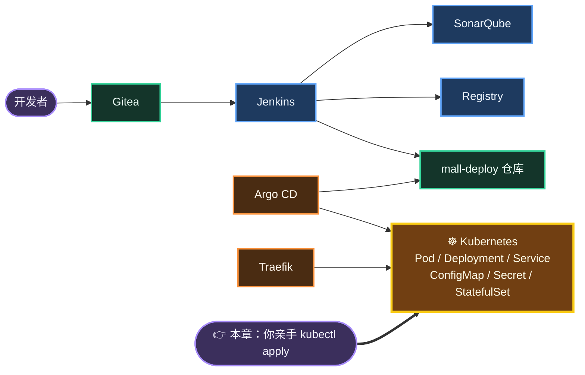
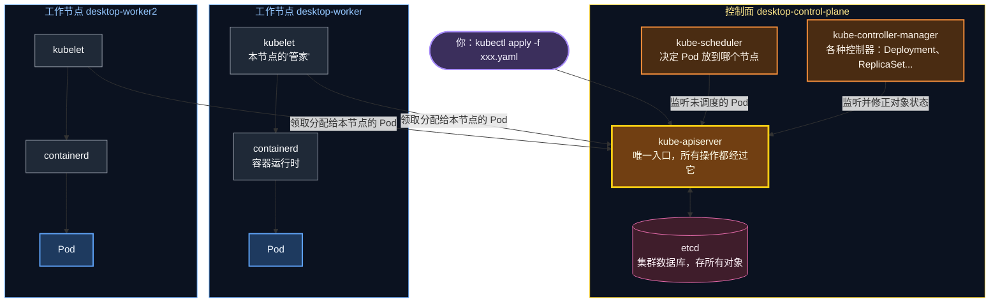
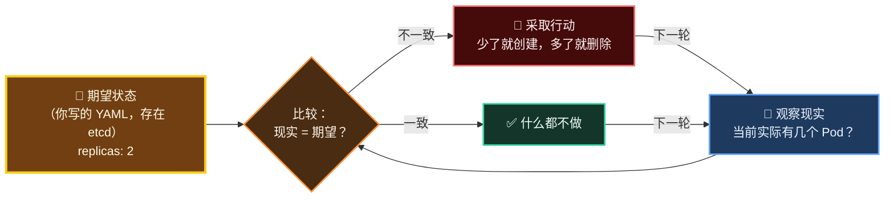
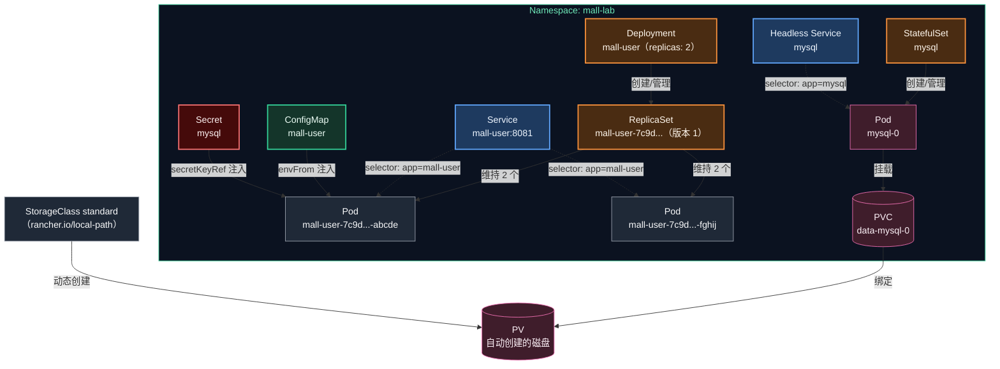
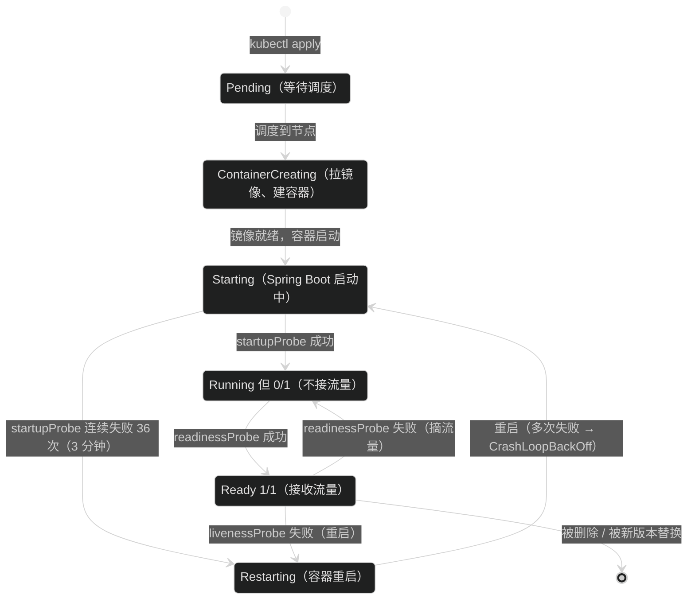
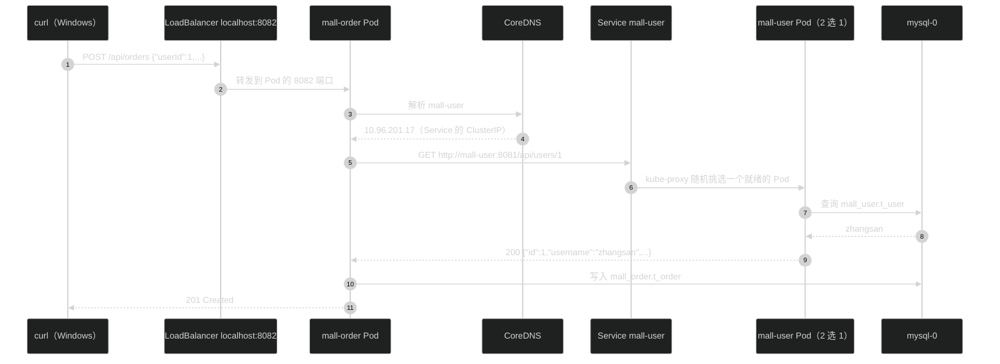
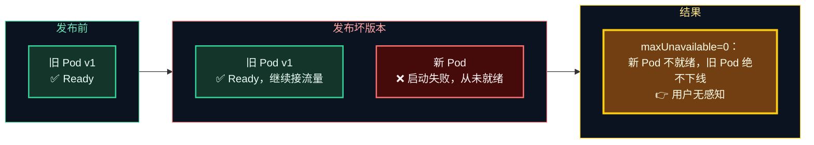
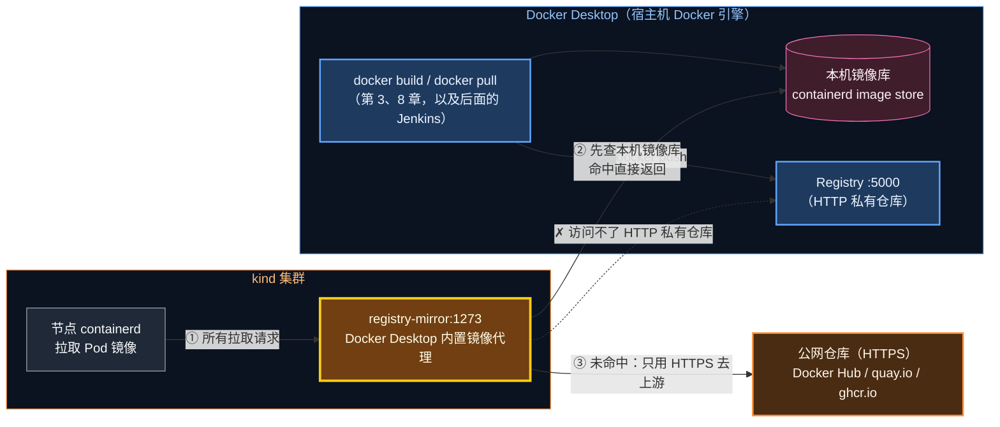
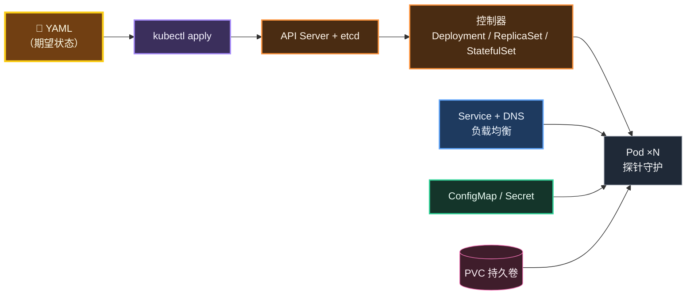

# 第 9 章 Kubernetes 核心概念与手工部署

> 前面 8 章，我们解决了"把代码变成镜像"的问题；从这一章开始，我们解决"把镜像可靠地跑起来"的问题。本章不用任何自动化工具，**亲手写 YAML、亲手 `kubectl apply`**，把 mall 部署到 Kubernetes 上，并亲眼看到自愈、扩缩容、滚动更新、回滚这些"超能力"。

---

## 本章目标

学完本章，你应该能够：

1. 说清楚 Kubernetes 的**控制面 / 工作节点**分工，并在本机三节点集群上找到对应的组件。
2. 理解**声明式 + 控制循环**的思想，能用 Java 世界的概念类比 Pod、Deployment、Service、ConfigMap、Secret、StatefulSet、PVC。
3. 用 `kubectl apply` 在命名空间 `mall-lab` 中部署 MySQL（StatefulSet）和 mall-user / mall-order（Deployment），并成功下单。
4. 亲手验证：**自愈、扩缩容、滚动更新、回滚、探针保护发布**。
5. 搞清楚本教程环境中 **Pod 的镜像到底从哪里来**（Docker Desktop kind 模式的"真相"）。

预计耗时：2 ～ 3 小时。

---

## 本章在全景中的位置



> 💡 本章跳过 Argo CD、Traefik，**由你自己扮演"部署工具"**。只有亲手做过一遍，后面看 Helm、Argo CD 才知道它们替你做了什么。

---

## 9.1 为什么需要 Kubernetes？

第 3 章我们已经用 Docker Compose 一条命令把 MySQL + 两个服务跑起来了，为什么还要 K8s？先看一张对比表：

| 场景 | Docker Compose | Kubernetes |
|---|---|---|
| 运行范围 | 单台机器 | 多台机器组成的集群 |
| 容器挂了 | `restart` 策略，只能原地重启 | 自动在**其他健康节点**重建 |
| 机器挂了 | 整个应用全挂 | Pod 被调度到其他节点 |
| 扩容 | 手动改 `replicas` 并重启 | `kubectl scale` 一条命令，秒级生效 |
| 发布新版本 | 停旧起新，有中断 | **滚动更新**：起新、就绪、再停旧，不中断 |
| 发布失败 | 手动回退 | `kubectl rollout undo` 一键回滚 |
| 健康检查 | 简单 healthcheck | 启动/存活/就绪三种探针，未就绪不接流量 |
| 服务发现 | 同网络内用服务名 | 集群内 DNS + 负载均衡 |
| 配置与密钥 | 环境变量 / 文件 | ConfigMap / Secret，独立管理、可复用 |

一句话总结：**Compose 是"单机启动器"，Kubernetes 是"集群操作系统"**。

```text
  Docker Compose 的世界                       Kubernetes 的世界
  ┌────────────────────────┐                  ┌──────────── 集群 ────────────┐
  │   一台机器              │                  │  ┌────────┐ ┌────────┐ ┌───┐ │
  │  ┌──────┐ ┌──────┐     │                  │  │ 节点 A │ │ 节点 B │ │...│ │
  │  │ user │ │order │     │                  │  │ user-1 │ │ user-2 │ │   │ │
  │  └──────┘ └──────┘     │                  │  │ mysql-0│ │ order-1│ │   │ │
  │  ┌──────┐              │   ──────────▶    │  └────────┘ └────────┘ └───┘ │
  │  │mysql │  机器挂=全挂  │                  │   节点挂了？Pod 自动迁移到别处  │
  │  └──────┘              │                  │   你只管"声明要什么"，K8s 负责做到│
  └────────────────────────┘                  └──────────────────────────────┘
```

---

## 9.2 K8s 架构：一个"自动驾驶"的集群

### 9.2.1 控制面与工作节点

Kubernetes 集群由两类角色组成：

- **控制面（Control Plane）**：集群的"大脑"，负责接收指令、存储状态、做调度决策。
- **工作节点（Worker Node）**：集群的"手脚"，真正运行你的容器。



| 组件 | 职责 | Java 世界类比 |
|---|---|---|
| kube-apiserver | 所有读写请求的唯一入口，做认证、校验 | Spring MVC 的 `DispatcherServlet` |
| etcd | 存储所有对象的"期望状态" | 数据库 |
| kube-scheduler | 给新 Pod 挑选合适的节点 | 线程池的任务分配策略 |
| kube-controller-manager | 运行各种控制器，持续把现实拉回期望 | 一堆 `@Scheduled` 定时巡检任务 |
| kubelet | 每个节点上的代理，负责启停本节点的容器 | 每台服务器上的运维脚本 |
| kube-proxy | 实现 Service 的负载均衡（iptables 规则） | 客户端负载均衡器（Ribbon/LoadBalancer） |
| CoreDNS | 集群内 DNS，把服务名解析成 IP | 注册中心（Nacos/Eureka）的"查询"功能 |

### 9.2.2 对照你本机的三节点集群

你本机的 Docker Desktop 启用的是 **kind 模式**：每个"节点"其实是一个隐藏的 Docker 容器，它们连在名为 `kind` 的 Docker 网络上。

```text
                    Windows 宿主机（Docker Desktop）
 ┌────────────────────────────── Docker 网络：kind (172.19.0.0/16) ───────────────────────────────┐
 │                                                                                               │
 │  ┌─────────────────────────┐  ┌─────────────────────────┐  ┌─────────────────────────┐         │
 │  │ desktop-control-plane   │  │ desktop-worker          │  │ desktop-worker2         │         │
 │  │ 172.19.0.2   控制面      │  │ 172.19.0.4   工作节点    │  │ 172.19.0.6   工作节点    │         │
 │  │ apiserver / etcd /      │  │ kubelet + containerd    │  │ kubelet + containerd    │         │
 │  │ scheduler / controller  │  │ ── 你的 Pod 跑在这里 ──  │  │ ── 你的 Pod 跑在这里 ──  │         │
 │  └─────────────────────────┘  └─────────────────────────┘  └─────────────────────────┘         │
 │                                                                                               │
 │  ┌─────────────────────────┐  ┌─────────────────────────┐                                     │
 │  │ kind-registry-mirror    │  │ kind-cloud-provider     │   ← Docker Desktop 的两个"外挂"      │
 │  │ 172.19.0.3 镜像代理      │  │ 172.19.0.5 实现          │     （9.10 节、9.8 节会讲到）        │
 │  │                         │  │ LoadBalancer → localhost│                                     │
 │  └─────────────────────────┘  └─────────────────────────┘                                     │
 └───────────────────────────────────────────────────────────────────────────────────────────────┘
```

动手看一看：

```bash
# 位置：任意目录
kubectl get nodes -o wide
```

预期输出（AGE 会不同）：

```text
NAME                    STATUS   ROLES           AGE   VERSION   INTERNAL-IP   EXTERNAL-IP   OS-IMAGE                       KERNEL-VERSION                              CONTAINER-RUNTIME
desktop-control-plane   Ready    control-plane   90d   v1.36.1   172.19.0.2    <none>        Debian GNU/Linux 13 (trixie)   6.18.40.1-microsoft-standard-WSL2 (amd64)   containerd://2.3.1
desktop-worker          Ready    <none>          90d   v1.36.1   172.19.0.4    <none>        Debian GNU/Linux 13 (trixie)   6.18.40.1-microsoft-standard-WSL2 (amd64)   containerd://2.3.1
desktop-worker2         Ready    <none>          90d   v1.36.1   172.19.0.6    <none>        Debian GNU/Linux 13 (trixie)   6.18.40.1-microsoft-standard-WSL2 (amd64)   containerd://2.3.1
```

再看看控制面组件，它们自己也是以 Pod 形式运行的：

```bash
# 位置：任意目录
kubectl get pods -n kube-system -o wide
```

你会看到：`coredns` ×2、`etcd-desktop-control-plane`、`kube-apiserver-desktop-control-plane`、`kube-controller-manager-desktop-control-plane`、`kube-scheduler-desktop-control-plane`、`kube-proxy` ×3（每个节点一个）、`kindnet` ×3（每个节点一个，负责 Pod 网络）。

> ✅ **检查点**：三个节点 `STATUS` 都是 `Ready`；`kube-system` 下的 Pod 都是 `Running`。如果 `kubectl` 报连接失败，回到第 1 章检查 Docker Desktop 的 Kubernetes 是否已启动。

---

## 9.3 声明式与控制循环：K8s 最核心的思想

传统运维是**命令式**的："启动 2 个容器""停掉容器 A"。K8s 是**声明式**的："我要 2 个 mall-user 在跑"——至于怎么做到、挂了怎么办，由 K8s 负责。

实现这一点的机制叫**控制循环（Control Loop / Reconcile Loop）**：



用 Java 伪代码表达，就是一个永不停止的循环：

```java
while (true) {
    int desired = etcd.get("deployment/mall-user").getReplicas(); // 期望：2
    int actual  = cluster.countRunningPods("app=mall-user");      // 现实：1（有一个挂了）
    if (actual < desired) createPods(desired - actual);           // 补一个
    if (actual > desired) deletePods(actual - desired);
    sleepUntilSomethingChanges();
}
```

> 🧠 **原理**：`kubectl apply` 只做了一件事——把 YAML 存进 etcd。**它不会直接启动任何容器**。真正干活的是各个控制器和 kubelet，它们都在各自的循环里"看到变化 → 修正现实"。这也是为什么后面 Argo CD 能工作：它只要保证"Git 里的 YAML = 集群里的 YAML"，剩下的交给 K8s 的控制循环。

---

## 9.4 核心对象速览（Java 工程师视角）

### 9.4.1 对象一览与类比

| 对象 | 一句话解释 | Java 类比 | 本章用在哪 |
|---|---|---|---|
| **Pod** | 最小调度单位，一个或多个容器 + 共享网络/存储 | 一个运行中的 JVM 进程 | mall-user 的每个实例 |
| **Deployment** | 管理"无状态"Pod 的副本数、发布策略 | 线程池：核心线程数固定、线程挂了自动补 | mall-user、mall-order |
| **ReplicaSet** | Deployment 的"下属"，负责维持某一版本的副本数 | 线程池内部的 Worker 集合 | 自动创建，不用手写 |
| **Service** | 给一组 Pod 一个固定的 DNS 名和虚拟 IP，并负载均衡 | 注册中心 + 客户端负载均衡 | `mall-user:8081` |
| **ConfigMap** | 非敏感配置 | `application.yml` 中的普通配置 | DB_HOST、DB_NAME |
| **Secret** | 敏感配置（只是 base64 编码，不是加密！） | Jasypt 加密配置（但 Secret 默认并不加密） | 数据库密码 |
| **StatefulSet** | 管理"有状态"Pod：名字固定、存储固定 | 有固定编号的主从节点 | MySQL |
| **PVC / PV / StorageClass** | 持久卷申请 / 实际磁盘 / 磁盘"供应商" | `DataSource` 接口 / 连接实现 / 连接池工厂 | MySQL 数据目录 |
| **Namespace** | 资源的逻辑隔离 | Java 的 package | `mall-lab` |

### 9.4.2 它们之间的关系



> 🧠 **最重要的一个机制：标签选择器（Label Selector）**。Deployment 和 Service 都**不直接引用** Pod 的名字，而是通过标签 `app=mall-user` "圈"出一组 Pod。Pod 重建后名字变了没关系，只要标签对得上就会被自动纳入管理和负载均衡。这就像 Spring 里按类型（而不是按名字）注入一组 Bean。

### 9.4.3 Service 的类型

| 类型 | 访问范围 | 在本机 Docker Desktop 上的表现 | 本章用途 |
|---|---|---|---|
| `ClusterIP`（默认） | 只能集群内访问 | 宿主机无法直接访问，需 `port-forward` | mall-user |
| Headless（`clusterIP: None`） | 集群内，DNS 直接返回 Pod IP | 同上 | mysql |
| `NodePort` | 通过"节点 IP:端口"访问 | ⚠️ **实测从 Windows 访问不通**（kind 节点是容器，端口没映射出来） | 不用 |
| `LoadBalancer` | 对外暴露 | ✅ Docker Desktop 的 `kind-cloud-provider` 会把它**映射到 Windows 的 `localhost:端口`** | mall-order |

### 9.4.4 三种探针 ↔ Spring Boot Actuator

我们在第 2 章的 `application.yml` 中开启了 `management.endpoint.health.probes.enabled=true`，正是为了这里：

| 探针 | 问题 | 失败后果 | 对应端点 |
|---|---|---|---|
| `startupProbe` 启动探针 | "你启动完了吗？" | 超过阈值仍未成功 → 重启容器；成功前不执行另两个探针 | `/actuator/health/liveness` |
| `livenessProbe` 存活探针 | "你还活着吗？" | 重启容器 | `/actuator/health/liveness` |
| `readinessProbe` 就绪探针 | "你能接流量吗？" | **从 Service 中摘除**（不重启） | `/actuator/health/readiness` |



### 9.4.5 requests / limits 与 JVM 内存

```yaml
resources:
  requests:          # 调度依据："我至少需要这么多"，节点剩余资源不够就不会调度过去
    cpu: 100m        # 0.1 核
    memory: 384Mi
  limits:            # 上限："最多只能用这么多"
    memory: 768Mi    # 超过 → 容器被 OOMKilled
```

第 3 章的 Dockerfile 里设置了 `JAVA_TOOL_OPTIONS="-XX:MaxRAMPercentage=75.0"`，JVM 会把**容器内存上限**的 75% 作为最大堆：768Mi × 75% ≈ **576Mi**。剩下 25% 留给元空间、线程栈、直接内存等堆外开销。部署完成后我们会亲手验证这一点。

> ⚠️ **常见坑**：如果你在 JVM 参数里写死 `-Xmx1g`，而 limits 只有 768Mi，JVM 会"以为"自己能用 1G，最终被 K8s 以 `OOMKilled` 杀掉。**容器里优先用 `MaxRAMPercentage`，不要写死 `-Xmx`。**

---

## 9.5 动手准备：检查镜像和端口

### 步骤 1：确认 v1 镜像存在

第 8 章我们手工构建并推送了 v1 镜像。先确认它们还在本机：

```bash
# 位置：任意目录
docker images | grep mall
```

预期能看到（IMAGE ID、SIZE 不同没关系）：

```text
localhost:5000/mall/mall-user    v1      xxxxxxxxxxxx   ...
localhost:5000/mall/mall-order   v1      xxxxxxxxxxxx   ...
mall/mall-user                   local   xxxxxxxxxxxx   ...
mall/mall-order                  local   xxxxxxxxxxxx   ...
```

如果没有 `localhost:5000/mall/...:v1`，执行下面的命令补建：

```bash
# 位置：/d/cicd-lab/mall
cd /d/cicd-lab/mall
mvn -B clean package -DskipTests
docker build -t localhost:5000/mall/mall-user:v1 mall-user
docker build -t localhost:5000/mall/mall-order:v1 mall-order
```

顺便把 MySQL 镜像也准备好（本机已有则会立即返回）：

```bash
# 位置：任意目录
docker pull mysql:8.4
```

> 💡 为什么要在**宿主机**上 `docker pull`？因为本教程的集群会优先从 Docker Desktop 本机镜像库取镜像（9.10 节详解）。提前拉好，K8s 里的 Pod 启动就快，也不受网络影响。

### 步骤 2：确认端口没被第 3 章的 Compose 占用

本章 mall-order 会通过 LoadBalancer 暴露在 `localhost:8082`，mall-user 会 `port-forward` 到 `localhost:8081`。如果第 3 章的 Compose 还在运行，会端口冲突：

```bash
# 位置：/d/cicd-lab/mall
cd /d/cicd-lab/mall
docker compose ps
```

如果看到 `mall-mall-user-1`、`mall-mall-order-1` 等容器在运行，先停掉：

```bash
# 位置：/d/cicd-lab/mall
docker compose down
```

> ✅ **检查点**：`docker compose ps` 输出为空（只有表头）。

---

## 9.6 动手①：部署 MySQL（StatefulSet）

### 步骤 1：创建命名空间

```bash
# 位置：任意目录
kubectl create namespace mall-lab
```

预期输出：

```text
namespace/mall-lab created
```

> 💡 `mall-lab` 是第 9、10 章的"练习场"。命名空间就像一个独立的房间，学完把整个房间删掉就干干净净，不会影响后面的 `mall-dev` / `mall-prod`。

### 步骤 2：读懂 MySQL 的 4 个文件

MySQL 的清单在 `mall-deploy/infra/mysql/` 下，第 11 章 Argo CD 也会复用它们。逐个看：

**① `secret.yaml` —— 数据库密码**

```yaml
# ⚠️ 学习用途：为了让流程完整可跑，密码以明文形式放在 Git 中。
# 生产环境绝不能这样做，应使用 Sealed Secrets / External Secrets / Vault 等方案（见第 14 章）。
apiVersion: v1
kind: Secret
metadata:
  name: mysql
type: Opaque
stringData:
  mysql-root-password: root123
  mysql-password: mall123
```

- `stringData`：写明文，K8s 存储时自动转成 base64 放进 `data` 字段。
- 两个 key：root 密码、业务账号 `mall` 的密码。

**② `configmap.yaml` —— 初始化 SQL**

```yaml
# 初始化脚本：以文件形式挂载到 /docker-entrypoint-initdb.d/，MySQL 首次启动（数据目录为空）时执行
apiVersion: v1
kind: ConfigMap
metadata:
  name: mysql-init
data:
  init.sql: |
    CREATE DATABASE IF NOT EXISTS mall_order DEFAULT CHARACTER SET utf8mb4 COLLATE utf8mb4_0900_ai_ci;
    GRANT ALL PRIVILEGES ON mall_order.* TO 'mall'@'%';
    FLUSH PRIVILEGES;
```

- ConfigMap 除了注入环境变量，还能**以文件形式挂载**：key `init.sql` 会变成容器里的文件 `/docker-entrypoint-initdb.d/init.sql`。
- 这和第 3 章 Compose 里 `./docker/mysql/init.sql:/docker-entrypoint-initdb.d/init.sql` 的作用完全一样。

**③ `service.yaml` —— Headless Service**

```yaml
# Headless Service（clusterIP: None）：StatefulSet 的标配，
# 集群内通过 mysql:3306 即可访问到 MySQL Pod
apiVersion: v1
kind: Service
metadata:
  name: mysql
  labels:
    app: mysql
spec:
  clusterIP: None
  selector:
    app: mysql
  ports:
    - name: mysql
      port: 3306
      targetPort: mysql
```

- `clusterIP: None`：不分配虚拟 IP，DNS 查询 `mysql` 时**直接返回 Pod 的 IP**。
- 应用里配置的 `DB_HOST: mysql` 就是解析的这个名字。

**④ `statefulset.yaml` —— MySQL 本体（节选关键部分）**

```yaml
apiVersion: apps/v1
kind: StatefulSet
metadata:
  name: mysql
spec:
  serviceName: mysql            # 关联上面的 Headless Service
  replicas: 1
  selector:
    matchLabels:
      app: mysql
  template:
    metadata:
      labels:
        app: mysql
    spec:
      containers:
        - name: mysql
          image: mysql:8.4
          env:
            - name: MYSQL_ROOT_PASSWORD
              valueFrom:
                secretKeyRef:          # 从 Secret 读取
                  name: mysql
                  key: mysql-root-password
            - name: MYSQL_DATABASE     # 自动创建 mall_user 库
              value: mall_user
            - name: MYSQL_USER         # 自动创建 mall 账号并授权 mall_user 库
              value: mall
            - name: MYSQL_PASSWORD
              valueFrom:
                secretKeyRef:
                  name: mysql
                  key: mysql-password
          volumeMounts:
            - name: data
              mountPath: /var/lib/mysql             # 数据目录 → 持久卷
            - name: init
              mountPath: /docker-entrypoint-initdb.d # 初始化脚本 → ConfigMap
          readinessProbe:
            exec:
              command: ["sh", "-c", "mysqladmin ping -h 127.0.0.1 -uroot -p\"$MYSQL_ROOT_PASSWORD\""]
      volumes:
        - name: init
          configMap:
            name: mysql-init
  volumeClaimTemplates:          # 为每个 Pod 自动创建一个 PVC：data-mysql-0
    - metadata:
        name: data
      spec:
        accessModes: ["ReadWriteOnce"]
        resources:
          requests:
            storage: 2Gi
```

> 🧠 **为什么 MySQL 用 StatefulSet 而不是 Deployment？**
>
> | | Deployment | StatefulSet |
> |---|---|---|
> | Pod 名 | 随机后缀 `mall-user-7c9d-abcde` | 固定序号 `mysql-0` |
> | 存储 | 所有 Pod 共享同一个卷（或不用卷） | **每个 Pod 独占一个 PVC**，重建后挂回原来的卷 |
> | 启停顺序 | 并行 | 按序号顺序 |
> | 适合 | 无状态服务（mall-user） | 数据库、消息队列、ZooKeeper |

### 步骤 3：应用清单

```bash
# 位置：/d/cicd-lab
cd /d/cicd-lab
kubectl apply -n mall-lab -f mall-deploy/infra/mysql/
```

`-f` 指向目录时，会按文件名顺序应用目录下所有 YAML。预期输出：

```text
configmap/mysql-init created
secret/mysql created
service/mysql created
statefulset.apps/mysql created
```

### 步骤 4：观察 MySQL 启动

```bash
# 位置：任意目录
kubectl get pods -n mall-lab -w
```

`-w`（watch）会持续输出状态变化，你会依次看到：

```text
NAME      READY   STATUS              RESTARTS   AGE
mysql-0   0/1     Pending             0          0s
mysql-0   0/1     ContainerCreating   0          2s
mysql-0   0/1     Running             0          5s
mysql-0   1/1     Running             0          35s
```

看到 `1/1 Running` 后按 `Ctrl + C` 退出观察。

> 💡 `Running` 但 `0/1` 的那 30 秒，是 MySQL 在执行首次初始化（建库、建用户、执行 init.sql）。此时就绪探针 `mysqladmin ping` 还不通过，所以显示"未就绪"。

### 步骤 5：查看自动创建的持久卷

```bash
# 位置：任意目录
kubectl get pvc -n mall-lab
```

预期输出：

```text
NAME           STATUS   VOLUME                                     CAPACITY   ACCESS MODES   STORAGECLASS   AGE
data-mysql-0   Bound    pvc-3f8a...                                2Gi        RWO            standard       1m
```

- `STATUS` 为 `Bound`：申请（PVC）已绑定到一块实际的卷（PV）。
- `STORAGECLASS` 为 `standard`：本机默认的存储类，由 `rancher.io/local-path` 在节点磁盘上创建目录作为卷。

```bash
# 位置：任意目录
kubectl get storageclass
```

```text
NAME                 PROVISIONER             RECLAIMPOLICY   VOLUMEBINDINGMODE      ALLOWVOLUMEEXPANSION   AGE
hostpath             rancher.io/local-path   Delete          WaitForFirstConsumer   false                  90d
standard (default)   rancher.io/local-path   Delete          WaitForFirstConsumer   false                  90d
```

> 🧠 `WaitForFirstConsumer`：PVC 不会立刻创建卷，而是等 Pod 被调度到某个节点后，再在**那个节点**上创建卷。这样卷和 Pod 一定在同一台机器上。

### 步骤 6：进入 MySQL 验证初始化结果

```bash
# 位置：任意目录
kubectl exec -n mall-lab mysql-0 -- mysql -umall -pmall123 -e "SHOW DATABASES;"
```

预期输出：

```text
mysql: [Warning] Using a password on the command line interface can be insecure.
Database
information_schema
mall_order
mall_user
performance_schema
```

> ✅ **检查点**：`mysql-0` 为 `1/1 Running`；PVC `data-mysql-0` 为 `Bound`；`mall` 账号能看到 `mall_user` 和 `mall_order` 两个库。

> ⚠️ **常见坑**：如果 `kubectl exec` 报路径相关的奇怪错误，检查命令前是否加了 `MSYS_NO_PATHCONV=1` 前缀（见第 1 章 1.3.2）。Git Bash 会把以 `/` 开头的参数"好心"转换成 Windows 路径，凡是参数中有容器内绝对路径的命令都要加这个前缀。

---

## 9.7 动手②：部署 mall-user 与 mall-order

### 步骤 1：逐段读懂 `k8s-basics/mall-user.yaml`

这个文件用 `---` 分隔了 3 个对象。

**① ConfigMap：非敏感配置**

```yaml
apiVersion: v1
kind: ConfigMap
metadata:
  name: mall-user
data:
  DB_HOST: mysql
  DB_PORT: "3306"
  DB_NAME: mall_user
  DB_USERNAME: mall
```

这些 key 正好对应 `application.yml` 中的占位符 `${DB_HOST:localhost}`、`${DB_PORT:3307}`……K8s 把它们注入成环境变量后，就覆盖了本地开发的默认值。**同一个镜像，换个环境只需要换配置**——这就是第 2 章强调"配置外部化"的原因。

> ⚠️ `DB_PORT: "3306"` 必须加引号。ConfigMap 的值只能是字符串，不加引号 YAML 会把它解析成数字，`kubectl apply` 会报错。

**② Deployment：Pod 的"生产线"**

```yaml
apiVersion: apps/v1
kind: Deployment
metadata:
  name: mall-user
  labels:
    app: mall-user
spec:
  replicas: 2                   # 期望 2 个副本
  selector:
    matchLabels:
      app: mall-user            # 管理哪些 Pod：标签 app=mall-user 的 Pod
  strategy:
    type: RollingUpdate
    rollingUpdate:
      maxSurge: 1               # 发布时最多比期望多 1 个 Pod
      maxUnavailable: 0         # 发布时不允许有任何 Pod 不可用
  template:                     # Pod 模板：每个 Pod 都按这个样子创建
    metadata:
      labels:
        app: mall-user          # ⚠️ 必须与 selector 一致
    spec:
      containers:
        - name: app
          image: localhost:5000/mall/mall-user:v1
          imagePullPolicy: IfNotPresent   # 节点上已有就不重新拉
          ports:
            - name: http                  # 给端口起名，探针和 Service 都可以用名字引用
              containerPort: 8081
          env:
            - name: APP_VERSION           # VersionController 返回的 version 字段
              value: "v1"
            - name: DB_PASSWORD           # 敏感配置从 Secret 读取
              valueFrom:
                secretKeyRef:
                  name: mysql
                  key: mysql-password
          envFrom:
            - configMapRef:               # 把 ConfigMap 的所有 key 一次性注入为环境变量
                name: mall-user
```

后半部分是探针和资源配额（9.4.4、9.4.5 已讲）：

```yaml
          startupProbe:
            httpGet:
              path: /actuator/health/liveness
              port: http
            periodSeconds: 5
            failureThreshold: 36        # 5 秒 × 36 次 = 最多等 3 分钟启动
          livenessProbe:
            httpGet:
              path: /actuator/health/liveness
              port: http
            periodSeconds: 10
          readinessProbe:
            httpGet:
              path: /actuator/health/readiness
              port: http
            periodSeconds: 5
          resources:
            requests:
              cpu: 100m
              memory: 384Mi
            limits:
              memory: 768Mi
```

**③ Service：固定入口**

```yaml
apiVersion: v1
kind: Service
metadata:
  name: mall-user               # 集群内 DNS 名就是 mall-user
spec:
  selector:
    app: mall-user              # 流量转发给带这个标签、且"就绪"的 Pod
  ports:
    - name: http
      port: 8081                # Service 自己监听的端口
      targetPort: http          # 转发到 Pod 的哪个端口（用名字引用 containerPort）
```

**`k8s-basics/mall-order.yaml` 与之结构相同**，区别只有 3 处：

| 区别 | mall-user | mall-order |
|---|---|---|
| ConfigMap 多出的配置 | — | `USER_SERVICE_URL: http://mall-user:8081` |
| 副本数 / 发布策略 | 2 / 显式写了 maxSurge=1、maxUnavailable=0 | 1 / 未写，使用默认值 25%/25% |
| Service 类型 | `ClusterIP`（默认） | `LoadBalancer`，端口 8082 |

> 🧠 `USER_SERVICE_URL: http://mall-user:8081`——订单服务通过 **Service 名**调用用户服务。在 Spring Cloud 体系里这要靠 Nacos/Eureka 注册中心，在 K8s 里由 Service + CoreDNS 免费提供。这就是为什么我们的 mall 项目**不需要注册中心**。

> 🧠 mall-order 没写发布策略，默认 `maxSurge: 25%`、`maxUnavailable: 25%`。副本数为 1 时，maxSurge 向上取整为 1、maxUnavailable 向下取整为 0——效果和 mall-user 一样：先起新的，再停旧的。

### 步骤 2：应用清单

```bash
# 位置：/d/cicd-lab
cd /d/cicd-lab
kubectl apply -n mall-lab -f k8s-basics/mall-user.yaml -f k8s-basics/mall-order.yaml
```

预期输出：

```text
configmap/mall-user created
deployment.apps/mall-user created
service/mall-user created
configmap/mall-order created
deployment.apps/mall-order created
service/mall-order created
```

### 步骤 3：观察 Pod 启动和分布

```bash
# 位置：任意目录
kubectl get pods -n mall-lab -o wide -w
```

大约 20～40 秒后，按 `Ctrl + C` 退出，再执行一次不带 `-w` 的命令看最终状态：

```bash
# 位置：任意目录
kubectl get pods -n mall-lab -o wide
```

```text
NAME                          READY   STATUS    RESTARTS   AGE   IP           NODE              ...
mall-order-6b8f7d9c4d-x2k8p   1/1     Running   0          60s   10.244.1.5   desktop-worker2   ...
mall-user-5d7c8b6f9-7hq2m     1/1     Running   0          60s   10.244.2.4   desktop-worker    ...
mall-user-5d7c8b6f9-kp4tn     1/1     Running   0          60s   10.244.1.6   desktop-worker2   ...
mysql-0                       1/1     Running   0          5m    10.244.2.3   desktop-worker    ...
```

注意 `NODE` 列：Pod 通常分布在 `desktop-worker` 和 `desktop-worker2` 上（控制面节点默认带"污点"，不跑业务 Pod）。两个 mall-user 副本被调度器尽量分散到不同节点，单个节点挂掉也不会全军覆没。

### 步骤 4：看看 Deployment 背后的 ReplicaSet

```bash
# 位置：任意目录
kubectl get deployment,replicaset -n mall-lab
```

```text
NAME                         READY   UP-TO-DATE   AVAILABLE   AGE
deployment.apps/mall-order   1/1     1            1           2m
deployment.apps/mall-user    2/2     2            2           2m

NAME                                    DESIRED   CURRENT   READY   AGE
replicaset.apps/mall-order-6b8f7d9c4d   1         1         1       2m
replicaset.apps/mall-user-5d7c8b6f9     2         2         2       2m
```

> 🧠 ReplicaSet 名字后缀（`5d7c8b6f9`）是 **Pod 模板的哈希值**。只要 Pod 模板变了（换镜像、改环境变量），就会产生一个新的 ReplicaSet——这正是滚动更新和回滚的基础，9.9 节会亲眼看到。

### 步骤 5：用 describe 和 logs 看细节

```bash
# 位置：任意目录
kubectl describe pod -n mall-lab -l app=mall-order
```

重点看最后的 `Events:` 部分，它记录了 Pod 的一生：

```text
Events:
  Type    Reason     Age   From               Message
  ----    ------     ----  ----               -------
  Normal  Scheduled  2m    default-scheduler  Successfully assigned mall-lab/mall-order-... to desktop-worker2
  Normal  Pulling    2m    kubelet            Pulling image "localhost:5000/mall/mall-order:v1"
  Normal  Pulled     2m    kubelet            Successfully pulled image ... in 1.2s
  Normal  Created    2m    kubelet            Container created
  Normal  Started    2m    kubelet            Container started
```

再看应用日志（和你在 IDEA 控制台看到的 Spring Boot 日志一样）：

```bash
# 位置：任意目录
kubectl logs -n mall-lab deploy/mall-order --tail=20
```

> ✅ **检查点**：`kubectl get pods -n mall-lab` 中 4 个 Pod 全部 `1/1 Running`。

> ⚠️ **常见坑**：mall-user / mall-order 的 `RESTARTS` 可能是 1～2。原因是它们比 MySQL 先启动完成、连不上数据库就退出了，K8s 自动重启几次后 MySQL 就绪，应用就正常了。**这是正常现象**，也正是"自愈"的体现。如果一直在重启，用 `kubectl logs -n mall-lab <Pod名> --previous` 查看上一次崩溃的日志。

---

## 9.8 动手③：访问服务

### 9.8.1 通过 LoadBalancer 访问 mall-order

```bash
# 位置：任意目录
kubectl get svc -n mall-lab
```

```text
NAME         TYPE           CLUSTER-IP      EXTERNAL-IP   PORT(S)          AGE
mall-order   LoadBalancer   10.96.118.42    172.19.0.7    8082:31234/TCP   3m
mall-user    ClusterIP      10.96.201.17    <none>        8081/TCP         3m
mysql        ClusterIP      None            <none>        3306/TCP         8m
```

- mall-order 的 `EXTERNAL-IP` 是 `172.19.0.x`（kind 网络里的地址），Docker Desktop 同时把它映射到了 Windows 的 `localhost:8082`。
- mysql 的 `CLUSTER-IP` 是 `None`，说明它是 Headless Service。

```bash
# 位置：任意目录
curl -s http://localhost:8082/api/orders/version; echo
```

预期输出（字段顺序可能不同，`host` 是 Pod 名）：

```json
{"service":"mall-order","version":"v1","host":"mall-order-6b8f7d9c4d-x2k8p"}
```

### 9.8.2 通过 port-forward 访问 mall-user

mall-user 是 ClusterIP，宿主机访问不到。开发调试时最常用的办法是 `kubectl port-forward`：**新开一个 Git Bash 窗口**，执行：

```bash
# 位置：任意目录（新终端，保持运行）
kubectl port-forward -n mall-lab svc/mall-user 8081:8081
```

```text
Forwarding from 127.0.0.1:8081 -> 8081
Forwarding from [::1]:8081 -> 8081
```

保持这个窗口不要关，回到原来的窗口：

```bash
# 位置：任意目录
curl -s http://localhost:8081/api/users/version; echo
```

```json
{"service":"mall-user","version":"v1","host":"mall-user-5d7c8b6f9-7hq2m"}
```

### 9.8.3 完整业务：创建用户 → 下单

```bash
# 位置：任意目录
# 1. 创建用户（经 port-forward 访问 mall-user）
curl -s -X POST http://localhost:8081/api/users \
  -H "Content-Type: application/json" \
  -d '{"username":"zhangsan","nickname":"Zhang San"}'; echo
```

```json
{"id":1,"username":"zhangsan","nickname":"Zhang San","createdAt":"2026-10-12T20:15:30.123"}
```

```bash
# 位置：任意目录
# 2. 下单（经 LoadBalancer 访问 mall-order，mall-order 内部再调用 mall-user）
curl -s -X POST http://localhost:8082/api/orders \
  -H "Content-Type: application/json" \
  -d '{"userId":1,"productName":"Mechanical Keyboard","amount":299.00}'; echo
```

```json
{"id":1,"userId":1,"username":"zhangsan","productName":"Mechanical Keyboard","amount":299.00,"createdAt":"2026-10-12T20:16:02.456"}
```

```bash
# 位置：任意目录
# 3. 用不存在的用户下单，应返回 400
curl -s -o /dev/null -w "%{http_code}\n" -X POST http://localhost:8082/api/orders \
  -H "Content-Type: application/json" \
  -d '{"userId":999,"productName":"Mouse","amount":99.00}'
```

```text
400
```

> 💡 示例里用英文昵称和商品名，是为了避免个别终端编码设置导致中文乱码。你也可以试试中文。

这次下单请求在集群里走过的完整路径：



### 9.8.4 在集群内部看 DNS 与负载均衡

启动一个临时的 busybox Pod，查询 DNS：

```bash
# 位置：任意目录
kubectl run dns-test -n mall-lab --rm -i --restart=Never --image=busybox:1.36 -- nslookup mall-user
```

```text
Server:    10.96.0.10
Address:   10.96.0.10:53

Name:   mall-user.mall-lab.svc.cluster.local
Address: 10.96.201.17

pod "dns-test" deleted
```

- `mall-user` 的完整域名是 `mall-user.mall-lab.svc.cluster.local`（服务名.命名空间.svc.cluster.local），同命名空间内直接写 `mall-user` 即可。
- 返回的是 Service 的 ClusterIP（虚拟 IP），而不是某个 Pod 的 IP。

再查一下 Headless 的 mysql：

```bash
# 位置：任意目录
kubectl run dns-test -n mall-lab --rm -i --restart=Never --image=busybox:1.36 -- nslookup mysql
```

这次返回的 `Address` 是 **mysql-0 这个 Pod 的 IP**（`10.244.x.x`），这就是 Headless 的含义。

接下来验证负载均衡——在集群内连续请求 6 次 mall-user：

```bash
# 位置：任意目录
kubectl run curl -n mall-lab --rm -i --restart=Never --image=curlimages/curl -- \
  sh -c 'for i in 1 2 3 4 5 6; do curl -s http://mall-user:8081/api/users/version; echo; done'
```

```text
{"service":"mall-user","version":"v1","host":"mall-user-5d7c8b6f9-7hq2m"}
{"service":"mall-user","version":"v1","host":"mall-user-5d7c8b6f9-kp4tn"}
{"service":"mall-user","version":"v1","host":"mall-user-5d7c8b6f9-kp4tn"}
{"service":"mall-user","version":"v1","host":"mall-user-5d7c8b6f9-7hq2m"}
{"service":"mall-user","version":"v1","host":"mall-user-5d7c8b6f9-7hq2m"}
{"service":"mall-user","version":"v1","host":"mall-user-5d7c8b6f9-kp4tn"}
pod "curl" deleted
```

`host` 在两个 Pod 之间切换——Service 自动做了负载均衡（kube-proxy 默认随机选择，所以不是严格轮询）。

> 💡 `kubectl run ... --rm -i --restart=Never` 是排查集群网络的"瑞士军刀"：起一个临时 Pod 执行命令，结束自动删除。这里用 `-i`（不加 `-t`）是为了避开 Git Bash 的 TTY 问题；如果你需要交互式 shell（`-it`），在命令前加 `winpty`。

> ⚠️ **为什么 port-forward 看不到负载均衡？** `kubectl port-forward svc/mall-user` 在建立连接时就**选定了一个 Pod**，之后所有请求都发给它。所以 port-forward 只适合调试，不能用来观察负载均衡。

> ✅ **检查点**：能成功创建用户、下单；不存在的用户下单返回 400；集群内循环请求能看到两个不同的 `host`。

---

## 9.9 动手④：体验 K8s 的"超能力"

### 9.9.1 自愈：删掉一个 Pod 会怎样？

**新开一个终端**持续观察（后面几个实验都可以复用这个窗口）：

```bash
# 位置：任意目录（观察窗口）
kubectl get pods -n mall-lab -l app=mall-user -w
```

回到操作窗口，删除其中一个 mall-user Pod（把名字换成你自己的）：

```bash
# 位置：任意目录
kubectl get pods -n mall-lab -l app=mall-user
kubectl delete pod -n mall-lab mall-user-5d7c8b6f9-7hq2m
```

观察窗口会看到：

```text
mall-user-5d7c8b6f9-7hq2m   1/1     Terminating         0          10m
mall-user-5d7c8b6f9-m8vzx   0/1     Pending             0          0s
mall-user-5d7c8b6f9-m8vzx   0/1     ContainerCreating   0          0s
mall-user-5d7c8b6f9-m8vzx   0/1     Running             0          2s
mall-user-5d7c8b6f9-m8vzx   1/1     Running             0          20s
```

旧 Pod 刚开始终止，ReplicaSet 控制器就发现"现实 1 个 < 期望 2 个"，立刻补了一个新的。这就是 9.3 节控制循环的现场直播。

### 9.9.2 扩缩容：一条命令

```bash
# 位置：任意目录
kubectl scale deployment mall-user -n mall-lab --replicas=3
kubectl get pods -n mall-lab -l app=mall-user
```

几秒后就是 3 个 Pod。缩回 2 个：

```bash
# 位置：任意目录
kubectl scale deployment mall-user -n mall-lab --replicas=2
```

> 💡 `kubectl scale` 是**命令式**操作，它修改的是集群里 Deployment 的 `replicas`，但你的 YAML 文件里仍然写着 2。如果下次 `kubectl apply` 这个文件，副本数又会变回 2。**集群和文件不一致**的问题，正是第 11 章 GitOps 要解决的。

### 9.9.3 滚动更新与回滚

真实发布是换镜像 tag，这里我们用"改环境变量 `APP_VERSION`"来模拟——只要 Pod 模板有任何变化，K8s 就会按滚动更新的方式替换 Pod。

**第 1 步：发布"新版本"**（观察窗口保持 `-w` 运行）

```bash
# 位置：任意目录
kubectl set env deployment/mall-user -n mall-lab APP_VERSION=v1.1
kubectl rollout status deployment/mall-user -n mall-lab
```

```text
deployment.apps/mall-user env updated
Waiting for deployment "mall-user" rollout to finish: 1 out of 2 new replicas have been updated...
Waiting for deployment "mall-user" rollout to finish: 1 out of 2 new replicas have been updated...
Waiting for deployment "mall-user" rollout to finish: 1 old replicas are pending termination...
deployment "mall-user" successfully rolled out
```

滚动更新的过程（maxSurge=1、maxUnavailable=0）：

```text
时间 ─────────────────────────────────────────────────────────────▶
 旧 ReplicaSet (v1)    ●●  →  ●●  →  ●   →  ●   →  (空)
 新 ReplicaSet (v1.1)       →  ○   →  ●   →  ●○  →  ●●
                        ①      ②      ③      ④      ⑤
 ① 初始：2 个旧 Pod 提供服务
 ② 新建 1 个新 Pod（○ = 启动中，总数 3 = 2 + maxSurge 1）
 ③ 新 Pod 就绪 → 下线 1 个旧 Pod（任何时刻可用 Pod 都 ≥ 2，因为 maxUnavailable = 0）
 ④ 再新建 1 个新 Pod
 ⑤ 新 Pod 就绪 → 下线最后一个旧 Pod，发布完成
```

**第 2 步：验证新版本**

```bash
# 位置：任意目录
kubectl run curl -n mall-lab --rm -i --restart=Never --image=curlimages/curl -- \
  sh -c 'for i in 1 2 3 4; do curl -s http://mall-user:8081/api/users/version; echo; done'
```

现在 `version` 都是 `v1.1` 了，`host` 也变成了新的 Pod 名。

> ⚠️ 之前开的 `port-forward` 窗口此时大概率已经断开（报 `lost connection to pod`），因为它连接的那个旧 Pod 被删除了。需要的话重新执行一次 port-forward 即可。

**第 3 步：查看发布历史**

```bash
# 位置：任意目录
kubectl rollout history deployment/mall-user -n mall-lab
kubectl get replicaset -n mall-lab -l app=mall-user
```

```text
deployment.apps/mall-user
REVISION  CHANGE-CAUSE
1         <none>
2         <none>

NAME                   DESIRED   CURRENT   READY   AGE
mall-user-5d7c8b6f9    0         0         0       20m     ← 旧版本，副本数归零但保留
mall-user-84b6dc7f5c   2         2         2       2m      ← 新版本
```

> 🧠 旧 ReplicaSet 没被删除，只是副本数变成 0。**回滚的本质就是把旧 ReplicaSet 的副本数调回来**——所以回滚非常快，而且不需要重新构建任何东西。

**第 4 步：一键回滚**

```bash
# 位置：任意目录
kubectl rollout undo deployment/mall-user -n mall-lab
kubectl rollout status deployment/mall-user -n mall-lab
```

再用上面的 curl 循环验证，`version` 回到了 `v1`。

### 9.9.4 探针保护：发布了一个"坏版本"会怎样？

这是本章最有价值的实验。我们故意把 mall-order 的数据库名改错，模拟一次"配置错误的发布"。

**第 1 步：观察窗口切换到 mall-order**

```bash
# 位置：任意目录（观察窗口，先 Ctrl+C 停掉之前的 -w）
kubectl get pods -n mall-lab -l app=mall-order -w
```

**第 2 步：发布坏版本**

```bash
# 位置：任意目录
kubectl set env deployment/mall-order -n mall-lab DB_NAME=not_exist
```

> 💡 `env` 中的同名变量优先级高于 `envFrom`，所以这里会覆盖 ConfigMap 里的 `DB_NAME`。

观察窗口中会看到：

```text
mall-order-6b8f7d9c4d-x2k8p   1/1     Running            0          30m   ← 旧 Pod，一直在服务
mall-order-7f9c6d8b5-q9w4r    0/1     ContainerCreating  0          0s
mall-order-7f9c6d8b5-q9w4r    0/1     Running            0          2s
mall-order-7f9c6d8b5-q9w4r    0/1     Error              0          15s
mall-order-7f9c6d8b5-q9w4r    0/1     Running            1          16s
mall-order-7f9c6d8b5-q9w4r    0/1     CrashLoopBackOff   1          30s
```

**第 3 步：确认服务没有中断**

```bash
# 位置：任意目录
curl -s http://localhost:8082/api/orders/version; echo
```

依然返回正常，`host` 是旧 Pod 的名字。查看新 Pod 失败的原因：

```bash
# 位置：任意目录（Pod 名换成你自己的新 Pod）
kubectl logs -n mall-lab mall-order-7f9c6d8b5-q9w4r --previous | grep -iE "denied|unknown database" | head -3
```

你会看到类似 `Access denied for user 'mall'@'%' to database 'not_exist'`（或 `Unknown database 'not_exist'`）的错误。



> 🧠 **原理**：滚动更新只有在新 Pod **就绪**后才会下线旧 Pod。新 Pod 启动失败 → 永远不就绪 → 发布卡住 → 旧 Pod 一直服务。如果没有配置探针，K8s 会认为"容器进程起来了就是就绪"，可能把流量打到还没启动完的应用上。**探针 + `maxUnavailable: 0` 是零停机发布的两大支柱。**

**第 4 步：回滚**

```bash
# 位置：任意目录
kubectl rollout undo deployment/mall-order -n mall-lab
kubectl get pods -n mall-lab -l app=mall-order
```

坏的 Pod 被删除，只剩旧 Pod。

> ✅ **检查点**：坏版本发布期间 `curl http://localhost:8082/api/orders/version` 始终正常；回滚后只剩 1 个 `1/1 Running` 的 mall-order。

### 9.9.5 Secret 只是 base64，不是加密

```bash
# 位置：任意目录
kubectl get secret mysql -n mall-lab -o yaml
```

```yaml
apiVersion: v1
data:
  mysql-password: bWFsbDEyMw==
  mysql-root-password: cm9vdDEyMw==
kind: Secret
...
```

```bash
# 位置：任意目录
kubectl get secret mysql -n mall-lab -o jsonpath='{.data.mysql-password}' | base64 -d; echo
```

```text
mall123
```

任何能读取 Secret 的人都能还原出明文。所以：

- 通过 RBAC 权限控制谁能读 Secret；
- **不要把 Secret 明文提交到 Git**（本教程为了流程完整做了妥协，第 14 章介绍 Sealed Secrets 等正确做法）。

### 9.9.6 修改 ConfigMap 后，Pod 会自动生效吗？

给 mall-user 的 ConfigMap 加一个新配置项：

```bash
# 位置：任意目录
kubectl patch configmap mall-user -n mall-lab --type merge -p '{"data":{"DEMO_FLAG":"hello"}}'
kubectl exec -n mall-lab deploy/mall-user -- printenv DEMO_FLAG
```

```text
configmap/mall-user patched
command terminated with exit code 1
```

`printenv` 没找到这个变量——**环境变量只在容器启动时注入一次**，ConfigMap 改了，正在运行的 Pod 看不到。需要手动触发一次滚动重启：

```bash
# 位置：任意目录
kubectl rollout restart deployment/mall-user -n mall-lab
kubectl rollout status deployment/mall-user -n mall-lab
kubectl exec -n mall-lab deploy/mall-user -- printenv DEMO_FLAG
```

```text
hello
```

> 💡 每次改配置都要记得 `rollout restart`？太容易忘了。第 10 章的 Helm Chart 会用一个 `checksum/config` 注解自动解决这个问题。

### 9.9.7 验证 JVM 堆大小

```bash
# 位置：任意目录
kubectl exec -n mall-lab deploy/mall-user -- java -XX:+PrintFlagsFinal -version 2>/dev/null | grep -E " MaxHeapSize | MaxRAMPercentage "
```

```text
   size_t MaxHeapSize                              = 603979776                              {product} {ergonomic}
   double MaxRAMPercentage                         = 75.000000                              {product} {environment}
```

603979776 字节 = 576MiB = 768Mi × 75%，与 9.4.5 节的计算一致。

---

## 9.10 镜像从哪来？—— Docker Desktop kind 模式的"真相"

细心的你可能发现了：Pod 的镜像写的是 `localhost:5000/mall/mall-user:v1`，而 `localhost` 对节点容器来说是它自己，根本没有 5000 端口的仓库。镜像是怎么拉到的？

### 9.10.1 揭秘：所有拉取都先经过一个"镜像代理"

执行下面的**只读**命令，看看节点上 containerd 的镜像源配置：

```bash
# 位置：任意目录
MSYS_NO_PATHCONV=1 docker exec desktop-control-plane cat /etc/containerd/certs.d/_default/hosts.toml
```

```text
[host."http://registry-mirror:1273"]
capabilities = ["pull", "resolve"]
skip_verify = true
```

`_default` 表示"对所有仓库生效"：节点拉取**任何**镜像，都先问 `registry-mirror:1273`，也就是 Docker Desktop 内置的 `kind-registry-mirror` 容器。



### 9.10.2 编写教程时的实测结论

| 实验 | 结果 |
|---|---|
| 本机 `docker tag` 出一个从未推送过的镜像 `cicd-probe/local-only:v1`，用它创建 Pod | ✅ 成功运行 |
| 本机 `docker tag` 出 `localhost:5999/cicd-probe:v1`（5999 端口根本没有仓库），用它创建 Pod | ✅ 成功运行 |
| 镜像**只推到** HTTP 私有仓库、删掉本机标签，再创建 Pod | ❌ `ImagePullBackOff`，事件中报 `unexpected status from HEAD request to http://registry-mirror:1273/...: 500 Internal Server Error` |
| 查看 mirror 日志 | 它只会用 `https://` 访问上游：`localhost` 指向 mirror 自己（连接被拒）；`host.docker.internal` 则报 `server gave HTTP response to HTTPS client` |

**结论**：

1. 本教程的集群，实际上是从 **Docker Desktop 本机镜像库**拿镜像的。只要镜像在宿主机 `docker images` 里能看到，Pod 就能用，镜像名的仓库前缀是什么都无所谓。
2. 我们的 Registry 是 HTTP 的，集群**无法**直接从它拉取。在本教程里，Registry 承担的是"**制品归档与分发**"的流程角色（第 8 章推送、第 12 章流水线推送），这是真实企业流程中必不可少的一环。
3. 因为 Jenkins 使用宿主机的 Docker 引擎构建镜像（第 4 章挂载了 `docker.sock`），流水线构建出的镜像天然就在本机镜像库里，所以后面的全自动流程可以顺利跑通。

### 9.10.3 生产环境是什么样的？

```text
  本教程（Docker Desktop kind 模式）                    真实生产环境
  ┌──────────────────────────────┐                   ┌──────────────────────────────────────┐
  │ Jenkins ──build──▶ 本机镜像库 │                   │ Jenkins/构建节点 ──push──▶ Harbor     │
  │            │          ▲      │                   │                         (HTTPS + 认证)│
  │            └─push─▶ Registry │                   │                              │        │
  │                       (归档) │                   │   K8s 节点 1 ◀──pull─────────┤        │
  │ K8s 节点 ──mirror──────┘      │                   │   K8s 节点 2 ◀──pull─────────┤        │
  │   (从本机镜像库取)             │                   │   K8s 节点 N ◀──pull─────────┘        │
  └──────────────────────────────┘                   │   凭据：Pod 上配置 imagePullSecrets    │
                                                      └──────────────────────────────────────┘
```

生产环境中，构建机和 K8s 节点是不同的机器，节点必须从镜像仓库拉取，因此：

- 镜像仓库必须是 HTTPS（或给每个节点配置信任），通常使用 **Harbor**；
- 私有仓库需要认证，在 Pod 上配置 `imagePullSecrets`（或在 ServiceAccount 上配置）；
- **镜像 tag 必须唯一且不可变**（第 8 章用 Git 提交哈希就是为此），否则节点上的缓存会让你"以为发布了新版本，实际跑的还是旧镜像"。

> 💡 如果你用的是 Docker Desktop 的 **kubeadm 模式**（单节点），集群直接使用宿主机 Docker 引擎的镜像，效果和这里一样：本机构建的镜像可以直接用。

---

## 9.11 kubectl 常用命令速查

| 目的 | 命令 |
|---|---|
| 查看资源 | `kubectl get pods\|deploy\|svc\|cm\|secret\|pvc -n <ns>` |
| 查看更多列 | `kubectl get pods -n <ns> -o wide` |
| 持续观察 | `kubectl get pods -n <ns> -w` |
| 按标签筛选 | `kubectl get pods -n <ns> -l app=mall-user` |
| 查看所有命名空间 | `kubectl get pods -A` |
| 详情与事件 | `kubectl describe pod <name> -n <ns>` |
| 命名空间事件 | `kubectl get events -n <ns> --sort-by=.lastTimestamp` |
| 日志 | `kubectl logs <pod> -n <ns> [-f] [--tail=100] [--previous]` |
| 某个 Deployment 的日志 | `kubectl logs deploy/<name> -n <ns>` |
| 在容器内执行命令 | `kubectl exec -n <ns> <pod> -- <命令>` |
| 交互式 shell | `winpty kubectl exec -it -n <ns> <pod> -- bash` |
| 端口转发 | `kubectl port-forward -n <ns> svc/<name> 本地端口:服务端口` |
| 应用 / 删除清单 | `kubectl apply -f <文件或目录>` / `kubectl delete -f <文件或目录>` |
| 扩缩容 | `kubectl scale deploy <name> -n <ns> --replicas=N` |
| 发布状态 / 历史 / 回滚 | `kubectl rollout status\|history\|undo deploy/<name> -n <ns>` |
| 重启 | `kubectl rollout restart deploy/<name> -n <ns>` |
| 查看对象 YAML | `kubectl get deploy <name> -n <ns> -o yaml` |
| 字段文档 | `kubectl explain deployment.spec.strategy` |
| 临时调试 Pod | `kubectl run tmp -n <ns> --rm -i --restart=Never --image=curlimages/curl -- curl ...` |

排查 Pod 问题的"三板斧"：

```text
 Pod 不正常？
   │
   ├─① kubectl get pods -n <ns>            看 STATUS / READY / RESTARTS
   │
   ├─② kubectl describe pod <name> -n <ns>  看最底部 Events：调度失败？拉镜像失败？探针失败？
   │
   └─③ kubectl logs <name> -n <ns> [--previous]  看应用日志：Spring Boot 报了什么异常？
```

---

## 9.12 清理（保留 MySQL）

第 10 章会用 Helm 重新部署 mall-user 和 mall-order，所以现在把手工创建的应用删掉，**MySQL 保留**：

```bash
# 位置：/d/cicd-lab
cd /d/cicd-lab
kubectl delete -n mall-lab -f k8s-basics/
```

```text
configmap "mall-order" deleted
deployment.apps "mall-order" deleted
service "mall-order" deleted
configmap "mall-user" deleted
deployment.apps "mall-user" deleted
service "mall-user" deleted
```

如果之前开的 port-forward 窗口还在，按 `Ctrl + C` 关掉它。

> ✅ **检查点**：`kubectl get all -n mall-lab` 只剩 `pod/mysql-0`、`service/mysql`、`statefulset.apps/mysql`。

> ⚠️ **一定要删干净**：如果残留了 `mall-user` 的 Deployment/Service/ConfigMap，第 10 章 `helm install` 会报"资源已存在且不归 Helm 管理"。

---

## 9.13 常见问题汇总

| 现象 | 可能原因 | 解决办法 |
|---|---|---|
| Pod `ImagePullBackOff` / `ErrImagePull` | 本机没有这个镜像，或镜像名/tag 写错 | `docker images \| grep mall` 确认；`kubectl describe pod` 看拉取的完整镜像名 |
| Pod 一直 `Pending` | PVC 未绑定、资源不足 | `kubectl describe pod` 看 Events，常见 `Insufficient memory`：调大 Docker Desktop 内存或减少副本 |
| `CrashLoopBackOff` | 应用启动报错 | `kubectl logs <pod> --previous` 看上一次崩溃的日志 |
| 应用重启 1～2 次后正常 | 启动时 MySQL 尚未就绪 | 正常现象，无需处理 |
| `localhost:8082` 访问不通 | 第 3 章 Compose 仍占用 8082；或 Service 还没分配 EXTERNAL-IP | `docker compose down`；`kubectl get svc -n mall-lab` 确认 EXTERNAL-IP 不是 `<pending>` |
| port-forward 突然断开 | 它连接的 Pod 被删除（滚动更新、自愈） | 重新执行 port-forward |
| `Unable to use a TTY` | Git Bash 的终端限制 | 交互命令前加 `winpty`，或改用不带 `-t` 的 `-i` |
| `kubectl exec ... -- /bin/xxx` 路径被改写 | Git Bash 自动路径转换 | 命令前加 `MSYS_NO_PATHCONV=1` 前缀（第 1 章 1.3.2） |
| `apply` 报 ConfigMap 值类型错误 | 数字没加引号 | ConfigMap 的值一律用字符串，如 `"3306"` |

---

## 本章小结

| 知识点 | 一句话 |
|---|---|
| 声明式 + 控制循环 | 你只描述期望状态，控制器持续把现实拉回期望 |
| Pod / Deployment / ReplicaSet | Deployment 管 ReplicaSet，ReplicaSet 管 Pod；Pod 模板一变就产生新 ReplicaSet |
| Service + DNS | 用固定的名字访问一组会变化的 Pod，K8s 自带服务发现和负载均衡 |
| ConfigMap / Secret | 配置与镜像分离；Secret 只是 base64；环境变量改了要重启 Pod |
| StatefulSet + PVC | 有状态应用：固定名字、独占存储 |
| 三种探针 | 启动看 startup、活着看 liveness、接流量看 readiness |
| 滚动更新 / 回滚 | 新的就绪才下线旧的；回滚 = 把旧 ReplicaSet 调回来 |
| 镜像来源 | 本教程集群通过 Docker Desktop 镜像代理从本机镜像库取镜像 |



**手写 YAML 的痛点也暴露出来了**：mall-user 和 mall-order 的 YAML 有 90% 是重复的；要部署 dev、prod 两套环境，就得复制两份再改；改了 ConfigMap 还得手动重启。下一章的 Helm 就是来解决这些问题的。

---

## 课后练习

1. **观察 StatefulSet 的"固定身份"**：执行 `kubectl delete pod mysql-0 -n mall-lab`，观察新 Pod 的名字是否还是 `mysql-0`；等它重新 `1/1 Running` 后执行 `kubectl exec -n mall-lab mysql-0 -- mysql -umall -pmall123 -e "SELECT username FROM mall_user.t_user;"`，确认之前创建的 `zhangsan` 还在（数据保存在 PVC 中，Pod 重建后挂回同一个卷）。
   > 9.12 节只删除了应用，MySQL 和数据都还在，所以这一题在清理前后做都可以。
2. **亲眼验证"镜像只在仓库里拉不到"**（做完记得清理）：
   ```bash
   # 位置：任意目录
   docker login localhost:5000 -u admin -p Admin@123456
   docker tag localhost:5000/mall/mall-user:v1 localhost:5000/mall/mall-user:only-in-registry
   docker push localhost:5000/mall/mall-user:only-in-registry
   docker rmi localhost:5000/mall/mall-user:only-in-registry       # 只删标签，镜像内容仍在 v1 名下
   kubectl run pull-test -n mall-lab --image=localhost:5000/mall/mall-user:only-in-registry --restart=Never
   kubectl describe pod pull-test -n mall-lab | tail -5              # 预期 ImagePullBackOff
   kubectl delete pod pull-test -n mall-lab                          # 清理
   ```
   思考：为什么 mirror 是按"镜像名"而不是按"镜像内容"查找的？
3. **用 `kubectl explain` 自学**：执行 `kubectl explain deployment.spec.strategy.rollingUpdate`，读一读 `maxSurge` 和 `maxUnavailable` 的官方说明，思考"副本数为 4、maxSurge=25%、maxUnavailable=25%"时滚动更新的过程。

---

下一章：[第 10 章 Helm 与 Ingress：模板化部署与统一入口](10-helm-ingress.md)
