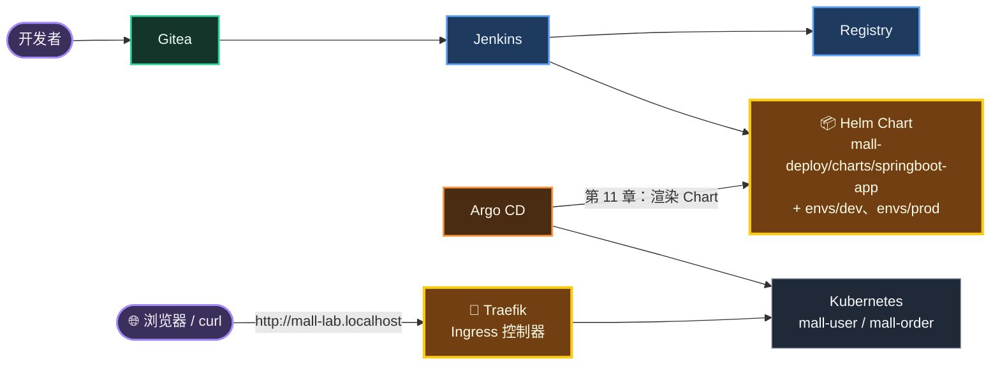
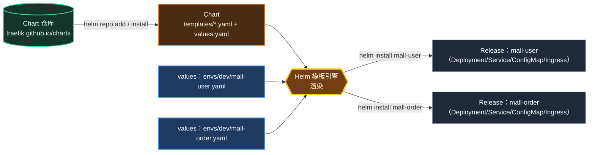
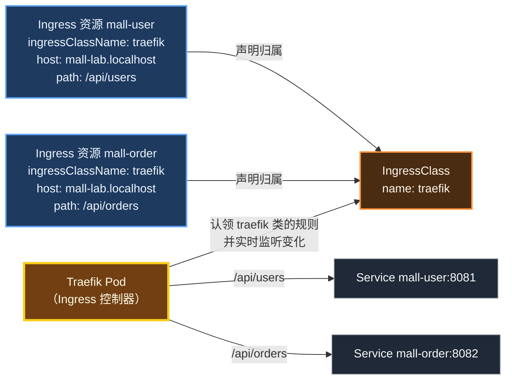
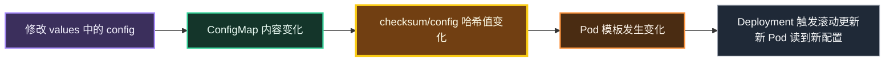
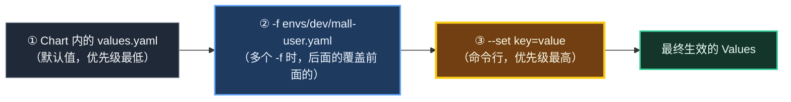
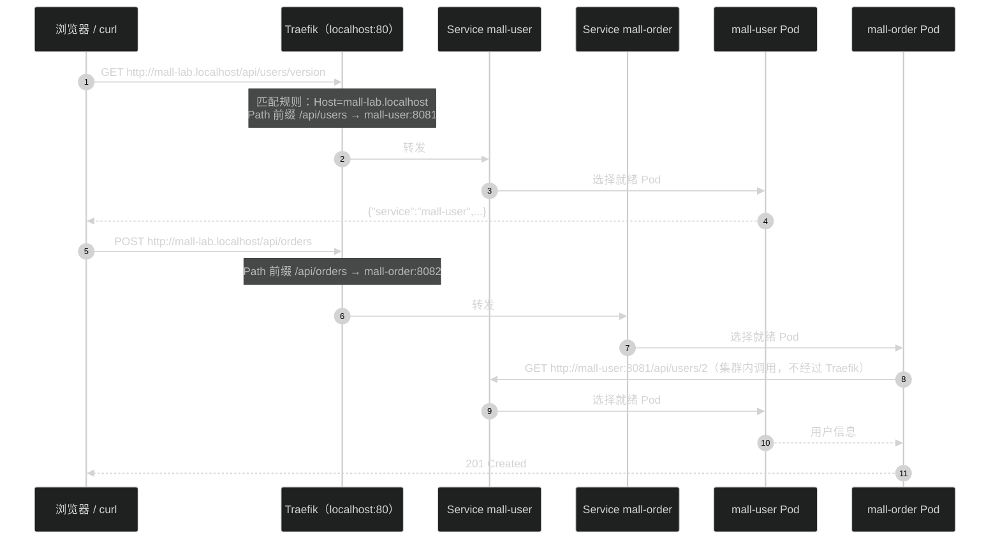
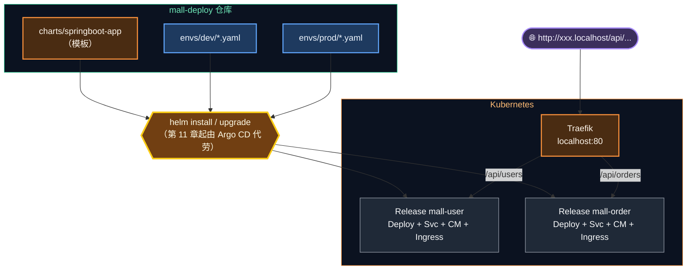

# 第 10 章 Helm 与 Ingress：模板化部署与统一入口

> 上一章手写 YAML 让我们看清了 K8s 的每个零件，也让我们尝到了"复制粘贴改参数"的痛苦。本章用 **Helm** 把 YAML 变成可复用、可配置的"安装包"，再用 **Traefik Ingress** 给所有服务一个统一的域名入口——从此访问服务不再需要 `port-forward`。

---

## 本章目标

学完本章，你应该能够：

1. 说清楚 Helm 的 **Chart / Values / Release / Repository** 四个概念，并能用 Maven 的概念类比。
2. 用 Helm 从公共仓库安装第三方软件（**Traefik**），并验证 `http://localhost` 入口已打通。
3. 读懂 `mall-deploy/charts/springboot-app` 的每一个模板文件，理解 `.Values`、`range`、`quote`、`toYaml | nindent`、`checksum` 注解等写法。
4. 理解多环境 values（dev / prod）的覆盖规则，并用 `helm lint`、`helm template` 在部署前检查和预览。
5. 用 Helm 在 `mall-lab` 中部署 mall-user / mall-order，通过 `http://mall-lab.localhost` 访问，并完成 **upgrade → history → rollback**。
6. 说清楚 **Ingress 资源** 与 **Ingress 控制器** 的区别，以及为什么本教程选择 Traefik 而不是 ingress-nginx。

预计耗时：2 ～ 3 小时。

---

## 本章在全景中的位置



> 💡 本章写好的 Chart 就是第 11 章 Argo CD 部署 dev / prod 环境时使用的那一份。今天你手动 `helm install`，明天 Argo CD 替你做同样的事。

---

## 10.1 手写 YAML 的三个痛点

回顾第 9 章：

```text
 痛点 ①：重复                     痛点 ②：多环境                    痛点 ③：配置变更不生效
 ┌──────────────┐ ┌──────────────┐  ┌──────────┐  ┌──────────┐      ConfigMap 改了
 │mall-user.yaml│ │mall-order.yaml│  │ dev 一份 │  │ prod 一份│      Pod 却不重启
 │ Deployment   │ │ Deployment   │  │ 副本 1   │  │ 副本 2   │      ──▶ 必须记得
 │ Service      │ │ Service      │  │ 域名 dev │  │ 域名 prod│          手动 rollout restart
 │ ConfigMap    │ │ ConfigMap    │  │ 内存 768M│  │ 内存 1G  │
 │ 探针 / 资源   │ │ 探针 / 资源   │  └──────────┘  └──────────┘
 └──────────────┘ └──────────────┘   2 个服务 × 2 个环境 = 4 份几乎一样的 YAML
   90% 内容相同                       改一个探针参数要改 4 个地方
```

如果你写 Java 遇到这种情况，第一反应一定是：**抽一个模板方法，把差异做成参数**。Helm 做的正是这件事。

---

## 10.2 Helm 核心概念

### 10.2.1 四个概念

| 概念 | 是什么 | Java 工程师类比 |
|---|---|---|
| **Chart** | 一个"安装包"：一组带占位符的 YAML 模板 + 默认参数 | 一个带 FreeMarker 模板的 jar 包 |
| **Values** | 填充模板的参数，可以分层覆盖 | `application.yml` + `application-dev.yml` + 命令行 `--xxx=yyy` |
| **Release** | 用某个 Chart + 某组 Values 在集群中安装出的一个实例 | 用某个 profile 启动的一个应用进程 |
| **Repository** | 存放 Chart 的远程仓库 | Maven 中央仓库 / 私服 |



**一份 Chart，多个 Release**：mall-user 和 mall-order 用的是同一个 `springboot-app` Chart，差异全部体现在各自的 values 文件里。

### 10.2.2 Helm 常用命令

| 命令 | 作用 | 类比 |
|---|---|---|
| `helm repo add <名字> <URL>` | 添加 Chart 仓库 | 在 `settings.xml` 加一个仓库 |
| `helm repo update` | 刷新仓库索引 | `mvn -U` |
| `helm search repo <关键字>` | 搜索 Chart | 在 Maven 仓库搜依赖 |
| `helm show values <chart>` | 查看 Chart 的所有可配置参数 | 看 starter 的配置项文档 |
| `helm lint <chart>` | 静态检查 Chart | 编译检查 |
| `helm template <release> <chart>` | 只渲染不安装，输出最终 YAML | 看模板渲染结果 |
| `helm install <release> <chart>` | 安装 | 首次部署 |
| `helm upgrade <release> <chart>` | 升级（参数/镜像变更） | 重新部署 |
| `helm upgrade --install` | 不存在就安装，存在就升级 | 幂等部署（CI 脚本常用） |
| `helm list -n <ns>` | 列出 Release | `jps` |
| `helm history <release>` | 查看 Release 的版本历史 | 发布记录 |
| `helm rollback <release> <版本>` | 回滚到某个历史版本 | 回退 |
| `helm get values <release>` | 查看安装时传入的参数 | 查看启动参数 |
| `helm uninstall <release>` | 卸载 | 停止并删除 |

先确认 Helm 可用（第 1 章已安装）：

```bash
# 位置：任意目录
helm version
```

输出形如 `version.BuildInfo{Version:"v4.x.x", ...}` 或 `v3.x.x` 都可以，本章命令在 Helm 3 和 Helm 4 中通用。

---

## 10.3 Ingress：集群的统一入口

### 10.3.1 没有 Ingress 时怎么访问？

第 9 章我们用了两种方式：

- `LoadBalancer`：每个服务占一个宿主机端口（8082、8083……），服务一多端口就乱了。
- `port-forward`：只适合调试，Pod 一换就断。

生产环境更不可能给每个服务开一个公网 IP。我们需要一个**统一入口**：所有请求都先到它，它再根据**域名（Host）和路径（Path）**转发给不同的 Service——这就是 Ingress。

```text
                                       ┌──────────── Kubernetes 集群 ─────────────┐
 浏览器                                 │                                          │
 http://mall-lab.localhost/api/users ──┐│  ┌───────────────────────┐   ┌─────────┐ │
                                       ├┼─▶│ Traefik（Ingress 控制器）│─▶│mall-user│ │
 http://mall-lab.localhost/api/orders ─┘│  │ 监听 localhost:80      │   └─────────┘ │
                                        │  │                       │   ┌──────────┐│
 http://argocd.localhost ───────────────┼─▶│ 按 Host + Path 匹配    │─▶│mall-order││
   （第 11 章）                          │  │ Ingress 规则后转发     │   └──────────┘│
                                        │  └───────────────────────┘   ┌──────────┐│
                                        │              └──────────────▶│ argocd   ││
                                        │                              └──────────┘│
                                        └──────────────────────────────────────────┘
```

### 10.3.2 Ingress 资源 vs Ingress 控制器

这是初学者最容易混淆的两个概念：

| | Ingress 资源 | Ingress 控制器 |
|---|---|---|
| 是什么 | 一条 YAML 写的**路由规则** | 一个真正处理流量的**反向代理程序** |
| 谁来写 | 开发者（随应用一起部署） | 运维/平台团队（集群装一次） |
| 类比 | Nginx 配置文件里的一个 `location` | Nginx 进程本身 |
| 本教程 | Chart 中的 `templates/ingress.yaml` | Traefik |

**只有规则没有控制器，规则不会生效**——就像只写了 nginx.conf 却没启动 Nginx。两者通过 `ingressClassName` 对上号：



### 10.3.3 为什么选 Traefik，而不是 ingress-nginx？

你在网上搜到的 K8s 教程，十有八九用的是 **ingress-nginx**。但是：

- 2025 年 11 月 11 日，Kubernetes SIG Network 与安全响应委员会宣布 **ingress-nginx 退役**，尽力维护到 2026 年 3 月；
- 2026 年 1 月 29 日，Kubernetes 指导委员会再次发表声明，强调退役后继续使用将面临安全风险；
- **2026 年 3 月，ingress-nginx 正式退役**，仓库归档只读，不再有任何修复。

注意：退役的只是 **ingress-nginx 这个控制器**，**Ingress API 本身并没有退役**，仍然是 K8s 的标准资源。官方建议迁移到 **Gateway API**，或者换用其他 Ingress 控制器。

本教程选择 **Traefik**：

| 考量 | Traefik |
|---|---|
| 维护状态 | 活跃维护，云原生社区主流方案之一 |
| 学习成本 | 标准 Ingress 资源开箱即用，不需要学私有注解 |
| 面向未来 | 同时支持 **Gateway API**（开关 `providers.kubernetesGateway.enabled`） |
| 资源占用 | 单个 Pod，很轻量 |

### 10.3.4 顺带认识 Gateway API

Gateway API 是 Ingress 的"继任者"，把职责拆得更清楚：

| 资源 | 由谁维护 | 作用 |
|---|---|---|
| `GatewayClass` | 平台/基础设施团队 | 声明用哪种实现（Traefik、Envoy Gateway……） |
| `Gateway` | 运维团队 | 声明入口监听哪些端口、协议、域名 |
| `HTTPRoute` | **开发者** | 声明路由规则（相当于 Ingress 中的 rules） |

同样的路由用 HTTPRoute 写，大致长这样（**仅供了解，本教程不执行**）：

```yaml
apiVersion: gateway.networking.k8s.io/v1
kind: HTTPRoute
metadata:
  name: mall-user
spec:
  parentRefs:
    - name: traefik-gateway        # 挂到哪个 Gateway 上
  hostnames:
    - mall-lab.localhost
  rules:
    - matches:
        - path:
            type: PathPrefix
            value: /api/users
      backendRefs:
        - name: mall-user
          port: 8081
```

> 💡 作为开发者，你需要知道：**新项目越来越多采用 Gateway API，但存量项目里 Ingress 仍然遍地都是**。两者的核心思想完全一样——Host + Path → Service。本教程用 Ingress，因为它是你在公司里最可能直接遇到的写法。

---

## 10.4 动手①：用 Helm 安装 Traefik

这是你第一次用 Helm 安装"别人写好的软件"。体会一下：一个功能完整的网关，几条命令就装好了。

### 步骤 1：添加 Chart 仓库

```bash
# 位置：任意目录
helm repo add traefik https://traefik.github.io/charts
helm repo update
```

预期输出：

```text
"traefik" has been added to your repositories
Hang tight while we grab the latest from your chart repositories...
...Successfully got an update from the "traefik" chart repository
Update Complete. ⎈Happy Helming!⎈
```

### 步骤 2：（可选）看看 Chart 有哪些参数

```bash
# 位置：任意目录
helm show values traefik/traefik | grep -nE "^service:|^ports:|^ingressClass:|^providers:" 
```

我们关心的几个默认值（编写教程时核实）：

| 参数 | 默认值 | 含义 |
|---|---|---|
| `service.spec.type` | `LoadBalancer` | Docker Desktop 会把它映射到 Windows 的 localhost |
| `ports.web.port` / `exposedPort` | `8000` / `80` | 容器内监听 8000，对外暴露 80 |
| `ports.websecure.port` / `exposedPort` | `8443` / `443` | HTTPS 入口 |
| `providers.kubernetesIngress.enabled` | `true` | 处理标准 Ingress 资源 |
| `providers.kubernetesGateway.enabled` | `false` | Gateway API 支持（默认关闭） |
| `ingressClass.enabled` / `isDefaultClass` | `true` / `true` | 自动创建名为 `traefik` 的 IngressClass，并设为默认 |

默认值完全满足我们的需求，所以**不需要任何自定义参数**。

### 步骤 3：安装

```bash
# 位置：任意目录
helm install traefik traefik/traefik -n traefik --create-namespace
```

| 参数 | 含义 |
|---|---|
| `traefik`（第 1 个） | Release 名称 |
| `traefik/traefik` | 仓库名/Chart 名 |
| `-n traefik` | 安装到 `traefik` 命名空间 |
| `--create-namespace` | 命名空间不存在就自动创建 |

预期输出（版本号以实际为准）：

```text
NAME: traefik
LAST DEPLOYED: Mon Oct 12 20:40:00 2026
NAMESPACE: traefik
STATUS: deployed
REVISION: 1
TEST SUITE: None
NOTES:
traefik with docker.io/traefik:v3.x.x has been deployed successfully on traefik namespace !
```

### 步骤 4：验证

```bash
# 位置：任意目录
kubectl get pods,svc -n traefik
```

```text
NAME                           READY   STATUS    RESTARTS   AGE
pod/traefik-6d8c5f7b9d-7xk2p   1/1     Running   0          40s

NAME              TYPE           CLUSTER-IP     EXTERNAL-IP   PORT(S)                      AGE
service/traefik   LoadBalancer   10.96.45.12    172.19.0.8    80:31580/TCP,443:30421/TCP   40s
```

```bash
# 位置：任意目录
kubectl get ingressclass
```

```text
NAME      CONTROLLER                      PARAMETERS   AGE
traefik   traefik.io/ingress-controller   <none>       1m
```

最关键的一步——从 Windows 访问 80 端口：

```bash
# 位置：任意目录
curl -i http://localhost
```

```text
HTTP/1.1 404 Not Found
Content-Type: text/plain; charset=utf-8
X-Content-Type-Options: nosniff
Date: Mon, 12 Oct 2026 12:41:00 GMT
Content-Length: 19

404 page not found
```

> ✅ **检查点**：看到 `404 page not found` 就说明**入口已经通了**！请求已经到达 Traefik，只是现在还没有任何 Ingress 规则，所以它回答"找不到"。这个 404 是好消息。

> ⚠️ **常见坑：80 端口被占用**。如果 `curl -i http://localhost` 返回的不是上面的内容（比如是 IIS 的欢迎页，或者连接被拒绝），说明 Windows 上有别的程序占用了 80 端口。排查：
>
> ```bash
> # 位置：任意目录
> netstat -ano | grep -E ":80 .*LISTENING"
> MSYS_NO_PATHCONV=1 tasklist /FI "PID eq <上一条命令最后一列的 PID>"
> ```
>
> 常见占用者：IIS（World Wide Web Publishing Service）、PID 为 4 的 `System`（http.sys，通常也是 IIS 或 SQL Server Reporting Services）、本地装的 Nginx/Apache。停掉它们即可。实在无法释放，可以让 Traefik 改用 8000 端口：
>
> ```bash
> # 位置：任意目录
> helm upgrade traefik traefik/traefik -n traefik --set ports.web.exposedPort=8000
> ```
>
> 之后本教程所有 `http://xxx.localhost/...` 的地址都要改成 `http://xxx.localhost:8000/...`。

---

## 10.5 Chart 解剖：逐个文件读懂 `springboot-app`

### 10.5.1 目录结构

```text
mall-deploy/charts/springboot-app/
├── Chart.yaml              ← Chart 的"身份证"（名字、版本）
├── values.yaml             ← 默认参数（所有服务共享）
└── templates/              ← 模板目录：这里的每个文件都会被渲染成 K8s YAML
    ├── configmap.yaml
    ├── deployment.yaml
    ├── service.yaml
    ├── ingress.yaml        ← 可选：ingress.enabled=true 时才生成
    └── NOTES.txt           ← 安装成功后打印给用户的提示（不会提交给 K8s）
```

对照第 9 章的 `k8s-basics/mall-user.yaml`：**三个对象拆成了三个模板文件，写死的值变成了 `{{ .Values.xxx }}` 占位符**，再加一个 Ingress。

### 10.5.2 `Chart.yaml`

```yaml
apiVersion: v2
name: springboot-app
description: 通用 Spring Boot 微服务 Chart —— mall 的每个服务都用它部署，差异只体现在 values 文件里
type: application
version: 0.1.0
appVersion: "1.0.0"
```

| 字段 | 含义 |
|---|---|
| `apiVersion: v2` | Helm 3 及以后的 Chart 格式 |
| `version` | **Chart 本身**的版本（改了模板就该升版本），类比 pom 的 `<version>` |
| `appVersion` | Chart 默认部署的**应用**版本，仅作展示（`helm list` 的 APP VERSION 列） |

### 10.5.3 `values.yaml`：默认参数

```yaml
replicaCount: 1

image:
  repository: ""          # 必填，例如 localhost:5000/mall/mall-user
  tag: ""                 # 必填，由 Jenkins 流水线自动更新为 Git 提交短哈希
  pullPolicy: IfNotPresent

# 应用监听端口（同时作为 Service 端口）
port: 8080

# 非敏感配置：渲染成 ConfigMap，再以环境变量形式注入容器
config: {}

# 敏感配置：从已存在的 Secret 中读取，注入为环境变量
secretEnv: []
#  - name: DB_PASSWORD          # 容器内的环境变量名
#    secretName: mysql          # Secret 名称
#    secretKey: mysql-password  # Secret 中的 key

resources:
  requests:
    cpu: 100m
    memory: 384Mi
  limits:
    memory: 768Mi

ingress:
  enabled: false
  className: traefik
  host: ""
  path: /
```

这份文件是"**所有服务的公约数**"：资源配额、拉取策略、Ingress 类名这些大家都一样的东西写在这里；镜像名、端口、域名这些各不相同的留空，交给每个服务自己的 values 文件。

### 10.5.4 `templates/configmap.yaml`：循环生成配置

```yaml
apiVersion: v1
kind: ConfigMap
metadata:
  name: {{ .Release.Name }}
  labels:
    app: {{ .Release.Name }}
data:
  {{- range $key, $value := .Values.config }}
  {{ $key }}: {{ $value | quote }}
  {{- end }}
```

逐个语法讲解：

| 写法 | 含义 | Java 类比 |
|---|---|---|
| `{{ .Release.Name }}` | Release 名称，即 `helm install` 后面的第一个参数（`mall-user`） | — |
| `{{ .Values.config }}` | 读取 values 中的 `config` 字段 | `@Value("${config}")` |
| `{{- range $key, $value := .Values.config }} ... {{- end }}` | 遍历 Map | `config.forEach((key, value) -> ...)` |
| `{{ $value \| quote }}` | 管道：把值传给 `quote` 函数，加上双引号 | `"\"" + value + "\""` |
| `{{-` / `-}}` | 去掉左侧 / 右侧的空白和换行，避免渲染出多余空行 | `String.trim()` |

为什么一定要 `quote`？因为 values 里写的 `DB_PORT: "3306"`，经过 YAML 解析后可能变成数字 `3306`，而 ConfigMap 的值**必须是字符串**——第 9 章那个"数字要加引号"的坑，在模板里用 `quote` 一劳永逸地解决了。

以 `envs/dev/mall-user.yaml` 为输入，渲染结果是：

```yaml
apiVersion: v1
kind: ConfigMap
metadata:
  name: mall-user
  labels:
    app: mall-user
data:
  DB_HOST: "mysql"
  DB_NAME: "mall_user"
  DB_PORT: "3306"
  DB_USERNAME: "mall"
```

### 10.5.5 `templates/deployment.yaml`：核心模板

```yaml
apiVersion: apps/v1
kind: Deployment
metadata:
  name: {{ .Release.Name }}
  labels:
    app: {{ .Release.Name }}
spec:
  replicas: {{ .Values.replicaCount }}
  selector:
    matchLabels:
      app: {{ .Release.Name }}
  # 滚动更新：先起一个新 Pod，就绪后再下线一个旧 Pod，保证发布过程中服务不中断
  strategy:
    type: RollingUpdate
    rollingUpdate:
      maxSurge: 1
      maxUnavailable: 0
  template:
    metadata:
      labels:
        app: {{ .Release.Name }}
      annotations:
        # ConfigMap 内容变化时，这个哈希值随之变化，从而触发 Pod 滚动重启
        checksum/config: {{ include (print $.Template.BasePath "/configmap.yaml") . | sha256sum }}
    spec:
      containers:
        - name: app
          image: "{{ .Values.image.repository }}:{{ .Values.image.tag }}"
          imagePullPolicy: {{ .Values.image.pullPolicy }}
          ports:
            - name: http
              containerPort: {{ .Values.port }}
          env:
            - name: APP_VERSION
              value: {{ .Values.image.tag | quote }}
            {{- range .Values.secretEnv }}
            - name: {{ .name }}
              valueFrom:
                secretKeyRef:
                  name: {{ .secretName }}
                  key: {{ .secretKey }}
            {{- end }}
          envFrom:
            - configMapRef:
                name: {{ .Release.Name }}
          # （探针部分与第 9 章完全相同，此处省略）
          resources:
            {{- toYaml .Values.resources | nindent 12 }}
```

重点讲 4 处：

**① 镜像地址由两个参数拼接**

```yaml
image: "{{ .Values.image.repository }}:{{ .Values.image.tag }}"
```

CI/CD 流水线每次发布**只需要修改 `image.tag` 这一个值**（第 12 章 Jenkins 就是这么做的），其他配置一概不动。

**② `APP_VERSION` 自动等于镜像 tag**

```yaml
- name: APP_VERSION
  value: {{ .Values.image.tag | quote }}
```

这样 `/api/users/version` 返回的版本号永远和镜像 tag 一致，发布后一眼就能确认"线上跑的到底是哪个版本"。

**③ `range` 遍历列表，生成 Secret 引用**

```yaml
{{- range .Values.secretEnv }}
- name: {{ .name }}
  valueFrom:
    secretKeyRef:
      name: {{ .secretName }}
      key: {{ .secretKey }}
{{- end }}
```

在 `range` 内部，`.` 指向**当前元素**（类比 for-each 里的循环变量），所以 `.name` 就是当前元素的 `name` 字段。

**④ `toYaml | nindent` 原样输出一整段配置**

```yaml
resources:
  {{- toYaml .Values.resources | nindent 12 }}
```

- `toYaml`：把 values 中的 `resources` 对象转成 YAML 文本；
- `nindent 12`：在前面加一个换行，并让每一行缩进 12 个空格（正好对齐到 `resources:` 下一级）。

数不对缩进，渲染出来的 YAML 就是错的——这是写 Chart 最常见的错误，10.7 节会教你用 `helm template` 检查。

### 10.5.6 `checksum/config`：解决"改配置不重启"的经典技巧

```yaml
annotations:
  checksum/config: {{ include (print $.Template.BasePath "/configmap.yaml") . | sha256sum }}
```

拆开看：

```text
 include (print $.Template.BasePath "/configmap.yaml") .   ① 把 configmap.yaml 模板渲染成文本
                                      │
                                      ▼
                              | sha256sum                  ② 对渲染结果计算 SHA-256
                                      │
                                      ▼
 checksum/config: 481f1b08bc...                            ③ 写进 Pod 模板的注解
```



> 🧠 第 9 章我们学到：**Pod 模板任何一处变化都会触发滚动更新**。这个技巧就是利用这一点，把"ConfigMap 变了"转化成"Pod 模板变了"。10.10 节会亲手验证。

### 10.5.7 `templates/service.yaml` 与 `templates/ingress.yaml`

```yaml
# service.yaml
apiVersion: v1
kind: Service
metadata:
  # Service 名即集群内的 DNS 名：其他服务通过 http://<Release 名>:<端口> 访问
  name: {{ .Release.Name }}
  labels:
    app: {{ .Release.Name }}
spec:
  selector:
    app: {{ .Release.Name }}
  ports:
    - name: http
      port: {{ .Values.port }}
      targetPort: http
```

> ⚠️ **Release 名决定 Service 名，进而决定 DNS 名**。mall-order 通过 `http://mall-user:8081` 调用用户服务，所以用户服务的 Release **必须**叫 `mall-user`。第 11 章 Argo CD 的 `releaseName: mall-user` 也是同样的原因。

```yaml
# ingress.yaml
{{- if .Values.ingress.enabled }}
apiVersion: networking.k8s.io/v1
kind: Ingress
metadata:
  name: {{ .Release.Name }}
  labels:
    app: {{ .Release.Name }}
spec:
  ingressClassName: {{ .Values.ingress.className }}
  rules:
    - host: {{ .Values.ingress.host | quote }}
      http:
        paths:
          - path: {{ .Values.ingress.path }}
            pathType: Prefix
            backend:
              service:
                name: {{ .Release.Name }}
                port:
                  name: http
{{- end }}
```

- 整个文件被 `{{- if .Values.ingress.enabled }} ... {{- end }}` 包住：`enabled: false` 时这个文件渲染为空，不会创建 Ingress。
- `pathType: Prefix`：前缀匹配，`/api/users` 能匹配 `/api/users`、`/api/users/1`、`/api/users/version`。
- `ingressClassName: traefik`：声明这条规则由 Traefik 处理。

### 10.5.8 `templates/NOTES.txt`

```text
{{ .Release.Name }} 已部署到命名空间 {{ .Release.Namespace }}，镜像 {{ .Values.image.repository }}:{{ .Values.image.tag }}

查看 Pod：  kubectl get pods -n {{ .Release.Namespace }} -l app={{ .Release.Name }}
{{- if .Values.ingress.enabled }}
访问地址：  http://{{ .Values.ingress.host }}{{ .Values.ingress.path }}
{{- else }}
本地调试：  kubectl port-forward -n {{ .Release.Namespace }} svc/{{ .Release.Name }} {{ .Values.port }}:{{ .Values.port }}
{{- end }}
```

`helm install` 成功后会打印这段提示，告诉使用者"装好了，怎么访问"。它**不会**被提交给 K8s。

---

## 10.6 多环境 values：dev 与 prod 的差异

每个服务、每个环境一个 values 文件，只写**与默认值不同**的部分：

```text
mall-deploy/envs/
├── dev/
│   ├── mall-user.yaml     ← 1 副本，默认资源，域名 mall-dev.localhost
│   └── mall-order.yaml
└── prod/
    ├── mall-user.yaml     ← 2 副本，更多资源，域名 mall.localhost
    └── mall-order.yaml
```

以 mall-user 为例：

```yaml
# envs/dev/mall-user.yaml
image:
  repository: localhost:5000/mall/mall-user
  tag: "v1"
replicaCount: 1
port: 8081
config:
  DB_HOST: mysql
  DB_PORT: "3306"
  DB_NAME: mall_user
  DB_USERNAME: mall
secretEnv:
  - name: DB_PASSWORD
    secretName: mysql
    secretKey: mysql-password
ingress:
  enabled: true
  host: mall-dev.localhost
  path: /api/users
```

| 配置项 | `envs/dev/mall-user.yaml` | `envs/prod/mall-user.yaml` | 为什么不同 |
|---|---|---|---|
| `image.tag` | 由 mall 流水线自动更新 | 由生产发布流水线从 dev"晋升" | 生产只发布 dev 验证过的版本 |
| `replicaCount` | 1 | 2 | 生产需要高可用；滚动更新时不中断 |
| `resources` | 继承默认（384Mi / 768Mi） | 512Mi / 1Gi，cpu 200m | 生产流量更大 |
| `ingress.host` | `mall-dev.localhost` | `mall.localhost` | 不同环境不同域名 |
| 其余 | 相同 | 相同 | 同一镜像、同一 Chart |

mall-order 的 values 与 mall-user 结构一致，区别是端口 `8082`、库名 `mall_order`、路径 `/api/orders`，以及多了一个 `USER_SERVICE_URL: http://mall-user:8081`。

### 10.6.1 values 的覆盖优先级



这和 Spring Boot 的配置优先级如出一辙：`application.yml` < `application-dev.yml` < 命令行参数。合并是**按字段深度合并**的：dev 文件只写了 `resources` 以外的字段，那么 `resources` 就沿用默认值。

---

## 10.7 动手②：部署前先检查——lint 与 template

### 步骤 1：helm lint 静态检查

```bash
# 位置：/d/cicd-lab/mall-deploy
cd /d/cicd-lab/mall-deploy
helm lint charts/springboot-app -f envs/dev/mall-user.yaml
```

预期输出：

```text
==> Linting charts/springboot-app
[INFO] Chart.yaml: icon is recommended

1 chart(s) linted, 0 chart(s) failed
```

`[INFO]` 只是建议（给 Chart 配个图标），可以忽略。只要 `0 chart(s) failed` 就是通过。

### 步骤 2：helm template 预览渲染结果

```bash
# 位置：/d/cicd-lab/mall-deploy
helm template mall-user charts/springboot-app -n mall-lab \
  -f envs/dev/mall-user.yaml \
  --set ingress.host=mall-lab.localhost
```

会输出 4 段 YAML（ConfigMap、Service、Deployment、Ingress），每段开头有 `# Source: springboot-app/templates/xxx.yaml` 标明来源。重点核对：

| 检查项 | 预期 |
|---|---|
| Deployment 的 `image` | `"localhost:5000/mall/mall-user:v1"` |
| Deployment 的 `replicas` | `1` |
| `APP_VERSION` | `"v1"` |
| `checksum/config` | 一串 64 位十六进制哈希 |
| Ingress 的 `host` | `"mall-lab.localhost"`（被 `--set` 覆盖了） |
| Ingress 的 `path` | `/api/users` |

> 💡 **养成习惯：改了 Chart 或 values，先 `helm template` 看一眼再部署**。它不连接集群、不产生任何副作用，相当于"编译预览"。模板缩进写错时，`helm template` 会直接报错并指出行号；加上 `--debug` 参数能输出出错前的渲染内容，便于定位。

> 🧠 为什么这里要 `--set ingress.host=mall-lab.localhost`？`envs/dev` 的域名是 `mall-dev.localhost`，那是第 11 章留给 Argo CD 部署的开发环境用的。今天在 `mall-lab` 里练习，用 `--set` 换一个域名，避免以后和真正的 dev 环境冲突。这也正好演示了 `--set` 的最高优先级。

---

## 10.8 动手③：用 Helm 部署 mall 到 mall-lab

### 步骤 1：确认第 9 章的残留已清理、MySQL 还在

```bash
# 位置：任意目录
kubectl get all -n mall-lab
```

预期只有 MySQL 相关的资源：

```text
NAME          READY   STATUS    RESTARTS   AGE
pod/mysql-0   1/1     Running   0          1h

NAME            TYPE        CLUSTER-IP   EXTERNAL-IP   PORT(S)    AGE
service/mysql   ClusterIP   None         <none>        3306/TCP   1h

NAME                     READY   AGE
statefulset.apps/mysql   1/1     1h
```

如果还有 `mall-user` / `mall-order` 的 Deployment 或 Service，回到第 9 章 9.12 节执行清理。

### 步骤 2：安装 mall-user

```bash
# 位置：/d/cicd-lab/mall-deploy
cd /d/cicd-lab/mall-deploy
helm install mall-user charts/springboot-app -n mall-lab \
  -f envs/dev/mall-user.yaml \
  --set ingress.host=mall-lab.localhost
```

预期输出（注意最后的 NOTES 就是 `NOTES.txt` 渲染出来的）：

```text
NAME: mall-user
LAST DEPLOYED: Mon Oct 12 21:00:00 2026
NAMESPACE: mall-lab
STATUS: deployed
REVISION: 1
TEST SUITE: None
NOTES:
mall-user 已部署到命名空间 mall-lab，镜像 localhost:5000/mall/mall-user:v1

查看 Pod：  kubectl get pods -n mall-lab -l app=mall-user
访问地址：  http://mall-lab.localhost/api/users
```

### 步骤 3：安装 mall-order

```bash
# 位置：/d/cicd-lab/mall-deploy
helm install mall-order charts/springboot-app -n mall-lab \
  -f envs/dev/mall-order.yaml \
  --set ingress.host=mall-lab.localhost
```

### 步骤 4：查看 Release 与资源

```bash
# 位置：任意目录
helm list -n mall-lab
```

```text
NAME        NAMESPACE   REVISION   UPDATED                    STATUS     CHART                  APP VERSION
mall-order  mall-lab    1          2026-10-12 21:00:30 ...    deployed   springboot-app-0.1.0   1.0.0
mall-user   mall-lab    1          2026-10-12 21:00:00 ...    deployed   springboot-app-0.1.0   1.0.0
```

```bash
# 位置：任意目录
kubectl get pods,svc,ingress -n mall-lab
```

```text
NAME                              READY   STATUS    RESTARTS   AGE
pod/mall-order-5c6d7f8b9-2xq4z    1/1     Running   0          60s
pod/mall-user-7b8c9d6f5-k3m8n     1/1     Running   0          90s
pod/mysql-0                       1/1     Running   0          1h

NAME                 TYPE        CLUSTER-IP     EXTERNAL-IP   PORT(S)    AGE
service/mall-order   ClusterIP   10.96.88.21    <none>        8082/TCP   60s
service/mall-user    ClusterIP   10.96.150.3    <none>        8081/TCP   90s
service/mysql        ClusterIP   None           <none>        3306/TCP   1h

NAME                                   CLASS     HOSTS                ADDRESS      PORTS   AGE
ingress.networking.k8s.io/mall-order   traefik   mall-lab.localhost   172.19.0.8   80      60s
ingress.networking.k8s.io/mall-user    traefik   mall-lab.localhost   172.19.0.8   80      90s
```

注意两个变化：

- 两个 Service 都是 `ClusterIP`——不再需要 LoadBalancer，统一由 Traefik 对外；
- 多了两条 Ingress 规则，`CLASS` 都是 `traefik`（`ADDRESS` 列可能为空或显示 IP，都不影响使用）。

> 💡 Helm 会给它创建的资源打上标记（标签 `app.kubernetes.io/managed-by: Helm` 和注解 `meta.helm.sh/release-name`），用来识别"这个资源归哪个 Release 管"。用 `kubectl get deploy mall-user -n mall-lab -o yaml | grep -A3 annotations` 可以看到。

---

## 10.9 动手④：通过 Ingress 访问服务

### 步骤 1：访问版本接口

```bash
# 位置：任意目录
curl -s http://mall-lab.localhost/api/users/version; echo
curl -s http://mall-lab.localhost/api/orders/version; echo
```

```json
{"service":"mall-user","version":"v1","host":"mall-user-7b8c9d6f5-k3m8n"}
{"service":"mall-order","version":"v1","host":"mall-order-5c6d7f8b9-2xq4z"}
```

**同一个域名、同一个 80 端口**，Traefik 根据路径把请求分别送到了两个服务。你也可以直接在浏览器打开 `http://mall-lab.localhost/api/users`。

> ⚠️ 如果 curl 报 `Could not resolve host: mall-lab.localhost`（个别旧版本 curl 不认识 `*.localhost`），用 Host 头兜底：
>
> ```bash
> curl -s -H "Host: mall-lab.localhost" http://localhost/api/users/version; echo
> ```

### 步骤 2：数据还在吗？

第 9 章创建的用户存在 MySQL 中，MySQL 没删，数据应该还在：

```bash
# 位置：任意目录
curl -s http://mall-lab.localhost/api/users; echo
```

```json
[{"id":1,"username":"zhangsan","nickname":"Zhang San","createdAt":"2026-10-12T20:15:30"}]
```

应用 Pod 换了一批又一批，数据却完好无损——**应用无状态、数据在数据库**，这就是为什么 Deployment 可以随意重建 Pod。

### 步骤 3：走 Ingress 完成一次下单

```bash
# 位置：任意目录
curl -s -X POST http://mall-lab.localhost/api/users \
  -H "Content-Type: application/json" \
  -d '{"username":"lisi","nickname":"Li Si"}'; echo

curl -s -X POST http://mall-lab.localhost/api/orders \
  -H "Content-Type: application/json" \
  -d '{"userId":2,"productName":"Monitor","amount":1299.00}'; echo
```

```json
{"id":2,"username":"lisi","nickname":"Li Si","createdAt":"..."}
{"id":2,"userId":2,"username":"lisi","productName":"Monitor","amount":1299.00,"createdAt":"..."}
```

### 步骤 4：访问不存在的路径

```bash
# 位置：任意目录
curl -i http://mall-lab.localhost/hello
```

返回 `404 page not found`——没有任何 Ingress 规则匹配 `/hello`，Traefik 直接拒绝，请求根本到不了应用。

完整的请求链路：



> 🧠 注意第 9 步：**服务之间的内部调用不走 Ingress**，而是直接通过 Service DNS。Ingress 只负责"南北向"流量（集群外 → 集群内），服务间的"东西向"流量由 Service 负责。

> ✅ **检查点**：`http://mall-lab.localhost/api/users/version` 和 `/api/orders/version` 都能访问；能看到第 9 章创建的 zhangsan；下单成功。

---

## 10.10 动手⑤：升级、历史与回滚

### 步骤 1：升级——扩到 2 个副本

```bash
# 位置：/d/cicd-lab/mall-deploy
helm upgrade mall-user charts/springboot-app -n mall-lab \
  -f envs/dev/mall-user.yaml \
  --set ingress.host=mall-lab.localhost \
  --set replicaCount=2
```

```text
Release "mall-user" has been upgraded. Happy Helming!
NAME: mall-user
LAST DEPLOYED: ...
NAMESPACE: mall-lab
STATUS: deployed
REVISION: 2
...
```

```bash
# 位置：任意目录
kubectl get pods -n mall-lab -l app=mall-user
```

现在是 2 个 Pod。

> ⚠️ **最容易踩的坑：`helm upgrade` 会丢掉上次的 `--set`**。`helm upgrade` 默认**不会**沿用上一次命令行传入的参数，而是以本次传入的为准。如果这次你忘了写 `--set ingress.host=mall-lab.localhost`，域名就会变回 `mall-dev.localhost`，`http://mall-lab.localhost/api/users` 立刻 404。
> 所以：**每次 upgrade 都要带上完整的参数**。这也是为什么真实项目都把参数写进 values 文件并提交到 Git，而不是依赖命令行——第 11 章的 GitOps 正是这个思路的终极形态。

查看这个 Release 当前生效的用户参数：

```bash
# 位置：任意目录
helm get values mall-user -n mall-lab
```

```text
USER-SUPPLIED VALUES:
config:
  DB_HOST: mysql
  ...
ingress:
  enabled: true
  host: mall-lab.localhost
  path: /api/users
replicaCount: 2
...
```

### 步骤 2：查看历史

```bash
# 位置：任意目录
helm history mall-user -n mall-lab
```

```text
REVISION   UPDATED                    STATUS       CHART                  APP VERSION   DESCRIPTION
1          Mon Oct 12 21:00:00 2026   superseded   springboot-app-0.1.0   1.0.0         Install complete
2          Mon Oct 12 21:10:00 2026   deployed     springboot-app-0.1.0   1.0.0         Upgrade complete
```

### 步骤 3：回滚到版本 1

```bash
# 位置：任意目录
helm rollback mall-user 1 -n mall-lab
helm history mall-user -n mall-lab
kubectl get pods -n mall-lab -l app=mall-user
```

```text
Rollback was a success! Happy Helming!

REVISION   UPDATED    STATUS       CHART                  APP VERSION   DESCRIPTION
1          ...        superseded   springboot-app-0.1.0   1.0.0         Install complete
2          ...        superseded   springboot-app-0.1.0   1.0.0         Upgrade complete
3          ...        deployed     springboot-app-0.1.0   1.0.0         Rollback to 1
```

副本数回到了 1。注意回滚本身产生了**新的版本号 3**，历史永远只增不减，方便审计。

```text
 helm 版本线：

   REV 1 ──upgrade──▶ REV 2 ──rollback 1──▶ REV 3
  (1 副本)           (2 副本)             (内容 = REV 1，1 副本)

 对比 kubectl rollout undo（第 9 章）：
   - kubectl 回滚的是单个 Deployment 的 Pod 模板
   - helm 回滚的是整个 Release：Deployment + Service + ConfigMap + Ingress 一起回到旧版本
```

> 🧠 Helm 把每个版本的完整信息保存在 Release 所在命名空间的 Secret 中（名字形如 `sh.helm.release.v1.mall-user.v3`）。用 `kubectl get secret -n mall-lab | grep helm` 可以看到。

---

## 10.11 动手⑥：验证 checksum 技巧

### 步骤 1：记下当前的 checksum

```bash
# 位置：任意目录
kubectl get deploy mall-user -n mall-lab -o yaml | grep "checksum/config"
```

```text
        checksum/config: 52c9e0a4f1...（一串哈希）
```

### 步骤 2：只修改配置，不改镜像

新开一个终端观察 Pod：

```bash
# 位置：任意目录（观察窗口）
kubectl get pods -n mall-lab -l app=mall-user -w
```

回到操作窗口，给 `config` 加一个 `LOG_LEVEL`（应用并不读取这个变量，这里只为演示配置变化）：

```bash
# 位置：/d/cicd-lab/mall-deploy
helm upgrade mall-user charts/springboot-app -n mall-lab \
  -f envs/dev/mall-user.yaml \
  --set ingress.host=mall-lab.localhost \
  --set config.LOG_LEVEL=debug
```

观察窗口中，你会看到一个新 Pod 被创建、就绪后旧 Pod 被终止——**只改了 ConfigMap，Pod 就自动滚动重启了**。

### 步骤 3：确认新配置生效

```bash
# 位置：任意目录
kubectl get deploy mall-user -n mall-lab -o yaml | grep "checksum/config"
kubectl exec -n mall-lab deploy/mall-user -- printenv LOG_LEVEL
```

```text
        checksum/config: 9f3b17d2c8...（与之前不同）
debug
```

对比第 9 章 9.9.6 节需要手动 `rollout restart` 的情形，体会模板带来的便利。

> ✅ **检查点**：`helm history mall-user -n mall-lab` 显示 4 个版本；`printenv LOG_LEVEL` 输出 `debug`。

---

## 10.12 清理

`mall-lab` 练习场的使命到此结束。第 11 章会由 Argo CD 在 `mall-dev`、`mall-prod` 中重新部署全部内容（包括各自的 MySQL）。

### 步骤 1：卸载两个 Release

```bash
# 位置：任意目录
helm uninstall mall-user mall-order -n mall-lab
```

```text
release "mall-user" uninstalled
release "mall-order" uninstalled
```

### 步骤 2：删除整个命名空间

> ⚠️ 删除命名空间会**连带删除其中的所有资源**，包括 MySQL 的 StatefulSet、Secret 和 PVC——第 9、10 章创建的用户、订单数据都会被清空。这是练习数据，放心删除。

```bash
# 位置：任意目录
kubectl delete namespace mall-lab
```

```text
namespace "mall-lab" deleted
```

命令可能要等十几秒才返回（在等待命名空间内的资源全部清理完）。

### 步骤 3：确认 Traefik 保留

```bash
# 位置：任意目录
kubectl get ns
helm list -A
```

`mall-lab` 已经不在了；`traefik` 命名空间和 Release 仍在——**Traefik 是集群的公共入口，后面所有章节都要用，不要删**。

---

## 10.13 常见问题汇总

| 现象 | 原因 | 解决办法 |
|---|---|---|
| `helm install` 报 `... exists and cannot be imported into the current release: invalid ownership metadata` | 第 9 章用 kubectl 创建的同名资源没删干净，Helm 拒绝接管不属于它的资源 | `kubectl delete -n mall-lab -f /d/cicd-lab/k8s-basics/` 后重试 |
| `cannot re-use a name that is still in use` | 同名 Release 已存在 | 改用 `helm upgrade`，或 `helm upgrade --install` |
| 访问域名返回 `404 page not found` | ① Host 不匹配（忘了 `--set ingress.host`，或访问了错误的域名）② `ingressClassName` 写错 ③ 路径不匹配 | `kubectl get ingress -n <ns>` 核对 HOSTS 和 CLASS；`kubectl describe ingress <name> -n <ns>` 看规则 |
| `curl http://localhost` 不是 Traefik 的 404 | 80 端口被 Windows 其他程序占用 | 见 10.4 节，停掉占用者或改用 8000 端口 |
| `Could not resolve host: xxx.localhost` | curl 版本太旧 | `curl -H "Host: xxx.localhost" http://localhost/...` |
| `helm template` 报 `error converting YAML to JSON: yaml: line N: ...` | 模板缩进错误（多半是 `nindent` 的数字不对） | `helm template ... --debug` 查看出错前的输出，对照行号修正 |
| upgrade 后域名或参数"莫名其妙"变了 | 本次 upgrade 没带上次的 `--set` | 每次带完整参数；或把参数写进 values 文件 |
| Ingress 能访问但返回 502/503 | 后端 Pod 未就绪 | `kubectl get pods -n <ns>`，按第 9 章"三板斧"排查 |

---

## 本章小结

| 知识点 | 一句话 |
|---|---|
| Chart / Values / Release | 一份模板 + 多组参数 = 多个部署实例 |
| values 优先级 | Chart 默认 < `-f` 文件（后者优先）< `--set` |
| 模板语法 | `.Values` 取值、`range` 循环、`if` 条件、`quote` 加引号、`toYaml \| nindent` 输出对象 |
| checksum 注解 | 把"配置变化"变成"Pod 模板变化"，自动触发滚动重启 |
| lint / template | 部署前的"编译检查"和"渲染预览" |
| upgrade / rollback | 以 Release 为单位整体升级、整体回滚，历史只增不减 |
| Ingress | 规则（Ingress 资源）+ 执行者（Ingress 控制器），按 Host + Path 路由 |
| Traefik | ingress-nginx 退役后的选择，同时支持 Ingress 与 Gateway API |



**新的问题又来了**：现在部署靠人敲 `helm upgrade`，参数靠人记；谁在什么时候改了线上什么配置，没有记录；有人手工 `kubectl edit` 改了线上，Git 里却不知道……下一章的 Argo CD 会让 **Git 成为唯一的事实来源**，彻底解决这些问题。

---

## 课后练习

1. **对比 dev 与 prod 的渲染结果**：执行
   ```bash
   # 位置：/d/cicd-lab/mall-deploy
   helm template mall-user charts/springboot-app -f envs/dev/mall-user.yaml  > /tmp/dev.yaml
   helm template mall-user charts/springboot-app -f envs/prod/mall-user.yaml > /tmp/prod.yaml
   diff /tmp/dev.yaml /tmp/prod.yaml
   ```
   说出每一处差异来自 values 文件的哪一行。
2. **给 Chart 加一个开关**：思考如果要让某个服务可以不创建 Service，应该如何用 `{{- if }}` 改造 `service.yaml`，并在 `values.yaml` 中加什么默认值。（只需在本地用 `helm template` 验证，**不要提交**到 mall-deploy 仓库，以免影响后续章节。改完记得 `git checkout .` 还原。）
3. **探索 Traefik 的参数**：执行 `helm show values traefik/traefik > /tmp/traefik-values.yaml`，找到 `providers.kubernetesGateway` 一节，思考开启 Gateway API 需要哪些步骤。

---

下一章：[第 11 章 Argo CD：GitOps 持续部署](11-argocd-gitops.md)
