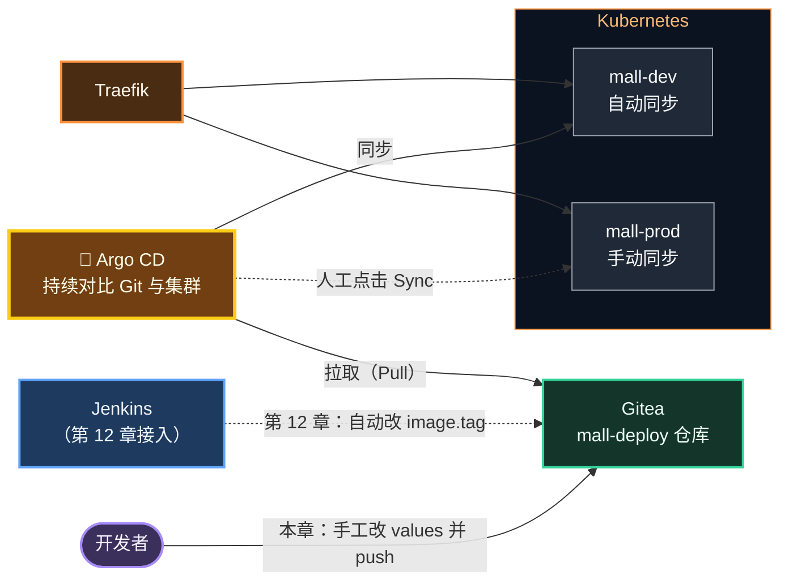
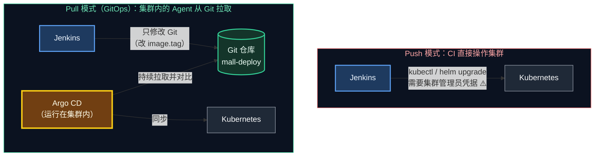
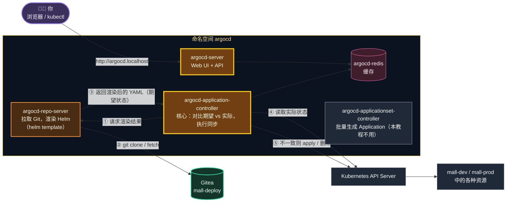
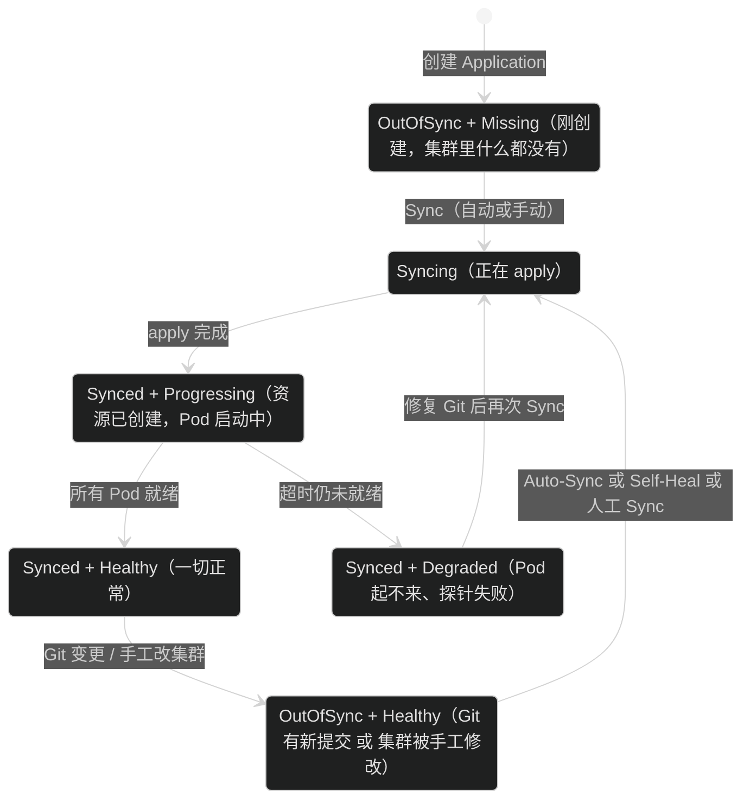
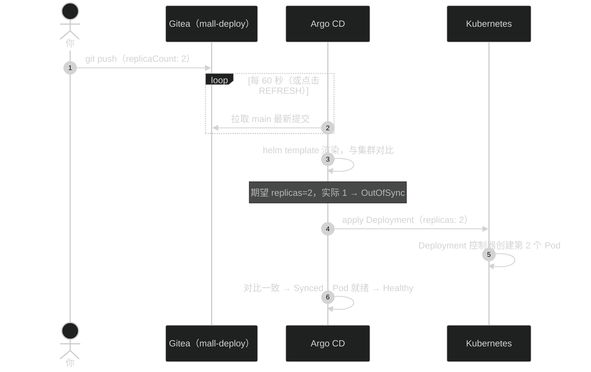
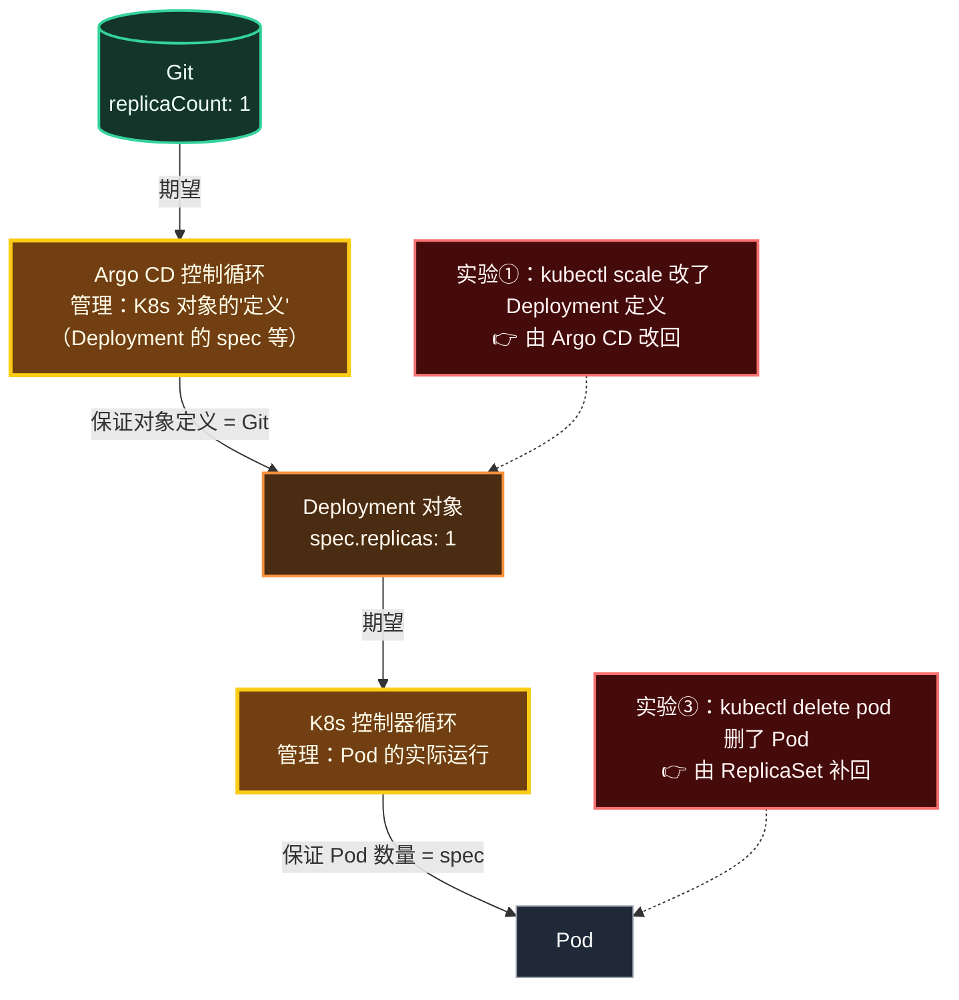
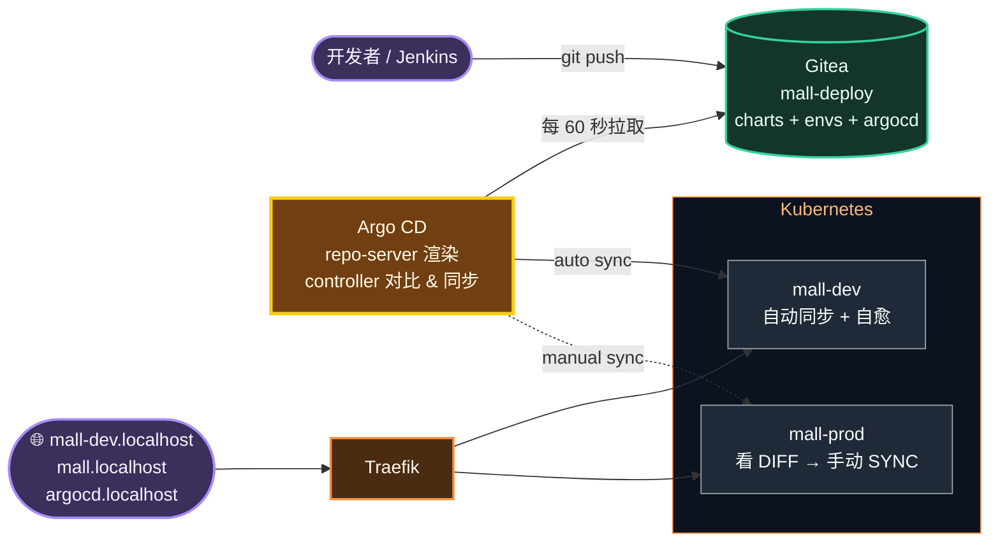

# 第 11 章 Argo CD：GitOps 持续部署

> 第 10 章结尾我们发现：靠人敲 `helm upgrade` 部署，参数容易漏、变更没记录、线上被人手工改了也不知道。本章引入 **Argo CD**，让 **Git 仓库成为部署的唯一事实来源**——想改线上？请提交代码。Argo CD 会持续把集群"拉回"到 Git 描述的样子。

---

## 本章目标

学完本章，你应该能够：

1. 说清楚 **GitOps** 的四个原则，以及 **Push 模式**与 **Pull 模式**部署的区别。
2. 用 Helm 安装 Argo CD，通过 `http://argocd.localhost` 登录 UI。
3. 把 Gitea 上的私有仓库 `mall-deploy` 接入 Argo CD，读懂 `Application` 的每一个字段。
4. 让 Argo CD 自动部署**开发环境 `mall-dev`**，并亲手验证**自愈（Self-Heal）**和"**改 Git 即改线上**"。
5. 让 Argo CD 以**手动同步**的方式部署**生产环境 `mall-prod`**，理解 Synced / OutOfSync、Healthy / Progressing / Missing 这些状态。

预计耗时：2 ～ 3 小时。

---

## 本章在全景中的位置



---

## 11.1 部署方式的演进：从"推"到"拉"

到目前为止，我们经历了两种部署方式：

| 阶段 | 方式 | 问题 |
|---|---|---|
| 第 9 章 | 人工 `kubectl apply` | 全靠人，易出错，无记录 |
| 第 10 章 | 人工 `helm upgrade` | 参数靠记，集群里实际是什么样只有集群知道 |

很多公司的下一步是"**让 CI 去执行 `kubectl/helm` 命令**"，这叫 **Push 模式**。而 Argo CD 采用的是 **Pull 模式**：



| 对比项 | Push 模式 | Pull 模式（GitOps） |
|---|---|---|
| 谁持有集群凭据 | CI 系统（Jenkins 被攻破 = 集群被攻破） | 只有集群内的 Argo CD |
| 线上实际状态 | 只有集群知道，可能被人偷偷改过 | **永远等于 Git**（被改了会自动改回来） |
| 变更记录 | 散落在 CI 日志里 | Git 提交历史：谁、何时、改了什么、为什么 |
| 回滚 | 重新跑一遍旧流水线 | `git revert` 一个提交 |
| 多集群 | CI 要能连上每个集群 | 每个集群里的 Agent 自己拉取 |

---

## 11.2 GitOps 的四个原则

GitOps 由 CNCF 下的 OpenGitOps 项目定义了四条原则：

| 原则 | 含义 | 在本教程中的体现 |
|---|---|---|
| **① 声明式（Declarative）** | 系统的期望状态用声明式描述 | Helm Chart + values、K8s YAML |
| **② 版本化且不可变（Versioned and Immutable）** | 期望状态存储在支持版本控制、不可篡改历史的系统中 | `mall-deploy` Git 仓库 |
| **③ 自动拉取（Pulled Automatically）** | Agent 自动从源头拉取期望状态 | Argo CD 每 60 秒检查一次仓库 |
| **④ 持续调和（Continuously Reconciled）** | Agent 持续观察实际状态，并尝试应用期望状态 | Argo CD 的自动同步 + 自愈 |

是不是很眼熟？第 ④ 条就是第 9 章讲的**控制循环**，只不过"期望状态"从 etcd 换成了 Git：

```text
   第 9 章：K8s 控制器                          本章：Argo CD
 ┌──────────────────────────────┐          ┌──────────────────────────────────┐
 │ 期望：etcd 中的 Deployment     │          │ 期望：Git 中的 Chart + values      │
 │ 现实：节点上运行的 Pod          │          │ 现实：集群中的 Deployment/Service… │
 │ 动作：创建/删除 Pod            │          │ 动作：kubectl apply / 删除对象      │
 └──────────────────────────────┘          └──────────────────────────────────┘
                 ▲                                           │
                 └──────── Argo CD 的"动作"正好写入了 etcd ────┘
                       两层控制循环首尾相接（11.11 节亲手验证）
```

---

## 11.3 Argo CD 架构



| 组件 | 职责 | 类比 |
|---|---|---|
| argocd-server | 提供 Web UI 和 API | Controller 层 |
| argocd-repo-server | 拉取 Git 仓库，执行 `helm template` 把 Chart 渲染成 YAML | 模板引擎 |
| argocd-application-controller | 定时对比"渲染出的期望 YAML"与"集群实际对象"，必要时执行同步 | `@Scheduled` 巡检任务 |
| argocd-redis | 缓存渲染结果和集群状态 | Redis 缓存 |

> 🧠 **重要**：Argo CD 部署 Helm Chart 时，是先用 `helm template` 渲染成普通 YAML，再自己 apply。它**不会**执行 `helm install`，所以 `helm list` 里**看不到**由 Argo CD 部署的应用，`helm rollback` 也不适用——回滚请用 Git（第 13 章）。

---

## 11.4 核心概念

| 概念 | 含义 |
|---|---|
| **Application** | Argo CD 的核心对象：**从哪里**（Git 仓库 + 路径 + 分支）、**用什么参数**（values 文件），部署**到哪里**（集群 + 命名空间） |
| **Project** | Application 的分组和权限边界（限制能部署到哪些命名空间、用哪些仓库）。本教程用内置的 `default` |
| **Sync Status 同步状态** | `Synced`：集群与 Git 一致；`OutOfSync`：不一致 |
| **Health Status 健康状态** | `Healthy`：资源正常；`Progressing`：正在变化中（如滚动更新）；`Degraded`：出错（如 Pod 一直起不来）；`Missing`：Git 里有但集群里没有；`Suspended`：被暂停 |
| **Sync 同步** | 把 Git 中的期望状态应用到集群 |
| **Auto-Sync 自动同步** | 检测到 OutOfSync 就自动 Sync，无需人工点击 |
| **Prune 剪枝** | Git 中删除的资源，集群中也删除（默认不删，防误操作） |
| **Self-Heal 自愈** | 集群被人手工改了，自动改回 Git 中的样子 |
| **Refresh** | 立即重新拉取 Git 并对比（不等 60 秒轮询） |
| **Hard Refresh** | 清空渲染缓存后再 Refresh（改了 Chart 模板却不生效时用） |

一个应用在两个维度上的状态变化：



---

## 11.5 动手①：安装 Argo CD

### 步骤 1：先读安装参数

`infra/k8s/argocd-values.yaml` 是我们为本地学习准备的精简配置：

```yaml
global:
  # 访问域名：*.localhost 在浏览器中自动解析到 127.0.0.1，无需修改 hosts 文件
  domain: argocd.localhost

configs:
  params:
    # 由 Traefik 对外提供 HTTP 访问，Argo CD Server 自身不再强制 HTTPS
    server.insecure: true
  cm:
    # 每 60 秒检查一次 Git 仓库变化（默认 120 秒），让实验反馈更快
    timeout.reconciliation: 60s

server:
  ingress:
    enabled: true
    ingressClassName: traefik

# 以下组件本教程用不到，关闭以节省资源
dex:
  enabled: false
notifications:
  enabled: false
```

| 参数 | 作用 |
|---|---|
| `global.domain` | Argo CD 的访问域名，Ingress 的 host 默认就取它 |
| `configs.params."server.insecure"` | argocd-server 默认强制 HTTPS；我们由 Traefik 提供 HTTP 入口，所以关闭它 |
| `configs.cm."timeout.reconciliation"` | 轮询 Git 的间隔，默认 120 秒，改成 60 秒 |
| `server.ingress.*` | 自动创建一条 Ingress，交给 Traefik 处理 |
| `dex.enabled: false` | Dex 用于对接 LDAP/OIDC 单点登录，本地用不到 |
| `notifications.enabled: false` | 通知组件（钉钉/邮件/Slack），本地用不到 |

> 💡 这就是第 10 章学的"用 values 文件定制第三方 Chart"。Traefik 用默认值就够了，Argo CD 则需要按我们的环境做些调整。

### 步骤 2：添加仓库并安装

```bash
# 位置：任意目录
helm repo add argo https://argoproj.github.io/argo-helm
helm repo update
helm install argocd argo/argo-cd -n argocd --create-namespace -f /d/cicd-lab/infra/k8s/argocd-values.yaml
```

预期输出（版本号以实际为准）：

```text
"argo" has been added to your repositories
...
NAME: argocd
LAST DEPLOYED: Mon Oct 12 21:40:00 2026
NAMESPACE: argocd
STATUS: deployed
REVISION: 1
TEST SUITE: None
NOTES:
In order to access the server UI you have the following options:
...
```

### 步骤 3：等待所有 Pod 就绪

```bash
# 位置：任意目录
kubectl get pods -n argocd -w
```

1～3 分钟后（取决于镜像下载速度），全部变为 `Running`，按 `Ctrl + C` 退出：

```text
NAME                                                READY   STATUS    RESTARTS   AGE
argocd-application-controller-0                     1/1     Running   0          2m
argocd-applicationset-controller-6f9d8c7b5-x4k2p    1/1     Running   0          2m
argocd-redis-7d8f9c6b5-m2n4q                        1/1     Running   0          2m
argocd-repo-server-5c7d8f9b6-p8r2t                  1/1     Running   0          2m
argocd-server-6b9c8d7f5-k3l9w                       1/1     Running   0          2m
```

> 💡 安装过程中你可能还会短暂看到一个名字带 `redis-secret-init` 的 Pod，状态为 `Completed`，那是安装前置任务，属于正常现象。

> ⚠️ **常见坑：Pod 卡在 `ImagePullBackOff` / `ErrImagePull`**。Argo CD 的镜像来自 quay.io 等境外仓库，网络不好时会拉取失败。利用第 9 章学到的"真相"——**集群会优先从宿主机本机镜像库取镜像**——可以这样处理：
>
> ```bash
> # 位置：任意目录
> # 1. 找出拉取失败的完整镜像名
> kubectl describe pod -n argocd <失败的Pod名> | grep -E "Image:|Failed"
> # 2. 在宿主机上拉取（宿主机 Docker 走 Docker Desktop 配置的代理/镜像加速）
> docker pull <上一步看到的完整镜像名>
> # 3. 删除失败的 Pod，让它重建
> kubectl delete pod -n argocd <失败的Pod名>
> ```

### 步骤 4：确认 Ingress 已创建

```bash
# 位置：任意目录
kubectl get ingress -n argocd
```

```text
NAME            CLASS     HOSTS              ADDRESS      PORTS   AGE
argocd-server   traefik   argocd.localhost   172.19.0.8   80      3m
```

> ✅ **检查点**：`argocd` 命名空间下 5 个 Pod 全部 `1/1 Running`；Ingress 的 HOSTS 为 `argocd.localhost`、CLASS 为 `traefik`。

---

## 11.6 动手②：登录 Argo CD

### 步骤 1：获取初始密码

Argo CD 首次启动时会生成一个随机的管理员密码，保存在 Secret `argocd-initial-admin-secret` 中：

```bash
# 位置：任意目录
kubectl -n argocd get secret argocd-initial-admin-secret -o jsonpath='{.data.password}' | base64 -d; echo
```

输出一串随机字符，例如 `xK3m9Pq2Lw7nR5tY`，复制下来。

### 步骤 2：浏览器登录

打开浏览器访问 **http://argocd.localhost**，看到 Argo CD 登录页（一只章鱼 🐙）：

| 字段 | 填写 |
|---|---|
| Username（用户名） | `admin` |
| Password（密码） | 上一步获取的初始密码 |

点击 **SIGN IN**。登录后是 **Applications（应用）** 页面，目前空空如也。

### 步骤 3：（可选）修改密码为统一密码

为了与全局约定保持一致、方便记忆，可以把密码改成 `Admin@123456`：

1. 点击左侧菜单 **User Info**（用户信息）；
2. 点击 **UPDATE PASSWORD**（更新密码）；
3. 填写：

| 字段 | 填写 |
|---|---|
| Current Password（当前密码） | 初始密码 |
| New Password（新密码） | `Admin@123456` |
| Confirm New Password（确认新密码） | `Admin@123456` |

4. 点击 **SAVE NEW PASSWORD**。修改后会要求重新登录。

> 💡 改密码后，`argocd-initial-admin-secret` 里的旧密码就失效了。官方建议此时删除这个 Secret，本地学习可以不管。（不同版本菜单位置可能略有差异）

---

## 11.7 动手③：网络自检——集群能访问 Gitea 吗？

Argo CD 运行在 K8s 集群里，它要去 `http://host.docker.internal:3000` 拉取 Gitea 上的仓库。**在连接仓库之前，先确认这条网络是通的**：

```bash
# 位置：任意目录
kubectl run nettest --rm -i --restart=Never --image=curlimages/curl -- curl -sI http://host.docker.internal:3000
```

预期输出（关键是第一行 `200 OK`）：

```text
HTTP/1.1 200 OK
Cache-Control: max-age=0, private, must-revalidate, no-transform
Content-Type: text/html; charset=utf-8
...
pod "nettest" deleted
```

```text
 网络路径：
 ┌───────── kind 集群 ─────────┐        ┌────────── Windows 宿主机 ──────────┐
 │ Pod（Argo CD repo-server）   │        │                                    │
 │   │ 解析 host.docker.internal │        │   Docker Desktop 端口映射           │
 │   └─────────────────────────┼──────▶ │   0.0.0.0:3000 ──▶ gitea 容器:3000  │
 └─────────────────────────────┘        └────────────────────────────────────┘
```

> ✅ **检查点**：看到 `HTTP/1.1 200 OK`，直接进入 11.8 节。

> ⚠️ **如果失败（超时或无法解析）**，改用 Windows 的局域网 IP：
>
> 1. 查看本机 IP（与 hosts 文件中 `host.docker.internal` 对应的 IP 相同）：
>    ```bash
>    # 位置：任意目录
>    grep host.docker.internal /c/Windows/System32/drivers/etc/hosts
>    ```
>    例如输出 `192.168.1.102 host.docker.internal`。也可以用 `ipconfig` 查看"IPv4 地址"。
> 2. 用这个 IP 重新自检：
>    ```bash
>    # 位置：任意目录
>    kubectl run nettest --rm -i --restart=Never --image=curlimages/curl -- curl -sI http://192.168.1.102:3000
>    ```
>    如果仍不通，检查 Windows 防火墙是否拦截了 3000 端口的入站连接。
> 3. 自检通过后，**后续所有 Argo CD 相关配置中的仓库地址都用 IP 代替 `host.docker.internal`**，需要修改两处：
>    - 11.8 节创建仓库 Secret 时的 `url`；
>    - `mall-deploy/argocd/dev.yaml`、`mall-deploy/argocd/prod.yaml` 中所有的 `repoURL`（共 6 处），改完提交并推送到 Gitea。
>
>    Jenkins 不受影响（它运行在宿主机 Docker 中，`host.docker.internal` 一定可用）。
>    注意：局域网 IP 可能随网络环境变化（换 Wi-Fi、DHCP 重新分配），变了需要同步修改。

---

## 11.8 动手④：把 Gitea 仓库接入 Argo CD

`mall-deploy` 是私有仓库，Argo CD 需要凭据才能拉取。Argo CD 支持用一个**带特殊标签的 Secret** 声明仓库及其凭据。

### 步骤 1：加载 Gitea 令牌

第 5 章我们把 Gitea 访问令牌保存在了 `/d/cicd-lab/tokens.txt`（内容形如 `GITEA_TOKEN=xxxxxxxx`）：

```bash
# 位置：/d/cicd-lab
cd /d/cicd-lab
source tokens.txt
echo "${GITEA_TOKEN:0:6}..."      # 只打印前 6 位确认已加载，避免令牌完整出现在屏幕上
```

### 步骤 2：创建仓库 Secret

```bash
# 位置：/d/cicd-lab
kubectl apply -f - <<EOF
apiVersion: v1
kind: Secret
metadata:
  name: mall-deploy-repo
  namespace: argocd
  labels:
    argocd.argoproj.io/secret-type: repository   # 关键：Argo CD 靠这个标签识别"这是一个仓库配置"
stringData:
  type: git
  url: http://host.docker.internal:3000/mall/mall-deploy.git
  username: mall-admin
  password: ${GITEA_TOKEN}
EOF
```

```text
secret/mall-deploy-repo created
```

| 字段 | 值 | 说明 |
|---|---|---|
| `metadata.namespace` | `argocd` | 必须放在 Argo CD 所在的命名空间 |
| `labels."argocd.argoproj.io/secret-type"` | `repository` | 告诉 Argo CD 这是仓库配置 |
| `type` | `git` | 仓库类型（另一种是 `helm` Chart 仓库） |
| `url` | `http://host.docker.internal:3000/mall/mall-deploy.git` | 必须与 Application 中的 `repoURL` **完全一致** |
| `username` / `password` | `mall-admin` / Gitea 令牌 | 用令牌代替密码，可随时吊销 |

> ⚠️ **安全提醒**：这里用 heredoc 直接把令牌传给 `kubectl`，**令牌不会落到任何文件里**。千万不要把包含令牌的 YAML 文件提交到 Git 仓库——这也是为什么这个 Secret 没有放在 `mall-deploy` 仓库中。

> 💡 也可以在 UI 中添加：**Settings → Repositories → + CONNECT REPO**，选择 `VIA HTTP/HTTPS`，填写 Type `git`、Project `default`、Repository URL、Username、Password。效果完全相同。命令行方式的好处是可重复、可脚本化。（不同版本菜单位置可能略有差异）

### 步骤 3：在 UI 中确认连接成功

浏览器中点击左侧 **Settings（设置）→ Repositories（仓库）**，应看到：

| TYPE | NAME | REPOSITORY | CONNECTION STATUS |
|---|---|---|---|
| git | | `http://host.docker.internal:3000/mall/mall-deploy.git` | ✅ **Successful** |

> ⚠️ 如果显示 **Failed**，点击该行查看错误信息：
> - `authentication required` / `401`：令牌错误或已失效 → 回第 5 章重新生成令牌，`kubectl delete secret mall-deploy-repo -n argocd` 后重建；
> - `timeout` / `no such host`：网络不通 → 回到 11.7 节；
> - `repository not found`：URL 拼错，或 `mall-admin` 没有该仓库的权限。

> ✅ **检查点**：Repositories 页面中 CONNECTION STATUS 为 `Successful`。

---

## 11.9 读懂 Application：`mall-deploy/argocd/dev.yaml`

这个文件定义了开发环境的 3 个 Application，用 `---` 分隔。先看第一个——MySQL：

```yaml
apiVersion: argoproj.io/v1alpha1
kind: Application
metadata:
  name: mysql-dev
  namespace: argocd                  # Application 对象本身必须放在 argocd 命名空间
spec:
  project: default
  source:                            # 从哪里来
    repoURL: http://host.docker.internal:3000/mall/mall-deploy.git
    targetRevision: main             # 跟踪 main 分支（也可以写 tag 或 commit）
    path: infra/mysql                # 仓库中的目录：里面是普通 K8s YAML
  destination:                       # 到哪里去
    server: https://kubernetes.default.svc   # 部署到 Argo CD 所在的集群本身
    namespace: mall-dev
  syncPolicy:
    automated:
      prune: true      # Git 中删除的资源，集群中也删除
      selfHeal: true   # 有人手工改了集群，自动改回 Git 中的样子
    syncOptions:
      - CreateNamespace=true
```

再看 mall-user，它的 `source` 指向的是 Helm Chart：

```yaml
apiVersion: argoproj.io/v1alpha1
kind: Application
metadata:
  name: mall-user-dev
  namespace: argocd
spec:
  project: default
  source:
    repoURL: http://host.docker.internal:3000/mall/mall-deploy.git
    targetRevision: main
    path: charts/springboot-app
    helm:
      releaseName: mall-user          # 决定 Deployment/Service 的名字，也就是集群内 DNS 名
      valueFiles:
        - ../../envs/dev/mall-user.yaml
  destination:
    server: https://kubernetes.default.svc
    namespace: mall-dev
  syncPolicy:
    automated:
      prune: true
      selfHeal: true
    syncOptions:
      - CreateNamespace=true
```

mall-order-dev 与 mall-user-dev 结构相同，只是 `releaseName: mall-order`、values 文件换成 `envs/dev/mall-order.yaml`。

逐个字段讲解：

| 字段 | 含义 | 要点 |
|---|---|---|
| `metadata.name` | Application 名称，UI 中显示的名字 | 命名约定 `<服务>-<环境>` |
| `source.repoURL` | Git 仓库地址 | 必须与仓库 Secret 的 `url` 一致 |
| `source.targetRevision` | 分支 / tag / commit | `main` 表示始终跟踪最新提交 |
| `source.path` | 仓库内的目录 | Argo CD 自动识别：有 `Chart.yaml` 按 Helm 渲染，否则当作普通 YAML |
| `helm.releaseName` | Helm 的 Release 名 | **决定资源名**。不写的话默认等于 Application 名 `mall-user-dev`，Service 就叫 `mall-user-dev`，mall-order 用 `http://mall-user:8081` 就找不到它了！ |
| `helm.valueFiles` | values 文件，路径**相对于 `path`** | `charts/springboot-app` 往上两级再进 `envs/dev`；可以引用 Chart 目录之外、同一仓库之内的文件 |
| `destination.namespace` | 部署到哪个命名空间 | |
| `automated.prune` | 允许删除 | 不开的话，从 Git 删掉的资源会在集群里"残留" |
| `automated.selfHeal` | 允许自愈 | 不开的话，手工改集群后只会显示 OutOfSync，不会自动改回 |
| `CreateNamespace=true` | 命名空间不存在则自动创建 | 等价于第 10 章的 `--create-namespace` |

用一张图对照第 10 章的 helm 命令：

```text
 第 10 章手工执行：
   helm install  mall-user  charts/springboot-app  -n mall-lab  -f envs/dev/mall-user.yaml
                    │              │                    │              │
 本章交给 Argo CD：   │              │                    │              │
   helm.releaseName ┘   source.path ┘  destination.namespace ┘  helm.valueFiles ┘
   + source.repoURL / targetRevision：从 Git 的哪个分支取这些文件
   + syncPolicy：什么时候执行、要不要自愈和剪枝
```

> 🧠 **Application 本身也是 K8s 对象**（一种自定义资源 CRD），所以我们用 `kubectl apply` 创建它，Argo CD 的控制器会监听它。这个文件也放在 Git 里，同样受版本管理。（更进一步可以用"App of Apps"模式让 Argo CD 管理 Application 本身，见第 14 章进阶路线。）

---

## 11.10 动手⑤：部署开发环境

### 步骤 1：确认 v1 镜像在本机

dev 环境的 values 中 `image.tag` 当前是 `"v1"`：

```bash
# 位置：任意目录
docker images | grep -E "mall/mall-(user|order)" | grep v1
```

能看到 `localhost:5000/mall/mall-user v1` 和 `localhost:5000/mall/mall-order v1` 即可。如果没有，回到第 9 章 9.5 节补建。

### 步骤 2：创建开发环境的 Application

```bash
# 位置：/d/cicd-lab/mall-deploy
cd /d/cicd-lab/mall-deploy
kubectl apply -f argocd/dev.yaml
```

```text
application.argoproj.io/mysql-dev created
application.argoproj.io/mall-user-dev created
application.argoproj.io/mall-order-dev created
```

### 步骤 3：在 UI 中观察同步过程

回到浏览器的 **Applications** 页面，你会看到 3 张卡片。每张卡片上显示：

| 卡片字段 | 示例值 |
|---|---|
| Project | default |
| Status | 健康状态图标 + 同步状态图标 |
| Repository | `http://host.docker.internal:3000/mall/mall-deploy.git` |
| Target Revision | main |
| Path | `charts/springboot-app` 或 `infra/mysql` |
| Destination | in-cluster |
| Namespace | mall-dev |

因为开启了自动同步，状态会自动变化：

```text
 时间 ───────────────────────────────────────────────────────────────────────▶
 mysql-dev      OutOfSync/Missing → Synced/Progressing ────────────→ Synced/Healthy  (~40s)
 mall-user-dev  OutOfSync/Missing → Synced/Progressing ──(Pod 重启 1~2 次)──→ Synced/Healthy (~1-2min)
 mall-order-dev OutOfSync/Missing → Synced/Progressing ──(Pod 重启 1~2 次)──→ Synced/Healthy (~1-2min)
```

> 💡 mall-user / mall-order 在 MySQL 就绪前可能会重启一两次，期间显示 `Progressing`，这和第 9 章看到的现象一样，**属于正常**。等 2 分钟左右，三个应用都应变为绿色的 **Healthy** 和 **Synced**。

### 步骤 4：查看资源树

点击 **mall-user-dev** 卡片进入详情页，你会看到一棵资源树：

```text
 mall-user-dev (Application)
   ├── mall-user (ConfigMap)
   ├── mall-user (Service)
   │     └── mall-user-xxxxx (EndpointSlice)
   ├── mall-user (Deployment)
   │     └── mall-user-7b8c9d6f5 (ReplicaSet)
   │           └── mall-user-7b8c9d6f5-k3m8n (Pod)   ← 点击可看日志、事件、YAML
   └── mall-user (Ingress)
```

这就是第 9 章 9.4.2 节那张"对象关系图"的可视化版本。详情页顶部有几个常用按钮：

| 按钮 | 作用 |
|---|---|
| **DETAILS**（APP DETAILS） | 查看 / 编辑 Application 配置 |
| **DIFF**（APP DIFF） | 查看 Git 与集群的差异（OutOfSync 时最有用） |
| **SYNC** | 手动同步 |
| **SYNC STATUS** | 查看最近一次同步的详细结果 |
| **HISTORY AND ROLLBACK** | 同步历史（每次对应一个 Git 提交） |
| **REFRESH** | 立即拉取 Git 对比；下拉菜单中有 **Hard Refresh** |

点击资源树中的 Pod，再点 **LOGS** 标签，就能看到 Spring Boot 的启动日志——不用再敲 `kubectl logs` 了。（不同版本菜单位置可能略有差异）

### 步骤 5：命令行确认

```bash
# 位置：任意目录
kubectl get applications -n argocd
kubectl get all -n mall-dev
```

```text
NAME             SYNC STATUS   HEALTH STATUS
mall-order-dev   Synced        Healthy
mall-user-dev    Synced        Healthy
mysql-dev        Synced        Healthy

NAME                              READY   STATUS    RESTARTS      AGE
pod/mall-order-5c6d7f8b9-8vq2m    1/1     Running   1 (90s ago)   2m
pod/mall-user-7b8c9d6f5-x7k4p     1/1     Running   2 (80s ago)   2m
pod/mysql-0                       1/1     Running   0             2m

NAME                 TYPE        CLUSTER-IP     EXTERNAL-IP   PORT(S)    AGE
service/mall-order   ClusterIP   10.96.77.150   <none>        8082/TCP   2m
service/mall-user    ClusterIP   10.96.12.201   <none>        8081/TCP   2m
service/mysql        ClusterIP   None           <none>        3306/TCP   2m

NAME                         READY   UP-TO-DATE   AVAILABLE   AGE
deployment.apps/mall-order   1/1     1            1           2m
deployment.apps/mall-user    1/1     1            1           2m
...
```

注意，这些资源**没有一个是你亲手 apply 的**——你只 apply 了 3 个 Application。

再验证 Helm 看不到它们：

```bash
# 位置：任意目录
helm list -n mall-dev
```

输出只有表头，没有任何 Release。原因见 11.3 节：Argo CD 只用 Helm 渲染模板，不用 Helm 安装。

> ✅ **检查点**：`kubectl get applications -n argocd` 三个应用都是 `Synced` + `Healthy`。

---

## 11.11 动手⑥：访问开发环境

```bash
# 位置：任意目录
curl -s http://mall-dev.localhost/api/users/version; echo
curl -s http://mall-dev.localhost/api/orders/version; echo
```

```json
{"service":"mall-user","version":"v1","host":"mall-user-7b8c9d6f5-x7k4p"}
{"service":"mall-order","version":"v1","host":"mall-order-5c6d7f8b9-8vq2m"}
```

创建用户并下单（dev 环境的 MySQL 是全新的，用户 id 从 1 开始）：

```bash
# 位置：任意目录
curl -s -X POST http://mall-dev.localhost/api/users \
  -H "Content-Type: application/json" \
  -d '{"username":"devuser","nickname":"Dev User"}'; echo

curl -s -X POST http://mall-dev.localhost/api/orders \
  -H "Content-Type: application/json" \
  -d '{"userId":1,"productName":"Keyboard","amount":199.00}'; echo
```

```json
{"id":1,"username":"devuser","nickname":"Dev User","createdAt":"..."}
{"id":1,"userId":1,"username":"devuser","productName":"Keyboard","amount":199.00,"createdAt":"..."}
```

> ✅ **检查点**：两个 version 接口返回 `"version":"v1"`；下单成功。

---

## 11.12 动手⑦：亲手验证 GitOps

### 实验 ①：自愈——手工改集群会被改回来

假设有同事"临时"手工把副本数改成了 3：

```bash
# 位置：任意目录
kubectl scale deployment mall-user -n mall-dev --replicas=3
kubectl get pods -n mall-dev -l app=mall-user -w
```

观察输出：

```text
NAME                        READY   STATUS              RESTARTS   AGE
mall-user-7b8c9d6f5-x7k4p   1/1     Running             2          10m
mall-user-7b8c9d6f5-a1b2c   0/1     ContainerCreating   0          1s
mall-user-7b8c9d6f5-d3e4f   0/1     ContainerCreating   0          1s
mall-user-7b8c9d6f5-a1b2c   0/1     Terminating         0          6s
mall-user-7b8c9d6f5-d3e4f   0/1     Terminating         0          6s
```

几秒钟内，多出来的两个 Pod 就被终止了，按 `Ctrl + C` 退出。到 UI 中点开 mall-user-dev → **HISTORY AND ROLLBACK** 或 **SYNC STATUS**，可以看到一次由自愈触发的同步记录。

> 🧠 Argo CD 发现集群中 `spec.replicas = 3`，而 Git 渲染出的期望是 `1` → OutOfSync → 开启了 selfHeal → 自动 Sync 把它改回 1。**任何绕过 Git 的线上修改都是徒劳的**——这正是 GitOps 想要的效果：线上状态永远可追溯。

### 实验 ②：GitOps 的正确姿势——改 Git

现在我们真的需要 2 个副本。正确做法是**修改 Git**：

```bash
# 位置：/d/cicd-lab/mall-deploy
cd /d/cicd-lab/mall-deploy
git pull --rebase                                                      # 养成好习惯：先拉最新
sed -i 's/^replicaCount: 1$/replicaCount: 2/' envs/dev/mall-user.yaml
git diff
```

```diff
-replicaCount: 1
+replicaCount: 2
```

```bash
# 位置：/d/cicd-lab/mall-deploy
git commit -am "scale(dev): mall-user 扩容到 2 个副本"
git push
```

然后什么都不用做，只需观察（Argo CD 每 60 秒检查一次仓库；等不及可以在 UI 中点 mall-user-dev 的 **REFRESH**）：

```bash
# 位置：任意目录
kubectl get pods -n mall-dev -l app=mall-user -w
```

一分钟内会出现第二个 Pod，并且**这次不会被删掉**。UI 中 mall-user-dev 的 **SYNC STATUS** 会显示 `Synced to main (xxxxxxx)`，括号里正是你刚才的提交哈希。

完整流程：



改回 1 个副本，恢复原状：

```bash
# 位置：/d/cicd-lab/mall-deploy
sed -i 's/^replicaCount: 2$/replicaCount: 1/' envs/dev/mall-user.yaml
git commit -am "scale(dev): mall-user 恢复 1 个副本"
git push
```

> ⚠️ 本章修改的 `envs/dev/mall-user.yaml` 在第 12 章会由 Jenkins 自动修改 `image.tag`。今后**手工修改 mall-deploy 前务必先 `git pull --rebase`**，否则推送时会与 Jenkins 的提交冲突。

### 实验 ③：两层控制循环

再做一个对比实验——删除一个 Pod：

```bash
# 位置：任意目录
kubectl delete pod -n mall-dev -l app=mall-user
kubectl get pods -n mall-dev -l app=mall-user
```

新 Pod 立刻被创建。但这次**和 Argo CD 无关**——是 Deployment/ReplicaSet 控制器补的（第 9 章的自愈）。两个实验对比：



> 🧠 **Argo CD 守护"对象定义与 Git 一致"，K8s 守护"运行状态与对象定义一致"**。两层循环各司其职，最终效果就是：**线上运行状态 = Git**。

> ✅ **检查点**：实验①中多出的 Pod 被自动删除；实验②中修改 Git 后副本数随之变化；最终 mall-user 恢复为 1 个副本，应用状态 `Synced` + `Healthy`。

---

## 11.13 动手⑧：部署生产环境（手动同步）

开发环境追求"快"，Git 一变立刻部署；生产环境追求"稳"，**Git 变了先别急着上，等人确认后再同步**。`mall-deploy/argocd/prod.yaml` 与 `dev.yaml` 的区别只有三点：

| 区别 | dev.yaml | prod.yaml |
|---|---|---|
| Application 名称后缀 | `-dev` | `-prod` |
| 命名空间 / values | `mall-dev` / `envs/dev/*` | `mall-prod` / `envs/prod/*` |
| `syncPolicy` | 有 `automated`（自动同步 + prune + selfHeal） | **没有 `automated`**，只保留 `CreateNamespace=true` |

```yaml
# prod.yaml 中 mall-user-prod 的 syncPolicy
  syncPolicy:
    syncOptions:
      - CreateNamespace=true
```

### 步骤 1：创建生产环境的 Application

```bash
# 位置：/d/cicd-lab/mall-deploy
cd /d/cicd-lab/mall-deploy
kubectl apply -f argocd/prod.yaml
```

```text
application.argoproj.io/mysql-prod created
application.argoproj.io/mall-user-prod created
application.argoproj.io/mall-order-prod created
```

回到 UI，三个 `-prod` 应用显示为黄色的 **OutOfSync** 和 **Missing**——Argo CD 已经知道"应该部署什么"，但没有自动执行，正在等你的指令。

```bash
# 位置：任意目录
kubectl get applications -n argocd
kubectl get ns mall-prod
```

```text
NAME              SYNC STATUS   HEALTH STATUS
mall-order-dev    Synced        Healthy
mall-order-prod   OutOfSync     Missing
mall-user-dev     Synced        Healthy
mall-user-prod    OutOfSync     Missing
mysql-dev         Synced        Healthy
mysql-prod        OutOfSync     Missing

Error from server (NotFound): namespaces "mall-prod" not found
```

连命名空间都还没有创建。

### 步骤 2：先看差异（DIFF）

点击 **mall-user-prod** 卡片进入详情页，点击顶部 **DIFF**（APP DIFF）。因为集群里什么都没有，你会看到 4 个资源（ConfigMap、Service、Deployment、Ingress）全部是"新增"。重点核对：

- Deployment 的 `replicas: 2`；
- `resources.limits.memory: 1Gi`；
- Ingress 的 `host: mall.localhost`。

> 💡 **生产发布前先看 DIFF**，确认"即将发生的变化正是我想要的"，这是 GitOps 赋予我们的一道安全阀。第 13 章发布新版本时，DIFF 会清楚地显示只有 `image` 和 `APP_VERSION` 两处变化。

### 步骤 3：先同步 MySQL

应用依赖数据库，所以先部署 MySQL。点击 **mysql-prod** 卡片上的 **SYNC** 按钮（或进入详情页点顶部 **SYNC**），右侧滑出同步面板：

| 面板选项 | 设置 | 说明 |
|---|---|---|
| Revision | `main`（默认） | 同步到哪个版本 |
| PRUNE | 不勾选 | 首次部署没有需要删除的资源 |
| DRY RUN | 不勾选 | 勾选则只演练不真正执行 |
| APPLY ONLY | 不勾选 | 勾选则跳过同步钩子 |
| FORCE | 不勾选 | 强制替换资源，**生产慎用** |
| SYNC OPTIONS → AUTO-CREATE NAMESPACE | 已勾选（来自 Application 定义） | 自动创建 `mall-prod` |
| SYNCHRONIZE RESOURCES | 全部勾选（默认） | 同步哪些资源 |

确认后点击面板顶部的 **SYNCHRONIZE**。（不同版本菜单位置可能略有差异）

等待 mysql-prod 变为 **Synced** + **Healthy**（约 40 秒）：

```bash
# 位置：任意目录
kubectl get pods -n mall-prod -w
```

看到 `mysql-0   1/1   Running` 后按 `Ctrl + C`。

### 步骤 4：同步 mall-user-prod 和 mall-order-prod

用同样的方式，分别点击 **mall-user-prod** 和 **mall-order-prod** 的 **SYNC → SYNCHRONIZE**。

```bash
# 位置：任意目录
kubectl get pods -n mall-prod
```

约 1 分钟后：

```text
NAME                          READY   STATUS    RESTARTS   AGE
mall-order-6c7d8e9f0-a2b3c    1/1     Running   0          60s
mall-order-6c7d8e9f0-d4e5f    1/1     Running   0          60s
mall-user-5b6c7d8e9-g6h7i     1/1     Running   0          70s
mall-user-5b6c7d8e9-j8k9l     1/1     Running   0          70s
mysql-0                       1/1     Running   0          3m
```

生产环境每个服务 **2 个副本**，和 `envs/prod/*.yaml` 中的定义一致。

### 步骤 5：访问生产环境

```bash
# 位置：任意目录
for i in 1 2 3 4; do curl -s http://mall.localhost/api/users/version; echo; done
```

```json
{"service":"mall-user","version":"v1","host":"mall-user-5b6c7d8e9-g6h7i"}
{"service":"mall-user","version":"v1","host":"mall-user-5b6c7d8e9-j8k9l"}
{"service":"mall-user","version":"v1","host":"mall-user-5b6c7d8e9-j8k9l"}
{"service":"mall-user","version":"v1","host":"mall-user-5b6c7d8e9-g6h7i"}
```

请求经 Traefik 分发到两个副本上。现在，同一个 Traefik 入口后面挂着三套服务：

```text
                              Traefik（localhost:80）
                                       │
        ┌──────────────────────────────┼──────────────────────────────┐
        ▼                              ▼                              ▼
  argocd.localhost             mall-dev.localhost               mall.localhost
  └▶ argocd-server             ├ /api/users  ▶ mall-user (×1)   ├ /api/users  ▶ mall-user (×2)
     （命名空间 argocd）         └ /api/orders ▶ mall-order (×1)  └ /api/orders ▶ mall-order (×2)
                                 （命名空间 mall-dev，自动同步）     （命名空间 mall-prod，手动同步）
```

> ✅ **检查点**：`kubectl get applications -n argocd` 六个应用全部 `Synced` + `Healthy`；`http://mall.localhost/api/users/version` 能在两个 `host` 之间切换。

### 步骤 6：体会"手动同步"的含义

生产环境没有开启 selfHeal，试试手工改它：

```bash
# 位置：任意目录
kubectl scale deployment mall-user -n mall-prod --replicas=3
kubectl get applications mall-user-prod -n argocd
```

```text
NAME             SYNC STATUS   HEALTH STATUS
mall-user-prod   OutOfSync     Healthy
```

这次 Pod **不会**被自动删除，Argo CD 只是诚实地标记为 `OutOfSync`。在 UI 中点开 mall-user-prod → **DIFF**，能清楚看到 `replicas: 2 → 3` 这处"漂移"。点击 **SYNC → SYNCHRONIZE**，恢复到 Git 中定义的 2 个副本。

> 🧠 **dev 用自动同步，prod 用手动同步**，是很多团队的常见做法：dev 环境追求反馈速度；prod 环境把"何时发布"的决定权留给人，并且在发布前能看到准确的 DIFF。第 13 章会在此基础上加入 Jenkins 审批，形成完整的生产发布流程。

---

## 11.14 常见问题汇总

| 现象 | 可能原因 | 解决办法 |
|---|---|---|
| Repositories 显示 `Failed` | 令牌错误 / URL 错误 / 网络不通 | 见 11.8 节步骤 3 的提示；回 11.7 节做网络自检 |
| 应用显示 `ComparisonError`，提示找不到 values 文件 | `valueFiles` 路径写错（它相对于 `source.path`），或文件没推送到 Gitea | 在 Gitea 网页上确认 `envs/dev/mall-user.yaml` 存在；核对 `../../envs/...` 路径 |
| 应用显示 `ComparisonError`，提示 `repository not found` | Application 的 `repoURL` 与仓库 Secret 的 `url` 不一致 | 两处改成完全一致（包括 `.git` 后缀） |
| Pod `ImagePullBackOff` | 本机没有 `localhost:5000/mall/...:v1` 镜像 | 回第 9 章 9.5 节补建镜像 |
| 应用长时间 `Progressing` | Pod 起不来或探针一直失败 | 资源树中点开 Pod 看 EVENTS 和 LOGS；或用第 9 章"三板斧" |
| 应用 `Degraded` | Deployment 超过发布期限仍未就绪 | 同上；修复后在 UI 中 SYNC |
| `http://argocd.localhost` 返回 404 | Traefik 未安装，或 Argo CD Ingress 未创建 | `kubectl get pods -n traefik`；`kubectl get ingress -n argocd` |
| 登录页能打开，但登录后不停跳转或报错 | `server.insecure` 未生效 | `helm upgrade argocd argo/argo-cd -n argocd -f /d/cicd-lab/infra/k8s/argocd-values.yaml` 后重试 |
| 改了 Git，Argo CD 迟迟不同步 | 还没到 60 秒轮询周期 | 点 **REFRESH**；仍不行点 **Hard Refresh** |
| `git push` mall-deploy 被拒绝（non-fast-forward） | 远端有新提交（第 12 章起 Jenkins 也会提交） | `git pull --rebase` 后再 push |
| `helm list -n mall-dev` 为空 | 正常现象：Argo CD 不用 `helm install` | 用 Argo CD UI 或 `kubectl get applications -n argocd` 查看 |

---

## 本章小结

| 知识点 | 一句话 |
|---|---|
| GitOps | Git 是唯一事实来源，集群状态由 Agent 持续拉取并调和 |
| Push vs Pull | Pull 模式下 CI 不需要集群凭据，线上状态永远可追溯 |
| Application | 定义"从 Git 哪里、用什么参数、部署到哪里、何时同步" |
| releaseName | 决定资源名和 DNS 名，务必显式指定 |
| 状态 | 同步状态（Synced / OutOfSync）+ 健康状态（Healthy / Progressing / Degraded / Missing） |
| 自动同步 + 自愈 + 剪枝 | dev 环境：Git 一变即部署，手工修改会被纠正 |
| 手动同步 | prod 环境：Git 变了先看 DIFF，确认后再 SYNC |
| 两层控制循环 | Argo CD 管"对象定义 = Git"，K8s 管"运行状态 = 对象定义" |



**到这里，"CD"的部分已经就位**：只要有人修改了 `mall-deploy` 中的 `image.tag`，dev 环境就会自动更新。那么——**谁来改这个 tag？** 当然不是人。下一章，我们让 Jenkins 在构建完镜像之后自动完成这件事，打通从 `git push` 到自动上线的全链路。

---

## 课后练习

1. **体验 Prune**：在 `envs/dev/mall-order.yaml` 中把 `ingress.enabled` 改为 `false`，提交推送后观察 mall-order-dev 的资源树——Ingress 被自动删除了吗？`curl http://mall-dev.localhost/api/orders/version` 返回什么？然后改回 `true` 并推送，确认恢复。思考：如果 Application 没开 `prune: true`，会发生什么？
2. **用 DIFF 看清每一次变更**：在 `envs/prod/mall-user.yaml` 中把 `replicaCount` 改为 `3` 并推送，到 UI 中查看 mall-user-prod 的 DIFF，然后**不要同步**，直接把提交 `git revert` 掉并推送，观察应用重新变为 `Synced`。体会"Git 才是真相"。
3. **阅读 Argo CD 的配置**：执行 `kubectl get configmap argocd-cm -n argocd -o yaml`，找到我们设置的 `timeout.reconciliation: 60s`；再执行 `kubectl get application mall-user-dev -n argocd -o yaml`，看看 `status` 字段里记录了哪些信息（同步到的 revision、资源列表、健康状态）。

---

下一章：[第 12 章 全链路打通：从 git push 到自动上线](12-end-to-end.md)
