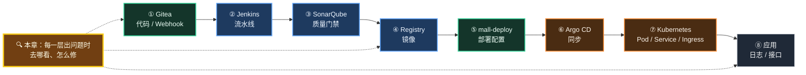
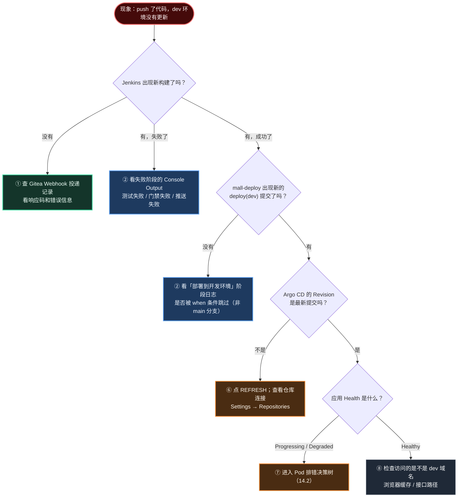
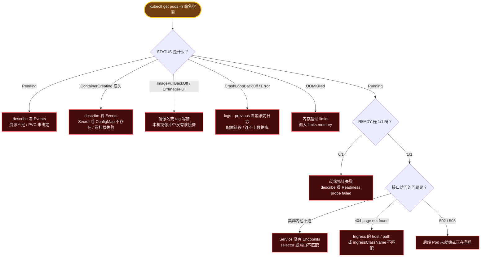
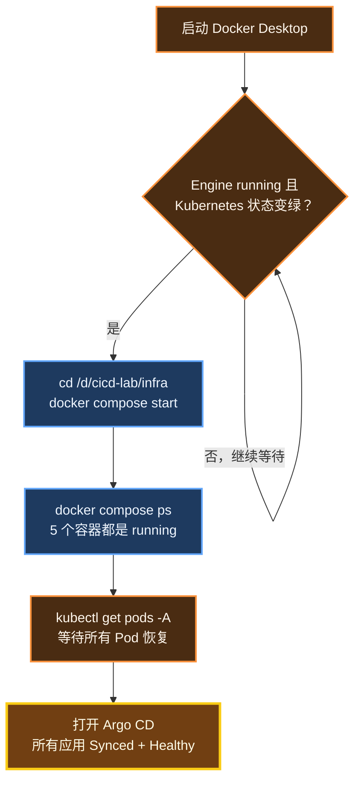
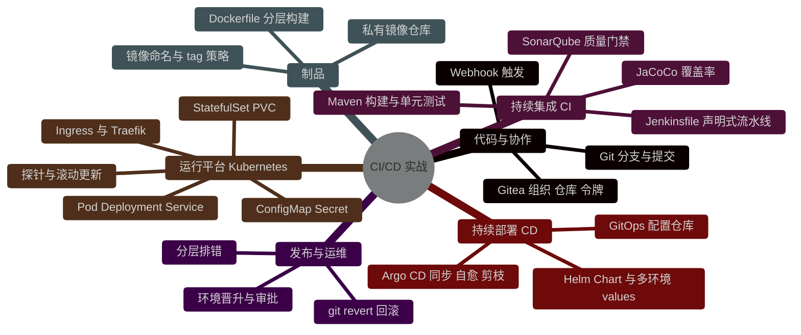

# 第 14 章 排错手册、资源清理与进阶路线

> 流水线不出问题是运气，出了问题能**十分钟定位到哪一层**，才是真本事。

---

## 本章目标

学完本章，你应该能够：

1. 用"沿链路分层定位"的方法，快速判断问题出在 Gitea、Jenkins、SonarQube、Registry、mall-deploy、Argo CD、K8s、应用中的哪一层
2. 根据 Pod 的状态（Pending / ImagePullBackOff / CrashLoopBackOff / 0/1 Ready……）选择正确的排查命令
3. 遇到本教程中的常见报错时，能在症状表中找到原因和解决办法
4. 正确地暂停、恢复、彻底清理整套实验环境，不误删数据
5. 知道下一步该学什么，并能把这条流水线迁移到一个真实的开源微服务项目上

预计耗时：1～2 小时（本章也是一本"字典"，以后遇到问题随时回来查）

---

## 本章在全景中的位置

本章不新增组件，而是把前 13 章串起来的整条链路，按"出问题时去哪看"重新梳理一遍：



---

## 14.1 排错方法论：沿着链路分层定位

### 14.1.1 三条原则

新手排错最常见的问题是"东改一下、西试一下"，最后问题解决了也不知道为什么。请记住三条原则：

| 原则 | 含义 | 反例 |
|---|---|---|
| **先定位层，再深入** | 先确定"断在哪一层"，再去看那一层的日志 | 应用没更新，第一反应是重启 Pod |
| **看证据，不靠猜** | 每个判断都要有日志、事件或状态做依据 | "应该是网络问题吧"然后去改代理 |
| **一次只改一处** | 改一处 → 验证 → 再改下一处 | 同时改了三个配置，好了也不知道是哪个起作用 |

### 14.1.2 八层链路："正常信号"与"去哪看"

整条链路从上游到下游，**每一层都有一个明确的"正常信号"**。排错时从第 ① 层开始往下检查，第一个没出现正常信号的层，就是问题所在。

```text
 一次 git push 应该依次留下这些"痕迹"：

 ① Gitea      mall 仓库出现新提交，Webhook 投递记录为 200
      │
 ② Jenkins    mall 任务自动出现新构建，各阶段变绿
      │
 ③ SonarQube  项目分析时间更新，质量门禁 Passed
      │
 ④ Registry   tags/list 中出现新的 7 位短哈希 tag
      │
 ⑤ mall-deploy 出现 "deploy(dev): mall <tag>" 提交
      │
 ⑥ Argo CD    mall-*-dev 应用的 Revision 变为最新提交，Synced + Healthy
      │
 ⑦ K8s        新 Pod 1/1 Running，镜像 tag 正确，旧 Pod 已下线
      │
 ⑧ 应用       /api/users/version 返回新 tag
```

| 层 | 正常信号 | 去哪看 | 常用命令 / 入口 |
|---|---|---|---|
| ① Gitea | 提交出现在仓库中；Webhook 投递成功 | mall 仓库 → **Settings → Webhooks** → 点击 Webhook → 页面底部 **Recent Deliveries** | `docker logs gitea --tail 100` |
| ② Jenkins | 构建自动出现，阶段全部成功 | 构建页 → **Console Output** / 阶段视图 | `docker logs jenkins --tail 100` |
| ③ SonarQube | 门禁 Passed，并回调 Jenkins | http://localhost:9000 项目页；**Administration → Configuration → Webhooks** 的投递记录 | `docker logs sonarqube --tail 100` |
| ④ Registry | 新 tag 存在 | Registry API | `curl -s -u admin:Admin@123456 http://localhost:5000/v2/mall/mall-user/tags/list` |
| ⑤ mall-deploy | 新的 deploy(dev) 提交，tag 已修改 | Gitea → mall-deploy → **Commits** | `git pull && git log --oneline -5` |
| ⑥ Argo CD | Revision 为最新提交，Synced + Healthy | http://argocd.localhost 应用详情页 | `kubectl get applications -n argocd` |
| ⑦ Kubernetes | Pod 1/1 Running，镜像正确 | — | `kubectl get pods -n mall-dev -o wide`、`kubectl describe pod ...` |
| ⑧ 应用 | 接口返回新版本，日志无 ERROR | — | `curl ...version`、`kubectl logs ...` |

### 14.1.3 决策图：我 push 了代码，但环境没有更新



> 💡 记住一个口诀：**"有没有触发 → 有没有成功 → 有没有改配置 → 有没有同步 → 有没有起来"**。五个问题问完，问题一定已经被定位到某一层了。

---

## 14.2 Pod 排错决策树

一旦定位到 K8s 层，第一条命令永远是：

```bash
# 位置：任意目录
kubectl get pods -n mall-dev -o wide
```

然后根据 **STATUS** 和 **READY** 两列，按下面的决策树走：



### 14.2.1 一次请求经过哪些环节

接口访问不通时，要知道请求从浏览器到 Pod 走过的路径，才能逐段排查：

```text
 浏览器 / curl
   │  http://mall-dev.localhost/api/users/version
   ▼
 localhost:80 ── Docker Desktop 把 LoadBalancer 服务映射到本机端口
   │
   ▼
 Traefik（命名空间 traefik）          ← kubectl logs -n traefik deploy/traefik
   │  按 Ingress 规则匹配：host = mall-dev.localhost，path 前缀 = /api/users
   ▼                                    ← kubectl get ingress -n mall-dev
 Service mall-user:8081（mall-dev）
   │  按 selector app=mall-user 找到"已就绪"的 Pod
   ▼                                    ← kubectl get endpointslices -n mall-dev -l kubernetes.io/service-name=mall-user
 Pod mall-user-xxxx:8081              ← kubectl logs / describe
   │
   ▼
 MySQL（Service mysql:3306 → Pod mysql-0）
```

**逐段绕过法**：从下往上验证，哪一段不通就是哪一段的问题。

```bash
# 位置：任意目录
# 1) 绕过 Ingress 和 Service，直连 Service（端口转发）——通了说明 Pod 和 Service 没问题
kubectl port-forward -n mall-dev svc/mall-user 18081:8081
# 另开一个窗口执行：
curl -s http://localhost:18081/api/users/version; echo

# 2) 在集群内部访问 Service 的 DNS 名——验证服务发现
winpty kubectl run tmp-curl --rm -it --image=curlimages/curl --restart=Never -n mall-dev -- \
  curl -s http://mall-user:8081/api/users/version

# 3) 查看 Ingress 规则
kubectl get ingress -n mall-dev
```

第 3 条命令的预期输出：

```text
NAME         CLASS     HOSTS                ADDRESS      PORTS   AGE
mall-order   traefik   mall-dev.localhost   172.19.0.7   80      2d
mall-user    traefik   mall-dev.localhost   172.19.0.7   80      2d
```

### 14.2.2 各状态的含义与排查

**① Pending：Pod 还没被调度到节点上**

```bash
# 位置：任意目录
kubectl describe pod <Pod名> -n mall-dev | tail -15
```

看最后的 Events。典型信息与处理：

| Events 中的信息 | 原因 | 处理 |
|---|---|---|
| `0/3 nodes are available: 3 Insufficient memory` | 节点内存不够（`requests` 总和超出） | 关掉暂时不用的东西（如 SonarQube），或调小副本数 / requests；必要时在 Docker Desktop 中加大内存 |
| `pod has unbound immediate PersistentVolumeClaims` | PVC 没有绑定到存储 | `kubectl get pvc -n mall-dev` 查看；默认 StorageClass `standard` 是 `WaitForFirstConsumer` 模式，**Pod 调度前 PVC 显示 Pending 是正常的** |

**② ContainerCreating 很久：调度成功，但容器建不起来**

| Events 中的信息 | 原因 | 处理 |
|---|---|---|
| `secret "mysql" not found` | 引用的 Secret 不存在（mysql-dev 应用还没同步，或命名空间不对） | `kubectl get secret -n mall-dev`；先同步 mysql 应用 |
| `configmap "mall-user" not found` | ConfigMap 不存在 | 检查 Chart 是否完整渲染：`helm template` |
| `CreateContainerConfigError` | 同上，配置引用错误（如 secretKey 写错） | `kubectl describe pod` 中会写明是哪个 key |

**③ ImagePullBackOff / ErrImagePull：镜像拉不到**

```bash
# 位置：任意目录
kubectl describe pod <Pod名> -n mall-dev | grep -A3 -iE "failed|pulling"
```

在我们的环境中（Docker Desktop kind 模式），集群通过内置的 `registry-mirror` **从本机 Docker 镜像库**获取镜像。所以典型报错长这样：

```text
Failed to pull image "localhost:5000/mall/mall-user:a1b2c3d": ... unexpected status from HEAD request to
http://registry-mirror:1273/v2/mall/mall-user/manifests/a1b2c3d?ns=localhost%3A5000: 500 Internal Server Error
```

| 原因 | 判断方法 | 处理 |
|---|---|---|
| tag 写错 | 对比 `envs/dev/*.yaml` 中的 tag 与 `docker image ls "localhost:5000/mall/*"` | 修正 mall-deploy 中的 tag |
| 本机镜像被删了（执行过 `docker image prune -a` / `docker rmi`） | `docker image ls` 中找不到该 tag | 从 Registry 拉回本机：`docker pull localhost:5000/mall/mall-user:<tag>`，然后 `kubectl delete pod <Pod名> -n mall-dev` 让它重建 |
| 第三方镜像（如 Argo CD、Traefik 的镜像）网络拉不下来 | Pod 所在命名空间是 argocd / traefik | 在宿主机先 `docker pull <完整镜像名>`（宿主机走 Docker Desktop 的代理 / 镜像加速），然后删除 Pod 重建 |

> 🧠 原理：为什么"宿主机先 pull 一下"就能解决集群拉不到镜像？因为 kind 节点的所有拉取请求都先经过 `registry-mirror`，它会优先从本机镜像库中查找。本机有了，集群就有了。

**④ CrashLoopBackOff / Error：容器启动后反复崩溃**

容器已经重启过，当前日志可能是空的，**一定要加 `--previous` 看上一次崩溃前的日志**：

```bash
# 位置：任意目录
kubectl logs <Pod名> -n mall-dev --previous --tail=80
```

本项目中最常见的几种：

| 日志关键字 | 原因 | 处理 |
|---|---|---|
| `Communications link failure` / `Connection refused`（连 MySQL） | MySQL 还没就绪 | 先看 `kubectl get pods -n mall-dev` 中 `mysql-0` 是否 1/1；等它就绪后应用会自动恢复 |
| `Access denied for user 'mall'@'%' to database 'xxx'` | `DB_NAME` 写错，或账号没有该库权限 | 检查 `envs/*/mall-*.yaml` 中的 `config.DB_NAME` |
| `Access denied for user 'mall'@'%' (using password: YES)` | 密码不匹配 | ⚠️ 见下方"MySQL 密码改了不生效"的说明 |
| `Unable to determine Dialect` / Hibernate 初始化失败 | 根本连不上数据库 | 检查 `DB_HOST`、`DB_PORT` 配置 |

> ⚠️ **MySQL 密码改了不生效**：MySQL 镜像只在**数据目录为空的第一次启动时**按环境变量初始化账号密码。之后再改 Secret 里的密码，数据库里的密码不会变，于是应用（用新密码）连不上。解决办法：要么用 `mysql` 客户端手工修改密码，要么删除 PVC 让它重新初始化（`kubectl delete statefulset mysql -n mall-dev && kubectl delete pvc data-mysql-0 -n mall-dev`，⚠️ **会清空该环境的全部数据库数据**；Argo CD 随后会重建 StatefulSet）。

**⑤ OOMKilled：内存超限被杀**

```bash
# 位置：任意目录
kubectl describe pod <Pod名> -n mall-dev | grep -A5 "Last State"
```

```text
    Last State:     Terminated
      Reason:       OOMKilled
      Exit Code:    137
```

处理：在 `envs/*/mall-*.yaml` 中调大 `resources.limits.memory`。我们的 Dockerfile 设置了 `-XX:MaxRAMPercentage=75.0`，JVM 堆会自动按 limits 的 75% 计算，剩余 25% 留给元空间、线程栈等堆外内存。

**⑥ Running 但 READY 是 0/1：就绪探针没通过**

```bash
# 位置：任意目录
kubectl describe pod <Pod名> -n mall-dev | grep -iE "probe failed" | tail -5
```

| 信息 | 原因 | 处理 |
|---|---|---|
| `Startup probe failed: ... connection refused`（启动后几十秒内） | Spring Boot 还在启动 | 正常，等待即可（启动探针最多给 3 分钟） |
| 持续 `connection refused`，最终容器被重启 | values 中的 `port` 与应用的 `server.port` 不一致（例如 mall-user 必须是 8081） | 修正 values 中的 `port` |
| `HTTP probe failed with statuscode: 404` | 探针路径不对，或 actuator 端点未开启 | 确认应用配置中 `management.endpoint.health.probes.enabled: true` |
| `statuscode: 503`（readiness） | 应用自己报告"未就绪" | 看应用日志 |

**⑦ Service 没有 Endpoints**

```bash
# 位置：任意目录
kubectl get endpointslices -n mall-dev -l kubernetes.io/service-name=mall-user
```

```text
NAME              ADDRESSTYPE   PORTS   ENDPOINTS    AGE
mall-user-7xk2p   IPv4          8081    10.244.1.5   2d
```

如果 `ENDPOINTS` 一列是 `<unset>` 或空的：要么 Service 的 `selector` 与 Pod 的标签不匹配（`kubectl get pods -n mall-dev --show-labels` 对比），要么所有 Pod 都没就绪（未就绪的 Pod 不会出现在 Endpoints 中）。

**⑧ Ingress 返回 404 page not found**

这是 Traefik 的默认 404 页面，表示**没有任何路由规则匹配这个请求**：

| 检查项 | 命令 |
|---|---|
| 域名是否拼错（`mall-dev.localhost` vs `mall.localhost`） | `kubectl get ingress -A` |
| 路径前缀是否匹配（只有 `/api/users`、`/api/orders` 开头的路径才会被转发） | 同上 |
| `ingressClassName` 是否为 `traefik` | `kubectl get ingress mall-user -n mall-dev -o yaml \| grep ingressClassName` |
| Traefik 是否正常运行 | `kubectl get pods -n traefik`、`kubectl logs -n traefik deploy/traefik --tail=50` |

---

## 14.3 症状 → 原因 → 解决（按组件分组）

下面这些表格覆盖了本教程实验过程中最常见的问题。遇到报错时，用 `Ctrl+F` 搜索报错中的关键字。

### 14.3.1 Docker / Docker Compose

| 症状 | 原因 | 解决 |
|---|---|---|
| `error during connect ... dockerDesktopLinuxEngine: The system cannot find the file specified` | Docker Desktop 没有启动 | 启动 Docker Desktop，等待左下角显示 Engine running |
| `Bind for 0.0.0.0:3000 failed: port is already allocated` | 宿主机端口被占用 | 用 14.3.9 中的方法查出占用进程；或修改 compose 中的端口映射 |
| 拉取镜像超时：`TLS handshake timeout` / `context deadline exceeded` | 访问 Docker Hub 等镜像源的网络问题 | 配置 Docker Desktop 的代理或镜像加速（第 1 章）；重试 |
| 修改了 Dockerfile 但容器里还是旧内容 | `docker compose up -d` 不会自动重新构建 | 加 `--build`：`docker compose up -d --build jenkins` |
| SonarQube 容器反复重启，日志有 `max virtual memory areas vm.max_map_count` | Elasticsearch 的生产环境自检 | compose 中已设置 `SONAR_ES_BOOTSTRAP_CHECKS_DISABLE: "true"`，确认没有删掉这一行 |
| SonarQube 启动很慢 / 被 OOM | SonarQube 至少需要约 2GB 内存 | 关闭其它占内存的程序；检查 Docker Desktop 的内存上限 |
| `docker run -v /xxx:/yyy` 在 Git Bash 中路径变成 `C:/Program Files/Git/xxx` | Git Bash 自动改写以 `/` 开头的参数 | 命令前加 `MSYS_NO_PATHCONV=1` 前缀，只对该命令生效（第 1 章 1.3.2） |
| `docker build` 时 "Sending build context" 非常大、非常慢 | 没有 `.dockerignore`，把 `src`、`.git` 都发给了 Docker | 本项目每个服务都有 `.dockerignore`，只发送 jar |
| Compose 中的 MySQL 一直不是 healthy | 首次初始化需要时间；或密码与健康检查不一致 | `docker compose logs mysql` 查看；首次启动可能需要 30～60 秒 |

### 14.3.2 Gitea / Webhook

| 症状 | 原因 | 解决 |
|---|---|---|
| push 后 Jenkins 没反应，Webhook 投递记录报 `webhook can only call allowed HTTP servers` | Gitea 默认 `webhook.ALLOWED_HOST_LIST=external`，禁止向私有地址发送 Webhook | compose 中已设置 `GITEA__webhook__ALLOWED_HOST_LIST: "*"`；修改后需 `docker compose up -d gitea` |
| Webhook 投递记录显示 `connection refused` | Webhook 地址写成了 `localhost:8080`（在 Gitea 容器里，localhost 指它自己） | Jenkins URL 必须是 `http://host.docker.internal:8080/` |
| Webhook 投递记录显示 `404` | Jenkins 中还没创建对应任务，或地址路径不对 | 地址应为 `http://host.docker.internal:8080/gitea-webhook/post` |
| Webhook 列表里根本没有 Jenkins 的 Webhook | Jenkins 的 Gitea Server 没勾选 Manage hooks，或令牌权限不足 | 检查 Jenkins → Manage Jenkins → System → Gitea Servers |
| 页面上的克隆地址显示成 `localhost:3000` 或其它地址 | `ROOT_URL` 配置不对 | compose 中 `GITEA__server__ROOT_URL` 应为 `http://host.docker.internal:3000/` |
| `git push` 一直让输入密码 / 提示认证失败 | 用了登录密码而非令牌；或 Windows 凭据管理器缓存了错误的凭据 | 密码处填**访问令牌**；打开 Windows「控制面板 → 凭据管理器 → Windows 凭据」，删除 `git:http://host.docker.internal:3000` 后重试 |
| Jenkins 报 `HTTP 403/Forbidden`（设置提交状态或创建 Webhook 时） | 令牌没有仓库**写**权限 | 重新生成令牌，repository 选 Read and Write |
| 浏览器打不开 `host.docker.internal:3000` | Windows hosts 中 `host.docker.internal` 指向的局域网 IP 已过期（切换过网络） | 查看 `cat /c/Windows/System32/drivers/etc/hosts \| grep docker`；重启 Docker Desktop 会重新写入 |

### 14.3.3 Jenkins

| 症状 | 原因 | 解决 |
|---|---|---|
| 构建 Jenkins 镜像时插件下载失败 | 访问 Jenkins 更新中心的网络问题 | 在 `infra/jenkins/Dockerfile` 中取消 `JENKINS_UC_DOWNLOAD` 那一行的注释，使用清华镜像后重新构建 |
| 忘记初始管理员密码（解锁页面） | — | `MSYS_NO_PATHCONV=1 docker exec jenkins cat /var/jenkins_home/secrets/initialAdminPassword` |
| `mvn: not found` / `yq: not found` / `docker: not found` | 运行的不是定制镜像 | 确认 compose 中 jenkins 使用 `build: ./jenkins`，执行 `docker compose up -d --build jenkins` |
| `permission denied while trying to connect to the Docker daemon socket` | Jenkins 没有以 root 运行 | compose 中 jenkins 需要 `user: root` |
| Maven 下载依赖极慢 | 没走镜像仓库 | 确认 `infra/jenkins/settings.xml` 已复制到镜像的 `/usr/share/maven/conf/settings.xml` |
| 依赖下载报 `Connection refused` / 访问 SonarQube、Gitea 超时，但宿主机访问正常 | 容器里被注入了 `HTTP_PROXY`，内部地址也被发往代理 | 执行 `docker exec jenkins env \| grep -i proxy` 检查；如有，在 compose 的 jenkins `environment` 中加入 `NO_PROXY` 与 `no_proxy`，值为 `host.docker.internal,sonarqube,gitea,registry,localhost,127.0.0.1`，然后 `docker compose up -d jenkins`。也可在 Docker Desktop 的代理设置中把这些地址加入绕过列表（不同版本菜单位置可能略有差异） |
| 多分支流水线扫描不到分支 / 没有任务 | Owner、Repository 填错；凭据错误；仓库根目录没有 `Jenkinsfile` | 查看任务左侧 **Scan Repository Log** |
| main 分支上「代码质量扫描」等阶段显示 skipped | 分支名不是 `main`（如 `master`），`when { branch 'main' }` 不满足 | 统一使用 `main` 分支 |
| `ERROR: SonarQube installation defined in this job (sonarqube) does not match any configured installation` | Jenkins 系统配置中 SonarQube 服务器的 Name 不是 `sonarqube` | Manage Jenkins → System → SonarQube servers，Name 填 `sonarqube` |
| 「质量门禁」阶段一直等待，5 分钟后超时失败 | SonarQube 没有回调 Jenkins | SonarQube 中添加 Webhook：`http://jenkins:8080/sonarqube-webhook/`（注意末尾斜杠） |
| `docker login` 报 `unauthorized` | `registry-cred` 凭据的用户名或密码错误 | 应为 `admin` / `Admin@123456`；也检查 htpasswd 文件是否正确生成 |
| `http: server gave HTTP response to HTTPS client` | 镜像地址用了 `host.docker.internal:5000` 等非 localhost 地址，Docker 默认要求 HTTPS | 统一使用 `localhost:5000`（Docker 默认信任 `127.0.0.0/8` 的 HTTP 仓库） |
| 推送 mall-deploy 时 `! [rejected] ... (fetch first)` | 远端有新提交（并发推送） | 重新运行构建 |
| 构建一直排队（Waiting for next available executor） | 执行器被占满，例如有 `input` 正在等待审批 | 处理掉等待中的审批；或调大内置节点的执行器数 |
| `/bin/sh^M: bad interpreter` 或 `$'\r': command not found` | 脚本是 Windows 的 CRLF 换行 | 仓库中已有 `.gitattributes`（`eol=lf`）；对已提交的文件执行 `git add --renormalize .` 后重新提交 |

### 14.3.4 SonarQube

| 症状 | 原因 | 解决 |
|---|---|---|
| 首次登录改密码时提示密码不符合要求 | SonarQube 的密码策略（长度、大小写、数字、特殊字符） | 使用约定的 `Admin@123456` |
| 扫描报 `Not authorized` / `401` | `sonar-token` 凭据错误或令牌已被撤销 | 在 SonarQube 中重新生成 **User Token**，更新 Jenkins 凭据 |
| 覆盖率显示 0% | 没有生成 JaCoCo 报告（例如跳过了 `mvn verify`） | `sonar:sonar` 必须在同一工作空间的 `mvn clean verify` 之后执行 |
| 门禁失败：`Coverage on New Code` 低于 80% | 新增代码缺少单元测试——这是门禁在正常工作 | 为新代码补测试（第 7 章） |
| 功能分支的扫描结果覆盖了 main | 社区版只支持分析一个分支 | 本教程只在 main 分支扫描；需要分支 / PR 分析要用商业版 |
| 传入 `sonar.branch.name` 参数时报错 | 社区版不支持分支参数 | 去掉该参数 |

### 14.3.5 Registry / 镜像

| 症状 | 原因 | 解决 |
|---|---|---|
| `curl http://localhost:5000/v2/_catalog` 返回 401 | Registry 开启了认证 | 加 `-u admin:Admin@123456` |
| `docker login localhost:5000` 一直失败，但密码确认无误 | htpasswd 文件格式不对：在 PowerShell 中用 `>` 重定向生成了 UTF-16 编码文件；或没有用 bcrypt（`-B`） | 在 **Git Bash** 中重新执行第 4 章的 htpasswd 生成命令，然后 `docker compose restart registry` |
| 通过 API 删除了镜像，但磁盘空间没有释放 | Registry 删除只是删除引用，需要垃圾回收 | 见 14.4.5 |
| Pod 报 `registry-mirror:1273 ... 500` | 本机镜像库中没有该镜像 | 见 14.2.2 第 ③ 条 |

### 14.3.6 Kubernetes

| 症状 | 原因 | 解决 |
|---|---|---|
| `Unable to connect to the server` / `connection refused` | Kubernetes 没有运行，或 kubectl 上下文不对 | 确认 Docker Desktop 中 Kubernetes 状态为运行中；`kubectl config use-context docker-desktop` |
| `kubectl exec -it` / `kubectl run -it` 报 `Unable to use a TTY` | Git Bash（mintty）的终端兼容问题 | 命令前加 `winpty` |
| NodePort 服务从本机访问不了 | Docker Desktop kind 模式不会把 NodePort 映射到本机 | 改用 LoadBalancer 类型，或 `kubectl port-forward` |
| LoadBalancer 服务的 `localhost:<端口>` 访问不了 | 本机端口被占用 | 换一个 Service 端口，或释放占用的端口 |
| `kubectl port-forward` 过一会儿自己断开 | 长时间空闲或 Pod 重建 | 重新执行即可，这是正常现象 |
| 命名空间一直处于 `Terminating` | 其中还有带 finalizer 的资源未清理完 | 等待几分钟；`kubectl get all,pvc -n <命名空间>` 查看剩余资源 |
| `kubectl top` 报 `Metrics API not available` | 集群没有安装 metrics-server | 本教程未安装，用 `docker stats` 粗略查看资源占用 |
| 改了 ConfigMap，Pod 里的环境变量没变 | 环境变量只在容器启动时读取一次 | 我们的 Chart 用 `checksum/config` 注解自动触发滚动更新；手工改的 ConfigMap 需要重启 Pod |

### 14.3.7 Helm

| 症状 | 原因 | 解决 |
|---|---|---|
| `helm: command not found`（刚用 winget 安装完） | 当前终端还没读取新的 PATH | 关闭并重新打开 Git Bash |
| `cannot re-use a name that is still in use` | 同名 Release 已存在 | 改用 `helm upgrade --install`，或先 `helm uninstall` |
| `helm repo add` / `helm repo update` 超时 | 网络问题 | 配置代理后重试 |
| 模板渲染报错（如 `nil pointer evaluating`） | values 缺少字段，或缩进错误 | 本地先 `helm template` / `helm lint` 检查（加 `--debug` 看详细信息） |
| 修改的 values 没生效 | 多个 `-f` 时**后面的覆盖前面的**；或改错了文件 | 用 `helm get values <release> -n <ns>` 查看实际生效的值 |
| `helm list` 里看不到 mall-user 等应用 | Argo CD 部署 Helm Chart 时使用的是 `helm template` 渲染再 apply，不会创建 Helm Release | 正常现象，到 Argo CD 中查看 |

### 14.3.8 Argo CD

| 症状 | 原因 | 解决 |
|---|---|---|
| 打不开 http://argocd.localhost | Traefik 没运行 / 80 端口被占用 / Ingress 未创建 | `kubectl get pods -n traefik`、`kubectl get ingress -n argocd` |
| 忘记 admin 初始密码 | — | `kubectl -n argocd get secret argocd-initial-admin-secret -o jsonpath='{.data.password}' \| base64 -d; echo` |
| 仓库连接失败：`authentication required` | 仓库凭据（令牌）错误 | Settings → Repositories 中更新，或重新 apply 仓库 Secret |
| 仓库连接失败：`connection refused` / `no such host` | Gitea 没运行，或集群内访问 `host.docker.internal` 有问题 | 先确认 `docker ps` 中 gitea 正常；再用 14.2.1 的 `tmp-curl` 方法在集群内执行 `curl -sI http://host.docker.internal:3000` 验证（参考第 11 章的连通性检查） |
| push 后应用迟迟不更新 | Argo CD 每 60 秒检查一次 | 点 **REFRESH**，或执行 `kubectl annotate application <应用名> -n argocd argocd.argoproj.io/refresh=normal --overwrite` |
| 应用显示 `ComparisonError`，提示 values 文件读取失败 | `valueFiles` 路径写错 | 路径相对于 Chart 目录：`../../envs/dev/mall-user.yaml` |
| 同步失败：`namespaces "mall-dev" not found` | 缺少自动建命名空间选项 | `syncOptions` 中加 `CreateNamespace=true` |
| Health 一直是 Progressing，十分钟后变 Degraded | Deployment 的新 Pod 起不来 | 进入 14.2 Pod 排错决策树 |
| Synced + Healthy，但接口还是旧版本 | Git 中的 tag 根本没变（流水线没执行到「部署到开发环境」） | 查看 mall-deploy 的提交历史 |
| 回滚报 `rollback cannot be initiated when auto-sync is enabled` | 自动同步的应用不允许用 Argo CD 回滚 | 用 `git revert`（第 13 章） |
| 用 kubectl 改的东西过一会儿自己变回去了 | `selfHeal: true`，这是设计行为 | 所有修改都通过 Git 进行 |
| Git 中删除了某个资源，prod 集群中还在 | prod 应用没有开启自动 prune | 同步时在 SYNC 面板中勾选 **PRUNE** |
| argocd 命名空间的 Pod `ImagePullBackOff` | Argo CD 的镜像来自 quay.io / ecr 等，网络拉不下来 | `kubectl describe pod` 找到镜像全名，在宿主机 `docker pull` 后删除该 Pod |

### 14.3.9 Windows 特有问题

| 症状 | 原因 | 解决 |
|---|---|---|
| 以 `/` 开头的参数被改成 Windows 路径 | Git Bash（MSYS）的路径转换 | 命令前加 `MSYS_NO_PATHCONV=1` 前缀（第 1 章 1.3.2） |
| `mvn -v` 报 `找不到或无法加载主类 org.codehaus.plexus.classworlds.launcher.Launcher`；`helm ... -f /d/...` 报找不到文件 | 在 `~/.bashrc` 中全局设置了 `export MSYS_NO_PATHCONV=1`，本机路径不再被转换 | 删除 `~/.bashrc` 中的这一行，执行 `unset MSYS_NO_PATHCONV`（第 1 章 1.3.2） |
| `kubectl ... -it` 报 `Unable to use a TTY` | mintty 终端 | 命令前加 `winpty` |
| 生成的 htpasswd 等文件无法被 Linux 容器识别 | PowerShell 的 `>` 默认输出 UTF-16 编码 | 这类命令统一在 Git Bash 中执行 |
| 换了 Wi-Fi / 连了 VPN 后，`host.docker.internal` 相关的一切都不通了 | hosts 中记录的是宿主机局域网 IP，网络变化后 IP 变了 | 重启 Docker Desktop，让它重新写入 hosts |
| 80 端口被占用，Traefik 无法监听 | 常见于 IIS / World Wide Web Publishing Service 等占用了 80 端口 | 先查占用（见下方命令）；无法释放时改 Traefik 端口：`helm upgrade traefik traefik/traefik -n traefik --reuse-values --set ports.web.exposedPort=8000`，之后访问地址都加上 `:8000`（如 `http://mall-dev.localhost:8000`） |
| curl `*.localhost` 不通，但浏览器正常 | Git Bash 中设置了 `http_proxy` 环境变量，curl 把本地请求也发给了代理 | `env \| grep -i proxy` 查看；临时用 `curl --noproxy '*' ...`，或设置 `export NO_PROXY=localhost,.localhost,127.0.0.1,host.docker.internal` |
| 浏览器打不开 `*.localhost`，curl 正常 | 代理软件的全局 / TUN 模式拦截了本地域名 | 在代理软件的绕过列表中加入 `localhost`、`*.localhost`、`127.0.0.1`、`host.docker.internal` |
| Docker Desktop 整体卡顿、内存吃满 | WSL2 虚拟机内存不足 | 暂停暂时不用的组件（如 SonarQube）；或在 `%UserProfile%\.wslconfig` 中调整内存上限 |

查找占用端口的进程（在 **PowerShell** 中执行，不受系统语言影响）：

```powershell
# 位置：PowerShell，任意目录
Get-NetTCPConnection -LocalPort 80 -State Listen | Select-Object LocalAddress, LocalPort, OwningProcess
Get-Process -Id <上一步的 OwningProcess>
```

---

## 14.4 命令速查

### 14.4.1 Docker / Compose

```bash
# 位置：/d/cicd-lab/infra（Compose 命令需要在 docker-compose.yml 所在目录执行）
docker compose ps                         # 查看本项目所有容器的状态
docker compose logs -f --tail=100 jenkins # 实时查看某个服务的日志（Ctrl+C 退出）
docker compose restart registry           # 重启某个服务
docker compose up -d --build jenkins      # 重新构建镜像并重建容器
docker compose stop                       # 停止（保留容器和数据）
docker compose start                      # 启动已停止的容器

# 位置：任意目录
docker ps -a --format 'table {{.Names}}\t{{.Status}}\t{{.Ports}}'   # 所有容器一览
docker stats --no-stream                  # 各容器的 CPU / 内存占用快照
docker system df                          # 镜像、容器、卷、构建缓存的磁盘占用
docker exec -it jenkins bash              # 进入容器（Git Bash 中如报 TTY 错误，加 winpty）
docker image ls "localhost:5000/mall/*"   # 查看本机的 mall 镜像
```

### 14.4.2 kubectl

```bash
# 位置：任意目录
kubectl config current-context                         # 应为 docker-desktop
kubectl get nodes                                      # 3 个节点都应是 Ready
kubectl get pods -A                                    # 所有命名空间的 Pod
kubectl get pods -n mall-dev -o wide                   # 带节点、IP 信息
kubectl get pods -n mall-dev --show-labels             # 带标签（排查 selector）
kubectl get pods -n mall-prod -l app=mall-user -w      # 持续观察
kubectl describe pod <Pod名> -n mall-dev               # 详情 + Events（排错第一利器）
kubectl logs <Pod名> -n mall-dev --tail=100            # 日志
kubectl logs <Pod名> -n mall-dev --previous            # 上一次崩溃前的日志
kubectl logs -n mall-dev -l app=mall-user --prefix --tail=20   # 按标签看所有副本的日志
kubectl get events -n mall-dev --sort-by=.lastTimestamp | tail -20   # 按时间排序的事件
kubectl get deploy,sts,svc,ingress,cm,secret,pvc -n mall-dev        # 一次看全资源
kubectl get endpointslices -n mall-dev -l kubernetes.io/service-name=mall-user
kubectl port-forward -n mall-dev svc/mall-user 18081:8081
kubectl rollout status deployment/mall-user -n mall-prod
kubectl rollout history deployment/mall-user -n mall-prod
kubectl exec -n mall-dev mysql-0 -- mysql -umall -pmall123 -e "show databases;"
kubectl get deploy -n mall-prod -o custom-columns='NAME:.metadata.name,IMAGE:.spec.template.spec.containers[0].image,READY:.status.readyReplicas'
```

### 14.4.3 Helm

```bash
# 位置：/d/cicd-lab/mall-deploy（涉及本地 Chart 的命令）
helm lint charts/springboot-app -f envs/dev/mall-user.yaml        # 检查 Chart
helm template mall-user charts/springboot-app -f envs/dev/mall-user.yaml   # 本地渲染，查看最终 YAML

# 位置：任意目录
helm repo list                       # 已添加的仓库
helm repo update                     # 更新仓库索引
helm search repo argo/argo-cd        # 查看可用版本
helm list -A                         # 所有 Release（不包括 Argo CD 部署的应用）
helm get values argocd -n argocd     # 查看某个 Release 实际使用的自定义参数
helm history traefik -n traefik      # Release 的升级历史
helm rollback traefik 1 -n traefik   # 回滚到第 1 个版本
```

### 14.4.4 Git（以 mall-deploy 为例）

```bash
# 位置：/d/cicd-lab/mall-deploy
git pull                                   # 改之前先拉最新（Jenkins 一直在推送）
git log --oneline --graph -10              # 最近的提交历史
git log --oneline -- envs/prod             # 只看修改过生产配置的提交
git show <提交哈希> --stat                  # 某次提交改了哪些文件
git diff HEAD~1 -- envs/dev                # 与上一次提交的差异
git revert --no-edit <提交哈希>             # 撤销某个提交（生成反向提交）
git pull --rebase                          # push 被拒绝时，变基到远端最新提交后再 push
```

### 14.4.5 Registry API

```bash
# 位置：任意目录
# 列出所有镜像仓库
curl -s -u admin:Admin@123456 http://localhost:5000/v2/_catalog; echo
# 预期：{"repositories":["mall/mall-order","mall/mall-user"]}

# 列出某个镜像的所有 tag
curl -s -u admin:Admin@123456 http://localhost:5000/v2/mall/mall-user/tags/list; echo
# 预期：{"name":"mall/mall-user","tags":["a1b2c3d","9b8c7d6", ...]}（具体 tag 因人而异）

# （可选）删除某个 tag：先取 digest，再按 digest 删除
curl -s -I -u admin:Admin@123456 \
  -H "Accept: application/vnd.oci.image.index.v1+json" \
  -H "Accept: application/vnd.oci.image.manifest.v1+json" \
  -H "Accept: application/vnd.docker.distribution.manifest.list.v2+json" \
  -H "Accept: application/vnd.docker.distribution.manifest.v2+json" \
  http://localhost:5000/v2/mall/mall-user/manifests/<tag> | grep -i docker-content-digest
curl -s -u admin:Admin@123456 -X DELETE http://localhost:5000/v2/mall/mall-user/manifests/<上一步的 sha256:... digest>

# 删除后执行垃圾回收，真正释放磁盘空间
MSYS_NO_PATHCONV=1 docker exec registry registry garbage-collect /etc/docker/registry/config.yml
```

> ⚠️ 删除的镜像如果还被某个环境使用，那个环境的 Pod 在本机镜像也被清理后将无法重建。删除前先确认 `envs/dev`、`envs/prod` 中都没有引用它。

### 14.4.6 Argo CD（不装 CLI，用 kubectl 查看）

```bash
# 位置：任意目录
kubectl get applications -n argocd
# 预期：
# NAME              SYNC STATUS   HEALTH STATUS
# mall-order-dev    Synced        Healthy
# ...

kubectl get application mall-user-dev -n argocd -o jsonpath='{.status.sync.revision}{"\n"}'   # 当前同步的 Git 提交
kubectl describe application mall-user-dev -n argocd | tail -30                              # 详情与事件
kubectl annotate application mall-user-dev -n argocd argocd.argoproj.io/refresh=normal --overwrite   # 立即刷新
kubectl -n argocd get secret argocd-initial-admin-secret -o jsonpath='{.data.password}' | base64 -d; echo
kubectl get pods -n argocd                                                   # Argo CD 各组件状态
kubectl logs -n argocd deploy/argocd-repo-server --tail=50                   # 拉取 Git、渲染 Helm 的日志
kubectl logs -n argocd statefulset/argocd-application-controller --tail=50   # 比对与同步的日志
kubectl logs -n argocd deploy/argocd-server --tail=50                        # UI / API 的日志
```

| Argo CD 组件 | 作用 | 什么时候看它的日志 |
|---|---|---|
| argocd-server | 提供 UI 和 API | 登录失败、页面报错 |
| argocd-repo-server | 拉取 Git 仓库、渲染 Helm 模板 | 仓库连接失败、ComparisonError、模板渲染错误 |
| argocd-application-controller | 比对 Git 与集群、执行同步 | 同步失败、状态异常 |
| argocd-redis | 缓存 | 一般不用看 |

---

## 14.5 资源管理：暂停、恢复与彻底清理

### 14.5.1 资源占用参考

下面是各组件的大致内存占用（参考值，实际以 `docker stats --no-stream` 和 Docker Desktop 面板为准）：

| 组件 | 大致内存 | 备注 |
|---|---|---|
| SonarQube + PostgreSQL | 2～3 GB | 最"重"的组件，不做代码扫描时可以单独停掉 |
| Jenkins | 1～1.5 GB | 构建时会更高（Maven + 测试） |
| Gitea、Registry | 合计 < 300 MB | |
| Argo CD | 0.5～1 GB | 已关闭 Dex 和通知组件 |
| Traefik | ~100 MB | |
| mall-dev（2 个应用各 1 副本 + MySQL） | ~1.5 GB | |
| mall-prod（2 个应用各 2 副本 + MySQL） | ~2.5 GB | |

临时释放内存最有效的办法是停掉 SonarQube（之后 main 分支的流水线会在扫描阶段失败，用完再启动即可）：

```bash
# 位置：/d/cicd-lab/infra
docker compose stop sonarqube sonar-db
# 需要时再启动
docker compose start sonar-db sonarqube
```

### 14.5.2 日常暂停与恢复

> ⚠️ **不要通过在 Docker Desktop 中停用 / 停止 Kubernetes 来"暂停"集群。** 停止集群会删除 Kubernetes 节点容器，在 kind 模式下集群状态（包括 Argo CD、所有应用和 MySQL 数据）会丢失。

**暂停（下班 / 不用时）：**

```bash
# 位置：/d/cicd-lab/infra
docker compose stop
```

预期输出：

```text
[+] Stopping 5/5
 ✔ Container jenkins    Stopped
 ✔ Container sonarqube  Stopped
 ✔ Container registry   Stopped
 ✔ Container gitea      Stopped
 ✔ Container sonar-db   Stopped
```

然后退出 Docker Desktop：右键任务栏托盘中的 Docker 鲸鱼图标 → **Quit Docker Desktop**（退出）。容器、数据卷和 Kubernetes 集群都会保留。

**恢复（下次学习时）：**



```bash
# 位置：/d/cicd-lab/infra
docker compose start
docker compose ps
kubectl get pods -A | grep -vE "Running|Completed"
```

最后一条命令列出所有"还没恢复好"的 Pod。刚启动时会有一些，**等 2～3 分钟再执行一次**，直到只剩表头。

> 💡 恢复过程中看到 mall-user、mall-order 的 RESTARTS 次数增加了 1～2 次是正常的：它们可能比 MySQL 先启动，连不上数据库就退出，等 MySQL 就绪后自然恢复。

> 💡 为什么暂停时要先 `docker compose stop`？compose 中的容器都配置了 `restart: unless-stopped`。如果直接退出 Docker Desktop，下次启动时这些容器会自动启动；先执行 `stop` 则表示"我主动停止了它们"，下次需要手动 `start`。两种方式都可以，先 stop 的好处是每次启动 Docker Desktop 时不会被 SonarQube、Jenkins 抢占资源。

### 14.5.3 彻底清理

学完了，想把实验环境全部清理掉？**按下面的顺序执行**。顺序很重要：如果先删命名空间、后删 Argo CD 应用，Argo CD 会把你刚删掉的东西又同步回来。

```text
 清理顺序（从"会自动重建别人的"到"被依赖的"）：

  ① Argo CD 应用定义 ──▶ ② 业务命名空间 ──▶ ③ Argo CD / Traefik ──▶ ④ CI 基础设施
                                                                         │
  ⑦ 实验目录 ◀── ⑥ 本地镜像 ◀── ⑤ mall 的 Compose 联调环境 ◀───────────────┘
```

**步骤 ①：删除 Argo CD 应用定义**

> ⚠️ 删除的是 Argo CD 中 6 个应用的"定义"。由于我们没有给 Application 配置级联删除的 finalizer，已经部署的 Pod、Service 等资源**不会**随之删除（下一步处理）。

```bash
# 位置：/d/cicd-lab/mall-deploy
kubectl delete -f argocd/prod.yaml -f argocd/dev.yaml
kubectl get applications -n argocd
```

预期最后输出 `No resources found in argocd namespace.`

**步骤 ②：删除业务命名空间**

> ⚠️ 将删除 mall-dev、mall-prod 中的全部资源，**包括 MySQL 的持久卷（PVC）——两个环境的数据库数据会永久丢失**。

```bash
# 位置：任意目录
kubectl delete namespace mall-dev mall-prod
kubectl delete namespace mall-lab --ignore-not-found
```

**步骤 ③：卸载 Argo CD 和 Traefik**

> ⚠️ 将删除 Argo CD（包括仓库连接配置、管理员密码）和 Traefik 入口。

```bash
# 位置：任意目录
helm uninstall argocd -n argocd
helm uninstall traefik -n traefik
kubectl delete namespace argocd traefik
helm repo remove argo traefik
```

Helm 卸载时默认会保留 CRD（自定义资源定义）。查看残留的 CRD：

```bash
# 位置：任意目录
kubectl get crd | grep -E "argoproj.io|traefik"
```

> ⚠️ 下面的命令会删除 Argo CD 和 Traefik 的 CRD。如果这个集群上还有其它项目使用 Argo CD / Traefik，**不要执行**。

```bash
# 位置：任意目录
kubectl get crd -o name | grep -E "argoproj.io|traefik" | xargs kubectl delete
```

（Traefik Chart 可能还安装了 `gateway.networking.k8s.io` 相关的 Gateway API CRD，它们是通用的 Kubernetes 扩展，不影响使用，可以保留。）

**步骤 ④：删除 CI 基础设施**

> ⚠️ `-v` 会同时删除所有数据卷：**Gitea 中的 mall、mall-deploy 远端仓库、Jenkins 的全部配置与构建历史、SonarQube 的分析数据、Registry 中的所有镜像、Maven 依赖缓存**都会永久删除。本地 `/d/cicd-lab/mall`、`/d/cicd-lab/mall-deploy` 两个 Git 仓库不受影响。

```bash
# 位置：/d/cicd-lab/infra
docker compose down -v
```

**步骤 ⑤：删除 mall 的本地联调环境**

> ⚠️ 删除第 3 章 Compose 联调用的 MySQL 数据卷。

```bash
# 位置：/d/cicd-lab/mall
docker compose down -v
```

**步骤 ⑥：清理本地镜像**

先看看有哪些本教程产生的镜像：

```bash
# 位置：任意目录
docker image ls --format '{{.Repository}}:{{.Tag}}' | grep -E "^localhost:5000/mall/|^mall/|^mall-jenkins"
```

> ⚠️ 删除本教程构建的镜像（业务镜像和定制 Jenkins 镜像）：

```bash
# 位置：任意目录
docker image ls -q "localhost:5000/mall/*" | sort -u | xargs -r docker image rm -f
docker image rm mall/mall-user:local mall/mall-order:local mall-jenkins:lts
docker builder prune -f            # 清理构建缓存
```

第三方镜像（`jenkins/jenkins`、`sonarqube`、`gitea`、`registry`、`postgres`、`mysql`、`eclipse-temurin`、`maven`、`curlimages/curl` 等）可以按需用 `docker image rm <镜像名>` 逐个删除。

> ⚠️ 慎用 `docker image prune -a`：它会删除**所有**没有被容器使用的镜像，包括你其它项目的镜像。只想清理无标签的悬空镜像，用不带 `-a` 的 `docker image prune` 即可。

**步骤 ⑦：删除实验目录**

> ⚠️ 删除 `/d/cicd-lab` 下的全部内容，包括本地的 mall、mall-deploy Git 仓库，以及你在实验中做的所有修改。教程资料（`cicd-study` 目录）不受影响。

```bash
# 位置：任意目录
rm -rf /d/cicd-lab
```

**可选：**

- 卸载 Helm：`winget uninstall Helm.Helm`
- 如果第 1 章为 Helm 在 `~/.bashrc` 中追加过 PATH，可以一并删除
- **最后手段**：Docker Desktop 设置中的 Kubernetes **Reset cluster**（重置集群）。⚠️ 这会清空集群中的**所有**工作负载（不仅是本教程的），只在集群彻底损坏时使用（不同版本菜单位置可能略有差异）

> ✅ 检查点：`kubectl get ns` 中不再有 mall-dev、mall-prod、argocd、traefik；`docker ps -a` 中不再有 gitea、jenkins、sonarqube、sonar-db、registry。

---

## 14.6 进阶路线

本教程刻意做了很多简化。下面这张表告诉你：每一项进阶技术解决什么问题、对应替换我们架构中的哪一块。

| 方向 | 解决什么问题 | 在本教程架构中替换 / 增强哪一块 | 学习优先级 |
|---|---|---|---|
| Harbor | 企业级镜像仓库：界面、项目权限、漏洞扫描 | 替换 `registry:2` | ⭐⭐⭐ |
| Nexus | Maven 私服：公司内部 jar 包的发布与代理 | 替换 settings.xml 中的阿里云镜像 | ⭐⭐⭐ |
| GitLab CI / GitHub Actions / Gitea Actions | 流水线与代码托管一体化 | 替换 Jenkins | ⭐⭐⭐ |
| Jenkins on K8s | 构建节点弹性伸缩、隔离 | 替换"在 Jenkins 主节点 + docker.sock 上构建" | ⭐⭐ |
| Gateway API | 新一代流量入口标准 | 替换 Ingress 资源 | ⭐⭐ |
| Secrets 管理 | 密码不能明文进 Git | 替换 `infra/mysql/secret.yaml` | ⭐⭐⭐ |
| 可观测性 | 发布后"看得见"：指标、日志、链路 | 新增 | ⭐⭐⭐ |
| 渐进式发布 | 金丝雀、自动分析、自动回滚 | 增强 Deployment 滚动更新 | ⭐⭐ |
| ApplicationSet / App of Apps | 批量管理 Argo CD 应用 | 替换 `argocd/dev.yaml`、`prod.yaml` | ⭐⭐ |
| Flyway | 数据库表结构版本化 | 替换 `ddl-auto: update` | ⭐⭐⭐ |
| Testcontainers | 用真实中间件做集成测试 | 增强 H2 单元测试 | ⭐⭐ |
| 供应链安全 | SBOM、漏洞扫描、镜像签名 | 增强"构建并推送镜像"阶段 | ⭐⭐ |


### 14.6.1 Harbor：企业级镜像仓库

- **解决什么问题**：`registry:2` 只有 API，没有界面、没有细粒度权限。Harbor 提供 Web 界面、项目隔离、**机器人账号**（给流水线专用的最小权限账号）、内置 **Trivy 漏洞扫描**、镜像复制、保留策略等能力，是国内企业最常见的私有镜像仓库。
- **替换哪一块**：替换 `infra/docker-compose.yml` 中的 `registry`。对开发者来说操作几乎不变：`docker login harbor.公司域名` → `docker push harbor.公司域名/项目/镜像:tag`。
- **生产中的关键差异**：真实集群的节点要从 Harbor 拉取私有镜像，需要在命名空间中创建 `docker-registry` 类型的 Secret，并在 Pod 中通过 `imagePullSecrets` 引用（本教程因为 kind 节点直接读取本机镜像库，所以不需要这一步）：

```bash
# 示意：生产环境为命名空间创建镜像拉取凭据
kubectl create secret docker-registry harbor-pull \
  --docker-server=harbor.example.com \
  --docker-username='robot$mall+puller' \
  --docker-password='<机器人账号令牌>' \
  -n mall-prod
```

```yaml
# 示意：Deployment 的 Pod 模板中引用
spec:
  template:
    spec:
      imagePullSecrets:
        - name: harbor-pull
```

- **学习建议**：在一台 Linux 虚拟机（或 WSL2 发行版）中用 Harbor 官方离线安装包安装一次，体验项目、机器人账号和漏洞扫描。

### 14.6.2 Nexus：Maven 私服

- **解决什么问题**：公司内部有公共 jar 包（如 `xxx-common`）需要发布给其它项目使用；同时需要一个统一代理 Maven 中央仓库的缓存，加速构建、规避外网故障。
- **替换哪一块**：`infra/jenkins/settings.xml` 中的 `<mirror>` 地址改为 Nexus；需要发布 jar 包的项目在 pom 中配置 `distributionManagement`，流水线中执行 `mvn deploy`。
- **学习建议**：`docker run -d -p 8081:8081 sonatype/nexus3` 起一个，把 mall 拆出一个 `mall-common` 模块发布上去试试（注意 8081 与本地运行的 mall-user 冲突，换个端口）。

### 14.6.3 GitLab CI / GitHub Actions / Gitea Actions

- **解决什么问题**：代码托管和流水线放在同一个平台，流水线文件跟着代码走，不需要单独维护 Jenkins。
- **替换哪一块**：替换 Jenkins。Gitea 本身也内置了 **Gitea Actions**，语法与 GitHub Actions 基本兼容，只需额外部署一个 Runner。
- **对照示例**：下面是与本项目 `mall/Jenkinsfile` 大致等价的 GitHub Actions 写法（**仅为示意**，action 版本号以官方为准，变量和密钥需在平台中配置）：

```yaml
# .github/workflows/mall.yml（示意）
name: mall
on:
  push:
    branches: ["**"]

jobs:
  build:
    runs-on: ubuntu-latest
    env:
      REGISTRY: ${{ vars.REGISTRY }}           # 例如 harbor.example.com
    steps:
      - uses: actions/checkout@v4

      - uses: actions/setup-java@v4
        with:
          distribution: temurin
          java-version: "21"
          cache: maven

      - name: 编译与单元测试
        run: mvn -B clean verify

      - name: 代码质量扫描 + 质量门禁
        if: github.ref == 'refs/heads/main'
        # sonar.qualitygate.wait=true：扫描器等待门禁结果，不通过则命令失败（相当于 waitForQualityGate）
        run: mvn -B sonar:sonar -Dsonar.qualitygate.wait=true
        env:
          SONAR_TOKEN: ${{ secrets.SONAR_TOKEN }}
          SONAR_HOST_URL: ${{ vars.SONAR_HOST_URL }}

      - name: 登录镜像仓库
        if: github.ref == 'refs/heads/main'
        uses: docker/login-action@v3
        with:
          registry: ${{ vars.REGISTRY }}
          username: ${{ secrets.REG_USER }}
          password: ${{ secrets.REG_PASS }}

      - name: 构建并推送镜像
        if: github.ref == 'refs/heads/main'
        run: |
          IMAGE_TAG=$(git rev-parse --short=7 HEAD)
          echo "IMAGE_TAG=$IMAGE_TAG" >> "$GITHUB_ENV"
          for svc in mall-user mall-order; do
            docker build -t "$REGISTRY/mall/$svc:$IMAGE_TAG" "$svc"
            docker push "$REGISTRY/mall/$svc:$IMAGE_TAG"
          done

      - name: 部署到开发环境（更新 GitOps 仓库）
        if: github.ref == 'refs/heads/main'
        run: |
          git clone "https://x-access-token:${{ secrets.DEPLOY_REPO_TOKEN }}@github.com/<组织>/mall-deploy.git"
          cd mall-deploy
          for svc in mall-user mall-order; do
            yq -i '.image.tag = strenv(IMAGE_TAG)' "envs/dev/$svc.yaml"
          done
          git config user.name "ci-bot" && git config user.email "ci-bot@example.com"
          git commit -am "deploy(dev): mall $IMAGE_TAG" && git push
```

对照来看，概念是一一对应的：

| Jenkins | GitHub Actions / Gitea Actions | GitLab CI |
|---|---|---|
| Jenkinsfile | `.github/workflows/*.yml`（Gitea 为 `.gitea/workflows/*.yml`） | `.gitlab-ci.yml` |
| `stage` | `job` / `step` | `stage` / `job` |
| `when { branch 'main' }` | `if: github.ref == 'refs/heads/main'` | `rules: - if: $CI_COMMIT_BRANCH == "main"` |
| 凭据 `withCredentials` | `secrets.XXX` | CI/CD Variables |
| 执行器 / Agent | Runner | Runner |

- **学习建议**：把 mall 推到 GitHub，照着上面的示意写一个能跑通"编译与单元测试"的 workflow，再逐步补齐。

### 14.6.4 Jenkins on Kubernetes

- **解决什么问题**：本教程在 Jenkins 主节点上直接构建，并借用宿主机的 `docker.sock`——这在生产中有两个问题：构建任务多了主节点扛不住；挂载 `docker.sock` 等于把宿主机的 root 权限交给了流水线。
- **替换哪一块**：安装 Jenkins 的 **Kubernetes 插件**后，每次构建临时创建一个 Pod 作为 Agent，用完即删；镜像构建改用**不依赖 Docker 守护进程**的工具，如 **BuildKit（rootless 模式）** 或 Buildah。
- **注意**：过去常用的 Kaniko，其原始仓库（GoogleContainerTools/kaniko）已于 2025 年 6 月归档、不再维护，新项目建议优先考虑 rootless BuildKit。

```groovy
// 示意：用 K8s Pod 作为构建 Agent
pipeline {
    agent {
        kubernetes {
            yaml '''
              apiVersion: v1
              kind: Pod
              spec:
                containers:
                  - name: maven
                    image: maven:3.9-eclipse-temurin-21
                    command: ["sleep"]
                    args: ["infinity"]
            '''
        }
    }
    stages {
        stage('编译与单元测试') {
            steps {
                container('maven') {
                    sh 'mvn -B clean verify'
                }
            }
        }
    }
}
```

- **学习建议**：用 Helm 把 Jenkins 安装到集群中（`jenkins/jenkins` Chart），先跑通 Maven 阶段，再研究镜像构建。

### 14.6.5 Gateway API

- **解决什么问题**：Ingress 的表达能力有限，很多功能（流量权重、请求头匹配、跨命名空间路由）只能靠各家控制器的注解实现，不可移植。**Gateway API** 是 Kubernetes 官方的新一代标准；社区的 ingress-nginx 控制器已于 2026 年 3 月退役，官方推荐迁移到 Gateway API。
- **替换哪一块**：替换 Chart 中的 `ingress.yaml`。Traefik 本身支持 Gateway API，只是 Helm Chart 默认没有启用（`providers.kubernetesGateway.enabled: false`）。
- **对照示例**：与 mall-dev 中两个 Ingress 等价的 HTTPRoute（**仅为示意**，启用方式、默认 Gateway 名称和跨命名空间策略请以 Traefik 官方文档为准）：

```bash
# 示意：启用 Traefik 的 Gateway API 支持，并允许其它命名空间的路由挂到默认 Gateway 上
helm upgrade traefik traefik/traefik -n traefik --reuse-values \
  --set providers.kubernetesGateway.enabled=true \
  --set gateway.listeners.web.namespacePolicy.from=All
kubectl get gatewayclass,gateway -A      # 确认 GatewayClass 与默认 Gateway 的名称
```

```yaml
# 示意：mall-dev 的 HTTPRoute（等价于 mall-user、mall-order 两个 Ingress）
apiVersion: gateway.networking.k8s.io/v1
kind: HTTPRoute
metadata:
  name: mall
  namespace: mall-dev
spec:
  parentRefs:
    - name: traefik-gateway        # 以 kubectl get gateway -A 的实际名称为准
      namespace: traefik
  hostnames:
    - mall-dev.localhost
  rules:
    - matches:
        - path:
            type: PathPrefix
            value: /api/users
      backendRefs:
        - name: mall-user
          port: 8081
    - matches:
        - path:
            type: PathPrefix
            value: /api/orders
      backendRefs:
        - name: mall-order
          port: 8082
```

- **学习建议**：在 mall-lab 命名空间中试验，确认路由生效后再考虑改造 Chart。

### 14.6.6 Secrets 管理

- **解决什么问题**：[`mall-deploy/infra/mysql/secret.yaml`](../mall-deploy/infra/mysql/secret.yaml) 把数据库密码明文放在了 Git 里——任何能读仓库的人都能看到生产密码。这在真实项目中是严重的安全问题。
- **替换哪一块**：替换这个 Secret 文件。常见三种方案：

| 方案 | 思路 | 适用 |
|---|---|---|
| **Sealed Secrets** | 用集群的公钥把 Secret 加密成 `SealedSecret`，**密文**可以放心提交到 Git；集群内的控制器用私钥解密成普通 Secret | 小团队、纯 GitOps |
| **External Secrets Operator** | Git 里只放"引用"，真正的密码存在外部密钥系统（Vault、云厂商 KMS），控制器负责同步 | 已有密钥管理系统的公司 |
| **HashiCorp Vault** | 专业的密钥管理系统，支持动态密码、自动轮换 | 中大型公司 |

```text
 Sealed Secrets 工作流程：

  开发者本地                                    Git                         集群
 ┌──────────────────┐  kubeseal（用集群公钥加密） ┌─────────────────┐  Argo CD  ┌──────────────────────┐
 │ secret.yaml（明文）│ ───────────────────────▶ │ sealed-secret.yaml│ ───────▶ │ SealedSecret 控制器   │
 │ 不提交            │                          │ （密文，可提交）  │          │ 用私钥解密 → Secret   │
 └──────────────────┘                          └─────────────────┘          └──────────────────────┘
```

- **学习建议**：从 Sealed Secrets 开始，把 `secret.yaml` 改造成 SealedSecret 并纳入 Argo CD 管理。

### 14.6.7 可观测性：发布之后"看得见"

- **解决什么问题**：第 13 章的发布检查清单里写着"观察错误率、响应时间"——但我们现在只能看日志。可观测性三件套让你真正"看得见"：

| 支柱 | 常用方案 | 在 mall 中如何接入 |
|---|---|---|
| 指标 Metrics | Micrometer + Prometheus + Grafana | 添加 `micrometer-registry-prometheus` 依赖，暴露 `/actuator/prometheus` 端点；集群中安装 kube-prometheus-stack |
| 日志 Logs | Loki + Grafana（或 ELK） | 应用输出结构化日志（JSON），由采集器收集 |
| 链路 Traces | OpenTelemetry（或 SkyWalking） | 接入 OpenTelemetry Java Agent 或 Micrometer Tracing，订单服务调用用户服务的链路就能可视化 |

- **学习建议**：先把 Prometheus + Grafana 跑起来，做一个 mall 的 QPS、错误率、P99 延迟看板，然后在发布时盯着看板做一次滚动更新。

### 14.6.8 渐进式发布：Argo Rollouts

- **解决什么问题**：滚动更新一旦开始就会全部替换完；如果新版本"能启动但有业务 bug"，所有用户都会受影响。金丝雀发布先放一小部分流量，**结合指标自动判断**是否继续或回滚。
- **替换哪一块**：用 `Rollout` 资源替换 Chart 中的 `Deployment`（写法见第 13 章 13.4 节的示意）。配合 Prometheus 指标，可以配置 AnalysisTemplate 实现"错误率超标自动回滚"。
- **学习建议**：先学会可观测性，再学渐进式发布——没有指标，金丝雀就没有判断依据。

### 14.6.9 ApplicationSet / App of Apps

- **解决什么问题**：`argocd/dev.yaml` 和 `prod.yaml` 里 6 个 Application 高度重复，再加一个服务就要改两个文件。
- **两种方案**：**App of Apps** 用一个"父应用"管理一个目录下的所有 Application；**ApplicationSet** 用生成器（Generator）按模板批量生成 Application。下面是用 ApplicationSet 生成 dev 环境两个服务的示意：

```yaml
# 示意：一个 ApplicationSet 生成 mall-user-dev、mall-order-dev
apiVersion: argoproj.io/v1alpha1
kind: ApplicationSet
metadata:
  name: mall-dev
  namespace: argocd
spec:
  generators:
    - list:
        elements:
          - service: mall-user
          - service: mall-order
  template:
    metadata:
      name: '{{service}}-dev'
    spec:
      project: default
      source:
        repoURL: http://host.docker.internal:3000/mall/mall-deploy.git
        targetRevision: main
        path: charts/springboot-app
        helm:
          releaseName: '{{service}}'
          valueFiles:
            - '../../envs/dev/{{service}}.yaml'
      destination:
        server: https://kubernetes.default.svc
        namespace: mall-dev
      syncPolicy:
        automated:
          prune: true
          selfHeal: true
        syncOptions:
          - CreateNamespace=true
```

- **学习建议**：再给 mall 加一个 `mall-product` 服务，体会 ApplicationSet 带来的便利。

### 14.6.10 Flyway：数据库变更也要进流水线

- **解决什么问题**：我们用 `ddl-auto: update` 让 Hibernate 自动建表——它不会删列、不会改类型、没有版本记录，生产环境绝不能这样用。Flyway 把每一次表结构变更写成带版本号的 SQL 脚本（`V1__init.sql`、`V2__add_phone.sql`），随应用启动自动按顺序执行，并记录执行历史。
- **替换哪一块**：替换 `application.yml` 中的 `ddl-auto: update`（改为 `validate`），在 `src/main/resources/db/migration/` 中维护脚本。Spring Boot 4 中请使用对应的 Flyway starter（以官方文档为准）。
- **与发布的关系**：回滚应用版本时，数据库**不会**跟着回滚。所以表结构变更要遵循"先扩展、后收缩"（Expand / Contract）：先加新列并兼容旧代码，发布稳定后再删旧列——保证任何时刻新旧两个版本的代码都能在同一份表结构上运行（还记得滚动更新时新旧版本是并存的吗？）。

### 14.6.11 Testcontainers：用真实 MySQL 做集成测试

- **解决什么问题**：H2 的 MySQL 兼容模式毕竟不是 MySQL，有些 SQL 在 H2 上能过、在 MySQL 上会失败。Testcontainers 在测试时临时启动一个真实的 MySQL 容器。
- **替换哪一块**：增强 `src/test` 中的测试配置。在我们的 Jenkins 里，因为挂载了 `docker.sock`，理论上可以直接运行 Testcontainers；但容器嵌套场景下的网络地址需要额外配置（如 Testcontainers 的 host 覆盖设置），以官方文档为准。
- **学习建议**：先在本机 IDEA 中跑通，再放进流水线。

### 14.6.12 供应链安全

- **解决什么问题**：你的镜像里有哪些依赖？有没有已知漏洞？部署到生产的镜像真的是流水线构建的那个吗？
- **增强哪一块**：在「构建并推送镜像」阶段前后增加：

| 能力 | 工具 | 作用 |
|---|---|---|
| SBOM（软件物料清单） | CycloneDX Maven 插件、Syft | 列出应用和镜像包含的所有组件及版本 |
| 漏洞扫描 | Trivy（Harbor 内置） | 扫描镜像中的已知 CVE，高危漏洞阻断发布 |
| 镜像签名 | cosign（Sigstore） | 流水线对镜像签名，集群只允许运行签过名的镜像 |

- **学习建议**：最容易上手的是 Trivy：`trivy image localhost:5000/mall/mall-user:<tag>`，看看你的镜像里有多少漏洞。

---

## 14.7 毕业作业：把 spring-petclinic-microservices 接入这条流水线

第 2 章我们调研过 [spring-petclinic-microservices](https://github.com/spring-petclinic/spring-petclinic-microservices)，当时因为它太"重"而选择了自建的 mall。现在你已经掌握了整条流水线，可以挑战一下它了。以下是**建议的步骤**，实际细节请以该仓库的最新代码为准：

```mermaid
flowchart LR
    s1["① Fork / 克隆<br/>固定一个提交"]:::scm --> s2["② 读懂结构<br/>服务、端口、依赖"]:::app
    s2 --> s3["③ 先挑 2～3 个服务<br/>本地跑通"]:::app
    s3 --> s4["④ 改造构建方式<br/>套用本教程 Dockerfile"]:::ci
    s4 --> s5["⑤ 推到 Gitea<br/>写 Jenkinsfile"]:::ci
    s5 --> s6["⑥ 套用 springboot-app<br/>Chart + envs"]:::cd
    s6 --> s7["⑦ Argo CD 部署<br/>再逐步加服务"]:::focus

    classDef scm fill:#14352a,stroke:#34d399,stroke-width:2px,color:#ecfdf5
    classDef ci fill:#1e3a5f,stroke:#60a5fa,stroke-width:2px,color:#eff6ff
    classDef cd fill:#4a2c12,stroke:#fb923c,stroke-width:2px,color:#fff7ed
    classDef app fill:#1f2937,stroke:#9ca3af,stroke-width:1px,color:#f9fafb
    classDef focus fill:#713f12,stroke:#facc15,stroke-width:3px,color:#fefce8
```



1. **固定一个提交**：开源项目在持续变化。克隆后先 `git log -1` 记下一个提交哈希，整个作业都基于它，避免做到一半上游改了结构。
2. **读懂结构**：它由 config-server（配置中心）、discovery-server（Eureka 注册中心）、api-gateway（网关）和若干业务服务组成，还可能包含 admin、链路追踪、AI 等附加服务。画一张自己的架构图，标出每个服务的端口和依赖关系。
3. **从 2～3 个服务开始**：建议先选 config-server、discovery-server 和一个业务服务（如 customers-service）。业务服务**依赖 Config Server 和 Eureka 才能启动**，你有两个选择：
   - 把 config-server、discovery-server 也作为服务一并部署（简单直接，更接近它原本的设计）
   - 或者改造：关闭 Eureka 客户端、改用 K8s Service DNS 做服务发现，用 ConfigMap 替代 Config Server（工作量更大，但更符合 K8s 的思路，也是很好的练习）
4. **改造构建方式**：它自带的镜像构建方式可能与本教程不同。你可以为每个服务写一个本教程风格的 Dockerfile（分层解压 + 非 root 用户），这样 Jenkinsfile 的「构建并推送镜像」阶段几乎不用改。
5. **推到 Gitea、写 Jenkinsfile**：在 Gitea 中新建仓库，复用 mall 的 Jenkinsfile 结构，修改 `SERVICES` 变量。
6. **套用 springboot-app Chart**：在 mall-deploy（或新建一个部署仓库）的 `envs/dev/` 中为每个服务写一个 values 文件。注意每个服务的端口、探针路径（确认 actuator 健康检查端点已开启）、内存 limits（Spring Cloud 应用通常需要更多内存）。
7. **Argo CD 部署，逐步扩展**：先让 2～3 个服务在 dev 跑起来，再逐个加入其它服务。资源紧张时可以先停掉 SonarQube。

> 💡 这个作业做完，你就真正具备了"把一个陌生的微服务项目接入 CI/CD"的能力——这正是工作中最常见的需求。

---

## 本章小结

| 要点 | 一句话总结 |
|---|---|
| 分层定位 | 沿 Gitea → Jenkins → SonarQube → Registry → mall-deploy → Argo CD → K8s → 应用 逐层找"正常信号" |
| 五问口诀 | 有没有触发 → 有没有成功 → 有没有改配置 → 有没有同步 → 有没有起来 |
| Pod 排错 | `get` 看状态 → `describe` 看事件 → `logs --previous` 看崩溃日志 |
| 逐段绕过 | port-forward 直连 Service、集群内 curl、再看 Ingress |
| 镜像拉不到 | kind 节点从本机镜像库取镜像：本机没有，就先 `docker pull` |
| 日常暂停 | `docker compose stop` + 退出 Docker Desktop；**不要停止 Kubernetes** |
| 彻底清理 | 先删 Argo CD 应用，再删命名空间，最后删基础设施；`-v` 会删数据 |
| 进阶方向 | Harbor、Nexus、GitHub Actions、Secrets 管理、可观测性、Flyway 优先 |

### 全课程知识地图



同一张地图的文字版：

```text
                                 ┌──────────────┐
                                 │  CI/CD 实战   │
                                 └──────┬───────┘
     ┌──────────────┬──────────────┬────┴─────────┬──────────────┬──────────────┐
  代码与协作      持续集成 CI        制品        运行平台 K8s     持续部署 CD      发布与运维
  ─────────      ──────────      ──────      ───────────     ──────────      ──────────
  Git / Gitea    Maven 测试      Dockerfile   Pod/Deployment  Helm Chart      环境晋升
  Webhook        JaCoCo          镜像 tag     Service/Ingress GitOps 仓库     审批
                 SonarQube       Registry     ConfigMap/Secret Argo CD        回滚
                 Jenkinsfile                  StatefulSet/探针 自愈/剪枝       分层排错
```

---

## 课后练习

1. **故障注入挑战**：请同伴（或你自己隔一天后）在环境中随机制造一个故障，例如：删除 Jenkins 中的 `registry-cred` 凭据、把 SonarQube Webhook 的地址改错、删除本机的某个 mall 镜像、把 `envs/dev/mall-order.yaml` 中的 `USER_SERVICE_URL` 端口改错。然后只用本章的方法论和命令定位问题，记录你用了多少分钟、在哪一层找到的。
2. **思考题**：把 `USER_SERVICE_URL` 改错后，mall-order 的 Pod 会 CrashLoopBackOff 吗？为什么？这个故障会在什么时候、以什么形式暴露出来？如何在发布阶段就提前发现它？（提示：想想就绪探针检查了什么、没检查什么。）
3. **毕业作业**：完成 14.7 节的 spring-petclinic-microservices 接入，并画出你的最终架构图。

---

## 结束语

恭喜你走完了全部 15 章！回顾一下这一路：

- 你从一个能在 IDEA 里跑起来的 Spring Boot 项目出发，把它变成了**可重复构建的镜像**
- 搭起了 **Gitea + Jenkins + SonarQube + Registry**，让每一次提交都自动经过编译、测试、扫描、打包
- 学会了 **Kubernetes** 的核心对象，用 **Helm** 把部署模板化，用 **Argo CD** 实现了 GitOps
- 最后掌握了**生产发布、审批、回滚和排错**——这才是 CI/CD 在日常工作中真正发挥价值的地方

作为 Java 开发工程师，你不需要记住每一个运维参数，但你现在已经能够：看懂公司的流水线、写出合格的 Dockerfile 和 Jenkinsfile、在发布出问题时第一时间定位是代码、配置还是环境的问题。这已经超过了大多数同行。

接下来，挑一个进阶方向，或者直接开始毕业作业吧。祝你学有所成！🎉

---

返回 👉 [README](../README.md)
